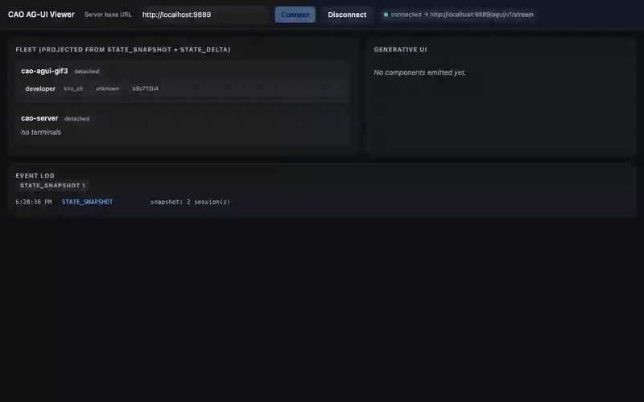
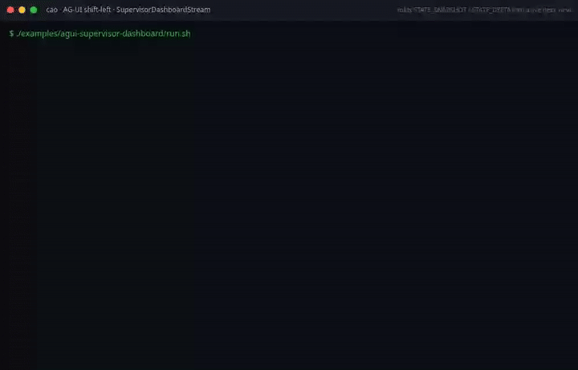
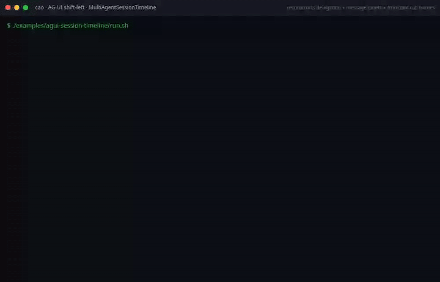
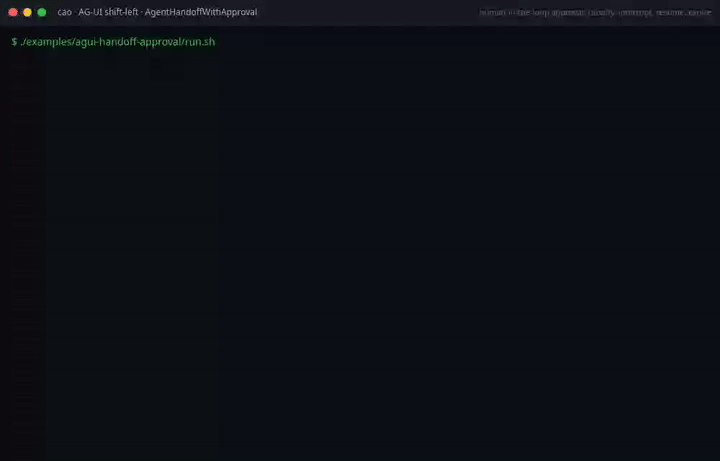
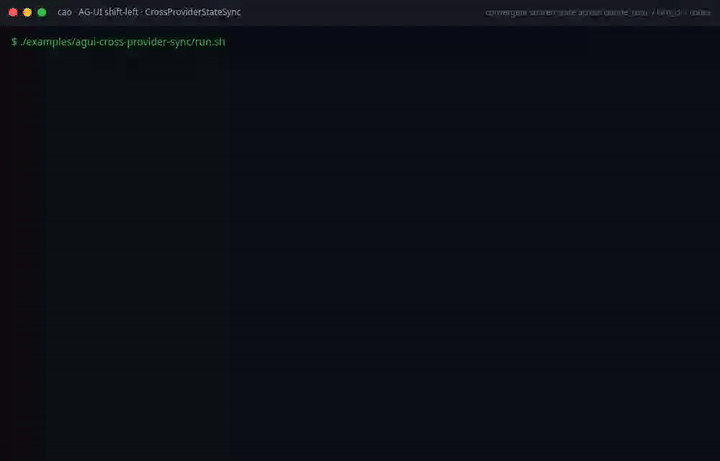

# AG-UI event stream

CAO exposes its normalized fleet events as an
[AG-UI](https://github.com/ag-ui-protocol/ag-ui) 1.0 run over Server-Sent
Events at `POST` and `GET /agui/v1/stream`. Any AG-UI client (CopilotKit apps,
the [AG-UI Dojo](https://docs.ag-ui.com/quickstart/applications), `@ag-ui/client`,
or a plain `EventSource`) consumes it with no CAO-specific wire code; rendering
CAO's own components needs only a handler for the `cao.*` `CUSTOM` names. A producer endpoint, `POST /agui/v1/emit_ui`, lets agents author
allow-listed **generative UI** onto the same stream.

The surface is **default-off** and metadata-only (message bodies are never on
the wire).

## Enabling the AG-UI surface

`/agui/v1/stream` and `/agui/v1/emit_ui` return `404` unless the surface is
enabled:

```sh
export CAO_AGUI_ENABLED=true      # dedicated AG-UI flag
# (or CAO_MCP_APPS_ENABLED=true, which also enables it — both surfaces read the
#  same in-process event source with the same privacy boundary)
```

With neither flag set the endpoints are absent and the server is byte-identical
to a build without the feature.

## The stream

The ambient stream is one [AG-UI 1.0](https://docs.ag-ui.com/) run that
narrates the **fleet**: the sessions and terminals one `cao-server` can see.
A *runner* is where a terminal executes. A terminal with no runner is local
(`runner_id` is `null`), and a terminal placed on a remote runner carries that
runner's id, so the fleet is the local and the remote terminals together; a
runner does not have a stream of its own. Every frame is a `data:` line whose
JSON carries its `type`, as the AG-UI SSE binding requires; there are no
`event:` lines. A stock client such as `@ag-ui/client`'s `HttpAgent` reads it with no CAO code, and the pinned
upstream `verifyEvents` accepts it (see [Verification](#verification)).

A short run, captured from the conformance tests (`metadata` trimmed):

```text
data: {"type":"RUN_STARTED","threadId":"cao-fleet-f1e2…","runId":"c790…","protocolVersion":"1.0",…}

data: {"type":"STATE_SNAPSHOT","snapshot":{"sessions":[],"terminals":[],…}}

id: evt-01
data: {"type":"SUBAGENT_STARTED","timestamp":1793786400000,"subagentRunId":"session:b8522a5d4d3df4e1","name":"cao-fleet-demo",…}

id: evt-02
data: {"type":"SUBAGENT_STARTED","subagentRunId":"terminal:aaaa1111","name":"supervisor","parentSubagentRunId":"session:b8522a5d4d3df4e1",…}

id: evt-04
data: {"type":"TOOL_CALL_START","subagentRunId":"terminal:aaaa1111","toolCallId":"evt-04","toolCallName":"handoff",…}

…

data: {"type":"RUN_FINISHED","threadId":"cao-fleet-f1e2…","runId":"c790…","outcome":{"type":"cancelled"},…}
```

There are two ways in:

- **`POST /agui/v1/stream`** (the AG-UI binding). The body is a `RunAgentInput`;
  `RUN_STARTED` and `RUN_FINISHED` echo its `threadId` and `runId`. CAO options
  ride in `forwardedProps.cao`: `since` (ISO-8601) and `maxSeconds` (1 to 3600).
  A body that is not a valid `RunAgentInput` gets `422`. A `threadId` outside
  the GET rule below (letters, digits and `._:-`, up to 128 characters) gets
  `400`, as on GET. A `protocolVersion`
  with a different major version gets `400`; a newer minor version, or a value
  CAO cannot parse, is served with a server-side warning. Only the published
  `MAJOR.MINOR` form is parsed, so `"2"`, `"2.0.0"` and `"draft"` are served
  with a warning, not refused. A non-empty `resume`
  gets `400`: the ambient run raises no interrupts, so there is nothing to
  resume, and answers go to the run plane (`POST /agui/v1/run`, below), which
  owns the interrupts. Input `state` is accepted; because the stream's
  `STATE_DELTA` patches apply to CAO's fleet snapshot and not to the caller's
  state, deltas that would precede the first `STATE_SNAPSHOT` are dropped.
- **`GET /agui/v1/stream`** (a convenience for `EventSource`, which cannot POST).
  Query parameters: `threadId` (letters, digits and `._:-`, up to 128
  characters; default `cao-fleet-<uuid>`, fixed for the server process),
  `since`, `maxSeconds`, and `access_token` (see Auth). Every connection is a
  new run with a new `runId`.

### The fleet snapshot

The first `STATE_SNAPSHOT` hydrates the fleet and later `STATE_DELTA` patches
keep it current. Its keys:

| Key | Content |
|---|---|
| `sessions` | `{id, name, status}` per session. Replaced whole on any change |
| `terminals` | `{id, session_name, provider, agent_profile, window, status, last_active, runner_id}` per terminal. Replaced whole on any change |
| `counts` | `{sessions, terminals}`. Patched per key |
| `scopes` | The scopes the caller holds |
| `profiles` | The profile catalog, below. Present on the ambient stream only |

`runner_id` is a label for the remote runner a terminal runs on, or `null` for
a local terminal. It is the only runner field on the wire, and it is metadata:
no terminal output, path or argument is in this snapshot. Frames name a terminal
by id, so a consumer joins to the snapshot to learn its runner; the session
timeline entries, handoff interrupts and `SUBAGENT_*` frames do not repeat it.
(The MCP Apps `DashboardSnapshot` and the deprecated [legacy framing](#legacy-framing)
carry `runner_id` on each terminal too, and nothing else is added to them.)

**Profile catalog.** `profiles` is a read-only list of `{name, source, role,
loadable}`, one per installed agent profile, so a dashboard can name the profile
behind a terminal. `source` is a label such as `built-in`, never a path. The
description, prompt, tools and MCP servers of a profile are not on the wire. It
is read with the same scopes as `GET /agents/profiles`, it is scanned at most
every 30 seconds rather than per event, and it is not scoped to a tenant or an
owner (that is #778). No AG-UI route writes a profile.

### Event mapping

| CAO record | AG-UI event(s) |
|---|---|
| session launch | `SUBAGENT_STARTED` for the session |
| terminal launch | `SUBAGENT_STARTED` for the terminal, `parentSubagentRunId` = its session |
| handoff / assign / `a2a_delegation` | `TOOL_CALL_START` attributed to the sending terminal (see below); `TOOL_CALL_END` when the receiver finishes or the call is closed. No `TOOL_CALL_RESULT`: CAO never sees the result |
| `send_message` (or no orchestration type) | `CUSTOM` `cao.message_dispatched` (sender, receiver; never the body) |
| terminal killed | `TOOL_CALL_END` for that terminal's open calls, then `SUBAGENT_FINISHED` with `metadata.cao.endReason: "killed"` |
| session killed | the row above for each of its terminals, then `SUBAGENT_FINISHED` for the session |
| error with a terminal | `SUBAGENT_ERROR` for that terminal |
| error without a terminal | `CUSTOM` `cao.error`; the run continues |
| file modification | `STATE_DELTA` (RFC 6902) against the fleet `STATE_SNAPSHOT` |
| agent-authored UI | `CUSTOM` `cao.generative_ui` (see [Generative UI](#generative-ui)) |
| anything else | `RAW` with `source: "cao"` |

A close for an invocation the run has not announced (its launch is older than
the replay window) synthesizes the `SUBAGENT_STARTED` first, parent before
child, so every `SUBAGENT_*` and tool-call event names an invocation the run
has already opened. The same holds for a tool call: when a `completion` or `error`
(replayed or live) closes a terminal on a run that never saw a call that terminal
received or sent, the run announces that call first (`TOOL_CALL_START` with the
call's own `toolCallId`, `metadata.cao` taken from the call's record, so its
`eventId` is the call record's) and then ends it (`TOOL_CALL_END`,
`closedBy: completion`). A call record that gives a worker a second call announces
the first one the same way and ends it with `closedBy: superseded`. A client that
held a call open across the reconnect has already seen that `TOOL_CALL_START`; it
dedupes it by `eventId`, `type` and `toolCallId` (see
[Ordering and deduplication](#ordering-and-deduplication)) and keeps the
`TOOL_CALL_END`. A call that an earlier record already ended is not announced
again, except after a session kill the replay does not hold. The run finds these calls in the event log, so if a call's record has left
the buffer (500 records, 24 h TTL in `EventLog.history()`), its `TOOL_CALL_END` is
not recoverable and the client keeps the call open. Fields use the schema names (`subagentRunId`, `toolCallId`,
`threadId`), and `timestamp` is integer epoch milliseconds. The CAO record's
own fields (`eventId`, `terminalId`, `sessionName`, `traceparent`) are under
`metadata.cao`, the same nested object and key names the run plane uses.
AG-UI merges `metadata` without recursing ("The merge MUST NOT recurse"), so a
later event's `cao` object replaces an earlier one as a whole; a client that
keeps one item's CAO fields should read each event's `metadata.cao` on its own.

**Attribution ids.** A terminal's `subagentRunId` is `terminal:<terminal id>`,
the same value a run-plane interrupt raised by that terminal carries. A
session's is `session:` plus the first 16 hex characters of a SHA-256 of the
session's incarnation id: the same incarnation gives the same id on every
connection and replay, a relaunched session under the same name gets a new
one, and the internal incarnation id is not exposed. The id is computed when a
record is logged and kept with it, so a replayed record keeps the id of the
incarnation it belongs to. The ids are opaque; clients must not parse them.

**Who owns an event.** When an event names a terminal it has not seen, the
stream checks whether CAO still has that terminal. The event is tagged with the
terminal's `subagentRunId` only when the terminal is open on the run, or when
CAO knows it and its invocation has not finished on this run (it is then
announced first). A sender that is not a terminal, such as the `operator` the
MCP Apps operator tools send or the `supervisor` that `cao-mcp-server` sends
without `CAO_TERMINAL_ID`, an id CAO does not know (for example an `emit_ui`
`terminal_id`), or a terminal that has already finished, never becomes a
subagent and never reuses a finished id: the event is tagged with the record's
open session invocation, or left untagged. The raw sender stays in
`metadata.cao.sender`. A terminal's own kill or error record is the exception:
CAO writes it about that terminal, so it still announces an unseen terminal
before closing it or reporting its error (for a kill the check could not succeed
anyway, because CAO has already removed the row). In a replay, a terminal that
has since been deleted can't be told apart from a label, so its earlier events
stay on the session, and its kill record still announces and closes it under the
generic name.

One case is not exact. A record logged while the incarnation lookup failed has
no stored id, so the stream derives one from the session's *current*
incarnation, or from the launch record's event id once that incarnation has
finished on the run. Both are stable across reconnects. But if the session was
relaunched after such a record was logged, a replay can attribute the old record
to the new incarnation. (The buffer is in-process, so records from before an
upgrade never reach a replay.)

**A killed invocation reads as success to a stock client.** AG-UI 1.0 defines
only success and suspended outcomes for a subagent, and an absent outcome means
success. CAO sends a killed terminal or session as `SUBAGENT_FINISHED` with no
outcome rather than `SUBAGENT_ERROR`, because a stop is not a failure.
CAO-aware clients read `metadata.cao.endReason: "killed"`.

### How the run ends

The fleet has no natural end, so the run ends when the connection does:

| Cause | Last events |
|---|---|
| `maxSeconds` reached | closers, then `RUN_FINISHED` `{type: "cancelled"}`, `metadata.cao.endReason: "max_seconds"` |
| `cao-server` stopping (SIGINT/SIGTERM) | closers, then `RUN_FINISHED` cancelled, `endReason: "server_stop"` |
| the event source ending | closers, then `RUN_FINISHED` cancelled, `endReason: "source_ended"` |
| the subscriber queue overflowing | `RUN_ERROR` `code: "cao.stream_overflow"`; reconnect to replay |
| an internal failure | `RUN_ERROR` `code: "cao.stream_error"` |
| the client disconnecting | nothing more: the run is truncated |

"Closers" are a `TOOL_CALL_END` for every open tool call and a
`SUBAGENT_FINISHED` (with that `endReason`) for every open invocation, children
before parents. An idle stream sends a `: keep-alive` comment every
`CAO_AGUI_HEARTBEAT_SECONDS` (default 15).

## Consuming it

```sh
curl -N http://localhost:9889/agui/v1/stream
```

```js
const es = new EventSource("http://localhost:9889/agui/v1/stream");
es.onmessage = (ev) => {
  const event = JSON.parse(ev.data);
  // event.type is RUN_STARTED, STATE_SNAPSHOT, SUBAGENT_STARTED, CUSTOM, ...
};
```

For a browser client on another origin, add that origin to CORS via
`CAO_CORS_ORIGINS` (comma-separated; appended to the localhost defaults):

```sh
export CAO_AGUI_ENABLED=true
export CAO_CORS_ORIGINS="https://dashboard.example.com"
uv run cao-server
```

## Auth (when CAO has Auth0 enabled)

If CAO runs with `AUTH0_DOMAIN` set, `/agui/v1/stream` requires a `cao:read`
JWT. Native `EventSource` can't send an `Authorization:` header, so the token
travels as the `?access_token=<JWT>` query parameter. `POST /agui/v1/stream` has
no such limit: it authenticates with an `Authorization: Bearer <JWT>` header
holding any of `cao:read`, `cao:write` or `cao:admin` (`require_any_scope`):

```
https://dashboard.example.com/?access_token=eyJhbGc...
```

**Keep these tokens short-lived.** A query-string credential can surface where
an `Authorization` header never would (browser history, proxy logs, `Referer`
headers) and stays replayable until `exp`. CAO scrubs `access_token` (and,
pre-emptively, `ticket`) values from its own access log, but that doesn't cover
intermediaries — so mint short-TTL tokens (minutes, not hours). A short-lived
single-use ticket handshake (`POST /agui/v1/ticket` with header auth →
`?ticket=`) is a follow-up.

## Replay

Replay is a **CAO extension**, not AG-UI resumption: each connection is a new
run, and a cursor only chooses which buffered CAO records that new run narrates
first, between `RUN_STARTED` and the `STATE_SNAPSHOT`. CAO does not declare the
AG-UI `transport.resumable` capability.

### Cursors

1. **`since`** (`?since=` on GET, `forwardedProps.cao.since` on POST): an
   ISO-8601 lower bound. A malformed value gets `400` before the stream starts.
2. **`Last-Event-ID`**, which a browser `EventSource` resends on its own when it
   reconnects. Frames for a CAO record carry an `id:` line: the record's id on
   its last frame, and `<record id>.<n>` on frames synthesized before it. A
   cursor that names a record replays the records after it; one that names a
   synthesized frame replays that record whole; an unknown cursor (evicted or
   aged out of the buffer) replays the whole buffer. Used only when `since` is
   absent.
3. **Neither**: no replay.

The buffer is the in-process ring (`event_log_service`, 500 records).

### Ordering and deduplication

The live subscription is registered **before** the replay is read, so a record
published during the handoff is in both; it is narrated once, from the replay.
The `STATE_SNAPSHOT` follows the replay, and every `STATE_DELTA` follows the
snapshot. Because a reconnect is a new run, a client that keeps state across
runs should dedupe records on `metadata.cao.eventId` combined with the event
`type` and its `subagentRunId`/`toolCallId`/`name`, since one record can become
several events.

**Overflow is a gap signal, not a silent drop.** Each subscriber has a bounded
queue, so a slow client never back-pressures the orchestration core. When the
queue fills, the run ends with `RUN_ERROR` `cao.stream_overflow`; the client
reconnects with its cursor and the missed records are replayed. (The MCP Apps
`/events` stream keeps its drop-on-slow behaviour and backfills via
`cao_fetch_history`.)

## Legacy framing

`?framing=cao-legacy` on `GET /agui/v1/stream` serves the pre-1.0 wire,
byte-for-byte: named `event:` lines, snake_case data, `RUN_STARTED`/`STEP_*`
per session and terminal, `TEXT_MESSAGE_CONTENT` for `send_message`, and no run
lifecycle. It is **deprecated**: the response carries
`Deprecation: @1793750400` (2026-11-04) and a `Link` header pointing here, and
the server logs a warning once per connection. `AguiStreamReader`
(`services/agui/stream_reader.py`) requests it, since it parses that wire. An
unknown `framing` value gets `400`. New clients should use the default.

## Verification

[`examples/ag-ui/ag-ui-stock-client-live/verify-ambient.mjs`](../examples/ag-ui/ag-ui-stock-client-live/verify-ambient.mjs)
runs the pinned `@ag-ui/client` `verifyEvents` over every stream the
conformance tests (`test/api/test_agui_stream_conformance.py`) capture when
`CAO_AGUI_CAPTURE_DIR` is set, and over a live `HttpAgent` run against
`POST /agui/v1/stream`. The AC3 CI job runs both.

## Generative UI

Any agent in the fleet — regardless of provider — can author a UI intent, and
a client that knows CAO's `cao.generative_ui` event renders it the same way
whichever provider wrote it. The safety model is what makes
that shippable over *untrusted* agents: an agent may only emit a **closed
allow-list of named components with JSON props** — no HTML, no script, no
`eval`, no iframe. An off-list component is **refused, never rendered**: the
caller gets a 400, and operators see a metadata-only refusal record on the
stream (see below).

**Wire path.** An agent calls the `emit_ui` MCP tool (or
`POST /agui/v1/emit_ui`) → the intent rides a CAO event as a `ui` block
(`{component, props}`) → the AG-UI adapter maps it to a `CUSTOM` event named
`cao.generative_ui` → `GET /agui/v1/stream` emits it → a client that handles
that name renders it.

AG-UI 1.0 defines no generative-UI event type, and a producer "MUST NOT emit an
event type the protocol does not describe" (`CUSTOM` and `RAW` exist for that).
The frame is therefore a spec `CustomEvent`. A stock AG-UI client receives it
and can ignore it; it renders nothing unless it handles `cao.generative_ui`.
Both planes use the same name and value:

```text
data: {"type": "CUSTOM", "name": "cao.generative_ui",
       "value": {"component": "progress", "props": {"label": "demo", "value": 0.5},
                 "event_id": "...", "terminal_id": "...", "session_name": "...",
                 "timestamp": "...", "traceparent": null},
       "metadata": {"cao": {"eventId": "...", "terminalId": "...", "sessionName": "..."}}}
```

The `value` object is the same on the default stream, on the legacy framing and
on the run plane.

**Server-side validation** (`services/agui_stream.py`): the closed allow-list
`GENERATIVE_UI_COMPONENTS = {approval_card, choice_prompt, diff_summary,
progress, metric, agent_card}`; unknown components are refused (mapped to `RAW`
with `rejected_component`); props must be JSON-serializable and are size-bounded
(8 KB), degrading safely. `POST /agui/v1/emit_ui` rejects off-list components and
oversized/non-serializable props with `400`; an oversized or non-serializable
intent reaches nothing.

**An off-list call never renders: a refusal record with no props is emitted so
operators see it** (#1158). Alongside the `400`, the server publishes a record it
builds from a fixed schema (`services/agui/refusal.py`); nothing from the
request is copied into it except the cleaned name, and the props are never read.
On the stream it is the `RAW` frame above:

```text
data: {"type": "RAW", "source": "cao", "subagentRunId": "terminal:<id>",
       "event": {"cao_kind": "generative_ui", "rejected_component": "iframe.<8 hex>",
                 "more_refused": 3, "event_id": "...", "terminal_id": "...",
                 "session_name": "...", "timestamp": "...", "kind": "other"},
       "metadata": {"cao": {"eventId": "...", "terminalId": "...", "sessionName": "..."}}}
```

- **The name** has every character outside `[A-Za-z0-9_.-]` replaced by `_`, is
  cut to 24 characters, and always ends in `.` and 8 hex digits of the SHA-256 of
  the requested name. It is at most 33 bytes (24 characters, `.`, 8 hex digits), and it can never equal an
  allow-listed name, so the stream can never render it as one. The name is
  caller text, not redacted: the visible part is what the caller sent, cleaned
  of unsafe characters and cut short, so an agent that puts message text in
  `component` by mistake exposes up to 24 characters of it to every reader of
  the `cao:read` stream and the 24-hour event log. The hash keeps names apart;
  it does not hide the prefix.
- **Attribution** comes from CAO, not the body: the terminal only if CAO has a
  row for it, its session from that row, and the subagent derived from the
  terminal. Any other terminal id, the body's `session_name` and any other key
  are ignored, and the record is unattributed. (An authorised caller can still
  name another terminal CAO knows, as on the on-list path.)
- **Scope.** Without `cao:write` (when auth is on), the scope check answers
  first, with `401` or `403`, and nothing is published. The `400` is the answer
  to an authorised caller.
- **Flood control.** A call repeating a (terminal, name) pair within 10 s is
  folded into `more_refused`. Each terminal publishes at most 5 records per 10 s,
  and the server 20; the rest are folded too. `more_refused` is a count carried
  by that terminal's next published record, so it is reported only with the
  bucket's next refusal: a flood that stops leaves its tail unreported, and a
  bucket the limiter evicts (it tracks at most 256 terminals) loses its count.
- **The event log.** Refusals hold at most a tenth of the event log's 500-record
  ring, which is how far a `since` or `Last-Event-ID` replay of real events
  reaches back; past that share a refusal is folded instead of recorded. Only
  refusal rows still inside the 24-hour window count, the rows `history()`
  returns, so an expired flood does not keep the share full. When the share
  fills, the server logs one warning (once per fill) and folds further
  refusals into a count. A folded refusal is not published, so the operator sees
  no record for it; the warning in the server log is the only trace.
- **Delivery.** The record is in the event log, so its SSE id is one a
  `Last-Event-ID` reconnect resumes from. It is published with
  `SseBus.publish_lossy`, which skips a subscriber whose queue is half full or
  more. When a real event then meets a full queue, the newest queued refusal is
  dropped to make room for it, so refusals never cause an overflow (`RUN_ERROR
  cao.stream_overflow`) that the real events alone would not. A skipped or
  dropped record is lost to that client; it stays in the log for a later `since`
  replay.

### Safety model

| Threat | Mitigation | Verified by |
|---|---|---|
| Agent emits arbitrary HTML/script | No HTML on the wire — only named components + JSON props | `TestGenerativeUI` |
| Agent names an off-list component (e.g. `iframe`) | Refused server-side (→ RAW / 400) | `test_off_list_component_is_refused` |
| Off-list names that clean to an allowed one (`metric!`) | The hash is always appended | `test_a_name_that_cleans_to_an_allowed_name_is_still_a_refusal` |
| A flood of off-list calls | Deduped, rate-limited and folded; published lossily, and queued refusals give way to real events | `test_a_10k_off_list_flood_loses_no_real_event_and_ends_no_stream` |
| Agent floods the bus with a huge payload | Props capped at 8 KB → `{_truncated: true}` | `test_oversized_props_are_truncated` |
| Non-serializable props | Degrade to `{}` | `test_non_serializable_props_degrade_to_empty` |
| Message-body leakage | Bodies never in the props path (metadata-only contract) | privacy tests |

A conformant client SHOULD mirror the allow-list as defense in depth and render
each component from JSON props only (no `dangerouslySetInnerHTML`, no `eval`),
falling back to an inert placeholder for anything unknown.

### Live proof

[`examples/ag-ui/ag-ui-dashboard/`](../examples/ag-ui/ag-ui-dashboard) is a credentials-free,
runnable demonstration: `run.sh` starts a `cao-server` with the surface enabled
and `showcase.sh` drives all six allow-listed components plus an off-list
refusal through `emit_ui`, gating on the `CUSTOM` `cao.generative_ui` frames actually
arriving on the live SSE stream (so it doubles as a deployment smoke test). Teach
an agent the component vocabulary with the bundled
[`agui-author`](../skills/agui-author/SKILL.md) skill.

A **stock browser client** rendering the stream — the dependency-free
[`examples/ag-ui/ag-ui-eventsource-viewer/`](../examples/ag-ui/ag-ui-eventsource-viewer) — is the
adapter-level proof. Its demo GIF is **generated by the build** (shift-left): the
recorder drives the six components + the off-list refusal and asserts each renders
before exporting the GIF, so CI fails if the stream→component contract drifts.



## Two-plane model

CAO exposes its AG-UI surface through two complementary planes that differ in
wire dialect, consumer shape, and intended use:

### Ambient dialect (GET /agui/v1/stream)

The **ambient plane** is `GET`/`POST /agui/v1/stream`: one conformant AG-UI
1.0 run per connection that narrates the fleet as subagent invocations, tool
calls and state patches (see [The stream](#the-stream)). Any
`EventSource`-compatible client, or a stock `HttpAgent`, connects, hydrates from
the `STATE_SNAPSHOT`, then folds live events into its projection.

This plane is for long-lived dashboard consumers and the L2 construct library.
The client is an observer and raises nothing. Replay is a CAO extension, by
`Last-Event-ID` (browser-automatic) or `since` (explicit); see
[Replay](#replay). The heading keeps its old name for existing links; the wire
is no longer a CAO dialect unless `?framing=cao-legacy` is requested.

### Stock run plane (POST /agui/v1/run)

The **run plane** is the `POST /agui/v1/run` endpoint. It speaks the stock
[ag-ui-protocol](https://github.com/ag-ui-protocol/ag-ui) wire dialect:
`data:`-only camelCase JSON frames with a `type` field, produced by the official
`EventEncoder`. This is what CopilotKit, the AG-UI Dojo, and other stock AG-UI
clients expect.

A client POSTs a `RunAgentInput` (required: `threadId`, `runId` and `messages`,
where an empty array is valid; optional: `resume[]`) and
receives a lifecycle-legal stream: `RUN_STARTED`, then `STATE_SNAPSHOT`, then
`RUN_FINISHED`. `RUN_STARTED` carries `threadId`, `runId` and
`protocolVersion: "1.0"`, the declaration AG-UI 1.0 requires of a producer. The
value comes from the installed `ag-ui-protocol` SDK, which is why the `[agui]`
extra needs `ag-ui-protocol>=1.0.0`. The response body ends right after
`RUN_FINISHED` (or `RUN_ERROR`), because a stock AG-UI client completes a run
only when the body ends. If open approval interrupts exist, the outcome is
`{type: "interrupt", interrupts: [...]}`, and the client re-POSTs with a
`resume[]` array to resolve them. Each entry is
`{interruptId, status: "resolved" | "cancelled", payload: {approved: bool, editedArgs?: string}}`;
`status` is required, `cancelled` is treated as a deny, and a body that is not a
valid `RunAgentInput` is rejected with HTTP 422 before the stream starts.

Each interrupt's `responseSchema` is built for that interrupt. It always lists
`approved` (boolean) and has `"required": ["approved"]`. It lists `editedArgs`
only when that interrupt offers `edit`; its presence is the signal that a
client may show edit UI. For CAO, `editedArgs` is a **string: the edited answer
text**, typed into the agent's prompt in place of a yes/no answer. It is not
replacement tool arguments. A resume entry that names an interrupt CAO did not
raise (or no longer retains), or that answers one that has expired, is skipped
with a server-side warning and the run proceeds, as AG-UI 1.0 asks of a
producer; whatever is still pending is reported again. The run also lists each
such entry on its `RUN_FINISHED`, in `result`:
`{"skippedResume": [{"interruptId": "<id>", "reason": "unknown" | "expired"}]}`.
`reason` is `unknown` for an id CAO never raised or no longer retains (an
evicted interrupt is indistinguishable from one never raised), and `expired`
for an answer to an interrupt that expired. The list carries ids and reasons
only, never prompt text, and rides either outcome, `success` or `interrupt`.
When nothing is skipped, `RUN_FINISHED` has no `result` key. `skippedResume`
appears only on `RUN_FINISHED`; a run that exits with `RUN_ERROR` carries no
list. Abandoning an
expired interrupt (`status: "cancelled"`) and re-sending an answer for an
interrupt that is already resolved are skipped without a warning and are not
listed. A
non-empty `resume[]` gets HTTP 404 when the server has no approval bridge (the
AG-UI surface was off when it started), as `POST /agui/v1/interrupts/{id}/resume`
does. Once `resume[]` is delivered and nothing is
left pending, the outcome is `{type: "success"}`. That means every entry that
named a pending interrupt was delivered; skipped entries are logged and listed
in `result.skippedResume`. It does not mean the agent finished. If the agent prompts again, the
next run returns the new interrupt. `messages[]` is not read. Live fleet
activity (`STATE_DELTA`, `SUBAGENT_*`, `TOOL_CALL_START/END`, `CUSTOM`) is on
the ambient plane, `GET /agui/v1/stream`. Embedders that call
`run_plane_stream` directly can still inject an event source to project it
inside a run.

Only `RUN_STARTED` and `RUN_FINISHED` carry `threadId` and `runId`, as the AG-UI
1.0 schema says. `STATE_SNAPSHOT`, `STATE_DELTA`, `STEP_*`, `TOOL_CALL_*`,
`CUSTOM` and `RUN_ERROR` carry only their own fields. A `STEP_STARTED`/
`STEP_FINISHED` that comes from a CAO terminal names it in `metadata`, as
`{"cao": {"terminalId": "<id>"}}`, the same nested `cao` object the ambient
stream uses, not in a `stepId` field (the schema defines none).

An interrupt raised by a terminal carries `subagentRunId`, the same
`terminal:<id>` the ambient stream gives that terminal's `SUBAGENT_STARTED`, so a
client can tie the prompt to the invocation it already shows. It is absent (never
null) when an interrupt has no terminal. The run plane itself emits no `SUBAGENT_*`
events and puts no `subagentRunId` on `RUN_*`.

The run plane passes `Interrupt.expiresAt` through when it is set: an ISO 8601
time after which the interrupt can no longer be answered. Nothing in CAO sets it
today. An interrupt expires when its terminal leaves the waiting state, with no
deadline known in advance, so the field is absent on every current provider.

**Answering several interrupts.** AG-UI 1.0 says the resume list MUST cover
every interrupt of the run it continues. When a run ends with several
interrupts, a client sends one `RunAgentInput` whose `resume` has one entry per
interrupt. Each entry is answered (`status: "resolved"`) or abandoned
(`status: "cancelled"`). On CAO, abandoning a prompt delivers a deny to the CLI,
so an abandoned entry is not a no-op. The CAO Dojo page holds a decided card
until every interrupt of the run has an answer, then sends them together on that
run's `threadId`. A run that only collects starts a fresh thread, so it never
continues past an interrupt it does not answer. It also declares
`protocolVersion: "1.0"` on every `RunAgentInput`.

The run plane requires the `[agui]` optional extra (`ag-ui-protocol` package).
Without it the endpoint returns HTTP 501.

### Capabilities

`GET /agui/v1/capabilities` returns the run plane's AG-UI 1.0 capabilities: one
`AgentCapabilities` object in the 1.0 schema shape. AG-UI leaves retrieval to the
implementation, so CAO serves it beside `POST /agui/v1/run`. Like the other AG-UI
routes it returns 404 unless `CAO_AGUI_ENABLED` is set, and it needs `cao:read`
when auth is on.

```json
{
  "identity": {"name": "cli-agent-orchestrator", "version": "<installed version>"},
  "transport": {"streaming": true},
  "tools": {"clientProvided": false},
  "state": {"snapshots": true},
  "humanInTheLoop": {"supported": true, "approvals": true, "interrupts": true}
}
```

The declaration lists only what the run plane does. A field that is left out is
undeclared, not unsupported:

- `humanInTheLoop.approveWithEdits` is omitted. AG-UI defines it for tool-call
  interrupts whose `editedArgs` replace tool arguments. CAO's interrupts are not
  tool calls, its `editedArgs` is answer text, and edit is offered per provider.
  Read each interrupt's `responseSchema`: edit is accepted only where it lists
  `editedArgs`.
- `transport.resumable` is never declared, because the HTTP + SSE binding has no
  stream resumption. The ambient stream's `since` / `Last-Event-ID` replay is
  CAO's own extension (see [Replay](#replay)).
- `tools.clientProvided` is `false`, because the run plane does not read
  `RunAgentInput.tools`.

A declaration is informative. The run's own events stay authoritative.

### Choosing a plane

| Use case | Plane | Why |
|---|---|---|
| Long-lived supervisory dashboard | Ambient | EventSource auto-reconnect, replay, no request body |
| CopilotKit / AG-UI Dojo integration | Run | Stock wire dialect, interrupt/resume lifecycle |
| L2 construct composition (Python) | Ambient | AguiStreamReader + fold constructs |
| Raw HTTP client proving connectivity | Run | Single POST, verifiable frame output |
| CI smoke tests | Either | Both exit non-zero on unmet preconditions |

---

## L2 construct library

The `services/agui/` package provides fold-based constructs that compose on top
of the ambient stream. Each construct consumes AG-UI frames (via `handle_frame`)
and derives a `projection()` view without I/O.

### Foundation

| Class | Role |
|---|---|
| `AguiConstruct` | Abstract base: `handle_frame`, `projection`, `emit` (validated) |
| `UiEmitter` / `RecordingUiEmitter` / `InProcessUiEmitter` / `HttpUiEmitter` | Emitter family (protocol + implementations) |
| `AguiStreamReader` | `requests`-based SSE reader yielding `(event_id, agui_type, data)` tuples; it requests the [legacy framing](#legacy-framing), whose frames the constructs below fold |
| `ToolCallLifecycleTracker` | Correlates TOOL_CALL opens with terminal completions |
| `apply_json_patch_strict` | Pure RFC-6902 subset (add/remove/replace), never mutates inputs |

### Fold-based constructs

#### SupervisorDashboardStream

Folds `STATE_SNAPSHOT` and `STATE_DELTA` frames to maintain a local copy of the
fleet topology. Derives:

- `hierarchy()`: session-name keyed dict with terminal lists and counts, and the
  `runner_ids` present in each session
- `hierarchy_by_runner()`: the same, keyed by `(runner_id, session_name)`, so
  two runners that both own a session called `main` stay apart
- `by_runner()`: terminals grouped by `runner_id`, local (`null`) first, then
  by id: `{runner_id, label, terminal_count, waiting, by_status}` per group. A
  list, because JSON cannot key an object by `null`. A fleet whose terminals have
  no runner is exactly one `local` group
- `supervisor_snapshot()`: active sessions, provider distribution, waiting terminals, `by_runner`, rollup counters

**Frames folded:** STATE_SNAPSHOT, STATE_DELTA, STEP_STARTED/FINISHED,
RUN_STARTED/FINISHED, TOOL_CALL_START/END/RESULT (rollup counters).

**Seen-Set Dedup:** id-bearing frames already processed are skipped; state
frames (event_id=None) are always folded.

#### MultiAgentSessionTimeline

Tracks delegations and messages as an ordered timeline:

- `TOOL_CALL_START` opens a delegation entry (keyed by tool_call_id)
- `TOOL_CALL_END`/`TOOL_CALL_RESULT` closes matching entries
- `TEXT_MESSAGE_CONTENT` appends message entries (metadata only, no body)

**Projection:** `entries()` returns `TimelineEntry` list sorted by `(started_at, id)`.

**Retention cap:** configurable (default 1000), evicts oldest first.

#### CrossProviderStateSync

Maintains a shared state view by folding snapshots/deltas:

- `shared_state()`: the current state (or None before first snapshot)
- `providers_seen()`: sorted list of unique providers from terminals
- `converges_with(authoritative)`: deep-equality check against a reference

Useful for verifying that a client-side projection has converged with the
server's authoritative state.

#### AgentHandoffWithApproval

Human-in-the-loop approval lifecycle:

- `on_provider_waiting(terminal_id, provider, raw_prompt)`: classifies the
  prompt via `classify_reason` and creates an `Interrupt` record
- `resume(interrupt_id, decision, edited_text)`: lock-guarded exactly-once
  resolution with per-provider answer translation
- `expire(terminal_id)`: zero-keystroke expiration on state transition
- `pending()`: list of unresolved interrupts

**Interrupt options** derive from the classified reason (permission_request gets
approve/deny/edit; trust_prompt gets approve/deny). `claude-code:permission_request`
gets approve/deny only: Claude Code's permission dialog is a selector with no text
field, so typed edit text cannot reach the agent. An `edit` decision on it is
refused (422 on the REST route, `RUN_ERROR` on the run plane) before anything is
typed, and the interrupt stays pending. If an approve or deny delivery for the
same interrupt is already in flight, a later `edit` joins it instead and returns
that decision's outcome, which names the delivered decision; nothing is typed for
the edit.

### Subclass extension points

All constructs expose their state through `projection()` (JSON-serializable dict).
Subclasses can:

1. Override `handle_frame` to fold additional frame types
2. Call `self.emit(component, props)` to author generative-UI intents (validated
   against the allow-list and 8 KB size bound)
3. Call `self.assert_no_body(data)` to enforce the metadata-only contract
4. Access `self._emitter` for custom transport needs

### Composition pattern

```python
from cli_agent_orchestrator.services.agui import (
    AguiStreamReader,
    RecordingUiEmitter,
    SupervisorDashboardStream,
)

reader = AguiStreamReader("http://localhost:9889")
emitter = RecordingUiEmitter()
dashboard = SupervisorDashboardStream(emitter)

for event_id, agui_type, data in reader.frames():
    dashboard.handle_frame(agui_type, data, event_id)

print(dashboard.hierarchy())
print(dashboard.supervisor_snapshot())
```

### Runnable examples

Each construct has a runnable example in `examples/`:

- [`agui-supervisor-dashboard/`](../examples/ag-ui/ag-ui-supervisor-dashboard/) - SupervisorDashboardStream composition
- [`agui-session-timeline/`](../examples/ag-ui/ag-ui-session-timeline/) - MultiAgentSessionTimeline delegation tracking
- [`agui-handoff-approval/`](../examples/ag-ui/ag-ui-handoff-approval/) - Human-in-the-loop approval (CI + live procedure)
- [`agui-cross-provider-sync/`](../examples/ag-ui/ag-ui-cross-provider-sync/) - CrossProviderStateSync convergence
- [`agui-stock-client-live/`](../examples/ag-ui/ag-ui-stock-client-live/) - Stock AG-UI run plane (POST /agui/v1/run)

### Shift-left video evidence (per feature)

Each new L2 construct ships a **gated** demo recording — proof-of-work, not
decoration. The recorder in
[`examples/ag-ui/ag-ui-construct-demos/tools/`](../examples/ag-ui/ag-ui-construct-demos/tools/)
runs the construct's own asserting example (the `run.sh` above, in
offline/synthetic mode — no live provider, network, or secrets), and **only**
produces a GIF if the example exits `0` and prints its `PASS` marker. If a
construct regresses, the example exits non-zero, the recorder fails, and CI goes
red (see the `AG-UI construct demos (shift-left recordings)` job) — so a broken
construct cannot yield a green recording. Regenerate locally with:

```sh
cd examples/ag-ui/ag-ui-construct-demos/tools
npm ci && npm run playwright:install && npm run record   # ONLY=<slug> for one
```

The GIFs are committed under [`docs/media/`](media/) and re-generated + uploaded
as CI artifacts (`agui-construct-demos`) on every run.

**SupervisorDashboardStream** — folds `STATE_SNAPSHOT`/`STATE_DELTA` into a live
fleet view (active sessions, provider distribution, waiting terminals, and the
terminals grouped by runner):



**MultiAgentSessionTimeline** — reconstructs the delegation + message timeline
from tool-call frames and closes entries on `TOOL_CALL_END`/`RESULT`:



**AgentHandoffWithApproval** — human-in-the-loop lifecycle: classify the prompt,
raise an interrupt, resume exactly-once (idempotent), and expire on transition:



**CrossProviderStateSync** — convergent shared state across `claude_code`,
`kiro_cli`, and `codex`, verified with `converges_with()` before and after a delta:



---

## Privacy boundary

`/agui/v1/stream` redacts message bodies (same contract as the SSE bus and the
in-host MCP Apps iframe). A message dispatch is `CUSTOM` `cao.message_dispatched`
(`TEXT_MESSAGE_CONTENT` on the legacy framing), carrying the sender, receiver and
orchestration type but never the message text.

## Troubleshooting

**Connection shows an error** — check that `CAO_AGUI_ENABLED` is set (else the
endpoint 404s) and, for a cross-origin browser client, that the origin is allowed
via `CAO_CORS_ORIGINS` (exact scheme + host + port), then restart CAO.

**401 on connect with auth enabled** — token missing or expired. Get a fresh
`cao:read` token and pass it via `?access_token=`.

**Events stop after a proxy idle timeout** — reconnect with backoff. A native
`EventSource` resumes automatically via `Last-Event-ID`; other clients resume
via `since`. The reconnect is a new run, and the missed records are replayed
into it.

**`verifyEvents` reports "First event must be 'RUN_STARTED'"** — the client is
reading the legacy framing. Drop `?framing=cao-legacy`.

**The run ends with `RUN_FINISHED` cancelled** — the connection reached its
`maxSeconds`, or the server is stopping. `metadata.cao.endReason` says which.
An `EventSource` reconnects on its own.
