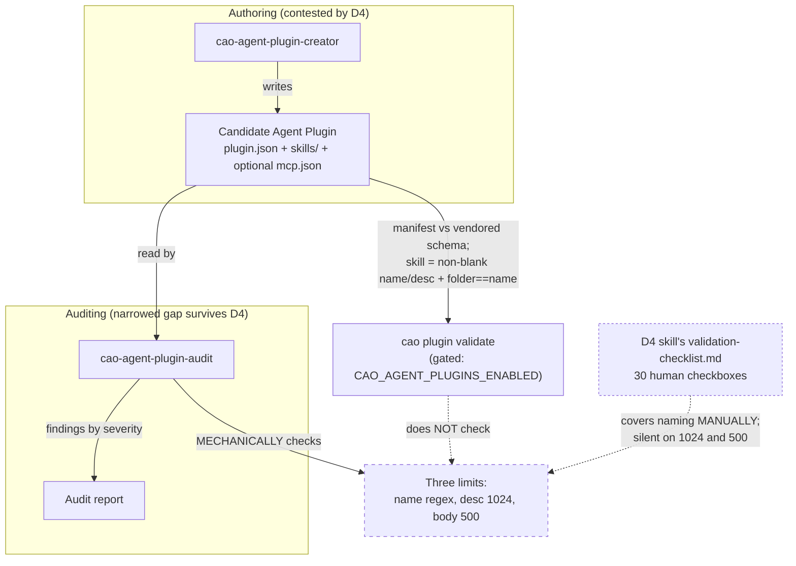
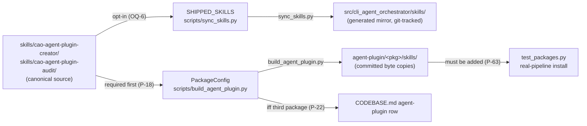

# Design Document: `cao-agent-plugin-lifecycle`

> **Issue of record:** [#1153](https://github.com/awslabs/cli-agent-orchestrator/issues/1153) · **Parent tracker:** [#1154](https://github.com/awslabs/cli-agent-orchestrator/issues/1154) · **Sibling:** [#1152](https://github.com/awslabs/cli-agent-orchestrator/issues/1152)
> **Requirements:** [`requirements.md`](requirements.md) — cited as `Requirement N.M`, matching the convention #573's test suite uses.
> **Factual authority:** `research.md`. Provenance rows `P-1`…`P-78` live in `requirements.md`.
> **Reviewed:** `review-1.md` — all six blocking and fifteen non-blocking findings applied. Later rounds are recorded in `review-2.md`, `review-6.md` and the working status file, all outside the pull request; review 6's one blocking finding, **R6-B-1**, is applied.
> **Status:** **OQ-1a** (proceed) and **OQ-16** (commit, never push) are **decided by the user**. **OQ-1b** — the maintainer's reverse/narrow/uphold on D4 — is **open and gates the MERGE, not the work**. Requirement 14 states the outcome under each resolution; under "D4 stands" the pull request is withdrawn unmerged.

## Overview

Two new skills and one package that ships them. A post about building it is **deferred out of this pull request** (**OQ-8**–**OQ-10**, **OQ-14**).

`cao-agent-plugin-creator` takes a contributor from an empty directory to an Agent Plugins 1.0.0 package that CAO's own validator calls loadable. `cao-agent-plugin-audit` mechanically checks an existing package against the vendored schemas **and** against three Agent Skills limits that nothing CAO ships enforces. The `Dogfood_Package` ships both, is built by CAO's builder, and is **audited by a skill it carries**.

The design problem is not the skill text. It is four constraints that each invalidate an obvious approach:

1. **The authoring half is contested.** D4 decided against it (`P-1`). The auditing half survives D4's premise, but only in a narrowed form (below).
2. **The validator CAO ships does less than it appears to.** `cao plugin validate` checks a skill only for non-blank `name`/`description` and folder-equals-`name` (`P-4`). The name regex, the 1024-character description limit and the 500-line body limit are enforced nowhere that ships with CAO (`P-5`, `P-7`). An audit skill that merely wraps `cao plugin validate` would add nothing.
3. **Two gates are vacuous unless handled.** `cao plugin validate` exits 1 when `CAO_AGENT_PLUGINS_ENABLED` is unset, emitting the refusal text and **no JSON** (`P-28`) — so exit status alone cannot distinguish a missing variable from a real finding, and the discriminator has to be "stdout parses as JSON" (Requirement 4.8). And the harness-oss validator, which the charter assumed was a gate, hard-codes its own root and ignores argv (`P-8`).
4. **The first gate depends on the hole the feature exists to fill.** The only script that checks the three limits is `validate_skills.py` inside a non-repo-tracked installed skill of unknown provenance (`P-11`, `P-14`). `review-1.md` **F-3** caught the resulting contradiction: Requirement 6 calls the source skills "design input only" while the ladder ran their script. Resolved by **OQ-4**: the limits stay **measurable directly**, and gate 1 is the `Audit_Skill`'s own bundled validator, so the bootstrap framing is retired (Requirement 11.9).

## Goals

- Close the narrowed, evidenced gap with an artifact that ships in this repository.
- Make the dogfood claim demonstrable by a command with an observed exit status.
- Keep the two new skills' **vocabulary** disjoint from the event-plugin skill and the migration skill.
- Mark every gate as observed or not observed, and never claim otherwise.

## Non-Goals

- Fixing `run_trigger_evals.py`'s crash on list-shaped eval files, or its unused `httpx` dependency (`P-35`, `P-37`). Requirement 13.1, 13.2.
- Generalising the harness-oss validator (`P-8`). Requirement 13.3.
- Implementing #573's **M4** rename (`P-40`). Requirement 13.4.
- Resolving #573's **M1** disagreement (`P-51`). Requirement 13.5.
- Retiring, renaming or editing the installed `cao-skill-creator` / `cao-skill-audit` (`P-11`). Requirement 6.4.
- Any commit or push **in the specification phase**, and **any push at all**. **OQ-16** is decided: the implementation phase commits, signed, and never pushes; the push and the draft pull request are the supervisor's after the user's approval.

## Terminology

**Never write an unqualified "plugin."** CAO has two unrelated systems sharing the word (`research.md:22-42`), and `review-1.md` **N-11** found this document breaking its own rule twice. Both occurrences are fixed in this revision.

| Term | Means | CAO code | Docs |
|---|---|---|---|
| **Agent Plugin** | A portable directory of skills, optionally with MCP servers, conforming to Agent Plugins 1.0.0 | `src/cli_agent_orchestrator/agent_plugins/`, `scripts/build_agent_plugin.py`, `agent-plugin/` | `docs/agent-plugins.md` |
| **event plugin** | A Python package running inside `cao-server`, reacting to lifecycle events | `src/cli_agent_orchestrator/plugins/` | `docs/plugins.md` |
| **Agent Skill** | A `SKILL.md` directory, the unit both new skills operate on | `skills/`, `src/cli_agent_orchestrator/skills/` | `docs/skills.md` |

## Relationship to #573

| Decision | Status | Effect |
|---|---|---|
| **D4** — a CAO agent-plugin authoring skill is out of scope (`P-1`) | **Recorded against this feature**, three times | Gates the **merge**, not the work. **OQ-1b**; Requirement 14 |
| **M1** — the CLI verb | Repository disagrees with itself (`P-51`) | This design uses `cao plugin validate` because that is what runs today (`P-29`), while declining to assert M1 is settled. Requirement 10.6 |
| **M2 / M4** — extension namespace and skill rename (`P-40`) | Open | The new skills name `cao-plugin` currently (**OQ-3**), and the package name may pre-empt the namespace (**OQ-12**) |

**D4 is confronted in `requirements.md`**, on exactly two grounds (Requirement 14.5). Both were revised after review:

- **Ground 1** is now `OBSERVED (direct)`: the skill D4 names has **no greenfield trigger** — its description and body presuppose an existing plugin in every clause (`P-3`). The not-shipped observation (`P-57`) sits under this ground as **context**, not as a third ground, because it restates D4's premise rather than refuting it: `573/design.md:1172` already points at the external `agent-plugins-example` package.
- **Ground 2 is narrower than the first revision claimed.** `review-1.md` **F-1** showed the earlier wording — an auditing gap "no existing skill fills" — could be rebutted with the very fixture this spec cites, whose `references/validation-checklist.md` covers naming manually and whose description claims an auditing trigger (`P-58`). The surviving ground is **mechanical enforcement**: 30 human checkboxes are not an enforced check, and the checklist mentions **neither** the 1024-character nor the 500-line limit.

## Architecture



The two dashed edges are the design's reason to exist, and the second was added after review: the prior art covers part of the ground, by hand.

### Order of creation

The builder raises a build error for a skill it cannot find at the canonical source (`P-18`), and packages commit byte-identical copies (`P-16`). The dependency order is fixed.



The last edge was added per `review-1.md` **N-13**: the real-pipeline install test is parametrised over only the two existing packages and asserts the installed set equals exactly those two (`P-63`), so a third package is never installed by the suite unless that test is extended.

### How a skill can reach a user — a taxonomy, not a checklist

Enumerating this properly matters, because an earlier revision derived its search set from *shipping* surfaces and therefore missed one. Three classes, keyed to "how would a user come to have this skill":

| Class | Surfaces | Example |
|---|---|---|
| **(a) Acquired by installing or upgrading CAO** | `SHIPPED_SKILLS`; the tracked wheel mirror; `seed_default_skills` / `SKILL_RENAMES` in `init.py` | Any of the 14 shipped skills |
| **(b) Acquired by installing something else** | A `PackageConfig` allowlist and its committed package copies, via `cao plugin add`; `cao skills add` against a `skills/` directory; plugin projection into the store as a managed symlink | `revive-oss-pr`'s skill, symlinked into the store (`P-54`) |
| **(c) Exercised but never acquired** | A test or fixture path loads or delivers the skill and no user obtains it | **#573 Requirement 23.5** requires the installer deliver the canonical example's skill to at least one provider (`P-60`) |

Class (c) is why "CAO ships it to nobody" is the wrong sentence: class (c) makes "CAO can deliver this skill" true while leaving "no installation acquires it" true as well. Collapsing (b) and (c) is how a claim about what CAO ships gets falsified by a test.

**And one qualifier that belongs here rather than buried:** `migrate-agent-plugin` is class (b) as well as class (c), because CAO's installer **projects** it into the store and skill catalog (`P-59`). A user following D4's documented route obtains it via `cao plugin add`. The absence of an activation contest holds only for a **default** install — which is exactly why Requirement 3.8's boundary is precautionary rather than unnecessary.

## Components and Interfaces

### 1. `Creator_Skill` — `skills/cao-agent-plugin-creator/`

```text
skills/cao-agent-plugin-creator/
├── SKILL.md            # ≤1024-char description, ≤500-line body
└── evals/evals.json    # object shape; ≥5 should-trigger, ≥5 should-not-trigger
```

A `references/` directory is **OQ-13**; optional here, recommended for the audit skill. A `scripts/` directory is deliberately not specified: `scaffold_skill.py` in the source skill scaffolds an *Agent Skill*, not an Agent Plugin, and a new scaffolder's only consumer would be itself.

The body states the manifest contract from the vendored schema (`P-23`, `P-24`, `P-25`), and where it tells the reader to validate, it states the gate precondition including that the value is stripped and lowercased (`P-27`) and that an unset gate emits no JSON (`P-28`).

### 2. `Audit_Skill` — `skills/cao-agent-plugin-audit/`

The audit's value is a **mechanical** superset relation. The table below is the one the skill body leads with, and it now carries a third column added after review:

| Check | `cao plugin validate` | D4 skill's checklist | `Audit_Skill` |
|---|---|---|---|
| Manifest against vendored schema | yes (`P-23`) | manually (`P-58`) | reports it |
| Skill `name`/`description` non-blank | yes (`P-4`) | partly (`P-58`) | yes |
| Folder name equals frontmatter `name` | yes (`P-4`) | manually, `:22` (`P-58`) | yes |
| Agent Skills **name regex** | **no** (`P-5`) | manually, `:13`/`:22` (`P-58`) | **yes, mechanically** |
| Description ≤ **1024** chars | **no** (`P-5`) | **not mentioned** (`P-58`) | **yes, mechanically** |
| Body ≤ **500** lines | **no** (`P-5`) | **not mentioned** (`P-58`) | **yes, mechanically** |
| Invalid skill skipped, not fatal | yes (`P-4`) | `:25` notes independence | reports the distinction |

Two honesty constraints are structural. Whether `cao plugin validate` **admits** an over-limit skill was inferred until T3 ran; **T3 observed it for the two length limits** (`P-6`), and the name regex and 64-character bound stay inferred, so Requirement 2.7 allows citing T3 for the first two and requires "inferred" for the others. And Requirement 2.11 forbids claiming no prior art audits an Agent Plugin, because the checklist does — by hand.

### 3. The bundled validator — **decided, OQ-4: option C**

| Option | Dependency | Checks the three limits? | Cost |
|---|---|---|---|
| **A.** Wrap `cao plugin validate --json` | A CAO install **and** a truthy `CAO_AGENT_PLUGINS_ENABLED` (`P-27`, `P-28`) | **No** (`P-5`) — defeats the skill's purpose | Lowest |
| **B.** Bundle a script pinned to the `PIN.json` hashes | Python plus one PEP 723 dependency; no CAO surface, no network (`P-26`) | **Yes** | A second validator to keep in step with the pin |
| **C.** Both, reported separately | Union | Yes | Highest |

**Decided: C** (the user, 2026-10-30). A alone cannot satisfy Requirement 2.4. B alone discards CAO's own conformance verdict. Reporting separately keeps the two non-zero exits distinguishable, which Requirement 4.8 now demands **mechanically** — the discriminator is whether stdout parses as JSON, because the exit status is 1 in both cases.

Option B also **replaces the bootstrap gate** (Requirement 4.9, 11.9). This is the resolution of the `F-3` contradiction: once a repo-tracked script checks the limits, the ladder no longer depends on a script of unknown provenance sitting on one machine.

**Bundled schema copies, called out so they are not mistaken for drift** (`P-74`). The validator ships its own byte-identical copy of the vendored schemas at `skills/cao-agent-plugin-audit/schemas/1.0.0/`, and refuses to run (exit 2) if a copy does not hash to its embedded pin, or if a CAO `PIN.json` it finds above itself disagrees. So the bytes in `src/cli_agent_orchestrator/schemas/agent_plugins/1.0.0/` now have **further copies**: in `skills/`, in T4's wheel mirror under `src/cli_agent_orchestrator/skills/cao-agent-plugin-audit/schemas/`, and in T5's package under `agent-plugin/cao-agent-plugin-lifecycle/skills/cao-agent-plugin-audit/schemas/`. Each is checked against the pin at run time, and none is the authority; the vendored copy and `PIN.json` remain the authority (Requirement 9.8). A schema re-vendor must re-bundle the skill's copy too, or the validator refuses to run, which is the intended failure.

**Exit status versus CAO's** (`P-76`). The validator exits 1 for any finding, including one CAO rates WARNING. So on an unknown top-level key it exits 1 where `cao plugin validate` exits 0. That is the exit contract, not a disagreement about the finding.

Two constraints follow from observed defects in the source skills: the PEP 723 block must declare only what the script imports (`P-37`), and it must not reference an artifact it does not create (`P-56`).

### 4. `Dogfood_Package` — placement **OQ-7**, name **OQ-12**

| | **A. Third `PackageConfig`** (recommended) | **B. Extend `cao-contributor`** | **C. `harness-oss`** (rejected) |
|---|---|---|---|
| Builder change | New `PackageConfig` appended to `PACKAGES` (`P-15`) | One allowlist line | None available |
| Conflict with in-flight work | None | ~~Collided with open PR #1121~~ — **resolved: #1121 is merged as `00611d11`** (`P-21`) | None |
| `CODEBASE.md:53` | **Must** be edited (`P-22`) | Not obligated | n/a |
| `test_packages.py` | **Must** be extended at every site that names exactly two packages, not only the install test (`P-63`, `P-69`; Requirement 8.11) | Already covered | n/a |
| Inside this feature's gates | Yes | Yes | **No** |
| Can be validated there | Yes | Yes | **No** (`P-8`) |
| Remote posture | `origin` plauzy, `upstream` awslabs | same | `origin` only, **no `upstream`** |
| In a PR to awslabs? | Yes | Yes | **No** |
| Narrative | **Strongest**: the package is the deliverable, audited by the skills it ships | Weaker | n/a |

**Decided: A, a third `PackageConfig` named `cao-agent-plugin-lifecycle`** (**OQ-7**, **OQ-12**). B's live-conflict cost is **gone** — #1121 merged as `00611d11` — so the decision now rests only on the narrative ground: the package is the deliverable, and its name matches this specification's directory and issue #1153, so package, spec and issue share one string. The removed cost is recorded rather than erased, so the decision's reasoning stays legible to anyone who reads an earlier revision.

**Build procedure and CI claim, from the release-path findings.** Build the new package once, in-process, at the held pin: `build_package(config, committed_package_version(), PACKAGES_DIR)`, then `make check-agent-plugin`. **Never `make agent-plugin`**, which rebuilds every package at `pyproject.toml`'s version and moves the pin. The trap is that `committed_package_version()` reads every entry in `PACKAGES`, so once the third config is appended and before its directory exists it returns **`None`**, and the `--check` fallback then reports every package as `CONTENT DIFFERS` (`P-68`). Take the version before appending, or from the two existing manifests, and assert it is `2.5.3` (Requirement 8.13). In CI the package is **gated by `make check-agent-plugin`** and is **not dogfooded**: the `agent-plugins-dogfood` job reaches only `agent-plugin/cao` through `run.sh` (`P-67`; Requirement 8.12). The release job, `--require-bounded-client` and `--require-current-pin` need no change for a third package (`P-70`).

**One claim corrected after review.** An earlier revision said the package is "produced by the skills it carries". It is not — it is produced by `build_agent_plugin.py` (Requirement 8.1). `review-1.md` **F-5** caught the overclaim. The defensible version is **audited by** a skill it carries, which Requirement 8.10 now mandates as an actual task step rather than a description.

**And the consequence, recorded rather than left implicit:** only the audit half is dogfooded **within this pull request's own artifacts**. `Audit_Skill` runs against the package in T6; `Creator_Skill` is **not dogfooded on an external package, by decision**: **OQ-17** is dropped (the user, 2026-11-02; Requirement 15), and no external work is planned. The charter's second goal names both, so the deviation stands — stated in full in `requirements.md`'s "Charter deviation: only the audit half is dogfooded (OQ-17 dropped)", together with the two papering-over routes that were available and rejected. `review-2.md` confirms that rejecting "guided by" was right, because no task makes it true; the same reasoning is why no task was invented to manufacture the creator half.

**C is rejected**, carrying the conventions-recon trade-offs verbatim: outside every gate in the ladder, no `upstream` remote, and a pull request to awslabs would not contain the dogfood artifact at all. Plus its validator **cannot validate a CAO package** (`P-8`) — run from the CAO worktree with `agent-plugin/cao` as an argument, it still reported harness-oss's own package and exited 0.

### 5. `Blog_Post`

Requirement 12 specifies only the mechanically enforced properties. **Content structure is `blog-outline.md`'s, owned by another seat** (Requirement 12.10).

Three settings in `docusaurus.config.ts:64-66` throw (`P-42`): `onInlineAuthors`, `onInlineTags`, `onUntruncatedBlogPosts`. The marker must be `{/* truncate */}` (`P-43`) — in MDX an HTML comment is not a comment and would render as visible text.

**One contradiction resolved.** `review-1.md` **F-6** found Requirements 12.10 and 12.11 irreconcilable: 12.10 defers content to the outline, and the outline publishes trailer counts and gate outputs that 12.11's blanket count ban forbade — while the charter *requires* the authorship claim cite the recounted trailers. 12.11 now bans a count as a **measure of effort or scale** and permits a dated trailer recount with its denominator, and a gate's verbatim output.

## Correctness Properties

### P1 — Vocabulary disjointness

The two new skills are distinguishable from the event-plugin skill and the migration skill **by vocabulary**, which is what a criterion can check. This property is deliberately *not* worded as an activation property: no provider-level activation test exists (`P-36`), so an activation claim would be unfalsifiable here.

Two refinements after review. The bigram "agent plugin" is **not** safe distinguishing vocabulary — `cao-plugin`'s description contains both tokens, via "CLI Agent Orchestrator" (`P-39`), and the heuristic stems tokens. Requirement 3.2 therefore names `plugin.json`, `mcp.json` and `manifest`. And Requirement 3.10 records that the `migrate-agent-plugin` boundary **cannot be gate-checked at all**, because the heuristic ranks a skill only against the skills present in the scanned directory and a `test/` fixture is never in `skills/`.

**Validates: Requirements 3.1, 3.2, 3.3, 3.4, 3.5, 3.7, 3.8, 3.9, 3.10**

### P2 — Audit rule superset

Every rule `Audit_Skill` checks includes the three limits CAO's loader omits, **mechanically**. If this fails, the audit adds nothing over the existing gate and the feature's justification disappears.

**Validates: Requirements 1.4, 2.3, 2.4, 2.5, 2.11**

### P3 — Mirror parity

`skills/<name>/` and `src/cli_agent_orchestrator/skills/<name>/` agree for every `SHIPPED_SKILLS` entry (`P-19`, `P-31`). Checked with a filesystem command, not `git ls-files`, because the mirror is unstaged until its task commits, and every check runs before that commit (**OQ-16** decided; Requirement 7.8).

**Validates: Requirements 7.1, 7.2, 7.3, 7.4, 7.8**

### P4 — Package byte-identity

Committed package bytes equal a fresh build, including every skill copy and `references/` subdirectory. `--check` exits 0 (`P-30a`); a stale copy reports differing content, as #1121's red phase recorded (`P-17`).

**Validates: Requirements 8.1, 8.4, 9.1, 9.2, 9.3, 9.4, 9.5**

### P5 — Gate-precondition soundness

No gate can pass or fail for a reason unrelated to what it claims to measure. Three hazards: an unset gate variable exits 1 with no conformance result and no JSON (`P-28`); the harness-oss validator silently validates a different package (`P-8`); and a `git` check can read state that no commit has produced (`review-1.md` **F-2**). A gate that cannot distinguish these from a real finding is worse than no gate, because its exit code looks authoritative.

**Validates: Requirements 1.8, 4.2, 4.6, 4.8, 4.9, 7.8, 8.8, 8.9, 11.3, 11.5, 11.6, 11.9**

### P6 — Claim honesty

No document produced by this feature asserts more than its evidence supports. Named cases: CAO's handling of an over-limit **name** is inferred, while its admission of an over-length description or body is observed (`P-6`, T3); CAO's treatment of an unknown manifest key depends on where it sits (`P-72`); trigger-eval scores measure a keyword heuristic in a named directory (`P-36`); the Docusaurus build was not run locally and is enforced only in CI (`P-47`, `P-62`); the sibling builder flags were read, not run (`P-30b`); and front matter is four keys in five of six posts, not all six (`P-46`).

**Validates: Requirements 2.7, 3.6, 5.5, 5.7, 5.8, 10.8, 11.1, 11.7, 11.8, 12.2, 12.8**

### P7 — Net-new safety

The change adds two skill directories and renames none, so `seed_default_skills()` cannot leave an upgraded installation holding both an old and a new folder, and `SKILL_RENAMES` stays untouched (`P-20`).

**Validates: Requirements 6.1, 6.2, 6.3, 6.4, 6.5, 6.7, 6.8**

### P8 — Reversibility under D4

The specification reaches a correct outcome under all three resolutions of **OQ-1b**, including the one where the pull request is **withdrawn unmerged**. **An earlier wording said "not implemented", which OQ-1a made unreachable** — implementation and signed commits now precede any maintainer answer, so the only reachable adverse outcome is non-merge. Requirement 14.2 now names every criterion and count that changes under the narrowed path, which `review-1.md` **N-9** found under-written.

**Validates: Requirements 14.1, 14.2, 14.3, 14.4, 14.5, 14.6**

## Shift-left gate ladder

**Split into observed and not-observed**, per `review-1.md` **F-4**, which found the ladder breaking Requirement 11.1 — the very property this feature is selling.

### Observed at `556726a4` — **not re-run at `00611d11` or at `27311798`**

**These exit statuses were measured at an earlier base and have NOT been re-verified at `00611d11` or at the current base, `27311798`.** #1121 moved line numbers in `scripts/build_agent_plugin.py` and changed `test/agent_plugins/test_packages.py`, which gate 7 counts, so gate 7's "169 passed" in particular is a figure from a tree that no longer exists. **An accurate label now is worth more than a figure we would have to re-verify anyway** — re-running them is `oss-dev`'s work during the waves, and each gate's acceptance criterion requires the run at that time.

| # | Gate | Command | Observed | Catches |
|---|---|---|---|---|
| 2 | Mirror drift | `uv run python scripts/sync_skills.py --check` | **0** — "OK: 14 shipped skills are in sync." (`P-31`) | `SHIPPED_SKILLS` edited without regenerating the mirror |
| 3 | Schema pin | `uv run python scripts/vendor_agent_plugins_schemas.py --check` | **0** — "OK (local): 2 vendored Agent Plugins 1.0.0 schemas match PIN.json" (`research.md:188`) | Vendored bytes drifting from `PIN.json` |
| 4 | Package drift + conformance | `uv run python scripts/build_agent_plugin.py --check` | **0** (`P-30a`) | A stale committed skill copy; allowlist ≠ discovered skills; a package not loadable |
| 5 | Validate each package | `CAO_AGENT_PLUGINS_ENABLED=1 uv run cao plugin validate ./agent-plugin/<pkg>` | **0** (`P-29`) | A manifest or skill defect in the package as committed |
| 5b | **Negative control** | `CAO_AGENT_PLUGINS_ENABLED=1 uv run cao plugin validate ./test/agent_plugins/fixtures/corpus/manifest-missing-name` | **1** — FATAL `manifest.invalid` (`P-29`) | Gate 5 having become incapable of failing |
| 5c | **Gate-off demonstration** | `env -u CAO_AGENT_PLUGINS_ENABLED uv run cao plugin validate ./agent-plugin/cao` | **1** — refusal, **no JSON** (`P-28`) | **Nothing.** See the note below |
| 6 | Markdown links | `uv run python scripts/validate_markdown_links.py` | **0** (`P-33`) | A broken link or fragment in this directory — `docs/issues/` is **not** excluded |
| 7 | Targeted tests | `uv run pytest -q -p no:cacheprovider test/agent_plugins/test_packages.py test/agent_plugins/test_schema_pin.py test/agent_plugins/test_conformance_corpus.py test/test_cao_contributing_skill_accuracy.py` | **0** — "169 passed in 147.36s" (`P-34`) | Package invariants, the pin, the conformance corpus, the referenced-skills-exist guard |

**The runnable forms live here, and this block is authoritative.** The table above is a summary; the commands below are what you copy. Per Requirement 10.9, executable content belongs in a fenced block and never in a table cell — a cell requires `|` to be escaped as `\|`, which this platform's grep reads as a **literal pipe**, so a cell's source text is not its runnable text. The renderer un-escapes `\|`, so the rendered page looks runnable while the source file, which is what a reader opening it copies, is not; the test is therefore to run a command as it sits in the source, under the shell a reader will paste it into. None of the current cells contains a pipe, so none is corrupted today; the hazard is latent, and this block removes it rather than relying on nobody adding one.

```bash
# 1  — skill limits (to execute; the bundled validator does not exist yet).
#      NOTE --skills-dir: skills/ is not a package root, it holds an inert
#      skills/plugin.json with no $schema, so a package-root call would reject it.
uv run --script skills/cao-agent-plugin-audit/scripts/validate_agent_plugin.py --skills-dir skills/

# 2  — mirror drift
uv run python scripts/sync_skills.py --check

# 3  — schema pin
uv run python scripts/vendor_agent_plugins_schemas.py --check

# 4  — package drift + conformance
uv run python scripts/build_agent_plugin.py --check

# 5  — validate each package (repeat per package directory)
CAO_AGENT_PLUGINS_ENABLED=1 uv run cao plugin validate ./agent-plugin/cao
CAO_AGENT_PLUGINS_ENABLED=1 uv run cao plugin validate ./agent-plugin/cao-contributor
CAO_AGENT_PLUGINS_ENABLED=1 uv run cao plugin validate ./agent-plugin/cao-agent-plugin-lifecycle

# 5b — negative control: a FATAL finding must exit non-zero
CAO_AGENT_PLUGINS_ENABLED=1 uv run cao plugin validate \
  ./test/agent_plugins/fixtures/corpus/manifest-missing-name

# 5c — gate-off demonstration: exits 1 and emits NO JSON. Catches nothing; it
#      demonstrates the refusal. The discriminator is "stdout parses as JSON".
env -u CAO_AGENT_PLUGINS_ENABLED uv run cao plugin validate ./agent-plugin/cao

# 6  — markdown links (covers docs/issues/, which is not excluded)
uv run python scripts/validate_markdown_links.py

# 7  — targeted tests, exactly as observed, -p no:cacheprovider included
uv run pytest -q -p no:cacheprovider \
  test/agent_plugins/test_packages.py \
  test/agent_plugins/test_schema_pin.py \
  test/agent_plugins/test_conformance_corpus.py \
  test/test_cao_contributing_skill_accuracy.py

# 8† — NOT a gate: a local measurement only. Its script lives solely in the
#      installed skills store, so listing it as a gate would break Requirement
#      11.9. No acceptance criterion depends on it.

# 9  — docs site build (not run locally; enforced by gh-pages.yml on pull_request)
cd docusaurus && npm ci && npm run typecheck && npm run build
```

Gate 7 now carries `-p no:cacheprovider`, which the first revision dropped — making the written command not quite the observed one (`review-1.md` **N-8**).

### Not repo-reproducible, or not observed

| # | Gate | Command | Status | Enforced elsewhere? |
|---|---|---|---|---|
| **1** | **Skill limits** — the `Audit_Skill`'s **bundled validator**, pinned to the `PIN.json` hashes (**OQ-4**, decided) | `uv run --script skills/cao-agent-plugin-audit/scripts/validate_agent_plugin.py --skills-dir skills/` | **to execute** — it does not exist yet; it is what Requirements 1.10, 2.9 and 11.9 rest on. **`tasks.md` T5's "Command that must pass" runs it**, in both `--skills-dir` mode and package mode, and requires exit 0; T2 specifies the `--skills-dir` contract (review 6, **R6-B-1**). Every skill in `skills/` at `27311798` passes the five limits when measured directly, so the gate can pass. **Note the mode flag:** `skills/` is *not* a package root — it holds `skills/plugin.json`, an inert proto-manifest with no `$schema` — so a package-root invocation would reject it (Requirement 4.3) | No, but it needs nothing outside the repository |
| 8† | Trigger evals, per-skill — **a local measurement, not a gate** | `… run_trigger_evals.py -- --skill <name> <dir>` | **never run on these skills.** The 7/10 figure is the *installed* `cao-skill-creator` measured in `$S` (`P-38`) | No |
| 9 | Docs site build | `cd docusaurus && npm ci && npm run typecheck && npm run build` | **not run** (`P-47`) | **Yes** — `gh-pages.yml:30` builds on `pull_request` for `docusaurus/**`, build step `:69` (`P-62`) |

### Three notes the table cannot carry

**Gate 1 is now a repo-tracked validator, which resolves a contradiction rather than documenting it.** Requirement 6.2 calls the source skills "design input only", yet an earlier ladder ran their `validate_skills.py` and two acceptance criteria depended on it — so those criteria could not be tested from a fresh clone. **OQ-4's decision retires that framing entirely:** the `Audit_Skill` ships its own validator, pinned to the same `PIN.json` hashes, and it is gate 1. The separate "repo-reproducible limits" row folds into it. The limits remain measurable directly with a `pyyaml` one-liner, so Requirements 1.10 and 2.9 are testable **before** the validator exists and never depend on a script absent from the repository. Requirement 6.8's line still holds: "design input only" governs the new skills' **content**, not whether a human may run a script locally.

**Gate 5c catches nothing, and the first revision's table claimed otherwise.** It exits 1 whether or not anything is wrong, so it *demonstrates* the gate-off behaviour and cannot detect a defect (`review-1.md` **N-4**). Gate 5 is safe because it sets the variable **inline**, not because the ladder can tell the two exit-1 cases apart. The mechanical discriminator is Requirement 4.8's: under `--json`, a FATAL finding still emits parseable JSON with a `loadable` key, while an unset gate emits refusal text and no JSON.

**Gate 8 is not a gate, and is marked † for that reason.** Its script lives only in the installed skills store, so listing it as a ladder gate would break **Requirement 11.9**'s own rule that the ladder shall not name a gate whose script is absent from the repository. It is retained as a **local measurement** an implementer may run, explicitly exempt from 11.9, and **no acceptance criterion depends on it.** With that said: it measures a keyword heuristic, in a named directory. It combines token overlap, Jaccard, body overlap and bigram overlap, and calls a skill triggered above a threshold **relative to the other skills in the directory** (`P-36`). It strips "Not for …" clauses before scoring, so a negative boundary earns no credit even though Requirement 3.1 requires one. Requirement 5.8 therefore forbids setting a numeric pass threshold: the 7/10 baseline is context, not a bar, because a score that depends on which other skills share the directory cannot be a criterion.

### Excluded from the ladder

| Excluded | Why |
|---|---|
| `harness-oss/tools/validate-plugin.py` | **Cannot be aimed at a CAO package** (`P-8`). Requirement 11.3 |
| `run_trigger_evals.py --all skills/` | **Crashes**, exit 1, on `agui-author`'s list-shaped evals (`P-35`). Requirement 11.4 |
| The CI `agent-plugins-dogfood` job | Inspected, not run. **It reaches only `agent-plugin/cao`**: `run.sh` names no other package (`P-67`). So it is not a gate for the third package, and Requirement 8.12 forbids claiming it is. Extending `run.sh` is an open user question |
| Full `pytest` suite | Not run by research; gate 7 is the targeted subset |
| Any `pyproject.toml` check | **Not an obligation** (`P-49`); adding a `skills/**` artifacts entry actively fails CI (`P-50`) |
| Any check that **requires** a file to be staged | Not used. **OQ-16** is decided (commit, never push), but every check runs during its task, before that task commits, so a staged-count check would still read zero. Requirement 7.8 uses a filesystem command. The scope check lists staged paths as **candidates** and requires none |

## Where outcomes and lessons are recorded

Charter-required content that the first revision omitted entirely (`review-1.md` **F-5**: a grep for `learning|fleet|smoke` across all three documents returned nothing).

**Outcomes.** This fleet records them in the **`workflow_outcomes`** table, not `outcomes`. It held **0 rows table-wide** when this work began, with `memory.learning_enabled: true`, and now holds four rows for workflow `agent-plugin-lifecycle-spec`: `9124f65c`, `821e3521`, `c79a4f5a`, `fa67120e` (`P-64`). **Those rows are the supervisor's `report_outcome` calls, not mine** — I re-read the table to confirm the count and the workflow name, and the attribution stays with terminal `9feec10a`.

**Lessons.** `cao-learning`'s contract is that a lesson ends with `Applies when: <trigger>`, which is what makes it findable by a later session, and that lessons hold conclusions rather than transcripts. `tasks.md` **T6** is the task that records both an outcome and a lesson for this feature; before this revision no task did, so a charter deliverable had no owner.

**Install smoke test.** `TestPackagesInstallThroughTheRealPipeline`, at `test/agent_plugins/test_packages.py:345` since T5 (`:309` at `27311798`, `P-77`), installs a package through the real pipeline and asserts its projected skill names equal the validator's (`P-63`). At `27311798` it was parametrised over only `OPERATOR_DIR` and `CONTRIBUTOR_DIR` at `:312`, and `test_both_packages_install_side_by_side` asserted the installed set equals `{"cao", "cao-contributor"}` at `:336` — so a third package needs that test extended. It is one of ten sites in that file that name exactly two packages and pass with a third present while not covering it (`P-69`); Requirement 8.11 lists all of them, so the obligation is a concrete edit list rather than a vague one.

**The fleet story** is `blog-outline.md`'s, pointed at rather than duplicated here, per Requirement 12.10.

## Error handling

| Condition | Expected behaviour | Evidence |
|---|---|---|
| Invalid skill inside a package | **Skipped with a report**, not fatal | `P-4` |
| Unknown **top-level** manifest key | **WARNING** `manifest.unknown_field`, key ignored, package still loadable, exit 0. Corrected 2026-11-01; earlier revisions said FATAL | `P-23`, `P-72` |
| Unknown key **nested** in a manifest object, e.g. `author.twitter` | **FATAL** `manifest.invalid`, exit 1 — the sub-schema is closed | `P-72` |
| Missing `name` in the manifest | **FATAL**, exit 1 | `P-29` |
| Missing `skills/` directory | **Not** an error | `P-23` |
| Agent Plugin surface gate unset | Exit 1, refusal text, **no JSON**, no conformance result | `P-28` |
| Skill in an allowlist but absent from `skills/` | Build error from the builder | `P-18` |
| Committed package copy stale | Drift guard reports differing content, non-zero exit | `P-17` |
| Over-limit skill reaching `cao plugin validate` | **Observed admitted** for a 2000-character description and a 600-line body (`"loadable": true`, `"findings": []`, exit 0); the name limits are still inferred | `P-6` (T3) |

The "skipped, not fatal" row is cited to `P-4`, not `P-23` — the first revision cited the manifest row for a skill-loader fact (`review-1.md` **N-8**).

## Testing strategy

Three experiments the gate ladder does not cover. `review-1.md` **N-13** found none of them mapped to a task; **T3** and **T6** now carry the first two.

1. **The superset relation (P2) — `tasks.md` T3.** A fixture package with one skill carrying a 2000-character description and one with a 600-line body should be reported clean by `cao plugin validate` and flagged by `Audit_Skill`. This converts `P-6` from inferred to observed, the single highest-value experiment here. **Done in wave 1:** CAO reported both skills clean, `"loadable": true`, `"findings": []`, exit 0 (`t3-overlimit-experiment.md`), and the bundled validator flags exactly that kind of skill. It runs in a temporary directory and leaves no repository artifact, which is also its limitation: **no lasting test is added by this feature**, and Requirement 8.11's extension of the real-pipeline install test is the only permanent coverage. That gap is accepted explicitly rather than left implicit.
2. **Vocabulary disjointness (P1) — partially gate-checkable.** Per-skill trigger evals, each eval file carrying a should-not-trigger query in event-plugin phrasing. The `migrate-agent-plugin` boundary is **not** gate-checkable at all (Requirement 3.10).
3. **Net-new safety (P7) — review-checked.** Assert `SKILL_RENAMES` unchanged and no store holding both an old and a new folder.

## Security considerations

- **No network at validation time.** CAO validates against vendored bytes and is forbidden from fetching a schema while loading an Agent Plugin (`P-26`). A bundled validator must honour that (Requirement 4.5).
- **The gate is a release control, not a security boundary.** `CAO_AGENT_PLUGINS_ENABLED` gates an unreleased surface (`P-27`); neither new skill should instruct a reader to set it permanently.
- **An installed Agent Plugin projects skills into the store as symlinks** (`P-54`, `P-59`). Neither new skill should instruct a reader to write into that store by hand.
- **No credentials in package data.** This feature introduces no `env` or `headers` block; the `Dogfood_Package` ships skills only and needs no `mcp.json`.

## Dependencies

| Depends on | Nature | Risk |
|---|---|---|
| `scripts/build_agent_plugin.py` | A new `PackageConfig` appended to `PACKAGES` | Low. #1121's edit to the `CONTRIBUTOR` block is merged (`P-21`), so the conflict that once argued against option B is gone. The real hazard is the build step's `None` version (`P-68`, Requirement 8.13) |
| `scripts/sync_skills.py` | `SHIPPED_SKILLS` entry, if shipping in the wheel | Low; additive |
| `test/agent_plugins/test_packages.py` | Must be extended at every two-package site (`P-63`, `P-69`) | T5 owns it under option A. Each site passes without the edit, so only Requirement 8.11's list catches an omission |
| Vendored schemas + `PIN.json` | Read-only authority | None; Requirement 9.8 forbids touching them |
| `CAO_AGENT_PLUGINS_ENABLED` | Precondition for gates 5, 5b | Vacuous-gate hazard; mitigated by 5c and Requirement 4.8's JSON discriminator |
| `docusaurus/blog/authors.yml` | **Deferred with the post.** A `plauzy` entry would be needed (`P-44`) | Build throws without it (`P-42`); not touched by this pull request |
| `blog-outline.md` | Owns the post's content structure | Another seat's file; Requirement 13.7 |
| #573 decision D4 | **Gates the merge** (`P-1`) | **OQ-1b**, now on issue #1153 |
| Commit and push | **Decided:** commit, signed; never push (**OQ-16**) | The push is the supervisor's, after the user's approval |

## Forward vocabulary constraints, from the AG-UI reconciliation

**The AG-UI reconciliation report contains no Agent Plugins items.** Nothing in it touches package shape, the manifest, the vendored schemas, `PIN.json`, `cao plugin validate`, the feature gate, or skills packaging, so **no requirement of this feature changes.** What it carries is vocabulary. **The constraints have one occurrence across these documents today**, the verbatim #436 title carved out below, so this block exists to stop a later editor introducing more, not to correct anything. Requirement 16 carries them as criteria.

| # | Constraint | Why |
|---|---|---|
| 1 | Say **"controlled generative UI"** for the six-component allow-list, never bare "generative UI". Reserve **"A2UI"** and **"declarative"** for A2UI itself. | The allow-list is a gate over six named components, not a general capability |
| 2 | Never claim allow-listed output **"renders in any AG-UI-compatible client"**, nor that it renders in every client built on a third-party UI framework | The allow-list is a gate, and A2UI is only a candidate target. The further claim that `GENERATIVE_UI` is not an AG-UI 1.0 event type is **unverified advice** (`P-65`) and is not stated here as fact (Requirement 16.2) |
| 3 | Avoid a third-party UI framework's product language: **"self-improving"**, **"AI coworkers"**, **"one checkpoint"**, **"governed"** | **The live risk.** That product's automatic learning "proposes each one as a skill. Every skill is a `SKILL.md`" is adjacent to what `Creator_Skill` does and to this feature's learn step, so borrowed phrasing would imply a shared design this feature does not have |
| 4 | Nothing to fold from the report's differentiator line | It already matches the attribution directive |

**One carve-out.** `research.md:241` reproduces PR #436's title, "feat(agui): AG-UI protocol adapter + generative UI (L1, default-off)", a bare "generative UI" that constraint 1 forbids. An earlier revision named `research.md:213` instead, which quotes no such claim. The title is a **verbatim third-party artifact** and stays unedited under Requirement 12.14 — editing a quotation to satisfy a naming rule corrupts the evidence it was quoted for.

The AG-UI fixes themselves are **out of this feature's scope** and are not specified here.

## Unverified, and carried forward rather than resolved

| Item | Status | Why it matters |
|---|---|---|
| Whether `cao plugin validate` **admits** an over-limit skill | **Observed for the two length limits** (T3, `P-6`); **inferred** for the name regex and the 64-character bound | The premise of ground 2. Requirement 2.7 lets the `Audit_Skill` cite T3 for the length limits and requires "inferred" for the name limits |
| Why a fresh `CAO_HOME_DIR` gains empty `fifos/`, `logs/`, `logs/terminal/` | **Effect observed, cause inferred** (startup directory creation), not traced (`P-73`) | No check here asserts `CAO_HOME_DIR` stays empty |
| Provenance of `cao-skill-creator` / `cao-skill-audit` | **Unknown** (`P-11`, `P-14`) | Why both new skills are net-new with no rename path, and why gate 1 is the bundled validator rather than their script |
| Agent Plugins specification **prose** | Not read (`research.md:300`) | No requirement cites a spec section as authority. Limits **OQ-2** |
| Provider-level activation | **No such test exists** (`P-36`) | Why P1 is a vocabulary property and gate 8 is a ranking measurement |
| Docusaurus build | **Not run locally** (`P-47`); enforced in CI (`P-62`) | Requirement 12.8 |
| The sibling builder flags | **Read, not run** (`P-30b`) | A single row claiming all four were run was mislabelled |
| **The charter's own premise about the harness-oss validator was wrong** | **Corrected** | See below |
| ag-ui fork's "12 commits ahead" | Measured against an unfetched local ref | Not used by this design |
| Inbox timestamps in the #1121 evidence | DB clock, timezone unconfirmed | Not used by this design |

### The charter premise, recorded because this feature's thesis is about gates

The charter described `harness-oss/tools/validate-plugin.py` as "a stdlib validator against the same schema bytes". The schema bytes do match, byte-for-byte (`P-10`). But the script hard-codes `ROOT = Path(__file__).resolve().parent.parent` at `:25` and never reads `sys.argv`, so it **cannot be aimed at a CAO package at all** (`P-8`). It is therefore not a gate in this ladder (Requirement 11.3).

This belongs in the record rather than being quietly corrected, because this feature's thesis is that shift-left gates catch things, and the most honest demonstration available is that the fleet's own governing document specified a gate that does not exist — caught before anything was built.

**One precision, because it is the difference between supporting the thesis and overstating it: no gate caught this.** The ladder could not have. A validator that silently validates its own package **exits 0 and looks like a pass**, and a vacuous pass is indistinguishable from a real one by exit status alone. It was caught by an agent running the command and reading what came back. That failure class is exactly why control 5c and Requirement 4.8's JSON discriminator exist.

It pairs with `P-9` as **one** point, not two: #1121's audit brief reported a pass from this same validator on `agent-plugin/cao` and `agent-plugin/cao-contributor`, and given `:25` those runs validated harness-oss's own package. CAO's packages are independently conformant by gates 4 and 5, so #1121's conclusion holds while that particular evidence does not support it. Two independent parties — a governing charter and a review brief — accepted the same false positive, which is evidence about the artifact rather than about either party.

## Questions for the user: decided, deferred and open

Full statements and authority in `requirements.md`'s "Decisions, and what remains open". Every **decided** row was decided by the user on 2026-10-30; **none is a maintainer answer**.

| Id | Question | Status |
|---|---|---|
| **OQ-1a** | Proceed now, or hold for the maintainer? | **Decided: proceed.** |
| **OQ-1b** | Reverse, narrow, or uphold **D4**? | **Open** — the maintainer's decision, and it gates the merge. Requirement 14 makes all three outcomes correct |
| **OQ-2** | Does the spec prose define greenfield authoring? | Not a blocker; ground 1 holds on the skill's own triggers |
| **OQ-3** | Name `cao-plugin`, or assume the **M4** rename? | **Decided:** `cao-plugin` |
| **OQ-4** | Which validator does `Audit_Skill` use? | **Decided: option C**; the bundled validator is gate 1 |
| **OQ-5** | Object or list eval shape; fix the runner? | **Decided:** object; the runner is not fixed |
| **OQ-6** | Ship the two skills in the wheel? | **Decided: yes** |
| **OQ-7** | Where does `Dogfood_Package` go? | **Decided: option A**, a third `PackageConfig` |
| **OQ-8**, **OQ-9**, **OQ-10**, **OQ-14** | The post's details | **Deferred with the post**, out of this pull request |
| **OQ-11** | The truncate-marker correction | Informational |
| **OQ-12** | The package's **name** | **Decided:** `cao-agent-plugin-lifecycle`, with the M2/M4 caveat |
| **OQ-13** | A `references/` directory? | **Decided:** yes for `Audit_Skill` (`P-61`) |
| **OQ-15** | Issue of record | **Resolved:** #1153 |
| **OQ-16** | May the implementation phase commit? | **Decided:** commit, signed; never push |
| **OQ-17** | Dogfood the `Creator_Skill` on an external package? | **Dropped, the user, 2026-11-02:** no external dogfood and no external work planned (Requirement 15). The charter deviation stands |
| CI dogfood coverage | Extend `run.sh` to the third package? | **Open**, a user decision (`P-67`, Requirement 8.12) |

## Decisions requiring maintainer sign-off

**D-b, D-c and D-d were decided by the user** (see the table above, and `requirements.md`'s decisions section). The maintainer may still decline any of them at review, and that decision is D-a.

| Id | Decision | Blocks |
|---|---|---|
| **D-a** | Whether this feature **merges**, given **D4** | The merge. **OQ-1b** — the work itself proceeds under **OQ-1a** |
| **D-b** | `Dogfood_Package` placement and name | Requirements 8, 9, 10.1. **OQ-7**, **OQ-12** |
| **D-c** | Validator selection for `Audit_Skill` | Requirements 4, 11.9. **OQ-4** |
| **D-d** | Wheel shipping | Requirement 7. **OQ-6** |
| **D-e** | Whether the new names pre-empt the **M2/M4** namespace | Requirement 3.5. **OQ-3**, **OQ-12** |
| **D-f** | ~~Whether the implementation phase may commit and push~~ | **Decided by the user (OQ-16):** commit, never push. No maintainer sign-off is needed for the commits; the maintainer decides the merge (D-a) |

## Questions relayed to the devops agent

Recorded here because their answers change `tasks.md` T5, not this design. Full text in `review-1.md`.

1. Is `gh-pages.yml`'s `pull_request` docs build a required status check on `awslabs` `main`, and does it run for PRs from forks?
2. Does `publish-to-pypi.yml`'s `regenerate-agent-plugin` handle a third package automatically, given the script iterates `PACKAGES`? Does `--require-bounded-client` apply to a package with no `mcp.json`? **Answered by reading, no action: yes, and the gate is global (`P-70`).**
3. A third package would first be built at the held pin and never released at that version. Does release-time `--require-current-pin` repin it cleanly, or is a release-sequencing note needed? **Answered by reading, no action: the `version` field is the pin, not a release claim (`P-70`).**
4. Does the `agent-plugins-dogfood` CI job list packages by name, so a third would need a job edit? **Answered: `run.sh` names only `agent-plugin/cao` (`P-67`). Whether to edit it is a user decision, not added here.**
5. ~~Under option B, what merge order with #1121 avoids a conflicting hunk in the `CONTRIBUTOR` block?~~ **Moot:** #1121 is merged and option B is not taken.
