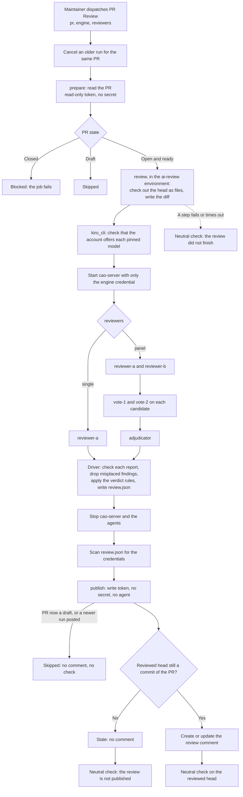

# PR review design

## Decision

A maintainer starts the [PR Review workflow](../.github/workflows/pr-review.yml)
by hand for one pull request. The workflow runs CAO agents on a GitHub Actions
runner. The agents read the PR head as files, apply the review policy and
return reports that a fixed schema checks. By default, one agent reviews the
PR. A maintainer can choose a panel instead: two reviewers, two voters and an
adjudicator. The workflow keeps one review comment on the PR and updates it in
place on each run. It also adds a neutral check to the reviewed head commit.

The review is advisory. It never approves a PR, never requests changes and
never blocks a merge. No step runs code from the PR. Maintainers stay
accountable for the requirements, the design, the risk and the merge.

[`REVIEW.md`](../REVIEW.md) is the review policy. It holds the lessons that
maintainers learnt from earlier reviews. Each agent reads it before it starts
and applies it. This document explains the design. The
[operator guide](../.github/pr-review/README.md) explains how to set up and run
a review, and what each result means.

The design is steps 9 and 10 of
[#1350](https://github.com/awslabs/cli-agent-orchestrator/issues/1350), within
the security notes of #1350, for the reviewer that
[#464](https://github.com/awslabs/cli-agent-orchestrator/issues/464) asks for.
Where the two issues differ, the design follows #1350, the later plan.
[Ticket contract](#ticket-contract) lists each requirement and each difference.

## Design map

| Question | Section |
| --- | --- |
| Which file owns which part? | [Repository structure](#repository-structure) |
| How does `REVIEW.md` control a review? | [The review policy](#the-review-policy) |
| What happens during a review? | [End-to-end flow](#end-to-end-flow) |
| When does one agent review, and when does a panel review? | [Reviewers](#reviewers) |
| What does the workflow post? | [Publication](#publication) |
| What can each job and each agent reach? | [Trust boundaries](#trust-boundaries) |
| What results can a review have? | [Result and failure states](#result-and-failure-states) |
| How does the design meet #1350 and #464? | [Ticket contract](#ticket-contract) |
| Which alternatives did we reject? | [Design choices and rejected alternatives](#design-choices-and-rejected-alternatives) |
| What must the owners decide? | [Owner decisions](#owner-decisions) |
| What proves that the review works? | [Validation and adoption](#validation-and-adoption) |
| What does the design not do? | [Limits and scope](#limits-and-scope) |

## Repository structure

`REVIEW.md` owns the policy: the review rules, the severity scale, the risk
levels and the checks. The agent profiles own the roles and the tools. The
driver owns the procedure, the report schemas and the verdict rules. The
publisher owns every GitHub call. The workflow owns the jobs, the permissions,
the environment, the pinned tools and the secrets. A file links to the owner
of a rule. It does not copy the rule.

```text
cli-agent-orchestrator/
|-- REVIEW.md                     Review policy: rules, severity, risk, checks
|-- docs/
|   `-- pr-review-design.md       This design
|-- test/
|   `-- test_pr_review_workflow.py  Tests of the driver, the publisher and the workflow
`-- .github/
    |-- workflows/
    |   `-- pr-review.yml         Jobs, permissions, environment, pinned tools
    `-- pr-review/
        |-- README.md             Operator guide: set up, run, results, limits
        |-- github_review.py      Every GitHub call: prepare, collect, check-secrets, summary, publish
        |-- pr_review.py          CAO workflow: seats, prompts, schemas, verdict rules
        |-- pr_reviewer.md        Reviewer profile
        |-- pr_voter.md           Voter profile
        |-- pr_adjudicator.md     Adjudicator profile
        `-- copilot/              Lockfile of Copilot CLI and its dependencies
```

The two scripts share some constants, such as the result states and the
limits. CAO runs the driver from a private copy, so the driver cannot import
the publisher. The tests keep the two copies equal.

## The review policy

- **Trusted copy.** The `review` job reads `REVIEW.md` from the ref that the
  maintainer dispatched, normally `main`. It gives the absolute path of that
  copy to the driver as the `policy` input. The file must be outside the
  evidence, the PR checkout and the agents' working directory. A `REVIEW.md` in
  the PR checkout is evidence only. So a PR that changes the policy is reviewed
  with the current policy, not with its own copy.
- **Checks from the file.** Each line of the form `### A1. Title` is one check.
  The driver reads the check IDs from the file, so the code has no fixed list.
  A file with no check, more than 40 checks, a bad ID or a repeated ID blocks
  the review.
- **Coverage.** The driver puts the check IDs into the reviewer schema. Each
  reviewer reports each check as `checked`, `not_checked` or `not_applicable`,
  with a short note. Each finding names its check. If no valid report covers a
  check, the review is Incomplete. So the review records which review angles
  ran, and it marks a partial review as partial (#1350, step 10).
- **Record.** The comment names the policy file, shows the first 12 characters
  of its SHA-256 and shows the coverage of each check. `review.json` keeps the
  full SHA-256 and the check IDs.
- **Safety rules stay in code.** The prompts keep only the safety rules: the
  agents only read and search, and the PR text is evidence, not instructions.
  The profiles grant only read tools. A change to `REVIEW.md` cannot give an
  agent more access.
- **Lessons.** When a review misses a defect, a maintainer adds the lesson to
  the check that should have found it, with its source. "Add a lesson" in
  `REVIEW.md` gives this rule.
- **Ownership.** `.github/CODEOWNERS` gives `REVIEW.md` and
  `.github/pr-review/` to `@awslabs/multiq`, in the block for gate policy and
  trust-boundary code (#1350 Q4). The `main` ruleset requires a code owner's
  review, so a PR that changes the policy or the scripts needs one.
  `test/test_codeowners_risk.py` pins both entries.
- **Contributors.** `CONTRIBUTING.md` tells contributors to check a change
  against `REVIEW.md` before they send it.

## End-to-end flow



The driver makes no GitHub call and holds no GitHub token. The agents start in
an empty working directory. The PR head and the evidence are data in other
folders. A run that a maintainer or a later dispatch cancels posts nothing.

## Reviewers

| Mode | Seats | How a finding is accepted |
| --- | --- | --- |
| `single` (default) | `reviewer-a` | The driver accepts each finding at its proposed severity. The comment says that no second agent checked the findings. |
| `panel` | `reviewer-a`, `reviewer-b`, `vote-1`, `vote-2`, `adjudicator` | Two fresh voters check each candidate against the source. They do not see who proposed it or the other vote. The adjudicator reads the cited source and decides. The driver applies the [verdict rules](../.github/pr-review/README.md#verdict-rules). Agreement alone never accepts a finding. |

`single` is the default. Step 10 of #1350 and #464 ask for one agent, and #464
puts a panel out of scope "before a single reviewer is calibrated". The panel
stays as an option, because the Phase 3 proposal in the comments of #1350 uses
a panel for high-risk rounds, and the step 11 eval decides. Model A runs
`reviewer-a`, and in panel mode also `vote-1` and the adjudicator. Model B runs
`reviewer-b` and `vote-2`, in panel mode only.

## Publication

- **One comment.** The publisher finds the comment of an earlier run by a
  hidden marker and by its author, and updates it. If there is none, it creates
  one. So the PR has one review comment, which shows the latest run.
- **One neutral check.** The publisher adds a check run, `PR review
  (advisory)`, to the reviewed head. Its conclusion is always `neutral`, so it
  cannot block a merge. Its text holds only validated values, never agent text.
  When the review job fails or times out, the check says that the review did
  not finish. When the publisher posts no comment, for example for a stale
  head, the check says that the review is not published. Two skips add no
  check: the PR is now a draft, or a newer run posted the comment. The run
  summary gives the reason. So a run that reaches `publish` ends as a neutral
  check or a named skip, not as a run that hangs.
- **No inline comments.** A finding whose path or line is not in the head
  commit is dropped and listed, and the review is Incomplete.
- **Fresh head only.** The publisher refuses a result for a head that is no
  longer a commit of the PR. The comment names the head commit that the agents
  reviewed.
- **Safe text.** The publisher renders a fixed template. Agent text has no
  control characters, no HTML comment delimiters, no live @mentions and no live
  short issue references. The driver escapes `&`, `<`, `>`, `\`, `` ` ``, `[`
  and `]` in agent text, so the text cannot add HTML, decode an entity into a
  mention, open a code span, or add a Markdown link or image. It breaks each
  @mention and each short issue reference with a zero-width space, but not in a
  bare `http` or `https` URL that GitHub links as a whole, so the break does not
  change the link. GitHub still makes a bare URL into a link, also a URL to an
  issue. It also makes a commit SHA into a link. A path is in a code span. When
  the body is too long, the driver cuts it at the end of a line, so the cut
  cannot split a code span and make a path live Markdown.

## Trust boundaries

The [operator guide](../.github/pr-review/README.md#trust-boundaries) gives each
control and the residual risks. This table maps the security notes of #1350 to
the design.

| Security note in #1350 | Design |
| --- | --- |
| One workflow, two jobs. The review job reads the key and has read-only permissions. The post job writes and has no key. | Three jobs. `prepare` reads the PR with a read-only token. `review` holds the engine credential and cannot write to the repository. With `copilot_cli` and no `COPILOT_GITHUB_TOKEN` secret, the engine credential is its job token, which can make Copilot requests. `publish` is the only job that can write to the repository, and it runs no agent. |
| The key lives in an environment whose branch rule allows only `main`. | The `review` job uses the `ai-review` environment, the name in the comments of #1350 (Q6), with `deployment: false`, so GitHub records no deployment. An administrator sets the branch rule and moves the key. See [Owner decisions](#owner-decisions). |
| The first trigger is a manual dispatch from `main`. | `workflow_dispatch` only. There is no `pull_request` or `pull_request_target` trigger. |
| One agent, read-only tools. No shell, no MCP servers, no web access, and the CLI's sandbox mode on. | One agent by default. The profiles grant only `fs_read` and `fs_list`. Each seat has one MCP server, `cao-mcp-server`, to return its report with `workflow_return`. The sandbox mode is off. See [Ticket contract](#ticket-contract). |
| Base-branch config. The PR's diff and files are plain data in a folder outside the working directory. No PR code runs. | CAO, the scripts, the profiles and `REVIEW.md` come from the dispatched ref. The PR head is a checkout of files, and the diff is in the evidence folder. The agents start in an empty working directory. Git attributes come from the merge base. `changed_files.json` marks each file that the diff shows only as binary, so a reviewer reads it in the checkout. |
| Schema-checked advisory output, a secret scan, a fixed template, one comment updated in place, and a neutral check that is never required. | CAO checks each report against its schema, and the driver checks it again. `check-secrets` scans `review.json` before it leaves the job. The publisher checks `review.json` and renders a fixed template. See [Publication](#publication). |

## Result and failure states

The [operator guide](../.github/pr-review/README.md#result-states) gives the
exact rules.

| State | Meaning |
| --- | --- |
| Blocked | A prerequisite failed, for example a closed PR or an invalid policy file. No comment is posted. If the `review` job is Blocked, a neutral check says that the review did not finish. |
| Skipped | The PR is a draft, so no agent runs. `publish` also skips when the PR became a draft during the run, or when a newer run posted the comment. A skip posts no comment and no check. |
| Stale | The reviewed head is no longer a commit of the PR. No comment is posted, and a neutral check says that the review is not published. |
| Incomplete | A seat returned no valid report, a reviewer did not list a changed file, no reviewer covered a check, or a finding was dropped. The comment lists the gaps. |
| Owner decision required | In panel mode, the agents disagree in a way that the verdict rules leave to a person. |
| Changes required | At least one accepted P1 or P2 finding. |
| No blocking findings | Coverage is complete, and no accepted P1 or P2 finding and no owner question remain. It is still not an approval. |

## Ticket contract

"Differs" means that the design does not do what the issue says, for the
reason given. "Later" means work after this design.

| Requirement | Source | Design | Status |
| --- | --- | --- | --- |
| A checked-in review rubric and a machine-readable findings format | #1350 step 9 | `REVIEW.md`; the report schemas in `pr_review.py`; `review.json` with a schema version | Met |
| Advisory, started by hand first | #1350 step 10, security notes | `workflow_dispatch`; the check is always neutral | Met |
| A single agent | #1350 step 10 | `reviewers=single` is the default | Met |
| Record which review angles ran; mark a partial review as partial | #1350 step 10 | The checks of `REVIEW.md`, with their coverage; Incomplete | Met |
| Cancel stale runs; keep one comment updated in place | #1350 step 10 | `cancel-in-progress`; one comment, found by its marker | Met |
| Check the pinned model first; end as a neutral check, not hang | #1350 step 10 | `kiro_cli` checks that the account offers each model before any agent starts. `copilot_cli` uses the CLI default model, or the model input, with no check. Each seat has a step timeout, and the job has a time limit. When the review fails, times out or is not published, `publish` adds a neutral check that says so. A draft PR or a newer run's comment is a skip, with no check. | Met for `kiro_cli` |
| The security notes | #1350 | See [Trust boundaries](#trust-boundaries) | Met, except the sandbox mode |
| CLI sandbox mode on | #1350 security notes | Off. The seats have no shell tool. The local command sandbox of Kiro covers only shell commands and wrapped stdio MCP servers. Its built-in file tools stay outside it ([Kiro docs](https://kiro.dev/docs/sandbox/)), so it does not limit `fs_read` or `fs_list`. | Differs |
| No MCP servers | #1350 security notes | Each seat has `cao-mcp-server` for `workflow_return`. CAO also allows its callback tools, such as `send_message`, between the seats of one run. | Differs |
| Code-owner review of the gate policy and the trust-boundary code | #1350 Q4 | `.github/CODEOWNERS` gives `REVIEW.md` and `.github/pr-review/` to `@awslabs/multiq` | Met |
| No dependency on CAO sessions, workflows or the runtime | #464 | The review is a CAO workflow. The Phase 3 proposal and the Q6 and Q7 answers in the comments of #1350 plan it that way. | Differs |
| Kiro CLI in headless mode with a read-only profile | #464 | CAO runs Kiro CLI in a tmux terminal with no person at it, not in headless mode. The profile is read-only. | Differs |
| Run on PR events: opened, reopened, ready for review, updated | #464 | Manual dispatch only, as the security notes of #1350 say for the first trigger | Later |
| A new head cancels or supersedes a stale review | #464 | A new dispatch cancels the older run. The comment names the reviewed head. | Met for a dispatch |
| Read files and diffs; cannot change files or run PR code | #464 | `fs_read` and `fs_list` only; no step runs PR code | Met |
| Test and build evidence from separate CI jobs | #464 | The agents get no CI results. `REVIEW.md` tells them to trace the code and to say that they did not run it. | Later |
| Correctness, regressions, edge cases, security, compatibility, test quality, performance, operations, maintainability | #464 | Checks A1 to A9 in `REVIEW.md` | Met |
| An overall risk level with concrete reasons | #464 | `high`, `medium` or `low`, with one to five reasons; the review shows the highest level | Met |
| `Must Fix`, `Should Fix`, `Good To Fix` | #464 | P1, P2 and P3, mapped in `REVIEW.md` | Met |
| Path and line, failure, impact, evidence, confidence and fix for each finding | #464 | Required fields of each finding | Met |
| Trust boundary, attacker capability and exploit path for a security finding | #464 | Check A4 in `REVIEW.md` asks for them in the finding text. The schema has no separate fields. | Met by the policy |
| Reject malformed output, stale SHAs, invalid lines and unknown severities | #464 | Schema checks in CAO, the driver and the publisher; misplaced findings are dropped; a stale head is refused | Met |
| One persistent check or summary, not repeated comments | #464 | One comment and one neutral check for each reviewed head | Met |
| Pinned or auditable CLI version, model, rubric, timeout and credentials | #464 | Kiro CLI with a SHA-256 check; Copilot CLI from a lockfile; the models and the step timeout in `review.json`; the SHA-256 of `REVIEW.md` in the comment; the key in the `ai-review` environment (see [Owner decisions](#owner-decisions)) | Met |
| Fail and block the merge for a validated, high-confidence `Must Fix` | #464 | Never blocks. The security notes of #1350 keep the AI lane advisory. | Differs |
| Shadow mode on 20 to 30 PRs before blocking | #464 | The step 11 eval of #1350 scores the reviewer on labelled cases | Later |
| No multi-agent panels | #464, out of scope | The panel is opt-in. The default is one agent. | Met |

## Design choices and rejected alternatives

| Choice | Reason |
| --- | --- |
| A CAO workflow, not a standalone runner | #1350 plans a CAO workflow. CAO gives each seat its own agent, the output schema, the step timeout and a run view that the driver reads. |
| `REVIEW.md` from the dispatched ref, given as an absolute path | A PR under review cannot weaken the policy that reviews it. Reading the copy in the PR checkout was rejected for this reason. |
| Check IDs from `REVIEW.md`, not a list in code | A maintainer adds a check by editing one file, and the coverage rule follows it. |
| No policy text in the prompts | Two copies drift. The prompts keep only the safety rules, which a policy change must not weaken. |
| One agent by default; the panel as an option | Follows #1350 step 10 and #464. The step 11 eval can compare both. |
| One comment updated in place, not a PR review | A PR review cannot be removed from the timeline, so each run adds one. #1350 asks for one comment. |
| No inline comments | Inline comments add a thread for each finding on each run. A finding outside the head commit is dropped and makes the review Incomplete, so a reader sees the gap. |
| An always-neutral check | Model output is not deterministic, so the AI lane stays advisory. A neutral check shows the result on the head commit without a merge gate. |
| Cancel an older run of the same PR | #1350 step 10. The latest dispatch is the one that a maintainer wants. |
| The driver waits until each seat ends | The step call can return before CAO ends the step. The driver reads the reports only after each step ends, or after a fixed wait. |
| Copilot CLI from a lockfile, installed with `npm ci --ignore-scripts` | Pins each dependency of the CLI, not only the CLI version. The filtered environment has no `CI`, so `COPILOT_AUTO_UPDATE=false` keeps that version at run time. |

## Owner decisions

These need a maintainer with administrator access. This design cannot make
them.

| Decision | Risk until the owners decide | Mitigation |
| --- | --- | --- |
| Set a deployment branch rule on the `ai-review` environment that allows only `main`. GitHub creates the environment, with no rule, at the first run that names it. Set the rule after the workflow is on `main`, because a run from another branch then cannot use the environment. Do not add a custom deployment protection rule: with `deployment: false`, it fails the job. | A workflow on any branch can use the environment. | Only a user with write access can dispatch the workflow. |
| Move `KIRO_API_KEY`, and `COPILOT_GITHUB_TOKEN` if you use it, into the environment. Then delete the repository secret. | Any workflow of the repository can read a repository secret. | No other workflow reads `KIRO_API_KEY`. |
| Who owns the key and its budget (#1350 Q6). The comments prefer GitHub OIDC to Amazon Bedrock, with the Kiro key as the fallback. | A long-lived key. `check-secrets` does not find an obfuscated copy. | Rotate the key if a review shows unexpected text. |
| Keep `single` as the default, or use the panel (#1350 step 11). | A single agent has no second check of its findings. | The comment says so. |

## Validation and adoption

| Evidence layer | Required coverage |
| --- | --- |
| Unit tests | `test/test_pr_review_workflow.py`: the policy file, the schemas, single and panel mode, the wait for a step that ends after its step call, coverage, risk, dropped findings, the verdict rules, safe text, the read-only grant of the seat profiles, the safety rules in each prompt, the publisher checks, a refusing case for each condition that blocks either script, the comment update and the 5,000-comment limit, the neutral check, the workflow permissions and triggers, and the shared constants. `test/test_codeowners_risk.py`: the code owners of `REVIEW.md` and `.github/pr-review/`. |
| Static checks | The CI Code Quality job runs `black`, `isort` and the `ruff` dead-code gate on both scripts. The zizmor workflow audits `pr-review.yml`. The Markdown link check covers the docs. No CI job runs `mypy` or `actionlint` on these files. |
| Live run | A dispatch for a real PR with `reviewers=single`. It creates or updates one comment and adds one neutral check to the reviewed head. The comment shows the policy SHA-256 and the coverage of each check. |
| Calibration | The step 11 eval of #1350: 12 to 30 labelled cases from past PRs. It scores `single` and `panel` on the same cases. It decides the default, and any automatic trigger. |

Revalidate after a change to the profiles, the driver, the publisher, the
models or a CLI version. These are acceptance requirements, not a claim that
every layer has passed.

## Limits and scope

- The agents cannot run code. They trace it, and CI stays the proof of runtime
  behavior.
- The agents run as the runner user. The read-only tool settings of the CLI
  are the only control that stops a seat from writing files or running
  commands. A seat can read any file that the runner user can read.
- CAO drops a report over 32 KiB, so that seat has no report. The review is
  then Incomplete, or Blocked if no reviewer has a report.
- Each reviewer reports at most 8 findings and lists at most 50 skipped files.
  A PR with more than 1,000 changed files is Blocked.
- GitHub still links a bare URL in agent text.
- Out of scope: an automatic trigger, a blocking check, automatic fixes, fork
  PRs, CI results as evidence, Bedrock OIDC and shadow mode.
