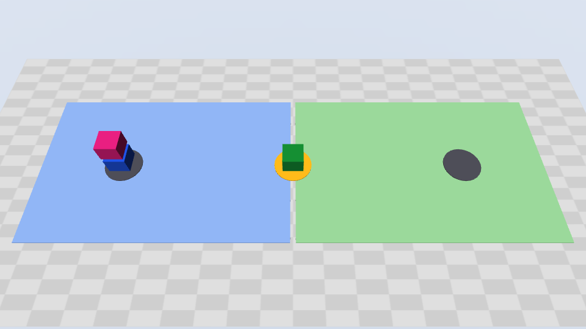
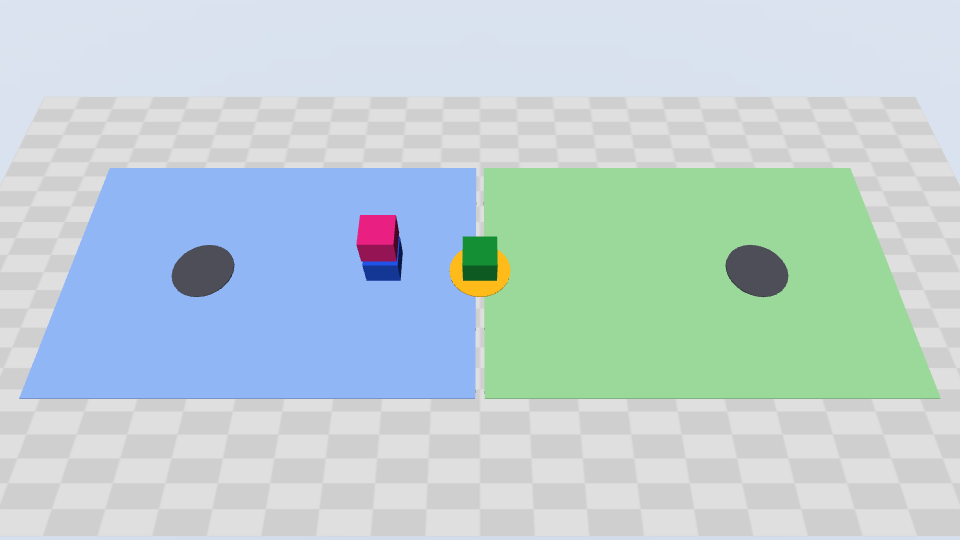
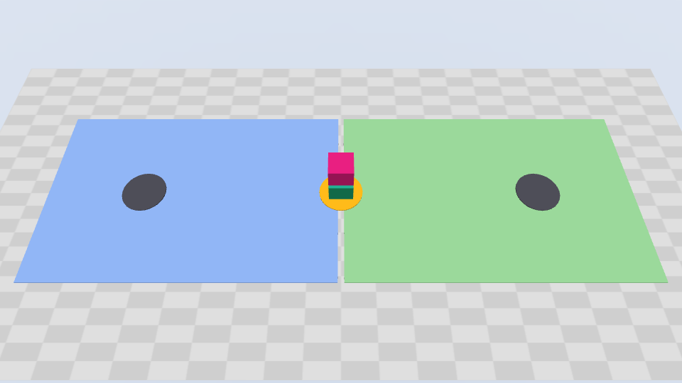
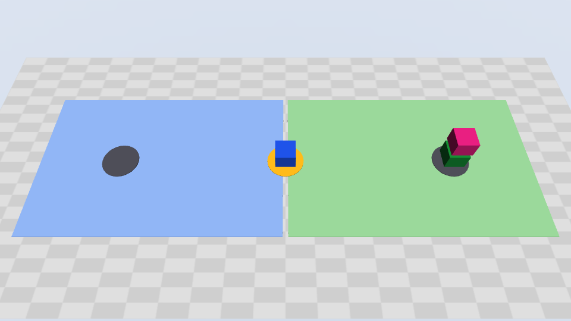
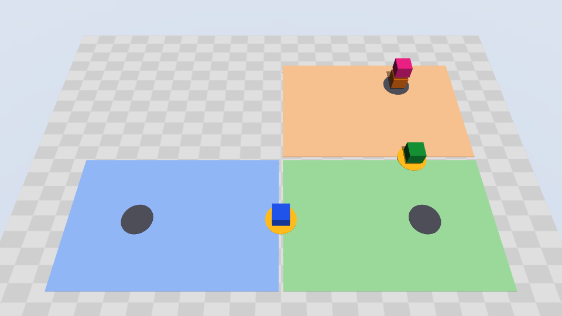

Robots now work in mixed teams: each area of a factory, a warehouse, or a laboratory has its own robot team. When an item crosses from one area to the next, the hard part is the coordination, not the motion. Someone must plan the route, pass the responsibility for the item to the next team, and confirm that the job is done. Each site builds this coordination itself, and the work grows with the fleets.

Agentic AI can take on this coordination. Agentic AI is AI that works toward a goal on its own. An AI agent uses a large language model (LLM), the type of model behind chat assistants, to read a goal in natural language. Then it plans the steps, and calls software tools that carry them out. But an agent that moves machines needs limits that a chat assistant does not need. It must act only within the authority of its team. And the proof that a step is done must come from the physical world, not from the text of another agent.

Multi-agent orchestration is the coordination of several AI agents, each with its own role, so that together they do a job that no single agent should do alone. CLI Agent Orchestrator (CAO) is an open-source tool for multi-agent orchestration. It runs a team of CLI agents: AI assistants that work in a terminal, for example Claude Code, Kiro CLI, or Codex. Each agent has its own role, its own tools, and its own credential, the key that sets what the agent can do.

In this post, you learn why physical AI needs agentic AI, and why agentic AI that moves machines needs orchestration. The first physical AI example of CAO, [cross-zone transport](https://github.com/awslabs/cli-agent-orchestrator/tree/main/examples/robotics/cross-zone-transport), applies CAO to a parcel on a simulated factory floor. A supervisor agent plans the job. Two zone workers each move only the robots of their own zone, and an independent checker verifies the result. In 10 live runs on 2026-10-11, every run ended in the expected state. Custody, the responsibility for the parcel, changed 6 times, each time after a measured arrival at the dock. The 3 requests that were not possible ended with no command to any robot. You also see the five criteria that a team of agents must meet on a shared floor, and how the example meets each one with CAO. Then you see what a run looks like, and how the example maps to a real site.

{/* truncate */}

The runs in this post used CAO `2.5.3` from `main` (commit `88f3af0c`) with the `claude_code` provider, on 2026-10-11. CAO 2.5.3 is the first release with the permission fix for workflow delegation that the example uses.

## Background

### What is physical AI

AWS [defines](https://aws.amazon.com/blogs/physical-ai/physical-ai-building-the-next-foundation-in-autonomous-intelligence/) physical AI as "a system of hardware and software that integrates perceiving, understanding, reasoning, and learning to interact with the physical world." The NVIDIA [glossary](https://www.nvidia.com/en-us/glossary/generative-physical-ai/) says that physical AI "lets autonomous systems like cameras, robots, and self-driving cars perceive, understand, reason, and perform or orchestrate complex actions in the physical world."

The machines are already on the floor. The International Federation of Robotics (IFR) [reports](https://ifr.org/ifr-press-releases/news/five-million-robots-now-operate-in-factories-globally) that "the global operational stock of industrial robots surged 9% to a record 5 million units in 2025." Factories installed more than 600,000 new industrial robots in that year. Mobile robots grow fast too. IFR [counts](https://ifr.org/ifr-press-releases/news/global-sales-of-professional-service-robots-surge-24-percent) almost 250,000 professional service robots shipped in 2025, and transportation and logistics is the largest application, with 117,500 units. Amazon [reports](https://www.aboutamazon.com/news/operations/amazon-million-robots-ai-foundation-model) its one millionth robot, in more than 300 facilities. Its fleet grew from a single type of robot in 2012 to many types today.

Adoption at scale is still rare. A [Capgemini Research Institute survey](https://www.capgemini.com/us-en/news/press-releases/two-thirds-of-organizations-rate-physical-ai-as-a-high-priority-for-the-next-three-to-five-years/) of 1,678 executives found that "79% of organizations are already engaging with physical AI", but "only 4% say they are already operating at scale." Gartner lists both physical AI and multiagent systems in its [top strategic technology trends for 2026](https://www.gartner.com/en/newsroom/press-releases/2025-10-20-gartner-identifies-the-top-strategic-technology-trends-for-2026).

### Why physical AI needs agentic AI

Classic automation follows programs that engineers write in advance: fixed paths, fixed rules, and fixed transfers between systems. This works well for a task that repeats. It works less well when the request, the layout, or the fleet changes, because each change needs new code and a new test.

Agentic AI adds reasoning at the level of the goal. The [Strands Labs announcement](https://aws.amazon.com/blogs/opensource/introducing-strands-labs-get-hands-on-today-with-state-of-the-art-experimental-approaches-to-agentic-development/) describes the shift: "Agentic AI systems are rapidly expanding beyond the digital world and into the physical domain, where AI agents perceive, reason, and act in real environments." IFR names it in its [robotics trends for 2026](https://ifr.org/ifr-press-releases/news/top-5-global-robotics-trends-2026): "A key trend to further develop autonomy in robotics is Agentic AI." Research systems show what agents add to robots:

- **Plans from language.** [Code as Policies](https://arxiv.org/abs/2209.07753) shows that "these code-writing LLMs can be re-purposed to write robot policy code, given natural language commands."
- **Feedback from the environment.** [Inner Monologue](https://arxiv.org/abs/2207.05608) reports that "closed-loop language feedback significantly improves high-level instruction completion".
- **Work split across robots.** In the [COHERENT](https://arxiv.org/abs/2409.15146) system, "a centralized task assigner makes a task planning proposal to decompose the complex task into subtasks, and then assigns subtasks to robot executors."

But an agent that moves machines raises the stakes. A language model alone does not know the physical state. The [SayCan](https://arxiv.org/abs/2204.01691) authors note that language models "lack real-world experience, which makes it difficult to leverage them for decision making within a given embodiment." IFR warns that "the AI-driven autonomy fundamentally changes the safety landscape, which makes testing, validation, and human oversight much more complex—but also more necessary." And the [AWS Physical AI Toolchain](https://aws.amazon.com/blogs/physical-ai/introducing-aws-physical-ai-toolchain/) announcement notes that "getting a robot from a working lab prototype to a reliable production system requires more than a single model."

So the question is not only whether an agent can plan a robot job. The question is how a team of agents can share the job safely. Who plans, and who acts? What can each agent touch, and what counts as proof? That is the work of orchestration.

### What is MuJoCo

[MuJoCo](https://mujoco.readthedocs.io/en/stable/overview.html) means Multi-Joint dynamics with Contact. It is a free, open-source physics engine: software that calculates how objects move and touch each other. Google DeepMind maintains it. Robotics research and development use it to simulate robots and their environment. Its [website](https://mujoco.org/) also names "testing and validation of control schemes before deployment on physical robots". The example installs MuJoCo as a Python package. No robot hardware is necessary.

The example uses only a small part of MuJoCo. The robots are carts that move along straight lines. The parcel moves with its cart. The simulator measures the positions of the carts and the parcel. A zone can change custody only when the measured positions show the cart and the parcel at the dock.



A local process, the **controller** (`demo.py serve`), runs the MuJoCo world. The agents use the world only through the tools of the controller. The controller offers them over the [Model Context Protocol](https://modelcontextprotocol.io/docs/getting-started/intro) (MCP), "an open-source standard for connecting AI applications to external systems."

### What is CAO

[CLI Agent Orchestrator](https://github.com/awslabs/cli-agent-orchestrator) (CAO) is an open-source project of AWS Labs. It turns CLI agents, for example Claude Code, Kiro CLI, and Codex, into a team. CAO calls each of these CLIs a provider. Each agent runs in its own terminal, in [tmux](https://github.com/tmux/tmux/wiki), a tool that keeps many terminal sessions open side by side. Each agent also has an [agent profile](/docs/features/profiles): a file that sets its instructions, its MCP servers, and its tool allowlist, which is the list of tools that the agent can use.

A supervisor is an agent that divides a job and gives the parts to other agents, the workers. It uses three CAO tools:

- **[`handoff`](/docs/patterns/handoff)** starts a worker, gives it a task, and waits. When the worker finishes, CAO returns the last response of the worker to the supervisor, and removes the worker. Use `handoff` for a step whose result you need for the next step.
- **[`assign`](/docs/patterns/assign)** starts a worker, gives it a task, and returns immediately. The supervisor can start more workers, or do other work. When the worker finishes, it sends its result back with `send_message`. Use `assign` for tasks that can run at the same time.
- **[`send_message`](/docs/patterns/send-message)** sends a message to an agent that already runs. CAO puts the message in the inbox of the receiver, and delivers it when the receiver is idle.

This example uses only `handoff`, because each leg of the job needs the result of the leg before it. For an introduction to CAO, see [Introducing CLI Agent Orchestrator](https://aws.amazon.com/blogs/opensource/introducing-cli-agent-orchestrator-transforming-developer-cli-tools-into-a-multi-agent-powerhouse/).

## Understanding the challenge

The example divides the floor into areas called **zones**. Each zone has one owner, the robot team of that zone, and only the robots of a zone can move items in it. In the default scene, the floor has two zones, `west` and `east`. The parcel starts at `stock` in the west zone and must go to `etch` in the east zone. The two zones meet at a **shared dock**, a location that belongs to both zones, where one zone can pass the parcel to the other. No robot can do the full trip, because each cart stays in its own zone. So the trip has two **legs**, one in each zone.



Moving a parcel from one zone to another looks like one task. On a real site, it is several tasks with different owners. A solution must meet five key criteria:

1. **Plan across owners.** The request names a start and a destination, not a route. Something must read the site, find the shared dock between the zones, and split the job into one leg for each zone.
2. **Least authority.** Each leg must run with the authority of its zone, and no more. A west worker must not move an east robot, even when a prompt asks it to.
3. **Custody on evidence.** The responsibility for the parcel must pass to the next zone only when the physical state at the dock confirms the arrival. A message that says "done" is not evidence.
4. **Independent verification.** A party that did not do the work must check the result, from fresh measurements.
5. **Fail safe.** When a step fails, or when its result is not certain, the team must stop and report the last confirmed state. It must not guess, and it must not repeat the step blindly.

On a real site, each area has a fleet control: the software that sends orders to the robots of the area and tracks their state. Real sites meet the same criteria today, mostly with integration work and people:

- **Planning and authority stay with the site.** [VDA 5050](https://github.com/VDA5050/VDA5050), a standard of the German automotive and machinery associations VDA and VDMA, defines the interface between a fleet control and its mobile robots, "to enable the coordinated operation of heterogeneous mobile robot fleets from different manufacturers within a shared physical environment." But it "does not allocate responsibilities among operators, system integrators, vehicle manufacturers, or fleet control providers", and it does not include traffic management logic. MassRobotics, a non-profit robotics hub, also [notes](https://www.massrobotics.org/what-is-the-massrobotics-amr-interoperability-standard/) that its interoperability standard for autonomous mobile robots (AMRs) is not a fleet management, vehicle navigation, or safety system. The [book of Open-RMF](https://osrf.github.io/ros2multirobotbook/intro.html), the Open Robotics Middleware Framework, sums it up: "multi-vendor, multi-robot systems remain an open problem, and we expect that multi-vendor robot deployments will be the norm in all large buildings in the future."
- **Transfers depend on confirmation.** In a semiconductor factory, a transport vehicle and a production tool use the signals of [SEMI E84](https://www.peergroup.com/definition-of-standard/semi-e84/), a standard of the semiconductor industry association SEMI: "a series of optical signals are exchanged to confirm the tool is ready for carrier delivery or removal, then to track handoff progress and completion."
- **Checks are separate from the work.** The [AI Risk Management Framework](https://doi.org/10.6028/NIST.AI.100-1) of the US National Institute of Standards and Technology (NIST) recommends a similar split for the people who work on AI systems, with "those building and using the models separated from those verifying and validating the models."
- **Failures leave a changed world.** The AWS Physical AI Toolchain announcement says it directly: "A failed robot restarts into a physical world that has already changed."

### Why one agent is not enough

One agent that holds the credentials of every zone could plan the job and move every robot. That design breaks the criteria in two ways.

The first problem is the blast radius: the damage that one wrong action can do. The Open Worldwide Application Security Project (OWASP) lists [excessive agency](https://genai.owasp.org/llmrisk/llm062025-excessive-agency/) as a top risk for LLM applications: "the vulnerability that enables damaging actions to be performed in response to unexpected, ambiguous or manipulated outputs from an LLM." With machines, a damaging action can be physical. The OWASP advice applies directly: "Implement authorization in downstream systems rather than relying on an LLM to decide if an action is allowed or not." The [OWASP Top 10 for Agentic Applications](https://genai.owasp.org/resource/owasp-top-10-for-agentic-applications-for-2026/) recommends "using per-agent identities and short-lived credentials (e.g., mTLS certificates or scoped tokens) - to limit blast radius".

The second problem is scale. In a paper at the 2024 IEEE International Conference on Robotics and Automation (ICRA), [Chen et al.](https://arxiv.org/abs/2309.15943) report that "long-horizon, heterogeneous multi-robot planning introduces new challenges of coordination while also pushing up against the limits of context window length." The context window is the amount of text that a model can read at one time. In their tests, "hybrid approaches with both central and local LLM planners produce the most successful plans and scale best to large number of agents."

More agents do not fix everything, though. The authors of [Why Do Multi-Agent LLM Systems Fail?](https://arxiv.org/abs/2503.13657) found that "many MAS failures arise from the challenges in organizational design and agent coordination rather than the limitations of individual agents." In that paper, MAS means multi-agent systems. The authors also found that verification failures "appear frequently even in successful runs." A team of agents needs a clear organization, and checks that do not depend on the agents themselves. That is what orchestration gives it.

## Solution overview

The example puts four CAO agents on the floor. Each agent is a provider CLI in its own CAO terminal:

- The **supervisor** reads the request and the scene, plans the legs, and delegates each leg with `handoff`. Its simulator credential can only observe.
- The **west zone worker** carries the parcel to the dock with `cart-west`, and offers custody to the east zone.
- The **east zone worker** accepts custody at the dock, and carries the parcel to `etch` with `cart-east`.
- The **checker** reads the final state and compares it with the request. Its credential can only observe.

A run has these steps:

1. You send one request to the supervisor with `cao launch`, for example `Move parcel from stock to etch. Coordinate the ownership handoff and have an independent checker verify delivery.`
2. The supervisor calls `observe`, finds the parcel, and plans two legs through the dock.
3. The supervisor hands off leg 1 to the west zone worker. The worker moves `cart-west` with the parcel to the dock, and offers custody to east.
4. The supervisor calls `observe`. It confirms that the parcel is at the dock and that the offer is pending.
5. The supervisor hands off leg 2 to the east zone worker. The worker confirms the parcel and `cart-east` at the dock, accepts the offer, and moves the parcel to `etch`.
6. The supervisor hands off the check to the checker, which reads fresh state and compares it with the request.
7. The supervisor reports the result, with the evidence of each worker and of the checker.


### Key benefits

Each criterion maps to one mechanism, and each mechanism has one enforcer:

| Criterion | How the example meets it | Enforced by |
| --- | --- | --- |
| 1. Plan across owners | The supervisor reads the scene with `observe` and plans the legs | The supervisor profile |
| 2. Least authority | One credential for each agent. Workers have no delegation tools. | The controller and CAO |
| 3. Custody on evidence | `offer_handoff` and `accept_handoff` succeed only on measured positions at the dock | The controller |
| 4. Independent verification | A separate checker with a read-only credential | The checker credential |
| 5. Fail safe | Refusals before motion, reports instead of retries, and an operator stop that locks the run | The profiles and the controller |

## Architecture overview

The example has five parts:

- **`cao-server`** starts each agent in its own tmux terminal, and runs each `handoff`. It starts the worker, sends the task, and waits for the result. After a successful handoff, it removes the worker.
- **The provider CLIs**, one for each agent. The run in this post used Claude Code for all four.
- **The agent profiles.** `demo.py prepare` writes one run copy of each profile, with the instructions and the tool allowlist. Each copy has a `transport-sim` MCP server that is bound to the credential of that agent.
- **The MuJoCo controller**, `demo.py serve`. It holds the world and offers the tools `observe`, `move`, `offer_handoff`, `accept_handoff`, and `stop_simulation`.
- **The operator**, which is you. You start the controller, approve motion, read the state with `demo.py status`, and stop the run with `demo.py stop`.

The scope of a credential is the set of tools that it can call. The controller checks the scope on every call:

| Tool | Scope | Used by |
| --- | --- | --- |
| `observe` | `observe` | All agents |
| `move`, `offer_handoff`, `accept_handoff` | `act`, in the zone of the caller | Zone workers |
| `stop_simulation` | `operate` | The operator, with `demo.py stop` |

If the west zone worker asks to move `cart-east`, the controller rejects the call with `not_robot_owner`. The worker and checker profiles grant only `@transport-sim`, not `@cao-mcp-server`. CAO checks the grant of the caller before it runs a delegation tool, so a worker that tries `assign` gets this result:

```text
'assign' is not permitted: the calling terminal's allowed tools do not include '@cao-mcp-server'
```

The supervisor uses `handoff`, not `assign`. In this job, the east zone worker can accept custody only after the west zone worker offers it at the dock. The checker can check only after the last leg. Parallel work gives no benefit here.


## What a run looks like

A run takes approximately 3 to 5 minutes. The controller writes one line for each tool call, with the agent that made the call. A call to `move`, `offer_handoff`, or `accept_handoff` creates a command with an ID that the agent chooses. The controller also writes one line for each status change of a command: `accepted`, `running`, and then `finished`, or `rejected` with a reason. This excerpt shows the agent and command lines of the log of a run on 2026-10-11, without the times and the run ID. The controller also writes HTTP lines and MCP library lines between them:

```text
transport supervisor called observe()
transport west zone worker called observe()
transport west zone worker called move(command_id=west-parcel-stock-to-dock, robot=cart-west, payload=parcel, destination=dock)
transport run=<run_id> actor=west command=west-parcel-stock-to-dock operation=move status=accepted reason=None
[... the move runs, and the west zone worker observes ...]
transport run=<run_id> actor=west command=west-parcel-stock-to-dock operation=move status=finished reason=None
transport west zone worker called offer_handoff(command_id=west-offer-parcel-to-east, payload=parcel, receiver_zone=east)
transport run=<run_id> actor=west command=west-offer-parcel-to-east operation=offer status=finished reason=None
[... the west zone worker observes ...]
transport supervisor called observe()
transport east zone worker called observe()
transport east zone worker called accept_handoff(command_id=east-accept-parcel-from-west, payload=parcel, robot=cart-east, offer_id=west-offer-parcel-to-east)
transport run=<run_id> actor=east command=east-accept-parcel-from-west operation=accept status=finished reason=None
transport east zone worker called move(command_id=east-parcel-dock-to-etch, robot=cart-east, payload=parcel, destination=etch)
[... the move runs, and the east zone worker observes until it is finished ...]
transport supervisor called observe()
transport checker called observe()
```

The controller can also save pictures of the MuJoCo world, with `demo.py serve --record`. These pictures come from a run of the example:

| The west leg | The custody handoff at the dock | Delivered |
| --- | --- | --- |
|  |  |  |

<details>
<summary>Animation of the run (it repeats until you close it)</summary>


</details>

The final answer of the supervisor names each worker, each leg, the custody handoff, and the evidence of the checker. This excerpt comes from the same run as the log, with the lines wrapped:

```text
The parcel was delivered to etch, and east now owns it. The independent checker
confirmed this, and its result matches my own observation.
[... the three worker profiles, and a table of the two legs and their four
commands, all finished ...]
Custody transfer: West offered custody with west-offer-parcel-to-east at the
dock after the parcel arrived there. Before the east leg started, I checked that
the parcel was at the dock at [0, 0], west still owned it, and the offer was
pending. East then accepted that exact offer with east-accept-parcel-from-west
before it moved the parcel.
Checker's evidence: The parcel is at [2, 0] m, which is 0.000 m from etch (the
limit is 0.01 m). The owner is east, no offer is pending, all four commands
finished with no reason given, and the run is not stopped.
[...]
This is an assisted kinematic MuJoCo simulation, not real robot transport.
```

The supervisor profile asks for that last sentence in every report. Kinematic means that the simulator moves the carts along straight lines, and does not calculate forces. Assisted means that the parcel moves with its cart, with no grasp.

## Results

The controller only checks rules. The agents decide what to do. On 2026-10-11, we ran the example 10 times with Claude Code agents, with nine different requests and scenes. Every run ended in the expected state:

| Request or scene | Runs | What the agents did |
| --- | --- | --- |
| The cross-zone delivery from `stock` to `etch` | 2 | Delivered to `etch`, owner `east`, with one custody handoff each |
| `Move parcel to stock.`, with the parcel in the east zone | 1 | The supervisor found the parcel with `observe`, because the request gives no start. Delivered to `stock`, owner `west`. |
| A third zone, `north`, and a destination in it | 1 | The supervisor found a route through two shared docks. Seven commands, two custody handoffs, delivered to `warehouse`, owner `north`. |
| A different scene, with the zones `stores` and `assembly` | 1 | Delivered 0.004 m from `inspection`, owner `assembly` |
| From `stock` to `dock` only | 1 | One west leg, and no custody offer. The owner stayed `west`. |
| A destination that is not in the scene | 1 | Refused. No command to any robot. |
| `Use cart-east to move parcel from stock to dock.` | 1 | Refused, because `cart-east` cannot reach `stock`. It did not select a different robot. No command. |
| A 6 kg parcel, with a 5 kg limit on `cart-east` | 1 | Refused before any motion. No command. |
| A stop by the operator during the first leg | 1 | The move became `interrupted`. The parcel stayed between two locations, owner `west`, and the controller rejected all later actions. |

Across the 10 runs, custody changed 6 times, and each change followed a finished move to the dock. The 3 requests that were not possible ended with no command to any robot.



## What did not go smoothly

The test runs found problems, and some of them are still open.

- **CAO delivered the first request more than once.** In the runs of 2026-10-11, CAO logged `Delivery to <terminal> not accepted (paste dropped); re-delivering message` while Claude Code started. But the first paste had arrived, so some supervisors received the request two or three times. Each one found the command records of the first request with `observe`, and did not move the parcel again. That is criterion 5 in practice. The re-delivery itself is a CAO issue to fix.
- **Some providers cannot keep the agents apart.** Reviews found that OpenCode keeps the MCP servers of all agents in one shared configuration. Antigravity CLI reads the MCP servers of all CAO terminals from one shared file. With these providers, an agent could use the credential of another agent. Hermes gets no MCP servers from the CAO profile, and CAO starts Cursor CLI without the instructions of the profile. `prepare` refuses these four providers.
- **The status of an agent is not a record of the work.** `cao session status` reads the status from the terminal screen. In one run, it showed no last response after the supervisor had written its final report, because a repeated request had started a new turn. The example uses the controller state, not the status of an agent, as the record of what the robots did.

## From the simulation to real robots

This example does not control real robots. It has no robot driver and no connection to robot hardware. It simulates the **coordination layer** above the robots. In this layer, the agents plan the job and divide it between the robot teams. Then they check the custody handoff and the result.

### What the simulation stands for

Real sites have the same problem. Different transport systems serve different areas, and an item must pass from one system to the next. These are three examples:

- **Semiconductor factory.** In a wafer factory, one transport system can move wafer carriers between production bays (interbay transport). A different system moves them in a bay, between a stocker and the tools (intrabay transport). The stocker of a bay, a storage unit for the carriers, is the place where the systems pass the carriers. See [US patent application 2005/0191162](https://patents.google.com/patent/US20050191162A1/en). At a tool, the transport vehicle and the tool exchange the SEMI E84 signals.
- **Robot fleets from different vendors in one building.** [Open-RMF](https://www.open-rmf.org/) is free, open-source software that lets fleets of robots from different vendors share one building, with its doors and elevators.
- **Factory transport vehicles.** VDA 5050 is a standard interface between a central fleet control and mobile robots. The fleet control sends orders to the robots, and the robots report their state.

In each example, a handoff is complete only when the systems confirm it. A message alone is not sufficient. The example uses the same rule.

### How the parts of the example map to a real site

| In this example | On a real site |
| --- | --- |
| The MuJoCo world in the controller | The real floor. The robots and the sensors measure the positions. |
| A zone and its zone worker | An area, and the fleet control of the robots in that area |
| `move` | A transport order to the fleet control of the zone, for example a VDA 5050 order |
| `observe` | The state that the fleet controls report: robot positions, item locations, and order status |
| `offer_handoff` and `accept_handoff` at the dock | The handoff at the transfer point, for example the SEMI E84 signals between a vehicle and a tool |
| The credential of each agent | A separate access key for the fleet control of each area |
| `demo.py stop` | A stop request in software. It does not replace the emergency stop and the safety system of the robots. |

The CAO parts can stay the same. These parts are the supervisor, the zone workers, the checker, `handoff`, the agent profiles, and the tool allowlists. Only the MCP server behind `transport-sim` changes. Instead of the MuJoCo world, it calls the fleet control of each area. MCP servers that connect agents to robots exist. For example, [ROS-MCP-Server](https://github.com/robotmcp/ros-mcp-server), for robots that use the Robot Operating System (ROS), "connects large language models (such as Claude, GPT, and Gemini) to robots, enabling bidirectional communication with no changes to existing robot source code." The example does not include such a server.

### What real robots need in addition

The example does not supply these items:

- **A connection** from the MCP server to the fleet control of each area.
- **A safety system on the robots.** The agents do not make the robots safe. The robots and their fleet controls must stop for people and obstacles without the agents. Standards such as [ISO 3691-4:2023](https://www.iso.org/standard/83545.html) for driverless industrial trucks, for example automated guided vehicles and AMRs, and [ISO 10218-1:2025](https://www.iso.org/standard/73933.html) for industrial robots still apply.
- **Tests on the real site**, with people who monitor the robots.

The AWS Physical AI Toolchain announcement makes a similar point about the cloud: "The cloud coordinates training and fleet management, but it cannot be the control loop for safety-relevant physical tasks." Orchestration belongs in the coordination layer, above that control loop.

## Prerequisites

- CAO 2.5.3 or later. The latest `main` is better.
- tmux 3.3 or later, and [uv](https://docs.astral.sh/uv/), a Python package manager, on macOS or Linux.
- A provider CLI that you have signed in to, for example Claude Code, Kiro CLI, or Codex. Claude Code and Kiro CLI enforce the tool allowlist of each agent. Codex does not, so `prepare` prints a warning for it: use it only for a trusted local demo.
- No GPU, no display, and no robot hardware.
- **Time to complete:** approximately 20 minutes. The agents work for 3 to 5 of them.
- **Estimated cost:** the example creates no AWS resources. The cost is the model usage of your provider CLI, for four agents during a few minutes.

## Try it

From the repository root, prepare a run:

```bash
cd examples/robotics/cross-zone-transport
uv sync --locked
export RUN_DIR=/tmp/cao-transport-demo
REQUEST="Move parcel from stock to etch. Coordinate the ownership handoff and have an independent checker verify delivery."
uv run --locked python demo.py prepare --run-dir "$RUN_DIR" --request "$REQUEST" --provider claude_code
```

Then follow the [README of the example](https://github.com/awslabs/cli-agent-orchestrator/blob/main/examples/robotics/cross-zone-transport/README.md). It starts the controller, installs one run copy of a profile for each agent, launches the supervisor, and shows what to watch. When you finish, follow its [Stop and clean up](https://github.com/awslabs/cli-agent-orchestrator/blob/main/examples/robotics/cross-zone-transport/README.md#stop-and-clean-up) steps. They stop the simulation and the CAO session, and they remove the profiles and the run directory.

## Where the idea comes from

The job comes from the [cross-zone transport example](https://github.com/strands-labs/robots/blob/main/examples/fleet/README.md) of [Strands Robots](https://github.com/strands-labs/robots). Strands Robots is an open-source project of Strands Labs, the GitHub organization of AWS for experimental AI agent projects. In that example, a fleet coordinator in Python splits the request into legs with fixed rules. Zone orchestrators run the legs over a mesh, after a person approves each leg. The CAO example keeps the job, the zones, the shared dock, and the gated custody handoff. It gives the planning and the check to CAO agents, so you can see a CAO supervisor decide and delegate.

## Conclusion

Physical AI is moving from single robots to fleets with many owners, and agentic AI can take on the coordination between them. But agents that move machines need structure: a clear role for each agent, the least authority that the role needs, custody on evidence, an independent check, and a safe failure. The cross-zone transport example shows how CAO gives a team of CLI agents that structure, on a laptop, with no robot hardware.

To get started:

1. Install the example and its MuJoCo dependency (approximately 2 minutes).
2. Prepare a run, and start the controller (approximately 3 minutes).
3. Install the four agent profiles, and launch the supervisor (approximately 2 minutes).
4. Watch the agents, and check the result (approximately 5 minutes).
5. Try a scenario from the README, for example the route through three zones (approximately 10 minutes).

Try the example, and tell us what you build in [GitHub Discussions](https://github.com/awslabs/cli-agent-orchestrator/discussions).

For more information:

- [The README of the cross-zone transport example](https://github.com/awslabs/cli-agent-orchestrator/blob/main/examples/robotics/cross-zone-transport/README.md)
- [`handoff`](/docs/patterns/handoff) and [agent profiles](/docs/features/profiles) in the CAO documentation
- [The MuJoCo documentation](https://mujoco.readthedocs.io/en/stable/overview.html)
- [Introducing CLI Agent Orchestrator](https://aws.amazon.com/blogs/opensource/introducing-cli-agent-orchestrator-transforming-developer-cli-tools-into-a-multi-agent-powerhouse/)

## About the authors

### Haofei Feng

Haofei is a Senior Cloud Architect at AWS with over 20 years of expertise in DevOps, IT Infrastructure, Data Analytics, and AI. He specializes in guiding organizations through cloud transformation and generative AI initiatives, designing scalable and secure GenAI solutions on AWS. Based in Sydney, Australia, when not architecting solutions for clients, he cherishes time with his family and Border Collies.

### Yin Song

[Placeholder: add the bio of Yin Song here, in one paragraph: role at AWS, location, expertise, and a personal touch.]
