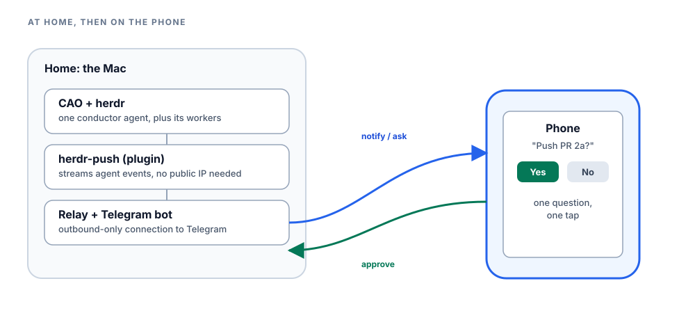

I was on a family holiday in Bali, half watching the kids and half watching my phone. It buzzed: "Push PR 2a?" One tap. Back home, an agent pushed the branch and opened the PR. I put the phone back in my pocket and kept watching the kids.

That's the shape of the last twelve days. [CAO](https://github.com/awslabs/cli-agent-orchestrator), the open-source CLI agent orchestrator, ran a small team of agents against its own repo, and I approved every push from wherever I happened to be, one question at a time. A CAO conductor agent planned the work, sized and delegated every task, and held the whole plan in its head. The question it sent me was never "what should we do" — it had already decided that, written it down, and handed it to a worker. It was always "is it safe to do the thing we already agreed on."

{/* truncate */}

## The numbers

| | |
|---|---|
| PRs opened | 32 (23 merged, 8 open, 1 closed) |
| Commits in those PRs | 218 |
| PRs merged in the window | 30 |
| Issues filed | 29 (8 closed, 21 open) |
| Window | 12 days, Oct 21 – Nov 1 |

A few honest caveats. Commits per PR ranged from 1 to 38 — some PRs carry nothing but review-fix commits stacked on top of the first one. Eight of the 32 are still open, waiting on review; the Kiro-related ones also wait on an operator checklist I run myself. And none of this shipped unattended: a human approved every push, every PR, and every security call.

## The setup

At home, my Mac runs CAO's server and one conductor agent, inside [herdr](https://herdr.dev), the terminal session manager CAO's agents run in. CAO is what plans, sizes, and delegates every task; herdr is just where the terminals live. For notifications and approvals away from the desk, [herdr-remote](https://github.com/dcolinmorgan/herdr-remote) — an open-source project, credited and linked here — adds a small relay on the same Mac. A herdr plugin called `herdr-push` streams agent events into that relay, and the relay runs a Telegram bot on top of it, carrying notifications and one-tap approvals to my phone. No public IP, no SSH — the Mac only needs outbound internet to reach Telegram.

The one rule that makes this work on a phone: the conductor asks **one question at a time**. A Telegram message with three questions in it gets truncated, so every approval is its own message, most urgent first. I learned that rule the slow way, by watching a multi-question prompt arrive on my phone as half a question.

Every task the conductor hands out is a file, not a chat message: the exact git commit to start from, the exact steps, the gates that must pass, and the one line a worker sends back when it's done. Workers report back through CAO's own inbox, and a message only lands when the receiver is free to read it — so the conductor sends one consolidated question per check-in, instead of three half-finished ones stacking up.

## The cast

This is CAO's own agent model at work. The conductor never writes code; everything else is delegated to a role CAO defines:

| Role | Job |
|---|---|
| Conductor | Plans, writes task briefs, delegates. No code of its own. |
| Ephemeral helper | A one-shot agent, sized small, medium, or large to the task, then deleted when it's done |
| Long-lived developer | Carries a multi-day track across several PRs |
| Reviewer | An independent agent, run through a CAO workflow with mutation testing (more on that below) |
| Architect | Weighs security and policy calls before anyone touches a file |
| Publisher | Pushes and opens PRs against an exact, checksum-pinned brief, never on its own judgment |
| PR watcher | Tracks every open PR, and auto-merges only our own approved, all-green ones |

## How CAO raises the bar

Before anything gets pushed, a fresh reviewer agent gets the exact commit range and the developer's own test evidence. It doesn't take that evidence on faith; it re-runs the tests itself. Findings come back ranked P1 (must fix), P2 (should fix), or P3 (nit), each with a file, a line, and a concrete way it could go wrong. They go back to the developer as one fix commit, which gets its own short follow-up review before anything moves on.

Part of every review is mutation testing: deliberately breaking the code in small, specific ways, then checking whether the tests notice — always against an unbroken "control" copy that has to pass cleanly first. A broken version the tests miss isn't a footnote. It becomes a new test.

The numbers, from every review still on disk: at least 18 reviews of our own changes so far, with 0 P1s, 11 P2s, and 40 P3s between them. Nearly all of those are already fixed; the newest, on the fix in the story below, wrapped up today with four minor nits still open.

Two catches worth naming. On the work to support Kiro CLI's newest engine, a reviewer found that a file path containing an `=` character would make a standard Unix tool misread it as a variable assignment and launch the wrong program entirely — a real bug, caught before any human looked at the code, fixed with a test before it went further. And across that same track's second phase, three rounds of review deliberately broke the isolation and launch code 111 separate ways. The tests caught all 111.

## One story, end to end: the Saturday alert

1. CI went red on two new HIGH-severity Dependabot alerts in the docs site's dependencies. Dependabot had already opened one PR for each, but both were red — each one's fix failed the scanner on the *other* alert.
2. A combined fix landed in one PR, and it still wasn't green. This time on two MEDIUM alerts in a dependency called minimatch.
3. CAO's architect role — the agent that weighs security and policy calls — looked into why a gate configured for HIGH and CRITICAL was failing on a MEDIUM, and found the trap: the CI step that uploads the security report ignores its own severity filter once it switches to a certain output format. Both MEDIUM alerts turned out to be unreachable code in this repo — flagged, but never actually callable.
4. The fix is a scoped exemption, naming the exact advisory and the exact two files, with an expiry date three months out so it can't be forgotten. An independent reviewer checked it against the exact advisory and the live gate, with no shortcuts: no blocking issues, four minor nits to tidy up. It's queued to go out, one tap at a time, the same way everything else gets approved.

## What I never hand over

Four things stay with me, no matter how the rest is delegated: pushes, GitHub posts, security decisions, and live checks on my own machine. Everything else can be delegated and re-delegated. These four can't: each is a point where a mistake leaves the building, with no quiet undo.

## What broke

Honestly, in no particular order: the laptop went to sleep and stalled an agent mid-task; a review scratch directory filled the disk; a callback arrived twice and nearly got acted on twice; and a local security check passed while CI failed, because the local run used the documented flags instead of the ones the CI step actually runs with.

## The punchline: CAO helped build CAO

Partway through this, we ran a live test of CAO's decision platform: a feature that lets a small model decide how big a helper agent needs to be, instead of a human guessing every time. In a throwaway, disposable CAO instance built for exactly this kind of test, a third-party decider, Jev, sized three ephemeral helpers for three sample tasks — a docs typo, a contained bug fix, a security review. In shadow mode, where the decision platform watches but doesn't decide anything yet, Jev picked small, medium, and large, matching the answers those test cases expect — they're Jev's own routing cases, with expected sizes. Once we switched it on, CAO actually launched the three helpers on those tiers — haiku, sonnet, and opus — each decision landing in 279 to 501 milliseconds.

It's a small result, but it's the right shape: the tool we were building to size agents for other work, sizing agents for the work of building itself. The public record is in [issue #1068's results comment](https://github.com/awslabs/cli-agent-orchestrator/issues/1068) and [issue #1182](https://github.com/awslabs/cli-agent-orchestrator/issues/1182), which tracks what's left before anyone outside this can rely on it: a release, a guide, and a published decider.

## Try CAO

- [CAO on GitHub](https://github.com/awslabs/cli-agent-orchestrator) — the orchestrator that ran this entire workflow: the conductor, the cast of agent roles, and the workflow reviews.
- [CAO's ephemeral-agents docs](https://github.com/awslabs/cli-agent-orchestrator/blob/main/docs/ephemeral-agents.md) — how to size one-shot helpers to a task yourself.
- [Issue #1182](https://github.com/awslabs/cli-agent-orchestrator/issues/1182) — what's left before decider-sized helpers, like Jev above, ship in a release.

If you want the phone half too: [herdr-remote](https://github.com/dcolinmorgan/herdr-remote) is the open-source project that carries CAO's notifications and approvals to a phone over Telegram.

## About the author

Stan Fan (`fanhongy`) is a Solutions Architect at AWS. He works with teams on agentic
systems and developer tooling, with a particular interest in how agents accumulate and reuse
context reliably across sessions, models, and tools, without turning memory into an
unbounded transcript.
