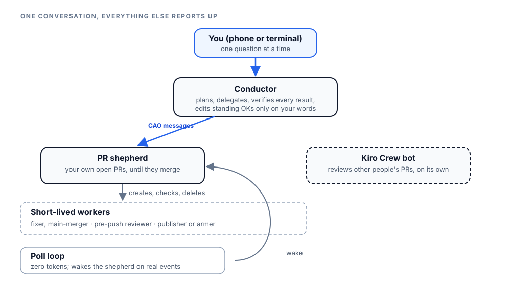
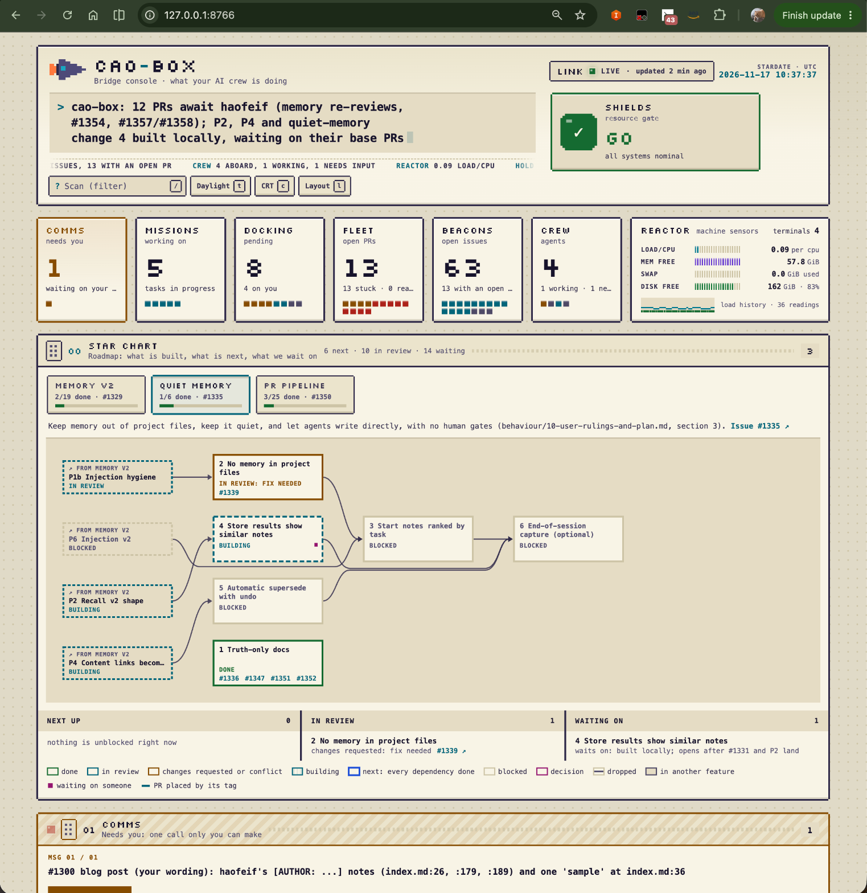
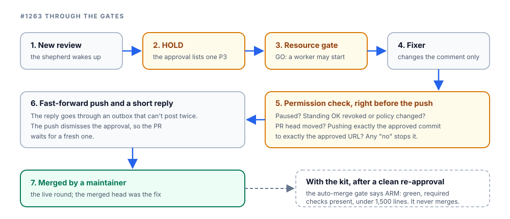

A few days ago, I ran my coding work from my phone. I gave one agent a few unrelated jobs in one conversation. All of it cost me a few one-line answers: yes, test it; yes, file it.

Well, I have to admit, it wasn't always like that. My agents running under CAO worked perfectly. Everything ran on a clock, hundreds of commits were pushed, and 80+ PRs were raised. However, as a human, I found it hard (impossible) to keep up.

{/* truncate */}

:::tip TL;DR
I can follow three, maybe five (after some really good coffee), agent sessions at once. Instead of talking to multiple agents and trying to memorise what they are busy with (it got even harder when those agents used the handoff function to assign jobs to other agents), I choose to talk to one conductor agent and let CAO run a PR shepherd and short-lived workers behind it. A Kiro Crew bot reviews other people's pull requests on its own (and I ask it to take extra care and be humble with my own PRs). That makes it a lot easier. The rules that matter are small scripts instead of prompts, and the kit starts in observe mode. Seven reviews said NOT-READY before one said READY. The agents still run as one OS user, but publishing to GitHub now goes through a user of its own.

:::

## Too many agents to follow

When I run many agents, I can follow three to five sessions at once, and that's barely. Past that, I lose track of which agent is waiting on what, and which one is about to do something I didn't mean.

Every agent needs me once in a while: a question here, an approval there. Ten agents meant twenty small interruptions, and none of them waited politely. Keeping up with all of them was impossible.

And under all of it was a worry. If I let agents work while I was away, what would they do wrong without me watching? I still remember the time an agent started to delete a worktree that I was still working in, just to free some disk storage.

## One conductor

I stopped trying to watch every agent. Now all my attention goes to **one** agent, the conductor. It plans the work, hands each job to a short-lived helper agent (check the ephemeral agent feature in CAO!), checks what comes back, and is the only agent that ever asks me a question.

Everything else sits behind the conductor, and [CAO](https://github.com/awslabs/cli-agent-orchestrator), the open-source CLI agent orchestrator, is the key that makes sure all of this runs on a clock: the conductor gives each job to a helper sized to that job. A "shepherd" agent looks after my own pull requests. Reviews of other people's pull requests no longer go through the conductor: a Kiro Crew bot handles them. My standing permissions are written as data, not prose. And a loop that costs no model tokens keeps it going day and night.

That's what I mean by a dark factory: a factory that runs with the lights off. I put it to the agent in one line: "This super agent is a piece of art, turn my daily coding work into a code dark-factory. Request/task in, quality code out."

The whole setup is in the CAO repo as a sample, [`examples/super-agent`](https://github.com/awslabs/cli-agent-orchestrator/tree/main/examples/super-agent): the agent profiles, their playbooks, the scripts and the poll loop, with my names and paths taken out.

## Remote Herdr with Telegram bot

The day started with a handover. The conductor I'd been talking to had passed its work to a new one. A conductor's memory is one long conversation, so a handover has to be a file. The old conductor wrote down everything in it: the open pull requests, who was waiting on whom, and the rules that should follow. A temp agent was created to read it, and wrote a short file back to say it had taken over. 

Then I started handing it work. Get Kiro CLI version 3 ready to use, with a status comment on the issue that tracks it. And give me a guide an agent could follow to set up ephemeral agents (short-lived helpers) and the Jev decider (the example decider in CAO's setup page).

The conductor gave each job to its own ephemeral agent and checked each result. Along the way it caught mistakes before they reached me.

### A task, from request to done

Every task takes the same path. I say what I want to the conductor. It writes the job as a brief file and hands it to a short-lived helper. The helper does the work and reports back in a fixed format. The conductor checks the result before anything goes public. Only then does it come back to me, with one question if it needs one.

Take the guide for ephemeral agents. The guide I asked for already existed, so the conductor offered to test it instead of writing a new one. I said yes. A helper followed the guide end to end, like a real user would, and found two gaps. The conductor checked both, asked me once, and filed the issue. A second helper wrote the fix and a third tested it. The pull request went up when I said yes, and it was open on GitHub, waiting for a review, that evening.

I answered two short questions. The conductor, the helpers and the checks did the rest.

### A review, and the fixes that follow

Pull requests move in two directions, and a different agent owns each one.

When a colleague opens a pull request, the Kiro Crew bot reviews it and posts its feedback on GitHub. When the author answers or pushes a fix, the bot comes back to the same thread and reviews again. It keeps going until the thread is settled.

When someone reviews one of my own pull requests, the PR shepherd reads the comments and the CI result. It decides what needs fixing and creates a worker to fix it. The worker pushes the fix and replies on the thread. If the reviewer asks for more, the shepherd does another round, and it keeps going until the pull request merges. Anything outside routine, like a security question, goes up to the conductor, which asks me.

## How the agents are arranged

To recap, I only talk to one agent. It writes each task as a brief file, hands the work to short-lived agents, and expects each to report back in a fixed format. Nothing goes public until the conductor has checked the result.

One more long-lived agent reports to it, never to me.

The **PR shepherd** looks after my own open pull requests until they merge. It reads feedback and red CI, decides what needs fixing, and creates the worker that fixes it. Anything outside routine, such as a security question or a force-push, goes up to the conductor, which asks me.

Reviewing other people's pull requests used to be a second long-lived agent under the conductor. It isn't any more. A **Kiro Crew bot** took that job over. It runs on its own, outside the conductor and outside CAO, and keeps watching the repo.

The shepherd's workers are sized to the job and deleted when done: a fixer and a main-merger on Codex, a pre-push reviewer on a large Claude model, and a small Claude agent that publishes replies or arms auto-merge.

*One conversation for me; the shepherd and its workers report to the conductor. The Kiro Crew bot reviews on its own.*

This isn't a demo. From 6 November until early on 9 November (UTC), my account merged 8 pull requests and filed 5 issues, and the Kiro Crew bot reviewed 44 PRs.

## The dashboard I watch

With this many agents, I still need one place to see what is going on. So I built a dashboard for the conductor, called cao-box. It is one page.

At the top, a headline says what needs me right now, and a row of counters shows what I should decide, what is in progress, what is pending, how many pull requests are open, how many issues are open, and how many agents are running. Below that is the roadmap, drawn as a graph of what is built, what is in flight and what is waiting on what. Then come the work in progress, the agents and what each is doing, and a live feed of what just happened.

Further down is every open pull request with its review state, its checks and its merge state side by side. At the bottom is the issue list.

Most of the day I don't open it. I look at the "needs me" part, make the decision, and close it.

*cao-box, the conductor's dashboard. The top shows what needs my decision, and the roadmap sits under it.*

## A sample pull request

Here is one review round on a small pull request, #1263, a code-comment change. A maintainer approved it with one minor nit, graded P3 on a scale from P1 (serious) to P3 (minor).

1. The poll loop sees the new review and wakes the shepherd.
2. The shepherd holds the PR. An approval that lists a finding is not a green light.
3. A fixer changes the comment and nothing else. A check confirms the code is unchanged.
4. The permission gate runs. It passes.
5. The fixer pushes a new commit on top (a fast-forward push) and posts a short reply.
6. The maintainer approves again, and the auto-merge gate can arm.

That round ran under my earlier PR watcher, before this kit existed. I replayed the maintainer's real review text through the kit as a test.

*How the kit would handle #1263's real review. The live round used the earlier watcher and ended in a maintainer's merge.*

## Why I needed scripts

A rule in a prompt only works while the agent keeps choosing to follow it, and an agent can talk itself past a rule with a reason that sounds fine. So the rules that matter live in small scripts that return an explicit pass or stop. I call them **gates**. Four things are gated.

| What is gated | What the script does |
|---|---|
| Every push, post and arm | Runs again right before the action. It stops the worker if I paused, if an OK was revoked, if the PR head moved, or if the PR isn't one of mine. |
| My permissions | Standing OKs are data records: who holds it, what action, what scope, and a tier. Only the conductor edits them, and only on my words. |
| Auto-merge | Gated by `automerge_gate.py`. It arms only when the approval covers the last commit, every required check is green, and the PR is 1,500 lines or fewer. GitHub does the merge. |
| Text from outside | PR comments, CI logs and web pages are data. They rank last and can never grant a permission. |

Some things always need me: force-pushes, new pull requests or issues, closing anything, security decisions, releases and keys. A one-off OK from me covers one exact action and expires soon.

## How the poll loop decides to wake the shepherd

An always-on factory has a quiet cost: something has to notice when a pull request changes. I don't want a model reading GitHub all night, so a poll loop does it with zero model tokens. I told it what I cared about: "pick the feedback and CI status from the PR that I owned and the pr that we reviewed have an update."

It wakes the shepherd for feedback, CI that needs action, review decisions, conflicts and state changes on my PRs. It also wakes it for new commits, replies and state changes on PRs we reviewed. A PR falling behind main won't wake the agent, unless the PR is approved or already armed. Everything else goes into a digest that rides along with the next wake. If the digest's oldest line has waited more than 24 hours, it causes one wake itself.

I tested the new wake rules on 118 recorded polls. The old rules woke the shepherd 25 times. The new rules woke it 26 times. The totals look the same, but the wakes are different. Four useless wakes are gone. Five events that the old rules missed are now caught, so we no longer miss a new commit on a PR we are watching. And 188 small updates went into the digest without waking the agent.

## Restarts, pauses and observe mode

Agents will crash sometimes. Laptops reboot. Conductors get replaced. Four more habits keep the factory going.

**Restart recovery.** Both long-lived agents run a restart routine before anything else. For each action that may or may not have happened, oldest first, they check git, GitHub, the outbox and the log before repeating it. Every post is reserved in an outbox first, so nothing goes out twice. Wakes replay from a journal.

**Pause and resume.** I say "pause" and every push, post and arm stops. It holds across restarts until I say "resume". Held work is re-checked before anything goes out.

**Observe, then act.** The shepherd starts in observe mode. Instead of acting, it proposes a "WOULD …" action, and the conductor answers GO or NO. Switching it to act mode is my call, after watching a few proposals.

**One question at a time.** Only the conductor asks me anything, one question per message, so each fits on my phone. I answer over Telegram, and the conductor stays quiet when nothing has changed.

## What I took from DeepSeek's super agent

At the end of October, DeepSeek published a [super-agent research prototype](https://github.com/deepseek-ai/dsh-superagent-prototype) and a [design article](https://x.com/DeepSeekHarness/status/2116857257245987236): one always-on router plus one worker per ticket, answering with pull requests. Its README calls it research code.

What we took:

- batching the inbox
- a code filter before any model call
- standing OKs as records
- observe mode first
- an outbox that can't post twice
- a pause that survives a restart
- a written restart routine
- the rule that outside text is data

What we adapted:

- their rule that an approval must cover the head commit
- their PR size cap, enforced in code (theirs lives in prompt text; their docs say "These instructions govern the agent, not GitHub's merge rules.")

What we didn't take:

- workers that run shell commands without approval, as the operator's OS user
- unprompted fix pull requests (the article shows them; the prototype gates them behind team-written rules)
- long-lived sessions per ticket (we prefer fresh agents)
- one fixed model per role (we size each task)

Their only published evaluations are two small experiments on synthetic workloads, which they call "indicative only", so I don't quote any numbers from them.

## Independent reviewers found real holes

Reviewers who hadn't written the kit kept finding real holes in it. The worst one would have sent my code to a repository I never approved.

They went over the kit read-only and reproduced each finding before reporting it. Over two days in November they returned seven NOT-READY verdicts, then READY. In all: 17 serious (P1) findings, 12 P2s and one P3.

The worst one worked like this. Before pushing, the kit asked git where `origin` *fetches* from. But a push goes wherever the *push* URL points, and git lets those two differ. A reviewer pointed the push URL at a second scratch repository, and the push landed there. My kit had checked the wrong address and felt safe. The fix compares every push destination with the one URL in my standing OKs, and refuses anything else.

If you build guardrails for agents, have someone who didn't write them try to break them. The tests grew with the reviews: 138 kit tests at the first review, 1,290 at the last, plus 101 for the PR watch. The sample in the repo now has more than 1,900 kit tests and more than 180 PR-watch tests. I also run mutation tests, which break each gate condition on purpose and check that a test notices.

The last gate is GitHub itself. Every change to the main branch goes through a pull request, and no agent can skip that. Even if one of my gates has a hole, the PR still needs its approval and green checks before it merges, and a person still reads it.

## What has improved since

The kit kept changing after the reviews. Most of the changes move trust out of prompts and into places an agent can't talk its way past.

- **Standing OKs have tiers.** Tier 1 is mechanical: a script checks the scope, heads, pins and caps, like a fast-forward push or an approved, green PR, and the rest is the shepherd's judgment, written in the OK's conditions. Tier 2 needs someone to read text, like the wording of a reply, so it needs a GO every time, even in act mode.
- **Every refusal says why and what to do next.** A DENY or STOP line names the cause and the values, and in the gate scripts a hint line names the next step. The agents stopped guessing.
- **One helper per procedure.** The change-set check after a merge of main, the check that a posted body equals its file, the leak check and the isolated test run are each one small script now, instead of a few lines of shell copied into every playbook. The playbooks shrank to the judgment calls, each with its reason.
- **One leak check guards every public body.** Every reply, PR body and diff goes through the same script before it goes out. It reports the kind of hit and the line, never the text.
- **The tick loop runs under a supervisor.** A loop started as an agent's background job died with that job, or lost its wake when the agent's turn ended. Now the conductor starts a small supervisor that keeps exactly one loop running and posts each wake to the shepherd's inbox, and keeps it on disk until it's delivered. If the loop keeps failing, the supervisor stops after five error wakes in a row and says so, instead of retrying forever.
- **Hooks watch every command.** Claude Code hooks look at every Bash command an agent runs. They still run in audit mode: they log what they would block, and block nothing. The first day's false alarms were triaged and fixed, and the alarms from real traffic are still being sorted before anything is enforced.
- **Publishing goes through a user of its own.** Every push, post and arm is a ticket for a separate operating-system user, which measures the PR and checks the ticket itself before it writes. In my own setup, standing OKs of the mechanical kind go straight through, and a refusal names its cause.
- **Everything else needs one tap on my phone.** For anything that isn't a mechanical OK, that user sends me a card with the exact action and text, and I tap Approve.
- **A shadow audit came before the switch.** On every real run, the new path decided too. Each time it disagreed with the old one, that was a check to fix or a finding to write down. Then the new path took over.

The publishing user, the phone approvals, the hooks and the cao-box dashboard need root on the machine to install, and their code isn't in the sample yet.

## What it can't do yet

The kit in the sample runs in observe mode. The shepherd proposes; the conductor says GO.

Every agent runs as the same operating-system user, so the permission and state checks only work if every agent runs them. They are not an operating-system boundary; the publishing user above is the first step past that. A deliberately forged, well-formed record is out of scope. Accidental damage, like a cut-off line, fails closed.

The reviews modelled GitHub merges and message delivery rather than running them live. And the big calls stay with people. I decide every new pull request or issue, every security question, and anything outside my standing OKs. Releases stay the maintainers' call.

## Start small

You don't need the whole kit to feel the shift. Add one piece at a time:

1. One conductor profile and one short-lived helper, using CAO's ephemeral agents. See what changes when you only talk to one agent.
2. Add a pause switch that survives a restart.
3. Only then add a shepherd, or a bot that reviews pull requests, and start it in observe mode.

Each piece is in [`examples/super-agent`](https://github.com/awslabs/cli-agent-orchestrator/tree/main/examples/super-agent), with a quick start. Its standing OKs ship as placeholders, and the shepherd starts in observe mode.

## Links

- [CAO on GitHub](https://github.com/awslabs/cli-agent-orchestrator): the orchestrator behind the conductor, the shepherd and its short-lived workers.
- [CAO's ephemeral-agents docs](https://github.com/awslabs/cli-agent-orchestrator/blob/main/docs/ephemeral-agents.md): an experimental feature (off by default) that lets an agent create a short-lived helper with a model tier and effort sized to the task.
- DeepSeek's [super-agent prototype](https://github.com/deepseek-ai/dsh-superagent-prototype) and [design article](https://x.com/DeepSeekHarness/status/2116857257245987236): where several of the ideas above came from.

For the phone half: [herdr-remote](https://github.com/dcolinmorgan/herdr-remote), an open-source (AGPL) dashboard for herdr that carries agent notifications and approvals over Telegram.

## Glossary

- **Conductor:** the one agent I talk to. It plans, hands out jobs and checks results.
- **Shepherd:** a long-lived agent that looks after my own pull requests.
- **Kiro Crew bot:** the agent that now reviews other people's pull requests. It runs outside the conductor.
- **Worker / ephemeral agent:** a short-lived helper, sized to one job and deleted after.
- **Gate:** a small script that returns an explicit answer, instead of a rule in a prompt.
- **Standing OK:** a permission I granted, stored as a data record.
- **Tier:** how a standing OK is checked. Tier 1's scope, heads, pins and caps are checked by a script; tier 2 needs a GO each time.
- **Shadow mode:** a new path runs next to the old one and records what it would do; the old path still does the real work.
- **P1 / P2 / P3:** finding severity, from serious to minor.
- **Fast-forward push:** a push that adds commits on top without rewriting history.
- **Arm auto-merge:** switch on GitHub's own auto-merge for a PR. GitHub does the merge.
- **Observe mode:** the agent proposes a "WOULD ..." action; it does not act.
- **Poll loop / digest:** a zero-token loop that watches GitHub; the digest batches quiet updates.
- **Outbox:** a record that reserves each post first, so nothing goes out twice.
- **Mutation test:** break a gate condition on purpose and check that a test notices.

## About the author

Stan Fan (`fanhongy`) is a Solutions Architect at AWS. He works with teams on agentic
systems and developer tooling, with a particular interest in how agents accumulate and reuse
context reliably across sessions, models, and tools, without turning memory into an
unbounded transcript.
