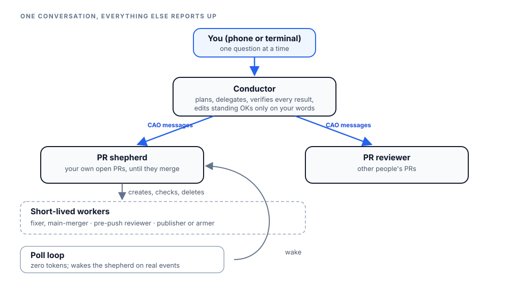
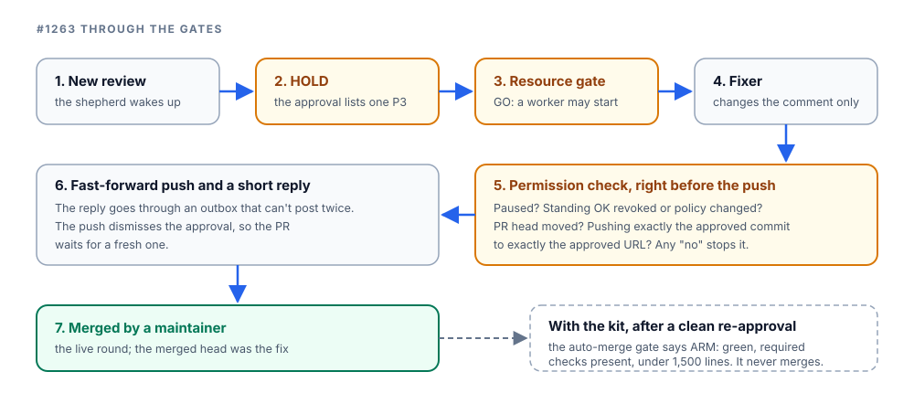

On 9 November I ran my coding work from my phone. Over one conversation I gave one agent several unrelated jobs, and all of it cost me a few one-line answers.

The day started with a handover. The conductor I'd been talking to had passed its work to a new one, and written everything down in a file: the open pull requests, who was waiting on whom, and the rules that had bitten us. The new conductor read it, started its two helpers, and wrote a short file back to say it had taken over. The old one was watching for that file.

Its first check was the machine. The resource gate read THROTTLE: memory pressure at warning, 22 GiB of swap, a busy CPU and four live agent terminals. So the rule was one new agent at a time.

Then I started handing it work. Get Kiro CLI 3.1.0 ready to use, with a status comment for the issue that tracks it. Give me a guide an agent could follow to set up ephemeral agents and the Jev decider.

The conductor gave each job to its own short-lived agent, checked each result, and caught their mistakes before they reached me. My part was a few one-line answers on my phone: yes, test it; yes, file it.

That's what I mean by a dark factory: a factory that runs with the lights off. In my words: "This super agent is a piece of art, turn my daily coding work into a code dark-factory." Mine is built on [CAO](https://github.com/awslabs/cli-agent-orchestrator), the open-source CLI agent orchestrator.

{/* truncate */}

## Why I watch only one agent

Running many agents, I can hold three to five issues in my head at most.

So I stopped trying to watch every agent. All my attention goes to **one** agent, the conductor. It holds everything else, and CAO is what makes that work:
- the conductor hands each job to a short-lived agent sized to it;
- a shepherd agent looks after my own pull requests;
- a reviewer agent reviews other people's;
- my standing OKs are written as data, not prose;
- a zero-token poll loop and a resource gate keep it running day and night.

## What the conductor caught that day

Kiro CLI 3.1.0 is installed on my laptop, but CAO refuses Kiro v3 helpers on that version by default. A person has to run a 19-check checklist on it live first. That run is mine, so the conductor had an agent write me a step-by-step runbook for it.

The runbook said CAO adds its own MCP server to an installed agent at launch. The conductor didn't take its word. It copied a built-in profile, installed the copy into a scratch folder, and read the file CAO produced. The server was there because the profile declares it, not because anything adds it at launch. The ten test profiles in the draft didn't declare it, so several checks would have failed for the wrong reason.

Two more catches came out of the same check:
- **Shell access.** The two test agents meant to show "no file writes" and "no web access" still had a shell, which can do both legitimately. I would have read a shell write as a FAIL. Those two lost the shell.
- **A leaky clean-up step.** It used a command that prints every matching process's environment, tokens included. The fix uses checks that print no values.

The guide was a different kind of catch. It already existed: a docs page merged the day before. So the conductor offered to test the page instead, and I said yes.

An agent followed it end to end, the way an agent would for a user. It used a sandbox with its own install and its own server, and it stopped where the page needs my consent. Its verdict was "Yes, with friction", and it found two real gaps:
- the restart check can run before the server is up, so an agent would read a slow start as a failed restart and stop to ask;
- the page calls a key check safe, but Jev's key is stored once per OS user. On a test install next to the real one, the decider's key commands would act on my real key.

The conductor asked me once, then filed the issue. A docs-only fix was written and tested in bash and zsh, and its pull request went up as soon as I said yes.

## The agents behind the conductor

I talk to one agent: the conductor. It plans, writes each task as a brief file, and hands the work to short-lived agents. Each agent reports back in a fixed format, and the conductor checks the result before anything goes public. It's the only agent that asks me anything.

Two more long-lived agents report to it, never to me:
- **The PR shepherd** looks after my own open pull requests until they merge. It reads feedback and red CI, decides what needs fixing, and creates the worker that fixes it. Anything outside routine, such as a security question or a force-push, goes to the conductor, which asks me.
- **The PR reviewer** reviews other people's pull requests, at most five a day. The conductor approves each review plan only after checking the PR head and comparing the review scripts with their trusted hashes.

The shepherd's workers are sized to the job and deleted when done: a fixer and a main-merger on Codex, a pre-push reviewer on a large Claude model, and a small Claude agent that publishes replies or arms auto-merge.

*One conversation for me; everything else reports to the conductor.*

This way of working is real. From 6 November until early on 9 November (UTC), my account merged 8 pull requests, filed 5 issues, and posted reviews on 6 other people's pull requests.

## One PR's day

The everyday case is small. On 8 November, a maintainer approved #1263, a code-comment change, with one minor wording nit (P3). An approval that lists a finding isn't a green light, so the PR was held.

A fixer changed the comment only, and a check confirmed the code's syntax tree was unchanged. It went out as a fast-forward push with a short reply. The push dismissed the approval, and the next day the maintainer merged it, with that fix as the head.

To be honest about timing: that round ran under my earlier PR watcher, before this kit existed. But the maintainer's real review text became a test fixture, and every later review of the kit replayed it.

*How the kit would handle #1263's real review. The live round used the earlier watcher and ended in a maintainer's merge.*

## Rules written as code, not prompts

An agent can talk itself past a rule in a prompt. So the checks for permissions, resources and auto-merge are small scripts with explicit results. Every worker must re-run the permission check right before each push, post or arm, so a pause, a revoked OK or a moved PR head stops it.

My standing OKs are data: eight records, each saying who holds it, what action it covers, and its scope. A revoked OK stays in the file, marked revoked. Only the conductor edits that file, only on my words, and it bumps the policy version every time.

Some things always need me: force-pushes, new pull requests or issues, closing anything, merging outside the gate, security decisions, other GitHub text, releases, and keys. A one-off OK from me is bound to that exact action, target and content, and expires soon.

The auto-merge gate arms a PR only when the approval covers the last real commit, nothing since then lists findings, every required check is present and green, GitHub answered clearly which checks are required, and the PR changes no more than 1,500 lines. Even then it only arms GitHub's own auto-merge; it never merges itself.

Outside text has a fixed place too. CAO's own policy comes first, then the agent's profile, my standing OKs, my messages and other agents' reports. PR comments, CI logs and web pages come last: they're data, and can never grant a permission.

## Keeping a 32 GB laptop alive

All of this runs on a 32 GB laptop. In my words: "Too many resource would lead the machine dead and entire workflow failed. Which is unbearable."

So an agent runs the resource gate before it creates a worker, approves a review plan or starts a full test suite. It reads memory pressure, free memory, swap, disk, load and the number of live agent terminals, then prints GO, THROTTLE or STOP:
- **STOP:** nothing new starts. That happens at critical memory pressure, under 15% free memory, under 20 GiB of free disk, or at seven live terminals.
- **THROTTLE:** one small worker at a time. If no STOP condition applies, warning pressure, under 30% free memory, above 16 GiB of swap, under 40 GiB of free disk, load above 1.2 per CPU, or four or more live terminals triggers it.

A reading it can't trust counts as THROTTLE, never GO. That rule came from a review: the first version treated a memory-pressure reading of 0 or −1 as healthy.

Full test suites and review runs share one "heavy" slot, held with a secret token, so only one runs at a time. And the agents never kill or pause anything they didn't start.

## Waking up only for the right things

I asked the poll loop to "pick the feedback and CI status from the PR that I owned and the pr that we reviewed have an update."

So it wakes for feedback, CI that needs action, review decisions, conflicts and state changes on my PRs, and for new commits, replies and state changes on PRs we reviewed. A PR falling behind main wakes it only when approved or already armed. Everything else goes into a digest that rides with the next wake; if its oldest line waits more than 24 hours, the digest causes one wake itself.

Replayed over 118 recorded polls, the old rules woke 25 times and the new ones 26. Four noisy wakes were dropped, five missed ones appeared (new commits on PRs we had reviewed), and 188 lines went to the digest instead of waking anyone. The win is the right wake-ups, not fewer.

## What running day and night needs

Agents crash, laptops reboot, and conductors get replaced. Five habits keep the factory going.

**Restart recovery.** Both agents run a restart routine before anything else. For each action that may or may not have happened, oldest first, they check git, GitHub, the outbox and the log before repeating it. Every post is reserved in an outbox first, so nothing goes out twice, and wakes replay from a journal.

**Handover files.** A conductor's memory is one long conversation, so a handover is a file. On 9 November the old conductor stopped its poll loop first, because only one may run. The new one started the shepherd, which started exactly one loop, and wrote its own file back.

**Pause and resume.** I say "pause" and every push, post and arm stops. It holds across restarts until I say "resume", and held work is re-checked before anything goes out.

**Observe, then act.** The shepherd starts in observe mode. Instead of acting, it proposes a "WOULD …" action, and the conductor answers GO or NO. Switching it to act mode is my call, after watching a few proposals.

**One question at a time.** Only the conductor asks me anything, one question per message, so each fits on my phone. I answer over Telegram, and the conductor stays quiet when nothing has changed.

## What we took from DeepSeek's super agent

At the start of November, DeepSeek published a [super-agent research prototype](https://github.com/deepseek-ai/dsh-superagent-prototype) and a [design article](https://x.com/DeepSeekHarness/status/2116857257245987236): one always-on router plus one worker per ticket, answering with pull requests. Its README calls it research code.

**What we took:** batching the inbox; a code filter before any model call; standing OKs as records; observe mode first; an outbox that can't post twice; a pause that survives a restart; a written restart routine; and the rule that outside text is data.

**What we adapted:** their rule that an approval must cover the head commit, and their PR size cap, enforced in code. Theirs live in prompt text; their docs say "These instructions govern the agent, not GitHub's merge rules."

**What we didn't take:** workers that act without approval as the operator's own user; "fix before anyone asked" pull requests; long-lived sessions per ticket (we prefer fresh agents); and one fixed model per role (we size each task). Their only published evaluation is a small synthetic test that they call "indicative only", so I don't quote any numbers from it.

## The seven reviews before the install

Independent reviewers, who hadn't written the kit, worked read-only and reproduced each finding before reporting it. Over 8 and 9 November they returned seven NOT-READY verdicts, then READY: 17 serious (P1) findings, 12 P2s and one P3 in all.

The worst was a push. Before pushing, the kit asked git where `origin` *fetches* from, but `git push` goes wherever the *push* URL points, and git lets those differ. A reviewer pointed the push URL at a second scratch repository, and the push landed there. The fix compares every push destination with the one URL in my standing OKs and refuses anything else.

Others: a publisher that crashed after posting could let a second one post the same reply; damaged records could turn a revoked permission back on; and a finding on an older commit slipped past the gate.

The tests grew with the reviews: 138 kit tests at the first review, 1,291 at the last, plus 100 for the PR watch. Mutation runs break each gate condition on purpose and check that a test notices.

## What it still can't do

The kit is running in observe mode. The shepherd proposes; the conductor says GO.

Every agent runs as the same operating-system user, so the permission and state checks are discipline, not an operating-system boundary. A deliberately forged, well-formed record is out of scope; accidental damage, like a cut-off line, fails closed.

The reviews modelled GitHub merges and message delivery rather than running them live. And the big calls stay with people: I decide every new pull request or issue, every security question, and anything outside my standing OKs. Releases stay the maintainers' call.

## Try CAO

- [CAO on GitHub](https://github.com/awslabs/cli-agent-orchestrator): the orchestrator behind the conductor, the shepherd, the reviewer and their short-lived workers.
- [CAO's ephemeral-agents docs](https://github.com/awslabs/cli-agent-orchestrator/blob/main/docs/ephemeral-agents.md): size one-shot helpers to a task yourself.
- DeepSeek's [super-agent prototype](https://github.com/deepseek-ai/dsh-superagent-prototype) and [design article](https://x.com/DeepSeekHarness/status/2116857257245987236): where several of the ideas above came from.

For the phone half: [herdr-remote](https://github.com/dcolinmorgan/herdr-remote), the open-source project that carries CAO's notifications and approvals over Telegram.

## About the author

Stan Fan (`fanhongy`) is a Solutions Architect at AWS. He works with teams on agentic
systems and developer tooling, with a particular interest in how agents accumulate and reuse
context reliably across sessions, models, and tools, without turning memory into an
unbounded transcript.
