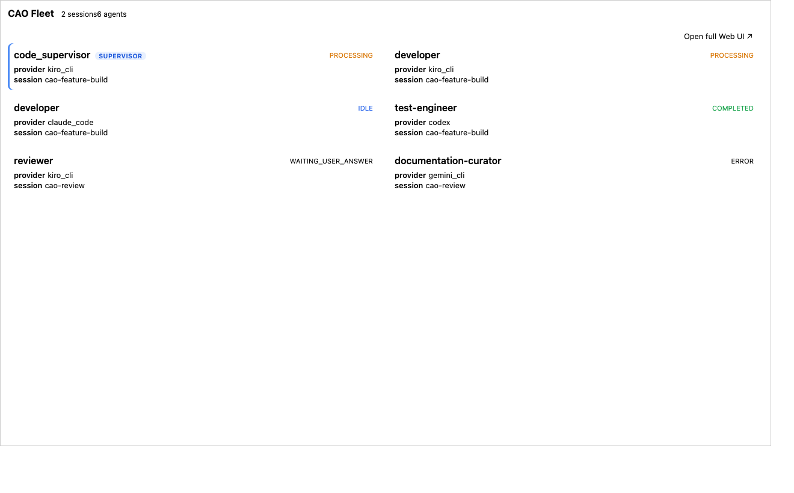

[CAO](https://github.com/awslabs/cli-agent-orchestrator) runs coding-agent CLIs as real processes in tmux sessions, each with its own login and tools. Between 2026-06-28 and 2026-11-19 I added support for three open protocols on those processes, plus a contributor skill: 50 merged pull requests.

## TL;DR

- **MCP Apps** ([#332](https://github.com/awslabs/cli-agent-orchestrator/pull/332), [#346](https://github.com/awslabs/cli-agent-orchestrator/pull/346), [#347](https://github.com/awslabs/cli-agent-orchestrator/pull/347)): sandboxed `ui://cao/*` views to watch and steer a fleet from an MCP App host.
- **AG-UI** ([#436](https://github.com/awslabs/cli-agent-orchestrator/pull/436), [#485](https://github.com/awslabs/cli-agent-orchestrator/pull/485), [#1107](https://github.com/awslabs/cli-agent-orchestrator/pull/1107), [#1111](https://github.com/awslabs/cli-agent-orchestrator/pull/1111), [#1115](https://github.com/awslabs/cli-agent-orchestrator/pull/1115), [#1117](https://github.com/awslabs/cli-agent-orchestrator/pull/1117)): an AG-UI client can approve or deny a real CLI's permission prompt. On `main`, both AG-UI surfaces follow the 1.0 rules and pass the pinned `@ag-ui/client` verifier ([#1198](https://github.com/awslabs/cli-agent-orchestrator/pull/1198), [#1232](https://github.com/awslabs/cli-agent-orchestrator/pull/1232), [#1243](https://github.com/awslabs/cli-agent-orchestrator/pull/1243), [#1267](https://github.com/awslabs/cli-agent-orchestrator/pull/1267)), and an operator dashboard reads them ([#1248](https://github.com/awslabs/cli-agent-orchestrator/pull/1248)).
- **Agent Plugins** ([#584](https://github.com/awslabs/cli-agent-orchestrator/pull/584)): CAO installs Agent Plugins 1.0.0 packages and publishes itself as two in 2.5.4. A third, [#1200](https://github.com/awslabs/cli-agent-orchestrator/pull/1200), is in the v2.5.5 tag, and so is `cao plugin validate` reporting Agent Skills limits ([#1236](https://github.com/awslabs/cli-agent-orchestrator/pull/1236)). The surface is gated closed; its graduation decisions are open in [#1393](https://github.com/awslabs/cli-agent-orchestrator/issues/1393).
- **Contributor skills** ([#448](https://github.com/awslabs/cli-agent-orchestrator/pull/448), [#1121](https://github.com/awslabs/cli-agent-orchestrator/pull/1121), [#1197](https://github.com/awslabs/cli-agent-orchestrator/pull/1197), [#1343](https://github.com/awslabs/cli-agent-orchestrator/pull/1343), [#1369](https://github.com/awslabs/cli-agent-orchestrator/pull/1369)): `cao-contributing` teaches CAO's dev loop, and CI fails when it stops matching the repository or when an installed skill's relative links leave its directory.
- **Release status** (checked 2026-11-23): 13 of the 50 merged PRs are in PyPI release 2.5.4. All 50 are in the v2.5.5 tag (`e2f2978c`, 2026-11-23), including the AG-UI round-trip fix (#1107), the CAO Dojo page (#1111) and all the AG-UI 1.0 work. v2.5.5 is tagged and PyPI is pending: PyPI's latest is still 2.5.4.

{/* truncate */}

## The problem: real CLIs versus protocol adapters

A protocol adapter in an agent framework calls the agent as a library, so a permission prompt is whatever the adapter says it is. In CAO, each agent is a full provider CLI in its own terminal. CAO reads the terminal to tell whether the agent is idle, busy or waiting, and types into it to answer the CLI's own permission dialog. That makes three things harder:

1. A protocol event must map onto something a real process did, read from its terminal.
2. An answer the CLI can't accept must be refused before CAO types anything, because a keystroke into a live dialog can't be undone.
3. A demo is worth publishing only if a test drove the real path and asserted on it.

## MCP Apps: the fleet inside the host

### What shipped

[#332](https://github.com/awslabs/cli-agent-orchestrator/pull/332) added MCP Apps support, built on SEP-1865: three sandboxed `ui://cao/*` views (a dashboard, a per-agent view and an event stream; a graph view came later, in [#442](https://github.com/awslabs/cli-agent-orchestrator/pull/442)) plus a topology widget, off by default behind `CAO_MCP_APPS_ENABLED`. [#346](https://github.com/awslabs/cli-agent-orchestrator/pull/346) upgraded the frontend toolchain and restored a 90% coverage floor. [#347](https://github.com/awslabs/cli-agent-orchestrator/pull/347) moved the docs to the stable 2026-01-26 spec and let the dashboard ask the host to open the full Web UI (`ui/open-link`) or change display mode, where the host allows it.

All three PRs are in 2.5.4, but **the 2.5.4 wheel I checked (macOS arm64) does not contain the built views.** Its `ext_apps/apps_static/` directory is empty, so `cao-mcp-server` logs "apps_static/ not found (frontend not built)" and registers no `ui://cao/*` resource. Only the topology widget, which needs no build, works. The release workflow on `main` (`79aa1a36`) still has no MCP Apps build step, so build the views yourself ("Try it").

### Evidence


*The `ui://cao/dashboard` view, captured in CAO's e2e host harness by `cao_mcp_apps/scripts/record-demo.mjs`, not in a real MCP App host. File as on `main` at `ab9bbaab`.*

### The gate

`CAO MCP Apps` fails below the 90% frontend coverage floor, and `CAO MCP Apps E2E (Playwright)` drives the dashboard, agent and event-stream views. `test/test_http_only_boundary.py` guards the HTTP-only boundary.

## AG-UI: the operator answers a real CLI's prompt

### What shipped

[#436](https://github.com/awslabs/cli-agent-orchestrator/pull/436) is the first layer. `GET /agui/v1/stream` turns fleet events into typed AG-UI server-sent events (`STATE_SNAPSHOT`, `STATE_DELTA`, `?since=` replay). Agents can emit UI only from an allow-list of six components, `approval_card`, `choice_prompt`, `diff_summary`, `progress`, `metric` and `agent_card`; anything else is refused. It also added `mock_cli`, a credential-free provider for CI. It is off by default behind `CAO_AGUI_ENABLED`.

[#485](https://github.com/awslabs/cli-agent-orchestrator/pull/485) is the second. `POST /agui/v1/run` speaks the stock AG-UI wire dialect with interrupt and resume. It added four constructs (supervisor dashboard, session timeline, handoff with approval, cross-provider state sync), the `[agui]` extra, and an example on the stock `@ag-ui/client`.

Both are in 2.5.4, where a run does not finish after a resume. Four follow-ups fix that. They are **not in 2.5.4**; all four are in the v2.5.5 tag, which is not on PyPI yet:

- [#1107](https://github.com/awslabs/cli-agent-orchestrator/pull/1107): after an approve, a deny, or a resume with nothing pending, a stock client now sees `RUN_FINISHED`. It also recognises Claude Code 2.1.310's Bash and Write permission prompts as interrupts.
- [#1115](https://github.com/awslabs/cli-agent-orchestrator/pull/1115): on a Claude Code permission prompt, an "edit" answer is refused with a 422 or `RUN_ERROR` before anything is typed. Before, it silently approved.
- [#1117](https://github.com/awslabs/cli-agent-orchestrator/pull/1117): a resume sent while the approval bridge is missing gets a 404 instead of a false success, and the run-plane request examples in the docs are now valid bodies.
- [#1111](https://github.com/awslabs/cli-agent-orchestrator/pull/1111): the CAO Dojo, a static page where an operator approves or rejects a real agent's permission prompt over AG-UI.

I don't claim "edit" for any provider. Claude Code refuses it by design. Kiro edit is covered by CAO's unit tests; CAO runs Kiro with `--trust-all-tools`, so no live approval exists to edit.

### Evidence

In a run on the author's machine, a real Claude Code agent asked to write one file. The dashboard showed a pending approval and a test that failed because the file did not exist. After a browser test script clicked Approve, the agent wrote the file and the test passed. The dashboard does not report which decision was applied: the file and the test prove the approve, and the pane text proves the deny. A declined second request left no file.

That run and its screenshots are not in the repository, so this account cannot be checked from a clone. What is in the repository is the CAO Dojo (`examples/ag-ui/cao-dojo/`), its recorded and scrubbed trace (`examples/ag-ui/cao-dojo/trace/`) and the local end-to-end script `examples/ag-ui/cao-dojo/tools/e2e-local.sh`, which drive the same approve and reject path.

### The gate

`AG-UI demo (shift-left recording)` asserts that each allow-listed component renders and an off-list one is refused. `AG-UI construct demos (shift-left recordings)` records the four constructs offline, with no real CLI. `AG-UI stock-client live (AC3)` drives the run plane with the stock client.

`test/api/test_agui_run_finishes.py` covers `RUN_FINISHED` after a resume and the missing-bridge 404; `test/services/agui/test_claude_code_permission_options.py` covers the refused "edit".

One gap: the CAO Dojo's end-to-end test, `examples/ag-ui/cao-dojo/tools/e2e-local.sh`, runs locally, not in CI.

### Shipped on `main`: the AG-UI 1.0 rules and an operator dashboard

[#1198](https://github.com/awslabs/cli-agent-orchestrator/pull/1198) (2026-11-04, `8bf6e8f0`) brought the run plane to 1.0: `RUN_STARTED` declares `protocolVersion: "1.0"` (asserted by `test/services/agui/test_run_plane_protocol_version.py`), CAO's `GENERATIVE_UI` frame becomes `CUSTOM cao.generative_ui`, an unknown resume entry is skipped with a warning instead of failing the run, and the `[agui]` extra pins the 1.0.x SDK.

[#1232](https://github.com/awslabs/cli-agent-orchestrator/pull/1232) (2026-11-06, `7ad7df76`) did the same for the ambient stream, and it is a breaking change. `GET /agui/v1/stream` is now one AG-UI 1.0 run per connection, with `data:`-only frames, and each session and terminal is a `SUBAGENT_*` invocation with a `subagentRunId` that is never reused. `POST /agui/v1/stream` serves the same run to a stock `HttpAgent`; the old wire stays available behind `?framing=cao-legacy`, with a `Deprecation` header. The run plane gained `GET /agui/v1/capabilities`, and its interrupts now carry the `subagentRunId` of the terminal that asked. [#1243](https://github.com/awslabs/cli-agent-orchestrator/pull/1243) stops the stream announcing a sender that isn't a real terminal (the operator, or an unknown id) as a subagent; [#1267](https://github.com/awslabs/cli-agent-orchestrator/pull/1267) closed the review follow-ups.

The check is the pinned upstream verifier. `examples/ag-ui/ag-ui-stock-client-live/verify-ambient.mjs` runs `@ag-ui/client`'s `verifyEvents` over the conformance captures from `test/api/test_agui_stream_conformance.py`, and drives a live `HttpAgent` run against `POST /agui/v1/stream`; the `AG-UI stock-client live (AC3)` job runs both.

[#1248](https://github.com/awslabs/cli-agent-orchestrator/pull/1248) (2026-11-08, `c690e21a`) added `examples/ag-ui/ag-ui-operator-dashboard/`, a React page, with no server-side change, that reads those two surfaces and answers approvals only through the run plane. Approval cards come only from the run plane's interrupts, so an `approval_card` frame on the ambient stream can't fake one. Decisions go back as one `resume[]`, and **Edit** appears only when the interrupt's schema accepts edited arguments.

[#1233](https://github.com/awslabs/cli-agent-orchestrator/pull/1233) (2026-11-11, `a89cee45`) delivered [#1116](https://github.com/awslabs/cli-agent-orchestrator/issues/1116): a recorded, scrubbed CAO Dojo trace with leak and drift guards, a recorder with keyless `--mock` and `--offline` modes, and a fourth Agent Plugin, `cao-ag-ui-builder` (name provisional). The dashboard also gained a session timeline ([#1293](https://github.com/awslabs/cli-agent-orchestrator/pull/1293)), which a browser test now checks in CI with the six components ([#1297](https://github.com/awslabs/cli-agent-orchestrator/pull/1297)), and shows off-list `emit_ui` refusals from a metadata-only record ([#1295](https://github.com/awslabs/cli-agent-orchestrator/pull/1295)); the stream now ends a call that a reconnect skipped ([#1296](https://github.com/awslabs/cli-agent-orchestrator/pull/1296)).

None of this is in 2.5.4, which still emits named SSE events and `GENERATIVE_UI` frames (not an AG-UI 1.0 event type) and declares no `protocolVersion`. All of it is in the v2.5.5 tag.

Upstream, [ag-ui-protocol/ag-ui#2216](https://github.com/ag-ui-protocol/ag-ui/pull/2216) was open and awaiting review on 2026-11-23. It would add `@ag-ui/cli-agent-orchestrator`, an `HttpAgent` subclass, and one Dojo feature, `tool_approval`.

### Shipped on main: the L3 fleet view (#1312)

[#1312](https://github.com/awslabs/cli-agent-orchestrator/pull/1312) merged on 2026-11-13 as `367f53f3` and added a Fleet panel to the operator dashboard: terminals grouped by runner, each with its live status and profile, and the host's load. It also shipped a dashboard stylesheet and a raw event inspector for recorded traces.

Limits: `runner_id` is always `null` on `main` (remote runners are on `3.0-beta1`, #1298), so grouping by runner is only exercised with synthetic data in the dashboard's tests, and the real remote path is unverified. Tenant scoping of the catalog waits on #778. Since #1312 merged, #1233's published Dojo trace is stale until re-recorded with a logged-in provider CLI.

### Self-hosting

CAO's AG-UI layer (ambient stream and run plane) implements the AG-UI protocol, whose reference repository is MIT-licensed. It runs inside `cao-server` on your machine, with the open-source `ag-ui-protocol` Python package as its AG-UI dependency (the `agui` extra). Install `main` with the extra, set `CAO_AGUI_ENABLED=1` (the surface is off by default), start `cao-server`; routes: `/agui/v1/stream`, `/agui/v1/run`, `/agui/v1/capabilities`, `/agui/v1/emit_ui` and `/agui/v1/interrupts/{interrupt_id}/resume`.

## Provider nuance: one protocol, different approval behaviour

AG-UI gives every provider the same interrupt lifecycle. What reaches it depends on how CAO launches each CLI:

| Provider | CAO's default launch | Can a profile bring prompts back? |
|---|---|---|
| Kiro CLI | `--trust-all-tools` | no |
| Antigravity CLI | `--dangerously-skip-permissions` | no; `permissionMode` isn't read |
| Claude Code | `--dangerously-skip-permissions` | yes, with `permissionMode` |

Under `--trust-all-tools`, Kiro CLI never stops for a tool approval; CAO answers its one startup consent dialog itself. Antigravity's flag skips tool approvals but not its workspace-trust dialog, which CAO's classifier doesn't know. Claude Code's card offers approve and deny, so "Try it" uses it.

## Agent Plugins: CAO installs packages and ships as one

[#584](https://github.com/awslabs/cli-agent-orchestrator/pull/584) added Agent Plugins 1.0.0 support: CAO manages packages with `cao plugin add`, `validate`, `list` and `remove`, and publishes `agent-plugin/cao` and `agent-plugin/cao-contributor` in 2.5.4. The surface is gated closed behind `CAO_AGENT_PLUGINS_ENABLED`.

See [the Agent Plugins post](../2026-11-22-agent-plugins-in-cao/index.md) for install steps.

## Contributor skills: easier to work on, for people and agents

### What shipped

[#448](https://github.com/awslabs/cli-agent-orchestrator/pull/448) added `cao-contributing`, a skill that teaches CAO's dev loop, which CI checks block, and the pre-PR checklist. It is in the 2.5.4 wheel.

[#1121](https://github.com/awslabs/cli-agent-orchestrator/pull/1121) added a dependency and lockfile section and put `cao-contributing` inside the `cao-contributor` agent plugin; [#1197](https://github.com/awslabs/cli-agent-orchestrator/pull/1197) applied its review follow-ups. [#1343](https://github.com/awslabs/cli-agent-orchestrator/pull/1343) (`a6f77303`, merged 2026-11-16, closing [#1342](https://github.com/awslabs/cli-agent-orchestrator/issues/1342)) and [#1369](https://github.com/awslabs/cli-agent-orchestrator/pull/1369) (`58aea18b`, merged 2026-11-17, closing [#1365](https://github.com/awslabs/cli-agent-orchestrator/issues/1365) and [#1366](https://github.com/awslabs/cli-agent-orchestrator/issues/1366)) fixed relative links in `cao-mcp-apps`, `cao-session-management` and `cao-session-liveness` that resolved in a repository checkout but dangled once a skill was installed on its own, fixed a contradictory `409` catch in `cao-workflow` and four trigger descriptions, and fixed `skills/cao-mcp-apps/scripts/validate.sh` so `/events` and `/agui/v1/stream` stream checks read `200` or `404` instead of concatenating curl's fallback `000` into `200000` or `404000`. All four are in the v2.5.5 tag, not in 2.5.4.

### Evidence and gate

`test/test_cao_contributing_skill_accuracy.py` pins the skill's claims to the repository, so CI fails when one stops being true; #1121 added `TestDependencySectionMatchesTheRepo` for the new section. `test/test_skill_packaging_parity.py` covers packaging, and #1369 taught `scripts/validate_markdown_links.py` to reject any relative link under `skills/<name>/` that resolves outside `skills/<name>/`.

#448 drew 17 non-author review submissions, the most of the 50, from maintainers, contributors and a review bot, and it was approved by a maintainer.

## The 50 merged PRs

Related follow-ups were consolidated into fewer, larger PRs per reviewer: [#1312](https://github.com/awslabs/cli-agent-orchestrator/pull/1312) absorbed [#1311](https://github.com/awslabs/cli-agent-orchestrator/pull/1311), [#1314](https://github.com/awslabs/cli-agent-orchestrator/pull/1314), [#1317](https://github.com/awslabs/cli-agent-orchestrator/pull/1317) and [#1318](https://github.com/awslabs/cli-agent-orchestrator/pull/1318); [#1369](https://github.com/awslabs/cli-agent-orchestrator/pull/1369) folded in [#1371](https://github.com/awslabs/cli-agent-orchestrator/pull/1371).

The 50 merged PRs, at `b784b909` on `main`:

| | |
|---|---|
| Merged PRs | 50 (13 in 2.5.4; all 50 in the v2.5.5 tag) |
| Open PRs | 4 |
| First and latest merge | 2026-06-28 (#333) and 2026-11-19 (#1400) |
| Commits on PR branches | 193, squashed to one per PR on `main` |
| Non-author review submissions | 125: 115 from people, 10 from bots |
| Human reviewers | five maintainers and contributors |
| PRs with at least one human approval | all 50 |

Authorship: plauzy is the git author of 50 commits on `main` at `b784b909`, one squash commit for each PR counted here, and 40 of them carry the trailer `Co-authored-by: Kiro Agent`. The other 10 have none. My CAO contributions were made with the Kiro CLI. None of this is a claim about Kiro's quality or rank; it says how the work was built. GitHub signs the squash commits; the author-signed commits are on the PR branches.

Ten merged PRs were CI, security and build hygiene: [#333](https://github.com/awslabs/cli-agent-orchestrator/pull/333), [#435](https://github.com/awslabs/cli-agent-orchestrator/pull/435), [#452](https://github.com/awslabs/cli-agent-orchestrator/pull/452), [#456](https://github.com/awslabs/cli-agent-orchestrator/pull/456), [#574](https://github.com/awslabs/cli-agent-orchestrator/pull/574), [#576](https://github.com/awslabs/cli-agent-orchestrator/pull/576), [#1119](https://github.com/awslabs/cli-agent-orchestrator/pull/1119), [#1211](https://github.com/awslabs/cli-agent-orchestrator/pull/1211), [#1302](https://github.com/awslabs/cli-agent-orchestrator/pull/1302) (`69c6b7d9`, taking `apt` off the browser jobs' critical path) and [#1400](https://github.com/awslabs/cli-agent-orchestrator/pull/1400) (`79b53ad0`, which makes `Dependency Security` block only on findings in code CAO ships). [#1369](https://github.com/awslabs/cli-agent-orchestrator/pull/1369) (`58aea18b`, counted under contributor skills, with [#1371](https://github.com/awslabs/cli-agent-orchestrator/pull/1371) folded in) also pins the Playwright `v1.64.1-noble` image by digest across all five browser jobs and requires every job to pin the same digest in `test/test_playwright_image_matches_lockfiles.py`.

Five more changed the test suite and terminal status monitor: the suite runs against a throwaway home ([#1231](https://github.com/awslabs/cli-agent-orchestrator/pull/1231)) and a private tmux server ([#1245](https://github.com/awslabs/cli-agent-orchestrator/pull/1245)), so a test can't touch the developer's provider configs, CLIs or sessions; [#1251](https://github.com/awslabs/cli-agent-orchestrator/pull/1251) stops orphaned `pipe-pane` writers; [#1256](https://github.com/awslabs/cli-agent-orchestrator/pull/1256) closes every SQLite connection CAO opens directly, which ended the suite's EMFILE failures; and [#1322](https://github.com/awslabs/cli-agent-orchestrator/pull/1322) (`470348ae`, closing [#1321](https://github.com/awslabs/cli-agent-orchestrator/issues/1321)) maps HPA (`CSI n \``) in `StatusMonitor`'s `pyte` stream subclass so `agy` footers land on the right row instead of leaving a stale `"esc to cancel"` line below the live `"? for shortcuts"` footer. #1231 also fixed a terminal-emulation bug that left Antigravity stuck on startup.

## Limits

The recording, the counts and the provider behaviour are from one machine, at the commits and versions named. Figures marked with a date are as of that date and will change.

## Try it

You need tmux 3.3 or later, [uv](https://docs.astral.sh/uv/), and one logged-in provider CLI.

**Compatibility:** this post describes `main`. The latest PyPI release is 2.5.4 (checked 2026-11-23), and it predates 37 of the 50 PRs. v2.5.5 is tagged and contains all 50, but PyPI is pending. On 2.5.4 you can run the ambient AG-UI stream in its pre-1.0 form, add, list and validate the `cao` plugin, and build the MCP Apps views from a checkout.

**Install 2.5.4 from PyPI:**

```bash
uv tool install 'cli-agent-orchestrator[agui]==2.5.4'
```

**Or install `main`** (Python 3.11+):

```bash
uv tool install 'cli-agent-orchestrator[agui] @ git+https://github.com/awslabs/cli-agent-orchestrator.git@main' --upgrade
```

**AG-UI ambient stream.** Start the server, then watch:

```bash
CAO_AGUI_ENABLED=1 cao-server
```

```bash
curl -N http://localhost:9889/agui/v1/stream
```

**Approve or deny a real agent's prompt from a browser**, with the CAO Dojo page from a clone (the approver profile needs a logged-in Claude Code). Serve it:

```bash
cd examples/ag-ui/cao-dojo && python3 -m http.server 8790 --bind 127.0.0.1
```

Start a server in a throwaway CAO home (`CAO_HOME_DIR`):

```bash
export CAO_HOME_DIR="$(mktemp -d)"
CAO_AGUI_ENABLED=1 CAO_CORS_ORIGINS=http://localhost:8790 cao-server --host 127.0.0.1 --port 9890
```

In a third shell with the same `CAO_HOME_DIR`, launch the approver:

```bash
export CAO_API_HOST=127.0.0.1 CAO_API_PORT=9890
cao install examples/ag-ui/cao-dojo/dojo-approver.md
cao launch --agents dojo-approver --session-name dojo-demo --working-directory "$(mktemp -d)" --headless --auto-approve --async "Do your task now."
```

This launches a real Claude Code agent under your real `HOME`, and Claude Code may add a project folder, history and config entries there.

Open `http://localhost:8790/index.html`, set the endpoint to `http://127.0.0.1:9890`, click **Connect**, then **Approve** or **Reject**. Tear down:

```bash
cao shutdown --session cao-dojo-demo
```

**MCP Apps views.** Build them from a checkout with `uv sync` and `(cd cao_mcp_apps && npm ci && npm run build:all)`, start `CAO_MCP_APPS_ENABLED=true uv run cao-server`, and point an MCP App host at `uv run cao-mcp-server`.

With no credential configured, the surface, `submit_command` mutations included, uses CAO's unauthenticated, localhost-only trust model; `CAO_AUTH_JWKS_URI` and `CAO_AUTH_AUDIENCE` add authorization.

See [`docs/mcp-apps.md`](https://github.com/awslabs/cli-agent-orchestrator/blob/main/docs/mcp-apps.md), [`docs/agui.md`](https://github.com/awslabs/cli-agent-orchestrator/blob/main/docs/agui.md) and [`docs/agent-plugins.md`](https://github.com/awslabs/cli-agent-orchestrator/blob/main/docs/agent-plugins.md).

## Where this goes next

CAO sits above the individual CLIs:

- **One surface over many real CLIs.** One AG-UI endpoint reports on every agent, whichever provider's CLI each terminal runs.
- **Native permission prompts become AG-UI interrupts.** A client approves or rejects the same way no matter which CLI asked, and an interrupt whose prompt clears on its own expires without a keystroke.
- **Built for a laptop.** The AG-UI surface is off by default and carries metadata only; message bodies never go on the wire.

What comes next, in order (status as of 2026-11-23):

1. **Graduating the gated `cao plugin` surface**, tracked under [#1154](https://github.com/awslabs/cli-agent-orchestrator/issues/1154) and [#1393](https://github.com/awslabs/cli-agent-orchestrator/issues/1393): on 2026-11-23, all 6 sub-issues of #1154 are closed, including [#1365](https://github.com/awslabs/cli-agent-orchestrator/issues/1365) (closed by [#1369](https://github.com/awslabs/cli-agent-orchestrator/pull/1369)) and [#1384](https://github.com/awslabs/cli-agent-orchestrator/issues/1384) (closed by [#1392](https://github.com/awslabs/cli-agent-orchestrator/pull/1392)). The maintainer decisions in [#1244](https://github.com/awslabs/cli-agent-orchestrator/issues/1244) closed on 2026-11-23 with [#1454](https://github.com/awslabs/cli-agent-orchestrator/pull/1454), which renamed the event-plugin authoring skill `cao-plugin` to `cao-event-plugin`. The graduation decisions in #1393 are still open, and the `cao plugin` surface is still gated closed. [#1428](https://github.com/awslabs/cli-agent-orchestrator/pull/1428) separately made the repository installable as a plugin marketplace for Claude Code and Codex.
2. **The rest of the L3 fleet-operations dashboard** that [#519](https://github.com/awslabs/cli-agent-orchestrator/issues/519) tracks: on 2026-11-23, 20 of its 24 sub-issues are closed, among them the approvals view (#1156, shipped as #1248), the session timeline (#1157), a generative-UI panel that shows an off-list refusal (#1158), the fleet view (#1155, shipped as #1312) and the preservation matrix ([#1160](https://github.com/awslabs/cli-agent-orchestrator/issues/1160)). Open are [#1166](https://github.com/awslabs/cli-agent-orchestrator/issues/1166) (robotics replay) and three items blocked on other work: [#1162](https://github.com/awslabs/cli-agent-orchestrator/issues/1162) and [#1164](https://github.com/awslabs/cli-agent-orchestrator/issues/1164) on the 3.0 tenant model and audit store (#778, #782), and [#1194](https://github.com/awslabs/cli-agent-orchestrator/issues/1194) on A2UI 1.0. The plan on #519 is to move those three under [#777](https://github.com/awslabs/cli-agent-orchestrator/issues/777) once #1166 resolves, and close #519.
3. **CI and status-detection reliability follow-ups** under the tracking epic [#1375](https://github.com/awslabs/cli-agent-orchestrator/issues/1375) (after [#1302](https://github.com/awslabs/cli-agent-orchestrator/pull/1302) and [#1322](https://github.com/awslabs/cli-agent-orchestrator/pull/1322)): on 2026-11-23, 3 of its 5 sub-issues are closed ([#1366](https://github.com/awslabs/cli-agent-orchestrator/issues/1366), the Playwright image digest pin; [#1370](https://github.com/awslabs/cli-agent-orchestrator/issues/1370), taking `tmux` off `apt` in the dashboard job; and [#1341](https://github.com/awslabs/cli-agent-orchestrator/issues/1341), intermittent test failures), with [#1367](https://github.com/awslabs/cli-agent-orchestrator/issues/1367) (idle pane output resetting the status monitor's quiet gate) and [#1393](https://github.com/awslabs/cli-agent-orchestrator/issues/1393) (Agent Plugins graduation) remaining.
