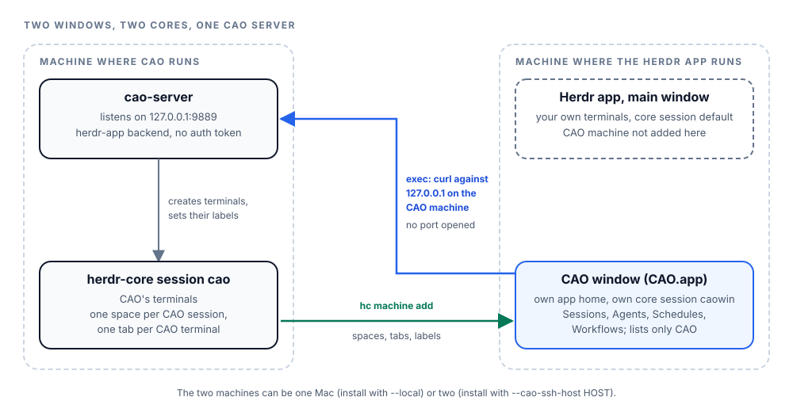
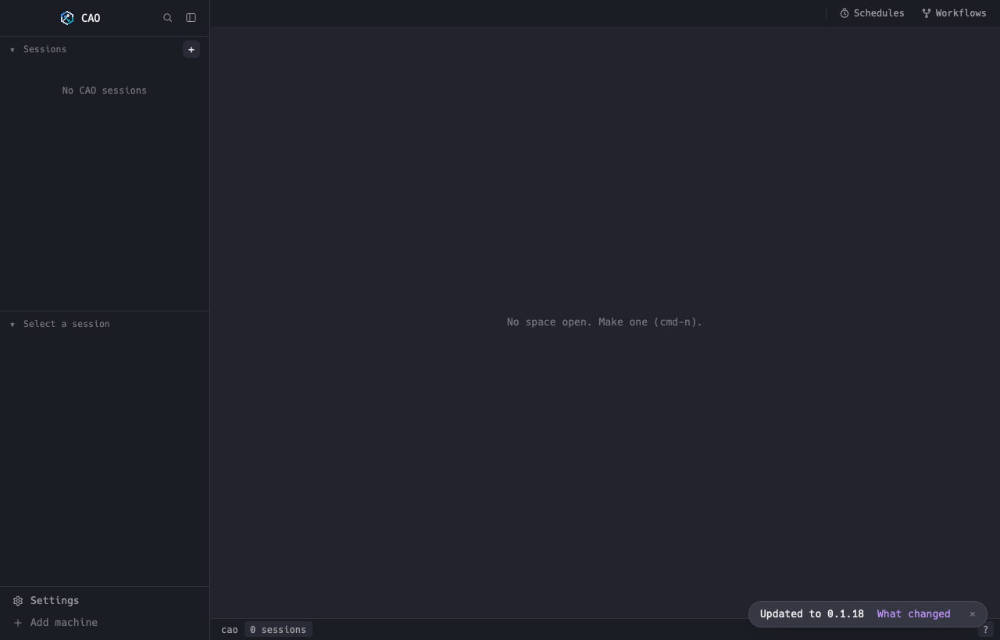
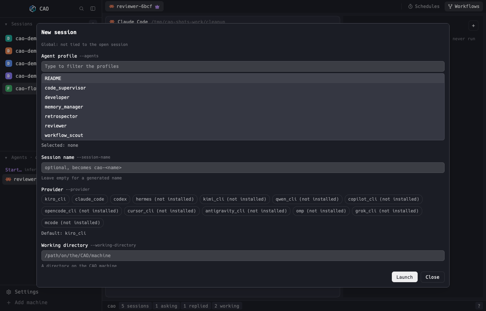
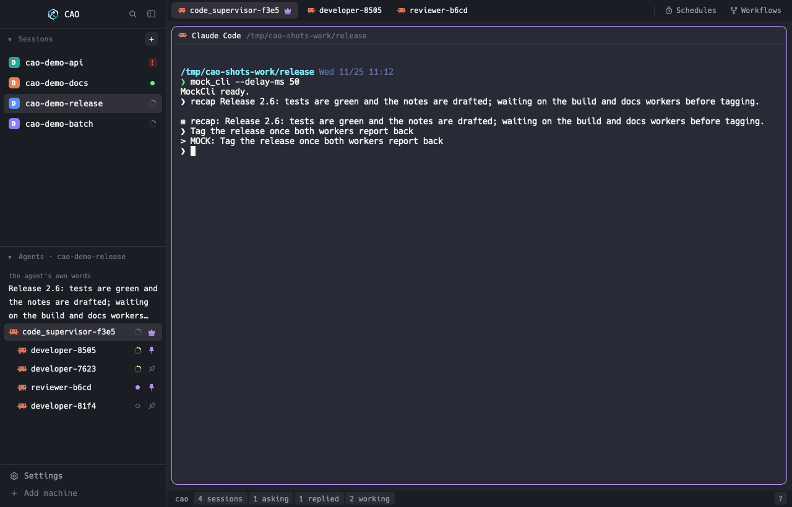
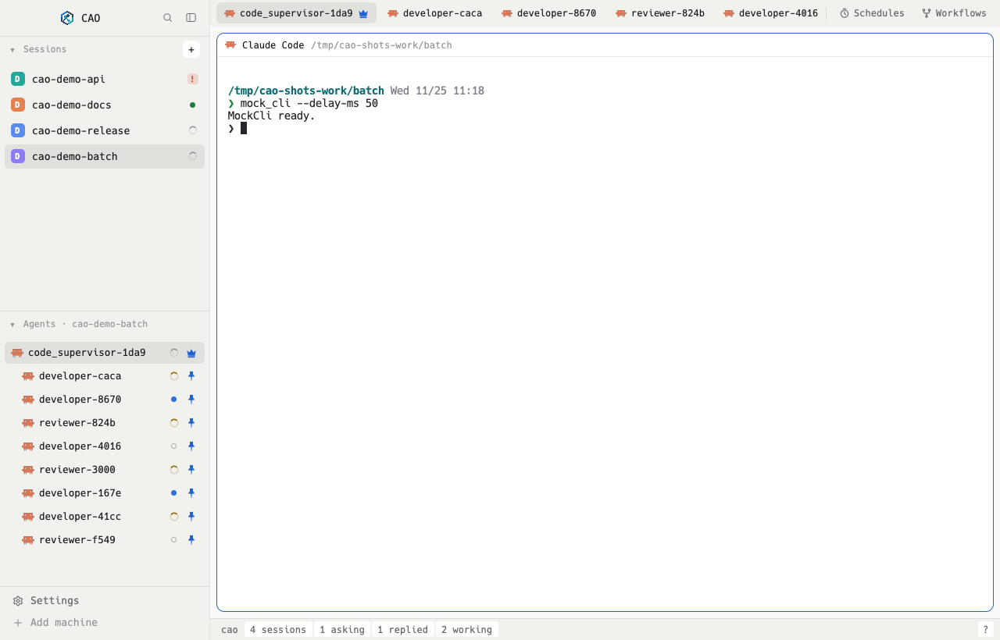
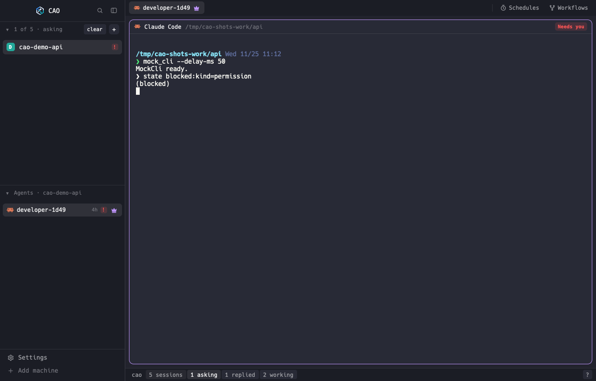
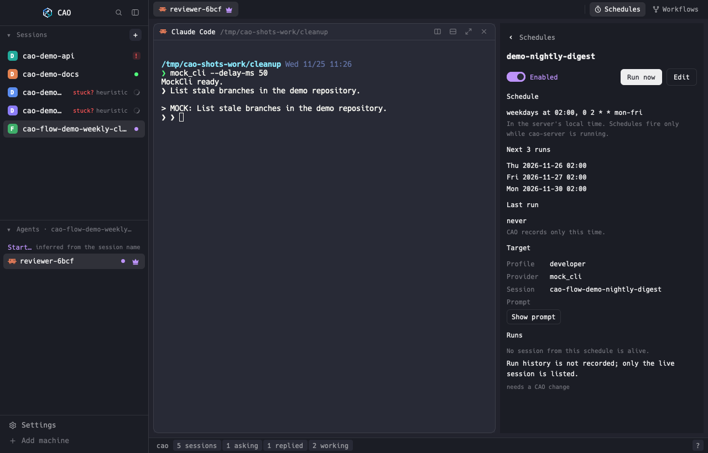
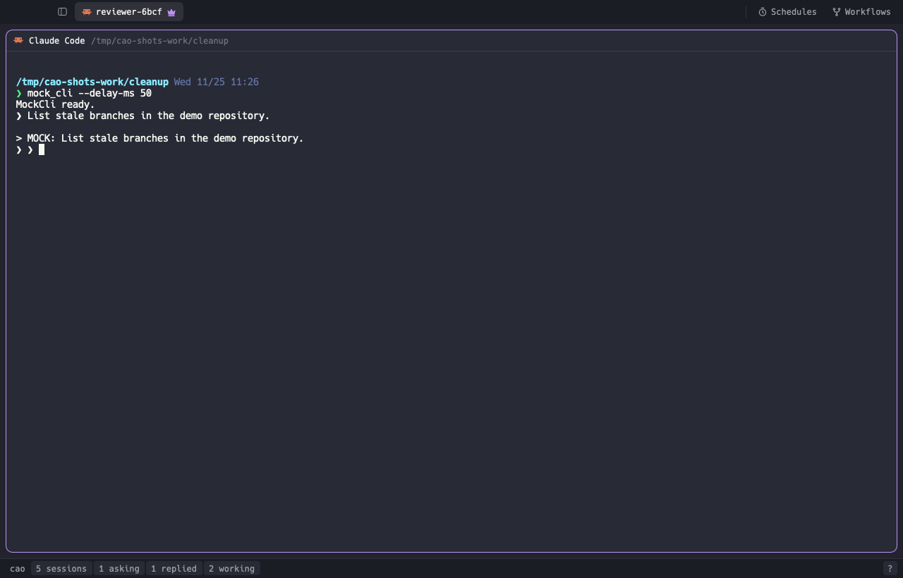
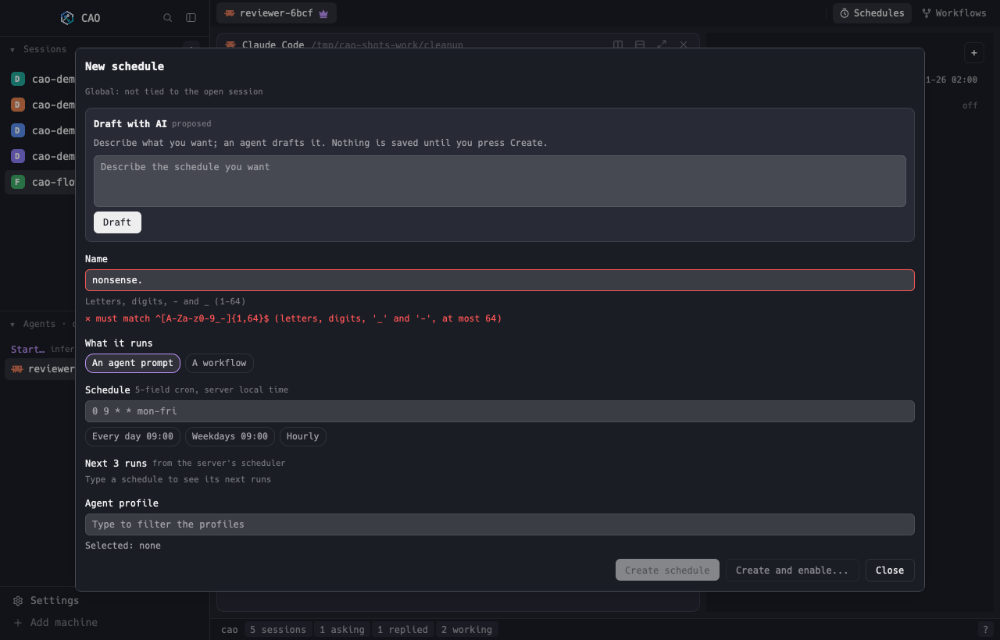
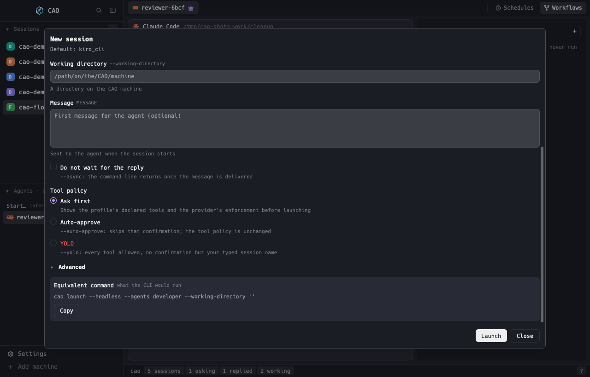

An idle conductor might have finished, or it might be waiting for workers. Herdr's tab strip does not tell you which, especially when CAO shares the window with your own terminals. This walkthrough puts CAO's sessions and agent tree in a separate window.

{/* truncate */}

:::tip TL;DR
The example adds a separate Herdr window for CAO, so you can see which sessions need you and which agents are waiting on workers. It has its own app home and its own core session, and it reaches cao-server through `exec` on the CAO machine, so no port opens. It is macOS only, it needs a cao-server with no auth token, and it is an example, not a release feature.
:::

{/* TODO(anil): record the versions actually tested (Herdr app, hc, CAO release) and replace the line below with "Everything below was run against CAO <release>, Herdr app <version> and hc <version>." */}

This draft describes the example at CAO commit `618ac202`, after v2.5.5. The walkthrough commands have not yet been verified against a released CAO version. The role labels and flow routes the window uses are in [#1504](https://github.com/awslabs/cli-agent-orchestrator/pull/1504), and the window itself is [#1505](https://github.com/awslabs/cli-agent-orchestrator/pull/1505). The screenshots use demo data and mock terminals, not live agent runs. They show the window's layout and controls.

## Too many tabs, one question

With the `herdr-app` backend, each CAO terminal is a tab in the Herdr app. A tab strip does not say who started whom, or who is waiting on whom.

Two things were missing. The first is that CAO's sessions sit among your own terminals, and the main window has no view of CAO's agents, schedules or workflows. The second is subtler. A conductor that has assigned workers and ended its turn looks idle to Herdr. A conductor that has finished also looks idle. Those are not the same state, and you would like to know which one you are looking at.

## Where the agents live

[Herdr](https://herdr.dev) is a terminal session manager. Its desktop app shows terminals as spaces and tabs, and `hc` is the command line of its core, herdr-core. With the `herdr-app` backend, CAO runs its terminals in a dedicated herdr-core session, and the app shows one space per CAO session and one tab per CAO terminal. herdr-core reports each agent's status natively (`working`, `blocked`, `idle`, `done`), so CAO delivers inbox messages from its event stream instead of polling terminal output.

The backend is experimental and opt-in. It is separate from the herdr TUI backend. To turn it on:

```sh
cao config set terminal.backend herdr-app
```

The core session is named `cao` by default, and CAO does not use your `default` session, the one the app opens for your own terminals. The [Herdr app backend page](/docs/features/herdr-app) has the rest: prerequisites, the other ways to enable it, and the label reference.

To see the terminals, add the CAO core as a machine on the machine where the app runs:

```sh
hc machine add <ssh-host> --session cao
```

That works. It also puts CAO in your main window, which is the problem.

## A second window just for CAO

The example in [`examples/herdr-app-cao-window`](https://github.com/awslabs/cli-agent-orchestrator/tree/main/examples/herdr-app-cao-window) is a second app window that lists only CAO. It has its own app home and its own herdr-core session, `caowin` by default. The CAO core is added as a machine to that session, not to your main one.


*Two cores. The CAO window reads the terminals from the cao core, and it calls cao-server only through `exec`.*

Three design choices shape it.

- **Labels, not a new route.** To draw a tree, the window needs each terminal's profile and caller. CAO writes `cao.profile` on each agent terminal, and `cao.caller`, the supervisor's terminal id, on a worker that `assign` or `handoff` creates from a supervisor on the same node. A root terminal has no caller. It also writes `cao.waiting`, the number of workers a terminal waits on. herdr-core already pushes label changes to every client, so a label needs no new endpoint and no polling. Only the `herdr-app` backend writes them. CAO updates the waiting count in the background and rechecks it every 30 seconds, so starting a worker does not wait for the label update.
- **`exec`, not a port.** The window talks to cao-server through `exec` on the CAO machine, against `127.0.0.1`. You open no port and set up no forward. Request bodies are visible in the CAO machine's process list while curl runs. If you enter environment values in New session, Launch is disabled and the dialog shows a `cao launch --env` command to run on that machine instead.
- **A `CAO.app` copy.** The Dock and Cmd+Tab take their name and icon from the app bundle, not from a window, and one Herdr bundle can only be named Herdr. On macOS the installer makes a second bundle. After updating Herdr, rerun the installer to update the copy.

## Set it up

Run the installer on your Mac, with Herdr app 0.1.16 or later, `hc` 0.1.21 or later, `jq`, and the `herdr-app` command-line tool. The CAO host also needs `hc` 0.1.21 or later and a cao-server configured for the `herdr-app` backend without an auth token. If you have not set up CAO yet, start with the [quick start](/docs/getting-started/quick-start).

### Step 1: check what you have

Clone the repository and look at the versions:

```sh
git clone https://github.com/awslabs/cli-agent-orchestrator.git
cd cli-agent-orchestrator/examples/herdr-app-cao-window
hc --version; jq --version; which herdr-app
defaults read /Applications/Herdr.app/Contents/Info CFBundleShortVersionString
```

### Step 2: install

Say where CAO runs. On this Mac:

```sh
sh install.sh --local
```

Or on another machine that `ssh HOST` reaches:

```sh
sh install.sh --cao-ssh-host HOST
```

The installer writes the window's home (`~/.config/herdr-app-cao`), a launcher (`~/.local/bin/herdr-cao`) and, on macOS, `~/Applications/CAO.app`. It fetches nothing from the network and does not change your main window's home. When the installation is already current, a rerun prints `install: up to date`. `sh install.sh --help` lists the options.

### Step 3: open it

```sh
~/.local/bin/herdr-cao
```

Until CAO has a session, the window is quiet. The Sessions list says "No CAO sessions", and the status bar says `cao` and `0 sessions` once the CAO machine is connected.


*The first launch, with no sessions yet.*

### Step 4: start a session

Click the `+` in the Sessions header. The New session dialog takes an agent profile, an optional name, a provider and a working directory on the CAO machine. The profiles are CAO's own ([profiles](/docs/features/profiles)).


*New session, with the profile list open. Providers that are not installed are marked.*

### Step 5: take CAO out of your main window

Once the CAO window works and you have run the [checklist](https://github.com/awslabs/cli-agent-orchestrator/blob/main/examples/herdr-app-cao-window/CHECKLIST.md), remove CAO from your main window. Keeping both connected duplicates alerts and lets both write the same structure document; that arrangement has not been tested. Run these commands in a terminal outside the CAO window, with `HC_SESSION` unset so they address your main core:

```sh
hc machine ls
hc machine rm <name>
```

CAO's terminals keep running.

### Step 6: remove it again

```sh
sh uninstall.sh
```

It removes the launcher and `CAO.app`, stops the window's core, and renames the window's home to `<home>.removed-<epoch>`. It does not touch your main home, CAO's core session or any CAO terminal.

## A tour

Each region of the window has one job.


*Sessions on top, the selected session's agents below, tabs in the top bar, counts in the status bar.*

**Sessions** lists sessions oldest first. Look for the `!` square when a session needs you, or the green dot when it has a reply you have not seen. Hover over the mark for the status in words.

**Agents** shows the selected session as a tree of who started whom. The conductor wears a crown. A worker has a pin, and a pin puts that worker's tab in the top bar. A conductor that is idle only because it waits on workers shows a muted spinner and `waiting on N workers` in its tooltip, which is what `cao.waiting` is for.


*A supervisor with eight workers, all pinned, so each has a tab.*

**The status bar** counts sessions, asking sessions, replies and working sessions. Each count is a button that filters the Sessions list.


*The asking filter, switched on from the status bar.*

The window labels what it guesses. Recaps read "the agent's own words". By default, a worker whose status has stayed working for 10 minutes shows `stuck?`, labelled "heuristic"; it may still be making progress. Where the window needs a CAO change that has not shipped, it says "needs a CAO change".

The Schedules and Workflows buttons open a right sidebar. A click on a row shows that item's details.


*A schedule's details. This frame is from before a header fix, so the Agents block still cuts "Started by schedule" to "Start".*

The fold button next to the search icon hides the left sidebar, like Cmd-B, and a button in the top bar brings it back.


*The sidebar hidden. The terminal gets the room.*

## Run and manage work

**Schedules.** These are CAO's [scheduled flows](/docs/features/scheduled-flows). You can create one disabled, check its next three run times, then enable it when you are ready. You can also edit, disable or run an existing schedule. The schedule checks and editing support were added in [#1504](https://github.com/awslabs/cli-agent-orchestrator/pull/1504).


*An invalid schedule name disables Create schedule before the request is sent.*

The form also warns about a trap. The scheduler counts weekdays from Monday as `0`, so a numeric `1-5` means Tuesday to Saturday. Write `mon-fri`.

**Workflows.** You can run, cancel, resume, create and edit them. A first run that needs plan approval shows the `cao workflow approve` command to run in a terminal. The window has no approve button.

**New session.** Under the form, the dialog shows the equivalent `cao launch` command. It offers three tool policies. Ask first shows the profile's declared tools and the provider's enforcement. Auto-approve skips that dialog. YOLO asks you to type the session name.


*The three tool policies, and the command the CLI would run.*

A broad named list in Advanced, such as `fs_*,execute_bash,web_fetch`, gives the agent as much access as YOLO and skips the typed confirmation. Treat it that way.

**Draft with AI.** It is marked "proposed". It fills a schedule or workflow form from a short-lived author agent that the window deletes afterward. Nothing is saved, enabled or run without your click. Draft with AI needs an author profile configured in `draftProfile`. Follow the README's [author-profile setup](https://github.com/awslabs/cli-agent-orchestrator/blob/main/examples/herdr-app-cao-window/README.md#draft-with-ai-needs-an-author-profile) (its provider restrictions, MCP configuration and working-directory requirement).

## What broke on the way

Review caught several bugs in the server and window. These are the ones that changed code.

**The server did not start.** Some `TZ` settings made the scheduler's time-zone lookup fail during startup. The fix added a fallback; a second review caught that the fallback also needed to account for clock changes. See [#1504](https://github.com/awslabs/cli-agent-orchestrator/pull/1504).

**The fold button.** It asked Herdr for its 76 px rail, and this window's sidebar has a 200 px minimum. The layout held 76 while 200 were drawn, so the top-left row went blank and the sidebar could collapse without leaving a button to bring it back on macOS. The fold button now hides the sidebar, as Cmd-B does.

**curl read `~/.curlrc`.** A line such as `include` in that file put response headers before the JSON, so the window reported a launch as failed even though CAO had started the session, and the next click on Launch could start a second one. `-q` is now the first curl argument, and `--noproxy "*"` keeps a proxy in the environment away from the loopback URL.

**A rerun with another host.** `install.sh` with a new `--cao-ssh-host` recorded the new host in its manifest but left the old machine entry in the window's core, and printed "done". It now replaces the entry in the window's own core and prints one line saying so.

**The asking count.** The status bar counted blocked terminals while the list counted sessions, so the number and the list disagreed. It counts sessions now.

## What it can't do yet

- **It does not work with a cao-server that has auth on.** It shows "CAO requires auth - not supported by this window yet" and disables the write controls.
- **The installer supports macOS only.** On Linux `install.sh` exits with code 4. A Linux machine is fine as the CAO host.
- **Role labels exist only on new terminals.** A terminal created before CAO wrote them, or a plain window that `cao terminal restore` recreates, has none. For those the window asks `GET /terminals/{id}` once per terminal.
- **An older cao-server without `POST /flows/validate`** cannot create a schedule from the window. Create is disabled, and the form points to `cao schedule add`.
- **No schedule run history.** CAO records only the last run time.
- **A finished agent that asks a question in prose** is not counted as asking. The `?` help in the status bar says so.
- **Esc and Tab in the dialog are not verified.** Nobody has checked on a Mac whether Esc reaches the window before Herdr closes the overlay. If it closes at once, text typed in the form is lost.
- **The screenshots use stand-in terminals.** Herdr identifies them as Claude Code; they illustrate the interface rather than demonstrate a live agent run.
- **It is an example on an experimental backend.** After a Herdr update, run the installer again so `CAO.app` follows.

## Start small

You do not need the whole window to see if this helps. Add one piece at a time:

1. Turn on the `herdr-app` backend and add the CAO machine to your main window. Look at the spaces.
2. If CAO and your own work mix, install the CAO window with `--local` or `--cao-ssh-host HOST`, and open it with `herdr-cao`.
3. Once it works, remove the CAO machine from your main window, as in step 5.

## Try CAO

- [The example folder](https://github.com/awslabs/cli-agent-orchestrator/tree/main/examples/herdr-app-cao-window): the Quick start, the installer options, the known limits and the screenshots.
- [The Herdr app backend docs](/docs/features/herdr-app): enabling the backend, the labels, and troubleshooting.
- [Architecture](/docs/core-concepts/architecture), [handoff](/docs/patterns/handoff) and [assign](/docs/patterns/assign): how a conductor starts workers.
- [#1504](https://github.com/awslabs/cli-agent-orchestrator/pull/1504) and [#1505](https://github.com/awslabs/cli-agent-orchestrator/pull/1505): the two pull requests, with their reviews.

If the window shows you something wrong, or hides something you needed, the [discussion board](https://github.com/awslabs/cli-agent-orchestrator/discussions) is the place to say so.

## About the author

Anil Kumar (`anilkmr-a2z`) contributed the CAO window example and the role and waiting labels behind it to CLI Agent Orchestrator.
