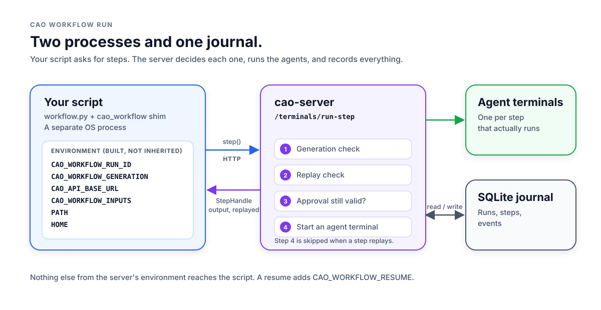
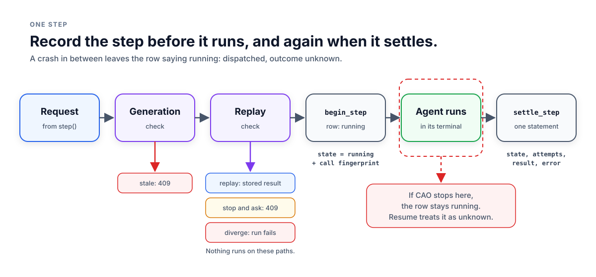
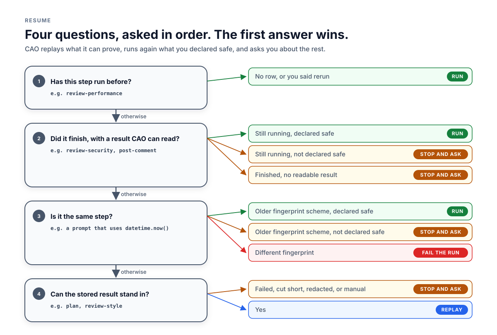

If you have used `cao workflow`, you have seen a few behaviours that look odd at first. The first
run of a new script is refused with a `plan_id`. A resumed run skips steps it already finished, and
those `step()` calls return with `replayed=True`. Now and then a resume stops and asks you to
`--decide` a step.

These behaviours come from two design goals. A multi-step agent job must survive a crash without
repeating work it already did, or guessing about work it cannot see. And no plan should run until a
human has approved it. Think of a review pipeline that dies at step 9 of 12. Run it again from
scratch and you pay for eight finished steps twice, and the step that posts a pull request comment
may post it twice too.

CAO workflows solve this with an engine that records every step, decides every step again on resume,
and asks a human when it cannot tell what happened. This post explains how that engine works and why
it was built this way. For commands and flags, see the [CAO workflows
reference](https://github.com/awslabs/cli-agent-orchestrator/blob/main/docs/workflows.md).

{/* truncate */}

Everything below describes CAO `v2.5.5`.

## What the engine must guarantee

The engine is easier to follow once you know what it promises. This section lists the guarantees,
then introduces the script used through the rest of the post.

### Five guarantees

1. **Isolated.** A workflow script runs outside the server and reaches CAO only through its HTTP
   API. The server's environment does not leak into it.
2. **Durable.** Every step is recorded before it runs and again when it settles.
3. **Faithful on resume.** A finished step is not run again by accident.
4. **Deterministic, not autonomous.** Whether a step runs again is decided by fixed rules and the
   author's own declaration, never by a model's judgement. When the rules cannot decide, CAO stops
   and asks a human.
5. **Human-approved.** A script plan does not run until a human approves it, and no agent can
   grant that approval.

The rest of the post is about how each one is kept.

### The running example

Here is a small review workflow. It plans a review, runs three reviewers at the same time, and then
posts one comment on a pull request:

```python
from concurrent.futures import ThreadPoolExecutor
from cao_workflow import step, emit_output, get_inputs, ShimError, ShimHTTPError

INPUTS = {"target": {"type": "path", "required": True}}
target = get_inputs()["target"]

# Reading and returning text has the same effect when repeated.
plan = step("claude_code", "reviewer", f"Read {target} and list what to check.",
            step_id="plan", recovery="idempotent")

def review(check):
    try:
        h = step("claude_code", "reviewer",
                 f"Review {target} for {check} only. Plan:\n{plan.output}",
                 step_id=f"review-{check}", recovery="idempotent")
        return check, h.output
    except ShimHTTPError as exc:
        if exc.status == 409:
            raise                      # a stop or a divergence: never absorb it
        return check, f"ERROR: {exc}"
    except ShimError as exc:
        return check, f"ERROR: {exc}"  # timeout or transport: keep the survivors

with ThreadPoolExecutor(max_workers=2) as pool:
    findings = dict(pool.map(review, ["style", "security", "performance"]))

# Posting a comment changes the outside world. Ask before doing it again.
posted = step("claude_code", "developer", f"Post one PR comment summarising: {findings}",
              step_id="post-comment", recovery="manual")

emit_output({"findings": findings, "comment": posted.output})
```

It is a sketch rather than a file in the repo. The closest shipped example is
[`examples/workflow/`](https://github.com/awslabs/cli-agent-orchestrator/tree/e2f2978c26c1b50cee2db90b524e7656ef64f46f/examples/workflow),
which has the same plan-then-fan-out shape.

## The shape of a run

A workflow run has two processes and one database. This section covers how they are split, what the
script is given to work with, and how CAO stops an old copy of the script from acting.



### The script runs outside CAO

When you start a run, CAO spawns your script as a separate operating system process. It never runs
the script inside the server. The script's environment is built from scratch, not copied from the
server, and it holds exactly six variables: `CAO_WORKFLOW_RUN_ID`, `CAO_WORKFLOW_GENERATION`,
`CAO_API_BASE_URL`, `CAO_WORKFLOW_INPUTS`, `PATH` and `HOME`. A resume adds `CAO_WORKFLOW_RESUME`.
Nothing else crosses over, so a secret in the server's environment cannot leak into your script.

The script talks to CAO only over HTTP. The `cao_workflow` package (the shim) is a thin client that
uses only the Python standard library. Each `step()` call becomes one request to
`/terminals/run-step`, and, unless the step is replayed, the server starts an agent terminal for it.
The linter refuses any script that imports `cli_agent_orchestrator`, because that would put the
server's code inside your process. The shim is a convenience, not a requirement: [one of the
examples](https://github.com/awslabs/cli-agent-orchestrator/blob/e2f2978c26c1b50cee2db90b524e7656ef64f46f/docs/examples/loop_raw_http_example.py)
drives the same endpoint with plain `urllib`.

The shim never retries a step. If a request fails with its outcome unknown, a retry could make an
agent do the same work twice. So the shim returns the failure to your script, and the decision about
trying again belongs to resume, where CAO has the journal to look at.

### The generation fence

Every run has a generation number, and every request from the script carries it with the run id.
Resume and cancel both raise the generation. Before the server starts a step, it checks the
request's generation against the one in the journal, and a request from an older generation is
refused with `409`.

This matters when a process outlives its run. A cancelled script might still be finishing a loop,
and a script from a crashed attempt might still be alive. Its next `step()` call carries an old
generation, so it is fenced out. It cannot start an agent alongside the new attempt.

One case needs more than a number. If the server restarts while a script keeps running, the
generation still matches, but the server no longer knows who started the run. That step is refused
too, and `cao workflow resume` binds the run again from the journal.

## What the journal records

Every step that runs leaves rows in a SQLite journal. This section covers how a step is written, why
the write is split into two parts, and what the event log keeps.



### A step is written twice

The journal is the source of truth for a run. The server keeps an in-memory copy for speed, but it
rebuilds that copy from the journal after a restart.

Each step is written in two parts. First, before the agent starts, `begin_step` writes a row in the
`running` state together with the step's fingerprint (a hash of what the call asks for; more on that
below). Then, when the agent finishes, `settle_step` writes the final state, the attempt count, the
result, the output and any error in one SQL statement.

The split is the point. If the server dies while the agent works, the row says `running`, which
means "dispatched, outcome unknown". It can never say `completed` with no result behind it.

The first write inserts the row, or updates it if the row is already there, so it also works when a
step is dispatched again. Its last clause [decides which fingerprint the row
keeps](https://github.com/awslabs/cli-agent-orchestrator/blob/e2f2978c26c1b50cee2db90b524e7656ef64f46f/src/cli_agent_orchestrator/services/workflow_journal.py#L1222-L1225):

```python
"call_fingerprint = CASE "
"WHEN workflow_run_step.state != 'completed' "
"THEN excluded.call_fingerprint "
"ELSE workflow_run_step.call_fingerprint END",
```

The `CASE` keeps the fingerprint of a completed row, because that fingerprint was recorded against a
real result. For a row that never completed, it records the new call's fingerprint, so a step that
is run again is judged against what actually ran.

The attempt count is kept by the SQL itself: `1` on the first settle, and one more on each later
one. The server's in-memory counter starts again at zero after a restart, so letting it set the
count would make the count go backwards.

### The event log

Beside the step rows, the journal keeps an append-only event log: `run.started`,
`step.attempt.started`, `terminal.created`, `step.completed`, `run.failed` and so on. Each run has
its own sequence of event numbers. `cao workflow events <id>` follows the log live.

If events are lost, the server says so with an explicit gap event. The client never infers a gap
from missing numbers, because two parties guessing about loss can disagree.

Output capture is off by default, so the event log keeps metadata only: states, timings, error
kinds, and a digest in place of any output. Two things are kept in full. Each step's final answer is
saved on its row, redacted and capped at 32 KiB, because that is what a replay returns. And the
run's inputs are saved as given, so pass a secret's name as an input, never the secret. Old runs are
pruned when the server starts: anything older than 30 days, or beyond the newest 100 runs.

## Resume: run the script again, let the server decide

Resume is where the journal pays off. This section covers how CAO recognises a step it has seen
before, the four questions it asks about each one, and what happens to the running example after a
crash.

### The whole script runs again

`cao workflow resume <run-id>` does not jump to the failed step. It runs a frozen copy of your
script from the top, under a new generation. Every `step()` call makes a real request, exactly as on
the first run. There is no `if resuming:` branch in the shim, and you should not write one. What
changes is what the server does with each request.

To recognise a step, the server computes a fingerprint of the call: a SHA-256 hash of ten fields in
a fixed order. They are the provider, agent profile name, prompt, model, engine, allowed tools,
working directory, worktree flag, terminal reuse flag and timeout. The value starts with `v2:`, so a
stored fingerprint says which hashing scheme made it.

Only the profile's name is in the fingerprint, not its contents. Edit a profile and a finished step
still replays under its old result. With approval on, though, the next step that launches that
profile is refused, and you need a new run (see plan approval below).

### Four questions, asked in order

For each step, the server reads the step's row in the journal and asks four questions, in order. The
first answer that settles the step wins.



1. **Has this step run before?** If there is no row, or you told CAO to rerun it, the step runs.
2. **Did it finish, with a result CAO can read?** If the row still says `running`, the outcome is
   unknown. The step runs again only if its author declared that safe. Otherwise CAO stops and asks
   you. A finished row with no readable result also stops and asks.
3. **Is it the same step?** CAO first checks that the stored fingerprint was made under the
   current scheme. If it was not, CAO cannot compare, so it runs the step again if that was
   declared safe, and asks you if not. If the fingerprints differ, the script changed at this
   step, and the whole run fails with `ReplayDivergenceError`.
4. **Can the stored result stand in for a new run?** Not if the step failed, if its stored text
   was cut short or redacted, or if its author marked it `manual`. Those stop and ask. Otherwise
   the stored result is returned and nothing runs. That is a replay.

In short: CAO replays what it can prove, runs again what you declared safe, and asks you about the
rest. A changed script stops the run.

The order is deliberate. CAO asks "can I trust this record?" before "does it match?", so an old
record is never reported as "your script changed" when the truth is "we cannot tell". And when you
resolve a stop with `skip`, which means "use the stored result", only the last question is relaxed.
A changed script still fails loudly.

When the journal itself cannot be read, CAO does not fall back to running the step. That would
repeat finished work in exactly the case resume exists for. The error reaches you instead.

### The running example after a crash

Say `cao-server` stops just after `review-style` finishes, while `review-security` is still running
and before `review-performance` starts. You start it again and run `cao workflow resume`:

- `plan` and `review-style` match their fingerprints and have results: **replayed** (question 4).
  Their `step()` calls return with `replayed=True`.
- `review-security` is `running` and declared `idempotent`: **executed** again (question 2).
- `review-performance` never started: **executed** (question 1).
- `post-comment` has no row yet, so it runs normally.

Now say the crash came later, while `post-comment` was running. Did the comment get posted? CAO
cannot know, and `manual` says not to guess, so question 2 **stops the run** at that step.

Inside the script, a stop arrives as a `409` error. Let it through: that is why `review()` re-raises
a `409` instead of treating it like a timeout.

You check the pull request, see no comment, and resume with:

```bash
cao workflow resume <run-id> --decide post-comment=rerun
```

That decision authorises exactly one attempt. If that attempt also crashes, the next resume asks
again. Consent never carries over to a later resume. The other decision, `skip`, accepts a step's
stored result. It fits a step that finished and stopped only because it is `manual`.

### What makes a script diverge

A step diverges when its fingerprint changed at the same `step_id`. The usual cause is a script that
is not deterministic: a prompt that includes `datetime.now()`, an unseeded random choice, or a
`uuid4()` id. On resume these produce a different prompt, and the run fails with
`ReplayDivergenceError` instead of quietly doing different work. The linter warns when a script
imports `random`, `secrets`, `time`, `datetime` or `uuid`, for this reason.

Fan-out has its own version of the problem. Without an explicit `step_id`, the shim numbers calls
`call-1`, `call-2` and so on. That counter is safe across threads, but thread timing decides which
call gets which number. On resume, a reviewer could arrive under another reviewer's number. Its
fingerprint then differs, and the run fails with `ReplayDivergenceError` although nothing in the
script changed. That is why every concurrent call needs a stable `step_id` such as
`review-security`, made of letters, digits, `_` and `-`, up to 64 characters.

## A recovery policy is a claim, not a permission

The `recovery=` keyword in every `step()` call is where "deterministic, not autonomous" shows most
clearly. CAO never works out for itself whether a step is safe to repeat. The author states it, and
the four questions act on it.

| Value | What you are saying |
| --- | --- |
| `idempotent` | Running this again has the same effect as running it once. |
| `reconcile` | Running it again needs a reconciliation first. Not built yet: treated as `idempotent`. |
| `manual` | Don't decide this one without me. Stop and ask. |
| *(none)* | Nothing declared. Replay is still allowed; running it again stops and asks. |

CAO cannot see what a step does to the outside world, so it does not try to verify the claim. It
acts on it. Declare `idempotent` on a step that sends mail, and a resume after a crash in that step
will send the mail again, exactly as told. If you can't show a step is safe to repeat, `manual` is
the honest choice. It costs one question on resume.

You can also declare nothing, by calling `run_step` instead of `step`. That is not the same as
`manual`: a step with no policy can still replay, but CAO will not run it again without asking. On
`step()` the policy is required, and the linter blocks a call that leaves it out.

## Plan approval: a human signs off on what will run

Resume protects work that already ran. Approval protects the first run. This section covers what is
approved, why agents cannot approve, and where the approval stops.

### What a plan identifier covers

When a script run starts, CAO freezes an execution manifest (a record of what the run will execute)
and derives a `plan_id` from it, in the form `plan-v2:<digest>`. For a script, what goes in is the
script's source hash, its resolved inputs, the state of the working directory (for Git, the commit
and the worktree changes), and a digest of every installed agent profile. Change any of them and the
`plan_id` changes.

This is a different hash from the step fingerprint, for a simple reason. Script steps only exist
once the Python runs, so at approval time there is no list of steps to hash. The prompts still
count, because they live in the source.

The profile digest covers every installed profile, not only the ones your script names, for the same
reason: nobody can know in advance which profiles a script will use.

### The first run is refused

A `plan_id` does not exist until a run computes it, so a new or changed plan cannot be approved yet.
The first run is refused by design:

```bash
cao workflow run review --run-id review-1 --input target=src/app.py   # 403 approval_required, carries the plan_id
cao workflow approve plan-v2:<digest>                                  # a human, at their own terminal
cao workflow run review --run-id review-1 --input target=src/app.py   # runs
```

There is a CLI command to grant approval and no MCP tool to grant it. That asymmetry is deliberate.
An agent that could approve the plan it just wrote would make the check useless. An agent that meets
the refusal shows you the `plan_id` and stops.

Approval is on by default. Only the server's `settings.json` can turn it off. The
`CAO_WORKFLOW_REQUIRE_APPROVAL` variable can only turn it on. If it could turn the check off, any
process that can set an environment variable could switch it off. Approvals can't be revoked or
edited, so an existing approval can never be pointed at a changed plan.

### Memory is frozen for the run

A script run resolves CAO memory once, at its first agent terminal, and stores a redacted copy in
the manifest. Every later step of that run and every resume gets those same bytes. Editing memory
after a crash does not change what the resumed run sees. The [memory
post](https://awslabs.github.io/cli-agent-orchestrator/blog/2026/10/08/cao-memory-design#keep-cao-workflow-replays-consistent)
explains why a replay must not mix old inputs with new facts.

### What an approval does not cover

Approval is a same-user local control, not a privilege boundary. CAO runs as you, so a determined
local process can edit the settings or the approval store. What the gate guarantees is narrower: a
changed script, changed inputs, a changed repository or a replaced working directory cannot run
unnoticed under an approval granted for something else.

Some launch inputs are read live and are not in the `plan_id`: memory content, values in CAO's
managed `.env` file, installed skills, and, for some providers, the MCP servers that agent plugins
add at launch. A new run of an approved plan can see changes to those without asking again. The
reference lists every case.

## Costs and limits

The engine asks things of you and has gaps of its own. Here they are in one place:

- **You owe determinism.** The replay check is only as good as your script's stability. Derive
  ids and prompts from inputs, never from the clock.
- **Approval is broad.** Installing or editing any agent profile changes every `plan_id`, so every
  plan needs approving again. That is the price of not knowing a script's steps in advance.
- **Two parts are unfinished.** `reconcile` behaves exactly like `idempotent` today. The YAML tier
  runs plain sequences only: its `parallel`, `pipeline` and `loop` modes validate but do not run.
- **Directory identity has a hole.** Outside Git, a working directory is bound by its device and
  inode. Deleting it and creating it again at the same path can reuse the inode and keep the
  approval.
- **Long runs need the right setup.** Prefer a headless provider such as `claude_code` for
  workflow steps. From an agent, start a long run with `workflow_start` and poll it, because the
  blocking `workflow_run` tool is bound by the MCP host's own timeout.

Workflows already carry real work: the independent reviews in [How CAO shipped 32 reviewed
PRs](https://awslabs.github.io/cli-agent-orchestrator/blog/2026/11/01/32-reviewed-prs-from-my-phone)
ran as a CAO workflow.

## Summary

A CAO workflow is a Python script that CAO runs as a separate, fenced process. Every step is
journaled before and after it runs. Every resume runs the script again from the top, and the server
decides each step against the journal with the same four questions, never by judgement. The author's
recovery policy supplies the one fact CAO cannot see, and a human approval stands between a written
plan and its first run. Together they let a long agent job fail halfway and pick up where it
stopped, without doing finished work twice.

## About the author

Stan Fan (`fanhongy`) is a Solutions Architect at AWS. He works with teams on agentic systems and
developer tooling, with a particular interest in how agents accumulate and reuse context reliably
across sessions, models, and tools.
