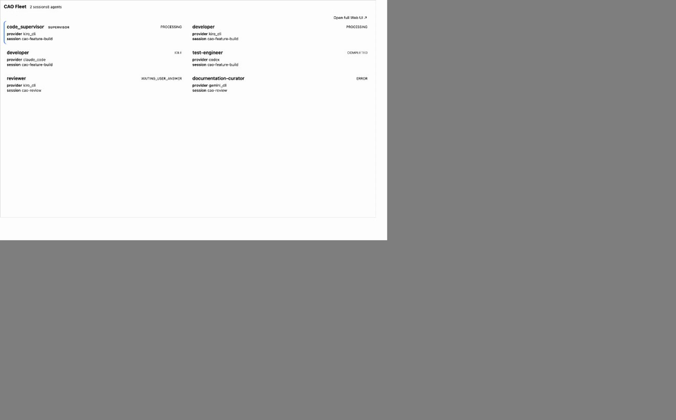
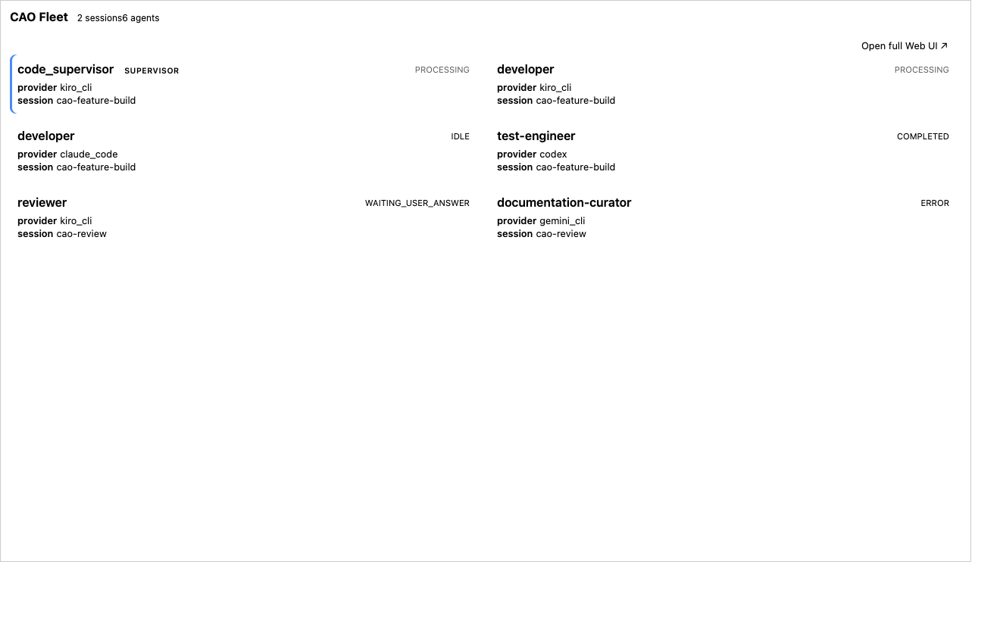
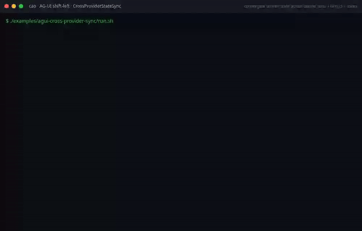
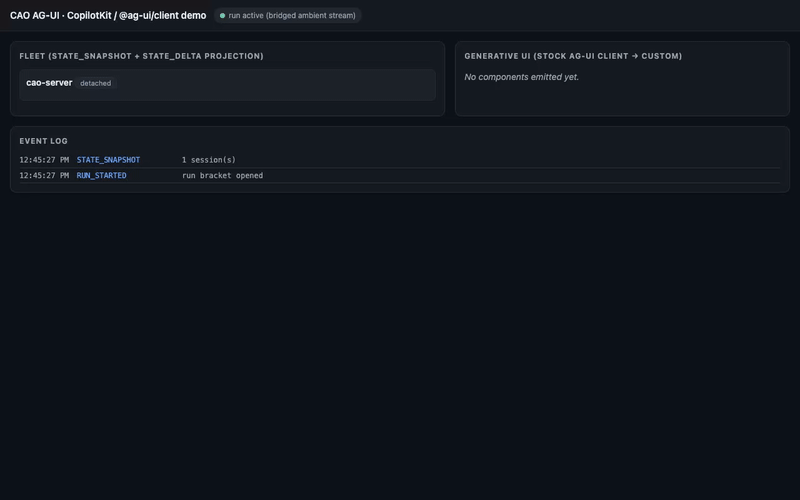

[CAO](https://github.com/awslabs/cli-agent-orchestrator) drives 13 provider CLIs, plus a mock for tests, as real processes in tmux sessions, each with its own login and tools ([the provider list at v2.5.5](https://github.com/awslabs/cli-agent-orchestrator/blob/d094b4baaf4900f59178e06134550cc5e16031ce/src/cli_agent_orchestrator/models/provider.py#L7-L21)), and puts them behind one AG-UI surface. How much of each CLI's permission prompts reaches that surface depends on how CAO launches it; Claude Code's is the one tested end to end ("Provider nuance" below). Between 2026-06-28 and 2026-11-19 I added support for three open protocols on those processes, plus a contributor skill: 50 merged pull requests.

## TL;DR

- **MCP Apps** ([#332](https://github.com/awslabs/cli-agent-orchestrator/pull/332), [#346](https://github.com/awslabs/cli-agent-orchestrator/pull/346), [#347](https://github.com/awslabs/cli-agent-orchestrator/pull/347)): sandboxed `ui://cao/*` views to watch and steer a fleet from an MCP App host.
- **AG-UI** ([#436](https://github.com/awslabs/cli-agent-orchestrator/pull/436), [#485](https://github.com/awslabs/cli-agent-orchestrator/pull/485), [#1107](https://github.com/awslabs/cli-agent-orchestrator/pull/1107), [#1111](https://github.com/awslabs/cli-agent-orchestrator/pull/1111), [#1115](https://github.com/awslabs/cli-agent-orchestrator/pull/1115), [#1117](https://github.com/awslabs/cli-agent-orchestrator/pull/1117)): an AG-UI client can approve or deny a real CLI's permission prompt. On `main`, both AG-UI surfaces follow the 1.0 rules and pass the pinned `@ag-ui/client` verifier ([#1198](https://github.com/awslabs/cli-agent-orchestrator/pull/1198), [#1232](https://github.com/awslabs/cli-agent-orchestrator/pull/1232), [#1243](https://github.com/awslabs/cli-agent-orchestrator/pull/1243), [#1267](https://github.com/awslabs/cli-agent-orchestrator/pull/1267)), and an operator dashboard reads them ([#1248](https://github.com/awslabs/cli-agent-orchestrator/pull/1248)).
- **Agent Plugins** ([#584](https://github.com/awslabs/cli-agent-orchestrator/pull/584)): CAO installs Agent Plugins 1.0.0 packages and publishes itself as two packages in 2.5.4 and four in v2.5.5 ([#1200](https://github.com/awslabs/cli-agent-orchestrator/pull/1200) and [#1233](https://github.com/awslabs/cli-agent-orchestrator/pull/1233) added the third and fourth). v2.5.5 also has `cao plugin validate` reporting Agent Skills limits ([#1236](https://github.com/awslabs/cli-agent-orchestrator/pull/1236)). The surface is gated closed (graduation: [#1393](https://github.com/awslabs/cli-agent-orchestrator/issues/1393)).
- **Contributor skills** ([#448](https://github.com/awslabs/cli-agent-orchestrator/pull/448), [#1121](https://github.com/awslabs/cli-agent-orchestrator/pull/1121), [#1197](https://github.com/awslabs/cli-agent-orchestrator/pull/1197), [#1343](https://github.com/awslabs/cli-agent-orchestrator/pull/1343), [#1369](https://github.com/awslabs/cli-agent-orchestrator/pull/1369)): `cao-contributing` teaches CAO's dev loop, and CI fails when it stops matching the repository or when an installed skill's relative links leave its directory.
- **Release status** (checked 2026-11-24): 13 of the 50 merged PRs are in 2.5.4. All 50 are in v2.5.5 (tag commit `d094b4ba`). The v2.5.5 GitHub release was published 2026-11-24 04:47 UTC, and 2.5.5 reached PyPI at 05:17 UTC.

{/* truncate */}

## Why this matters

**(a) What a team running several coding-agent CLIs can do now.** One issue states the risk plainly: "A worker's callback can literally answer a human's decision dialog." ([#405](https://github.com/awslabs/cli-agent-orchestrator/issues/405)). That issue is about question and plan dialogs, and it was open on 2026-11-25. For permission prompts there is now an answer: a Claude Code permission prompt becomes an AG-UI interrupt that a person approves or rejects, and the run ends on it ([#1107](https://github.com/awslabs/cli-agent-orchestrator/pull/1107), [#1115](https://github.com/awslabs/cli-agent-orchestrator/pull/1115)). Another issue says "The web dashboard currently speaks tmux" ([#292](https://github.com/awslabs/cli-agent-orchestrator/issues/292)). On `main`, an operator dashboard ([#1248](https://github.com/awslabs/cli-agent-orchestrator/pull/1248), [#1293](https://github.com/awslabs/cli-agent-orchestrator/pull/1293), [#1312](https://github.com/awslabs/cli-agent-orchestrator/pull/1312)) and the CAO Dojo page ([#1111](https://github.com/awslabs/cli-agent-orchestrator/pull/1111)) show the fleet and answer prompts in a browser.

**(b) Why an open protocol on real CLI processes is different.** A framework adapter usually calls an agent as a library, so an approval is whatever the adapter defines. CAO drives each vendor's own CLI in its own terminal, answers that CLI's real dialog, and does it over AG-UI, an open protocol, so the client is not tied to one vendor's UI. A maintainer describes the work as "one typed surface over many terminal-mode CLIs" ([#649](https://github.com/awslabs/cli-agent-orchestrator/issues/649)). To our knowledge, judged from the README of each integration package at ag-ui `main` `c31e1e81` on 2026-11-23, none of them describes one adapter over several vendors' coding CLIs; each wraps one framework, SDK or hosted runtime. The CAO integration proposed in [ag-ui PR #2216](https://github.com/ag-ui-protocol/ag-ui/pull/2216) would add one.

**(c) What it unlocks for the CAO ecosystem.** Because the surface is AG-UI rather than a CAO-only UI, other clients can read it: a CopilotKit page and CAO's own viewer render the same stream ([#436](https://github.com/awslabs/cli-agent-orchestrator/pull/436), [#485](https://github.com/awslabs/cli-agent-orchestrator/pull/485)). MCP Apps puts the fleet inside an MCP host ([#332](https://github.com/awslabs/cli-agent-orchestrator/pull/332), [#347](https://github.com/awslabs/cli-agent-orchestrator/pull/347)), the base for [#582](https://github.com/awslabs/cli-agent-orchestrator/issues/582), after [#580](https://github.com/awslabs/cli-agent-orchestrator/issues/580) noted that another host "cannot currently launch and supervise a CAO fleet as one continuous workflow". And one Agent Plugins package carries the same skills to several clients ([#584](https://github.com/awslabs/cli-agent-orchestrator/pull/584)); the repository also installs as a plugin marketplace in Claude Code and Codex ([#1428](https://github.com/awslabs/cli-agent-orchestrator/pull/1428)).


*"Approve flow: send a message, the card appears, Approve, the card clears", from proposed ag-ui PR [#2216](https://github.com/ag-ui-protocol/ag-ui/pull/2216) (unmerged on 2026-11-25). The PR body says "Recorded at `3b17df02` against CAO `f8da9364` (the AG-UI source it carries is identical in 2.5.5) and Claude Code 2.1.330", and its verification table lists a "Live" run.*

## The problem: real CLIs versus protocol adapters

Each CAO agent is a full provider CLI in its own terminal. CAO reads the terminal to tell whether the agent is idle, busy or waiting, and types into it to answer the CLI's own permission dialog. That makes three things harder:

1. A protocol event must map onto something a real process did, read from its terminal.
2. An answer the CLI can't accept must be refused before CAO types anything, because a keystroke into a live dialog can't be undone.
3. A demo is worth publishing only if a test drove the real path and asserted on it.

## What CAO adds on top of AG-UI

AG-UI describes how an agent talks to a frontend. The AG-UI epic, [#519](https://github.com/awslabs/cli-agent-orchestrator/issues/519), sets out what CAO adds on top. Each point below carries its status as checked on 2026-11-26.

1. **One AG-UI surface over many provider CLIs.** The approval bridge starts from the terminal status every provider reports and classifies each prompt per provider. Shipped ([#485](https://github.com/awslabs/cli-agent-orchestrator/pull/485), [#1107](https://github.com/awslabs/cli-agent-orchestrator/pull/1107)).
2. **Native permission prompts become AG-UI interrupt and resume.** A terminal that stops for its user's answer opens an interrupt, and the run ends with an `interrupt` outcome until a `resume[]` decides it. Shipped on the run plane ([#1107](https://github.com/awslabs/cli-agent-orchestrator/pull/1107), [#1198](https://github.com/awslabs/cli-agent-orchestrator/pull/1198)); tested end to end with Claude Code only.
3. **Supervisor and worker fleets attributed per agent.** On the ambient stream each session and terminal is a subagent invocation, so each worker's events carry its own identity. Shipped ([#1232](https://github.com/awslabs/cli-agent-orchestrator/pull/1232), [#1243](https://github.com/awslabs/cli-agent-orchestrator/pull/1243)).
4. **The laptop rule.** The surface is off unless `CAO_AGUI_ENABLED` is set or the MCP Apps surface is on (`CAO_MCP_APPS_ENABLED=true`, or `apps.enabled` in `settings.json`), and the run plane, `POST /agui/v1/run`, sits behind the same gate; with it on, a laptop needs no sign-in, database server, broker or cluster. This is a design rule: [#519](https://github.com/awslabs/cli-agent-orchestrator/issues/519) leaves its acceptance criterion unticked, because no recorded run has shown it yet.
5. **The run plane, MCP Apps and Agent Plugins in one server.** One `cao-server` serves all three, each off by default. Shipped ([#485](https://github.com/awslabs/cli-agent-orchestrator/pull/485), [#332](https://github.com/awslabs/cli-agent-orchestrator/pull/332), [#584](https://github.com/awslabs/cli-agent-orchestrator/pull/584)).

Every item in [#519](https://github.com/awslabs/cli-agent-orchestrator/issues/519) keeps the same constraints. The view is composed from L2 constructs only ([#386](https://github.com/awslabs/cli-agent-orchestrator/issues/386)'s AC6), off by default, and, for fleet events, metadata-only on the wire: no message bodies, no terminal output, no credentials. The exception is `emit_ui`: the props an agent writes reach stream readers unchanged (checked as JSON and capped at 8 KB, not filtered), so they must not carry secrets or other sensitive content. The six-component `emit_ui` allow-list is frozen; a new need becomes a new typed construct. On the AG-UI surface, the operator's one write is answering an approval: a `resume[]` on `POST /agui/v1/run`, which needs `cao:write` when authorization is configured. With none configured (the default), any caller that can reach the local port can send it. There is no profile, skill, settings or workflow write path. Being tenant- and runtime-aware is half shipped: [#1312](https://github.com/awslabs/cli-agent-orchestrator/pull/1312) carries each terminal's runtime, and tenant scoping depends on the CAO 3.0 tenant model, [#778](https://github.com/awslabs/cli-agent-orchestrator/issues/778).

[#519](https://github.com/awslabs/cli-agent-orchestrator/issues/519)'s four dashboard surfaces have shipped on `main`: the fleet supervisor view, interrupt and approval through the run plane, the session timeline and generative UI with its off-list refusal.

## MCP Apps: the fleet inside the host

### What shipped

[#332](https://github.com/awslabs/cli-agent-orchestrator/pull/332) added MCP Apps support, built on SEP-1865: three sandboxed `ui://cao/*` views (a dashboard, a per-agent view and an event stream; a graph view came later, from another contributor, in [#442](https://github.com/awslabs/cli-agent-orchestrator/pull/442)) plus a topology widget, off by default behind `CAO_MCP_APPS_ENABLED`. [#346](https://github.com/awslabs/cli-agent-orchestrator/pull/346) upgraded the frontend toolchain to Vite 8 and Vitest 4 and restored the frontend coverage floor. [#347](https://github.com/awslabs/cli-agent-orchestrator/pull/347) moved the docs to the stable 2026-01-26 spec and let the dashboard ask the host to open the full Web UI (`ui/open-link`) or change display mode, where the host allows it.

All three PRs are in 2.5.4 and v2.5.5, but **neither 2.5.5 wheel on PyPI contains the built views**: both lack `ext_apps/apps_static/`, and only the build-free topology widget is included (checked 2026-11-24). Author-reported: with the 2.5.4 wheel (macOS arm64), `cao-mcp-server` logged "apps_static/ not found (frontend not built)" and registered no `ui://cao/*` resource; I did not re-run that on 2.5.5. The release workflow at the v2.5.5 tag has no MCP Apps build step, so build the views from a checkout, not PyPI.

### Evidence


*MCP Apps views built from CAO `main` `6234f1f5`, recorded on 2026-11-24 in CAO's Node e2e host harness with fixture data, not in a real MCP App host; no cao-server ran. The 2.5.5 wheels ship no built views. [Watch it as video (WebM)](./mcp-apps-views-main-6234f1f5.webm).*


*The `ui://cao/dashboard` view from the same 2026-11-24 Node e2e host harness run (`main` `6234f1f5`, fixture data).*

### The gate

`CAO MCP Apps` builds the views and runs the frontend tests under a coverage ratchet, and `CAO MCP Apps E2E (Playwright)` drives the dashboard, agent and event-stream views. `test/test_http_only_boundary.py` guards the HTTP-only boundary.

## AG-UI: the operator answers a real CLI's prompt

### What shipped

[#436](https://github.com/awslabs/cli-agent-orchestrator/pull/436) is the first layer. `GET /agui/v1/stream` turns fleet events into typed AG-UI server-sent events (`STATE_SNAPSHOT`, `STATE_DELTA`, `?since=` replay). Agents can emit UI only from an allow-list of six components, `approval_card`, `choice_prompt`, `diff_summary`, `progress`, `metric` and `agent_card`; anything else is refused. It also added `mock_cli`, a credential-free provider for CI. It is off by default; `CAO_AGUI_ENABLED`, or turning on MCP Apps, enables it.

[#485](https://github.com/awslabs/cli-agent-orchestrator/pull/485) is the second. `POST /agui/v1/run` speaks the stock AG-UI wire dialect with interrupt and resume. It added four constructs (supervisor dashboard, session timeline, handoff with approval, cross-provider state sync), the `[agui]` extra, and an example on the stock `@ag-ui/client`.

Both are in 2.5.4, where a run does not finish after a resume. Four follow-ups, **not in 2.5.4**, fix that:

- [#1107](https://github.com/awslabs/cli-agent-orchestrator/pull/1107): after an approve, a deny, or a resume with nothing pending, a stock client now sees `RUN_FINISHED`. It also recognises Claude Code 2.1.310's Bash and Write permission prompts as interrupts. Reported in [#1512](https://github.com/awslabs/cli-agent-orchestrator/issues/1512): CAO 2.5.5 classifies a permission prompt's reason as `unknown_prompt` instead of `permission_request` with Claude Code 2.1.331 and 2.1.332; the report says approve and deny still work. Proposed fix: [#1515](https://github.com/awslabs/cli-agent-orchestrator/pull/1515).
- [#1115](https://github.com/awslabs/cli-agent-orchestrator/pull/1115): on a Claude Code permission prompt, an "edit" answer is refused with a 422 or `RUN_ERROR` before anything is typed. Before, it silently approved.
- [#1117](https://github.com/awslabs/cli-agent-orchestrator/pull/1117): a resume sent while the approval bridge is missing gets a 404 instead of a false success, and the run-plane request examples in the docs are now valid bodies.
- [#1111](https://github.com/awslabs/cli-agent-orchestrator/pull/1111): the CAO Dojo, a static page where an operator approves or rejects a real agent's permission prompt over AG-UI.

I don't claim "edit" for any provider. Claude Code refuses it by design. Kiro edit is covered by CAO's unit tests only ("Provider nuance").

### Evidence

The public record of a real run is in [ag-ui PR #2216](https://github.com/ag-ui-protocol/ag-ui/pull/2216). Its verification table lists a "Live" run of `scripts/e2e-local.sh` against CAO `f8da9364` and Claude Code 2.1.330, through the real `tool_approval` page, with approve, reject, nothing pending and both retries passing. The PR says its live run against the 2.5.5 release was not completed.


*"1. Pending prompt" ("approval card"), ag-ui PR [#2216](https://github.com/ag-ui-protocol/ag-ui/pull/2216). The table sits above body line 15: "Recorded at `3b17df02` against CAO `f8da9364` (the AG-UI source it carries is identical in 2.5.5) and Claude Code 2.1.330".*


*"3. Result: file written" ("file written"), ag-ui PR [#2216](https://github.com/ag-ui-protocol/ag-ui/pull/2216), same table, above that line.*


*"Result: no file" ("no file"), ag-ui PR [#2216](https://github.com/ag-ui-protocol/ag-ui/pull/2216), second table, above that line.*


*"Delivery unconfirmed notice with a locked Retry: Approve", ag-ui PR [#2216](https://github.com/ag-ui-protocol/ag-ui/pull/2216): "Captured in the `retry` phase, which drops the first resume request on purpose". The PR lists the retry runs in its live check.*

Author-reported: in an earlier run on my machine, the operator dashboard showed a real Claude Code agent's pending approval and a test that failed because a file did not exist. After a test script clicked Approve, the agent wrote the file and the test passed; a declined second request left no file. The dashboard does not show the decision; the file proves an approve, the pane text a deny. Those screenshots are not published, so that account cannot be checked from a clone. What is in the repository is the CAO Dojo (`examples/ag-ui/cao-dojo/`), its recorded and scrubbed trace (`examples/ag-ui/cao-dojo/trace/`) and the local end-to-end script `examples/ag-ui/cao-dojo/tools/e2e-local.sh`, which drive the same approve and reject path.

<video width="100%" controls loop muted playsInline preload="metadata" poster={dashboardPoster} aria-label="CAO operator dashboard against a private CAO 2.5.5 server with mock_cli terminals: generative-UI cards arrive, an assign call opens in the session timeline, and an approval injected into a mock_cli pane is approved and shown as delivered.">
  <source src={dashboardMp4} type="video/mp4" />
  CAO operator dashboard against a private CAO 2.5.5 server with mock_cli terminals: generative-UI cards arrive, an assign call opens in the session timeline, and an approval injected into a mock_cli pane is approved and shown as delivered.
</video>

*Recorded against CAO 2.5.5 from PyPI on 2026-11-24: the operator dashboard from CAO `main` `6234f1f5`, with `mock_cli` terminals and no live provider. The recording script made the four `emit_ui` calls and the assign, and injected the approval prompt into a `mock_cli` pane. After Approve, the card reads "delivered (decision applied: not reported by the run plane)"; a brief unverified "resolved: expired" hint shows first.*

### The gate

`AG-UI demo (shift-left recording)` asserts that each allow-listed component renders and an off-list one is refused. `AG-UI construct demos (shift-left recordings)` records the four constructs offline, with no real CLI. `AG-UI stock-client live (AC3)` drives the run plane with the stock client.

`test/api/test_agui_run_finishes.py` covers `RUN_FINISHED` after a resume and the missing-bridge 404; `test/services/agui/test_claude_code_permission_options.py` covers the refused "edit".

One gap: that end-to-end script runs locally, not in CI. PR [#2216](https://github.com/ag-ui-protocol/ag-ui/pull/2216) gives the reason for its own version: "The flow needs a local tmux server and a logged-in coding CLI."

### Shipped on `main`: the AG-UI 1.0 rules and an operator dashboard

[#1198](https://github.com/awslabs/cli-agent-orchestrator/pull/1198) (merged 2026-11-04) brought the run plane to 1.0: `RUN_STARTED` declares `protocolVersion: "1.0"` (asserted by `test/services/agui/test_run_plane_protocol_version.py`), CAO's `GENERATIVE_UI` frame becomes `CUSTOM cao.generative_ui`, an unknown resume entry is skipped with a warning instead of failing the run, and the `[agui]` extra pins the 1.0.x SDK.

[#1232](https://github.com/awslabs/cli-agent-orchestrator/pull/1232) (merged 2026-11-06) did the same for the ambient stream, and it is a breaking change. `GET /agui/v1/stream` is now one AG-UI 1.0 run per connection, with `data:`-only frames, and each session and terminal is a `SUBAGENT_*` invocation with a `subagentRunId` that is never reused. A client that still needs the pre-1.0 wire can request `?framing=cao-legacy`, which is deprecated.

[#1243](https://github.com/awslabs/cli-agent-orchestrator/pull/1243) stops the stream announcing a sender that isn't a real terminal as a subagent; [#1267](https://github.com/awslabs/cli-agent-orchestrator/pull/1267) closed the review follow-ups.

The check is the pinned upstream verifier. `examples/ag-ui/ag-ui-stock-client-live/verify-ambient.mjs` runs `@ag-ui/client`'s `verifyEvents` over the conformance captures from `test/api/test_agui_stream_conformance.py`, and drives a live `HttpAgent` run against `POST /agui/v1/stream`; the `AG-UI stock-client live (AC3)` job runs both. Copied onto [#1232](https://github.com/awslabs/cli-agent-orchestrator/pull/1232)'s base, that test file fails 42 tests and one never ends; on its head, all 43 pass.

[#1248](https://github.com/awslabs/cli-agent-orchestrator/pull/1248) (merged 2026-11-08, `c690e21a`) added `examples/ag-ui/ag-ui-operator-dashboard/`, a React page, with no server-side change, that reads those two surfaces and answers approvals. Approval cards come only from the run plane's interrupts, so an `approval_card` frame on the ambient stream can't fake one. Decisions go back as one `resume[]`, and **Edit** appears only when the interrupt's schema accepts edited arguments.

[#1233](https://github.com/awslabs/cli-agent-orchestrator/pull/1233) (merged 2026-11-11, `a89cee45`) delivered [#1116](https://github.com/awslabs/cli-agent-orchestrator/issues/1116): a recorded, scrubbed CAO Dojo trace with leak and drift guards, a recorder with keyless `--mock` and `--offline` modes, and a fourth Agent Plugin, `cao-ag-ui-builder` (name provisional). The dashboard also gained a session timeline ([#1293](https://github.com/awslabs/cli-agent-orchestrator/pull/1293)), which a browser test now checks in CI with the six components ([#1297](https://github.com/awslabs/cli-agent-orchestrator/pull/1297)), and shows off-list `emit_ui` refusals from a metadata-only record ([#1295](https://github.com/awslabs/cli-agent-orchestrator/pull/1295)); the stream now ends a call that a reconnect skipped ([#1296](https://github.com/awslabs/cli-agent-orchestrator/pull/1296)).

None of this is in 2.5.4.

Upstream, [ag-ui-protocol/ag-ui#2216](https://github.com/ag-ui-protocol/ag-ui/pull/2216) was open, not merged, on 2026-11-25. It would add `@ag-ui/cli-agent-orchestrator`, an `HttpAgent` subclass, and one Dojo feature, `tool_approval`.

### Shipped on main: the L3 fleet view ([#1312](https://github.com/awslabs/cli-agent-orchestrator/pull/1312))

[#1312](https://github.com/awslabs/cli-agent-orchestrator/pull/1312) merged on 2026-11-13 as `367f53f3` and added a Fleet panel to the operator dashboard: terminals grouped by runner, each with its live status and profile, and the host's load.

Limits, author-reported: `runner_id` is always `null` on `main` (remote runners are on `3.0-beta1`, where [#1298](https://github.com/awslabs/cli-agent-orchestrator/pull/1298) merged), so grouping by runner is only exercised with synthetic data in the dashboard's tests, and the real remote path is unverified.

## Provider nuance: one protocol, different approval behaviour

What reaches AG-UI's shared interrupt lifecycle depends on how CAO launches each CLI:

| Provider | CAO's default launch | Can a profile bring prompts back? |
|---|---|---|
| Kiro CLI | `--trust-all-tools` | no |
| Antigravity CLI | `--dangerously-skip-permissions` | no; `permissionMode` isn't read |
| Claude Code | `--dangerously-skip-permissions` | yes, with `permissionMode` |

Under `--trust-all-tools`, Kiro CLI never stops for a tool approval; CAO answers its one startup consent dialog itself. Antigravity's flag skips tool approvals but not its workspace-trust dialog, which CAO's classifier doesn't know. Claude Code's card offers approve and deny, so "Try it" uses it.


*Offline example with synthetic data, recorded by CAO's construct-demo recorder: the provider names are labels in a fixture, not running CLIs.*

## Agent Plugins: CAO installs packages and ships as one

[#584](https://github.com/awslabs/cli-agent-orchestrator/pull/584) added Agent Plugins 1.0.0 support: CAO manages packages with `cao plugin add`, `validate`, `list` and `remove`, and publishes `agent-plugin/cao` and `agent-plugin/cao-contributor` in 2.5.4. The surface is gated closed behind `CAO_AGENT_PLUGINS_ENABLED`.

<video width="100%" controls loop muted playsInline preload="metadata" poster={replayPoster} aria-label="Replay of a captured terminal transcript: CAO 2.5.5 from PyPI validates, installs, lists and removes the cao-agent-plugin-lifecycle package from CAO main 6234f1f5; every command exits 0.">
  <source src={replayMp4} type="video/mp4" />
  Replay of a captured terminal transcript: CAO 2.5.5 from PyPI validates, installs, lists and removes the cao-agent-plugin-lifecycle package from CAO main 6234f1f5; every command exits 0.
</video>

*A replay of a captured transcript, recorded on 2026-11-24: `cao` 2.5.5 from PyPI, with `CAO_AGENT_PLUGINS_ENABLED=1` set, validates, adds, lists and removes the `cao-agent-plugin-lifecycle` package from CAO `main` `6234f1f5`. The output is verbatim; `cao` was run by its full path from a temporary install, and blank lines are drawn as empty space. On 2.5.5, `remove` printed no traceback. It is not the measured 2.5.4 run in the Agent Plugins post.*

See [the Agent Plugins post](../2026-11-28-agent-plugins-in-cao/index.md) for install steps.

## Contributor skills: easier to work on, for people and agents

### What shipped

[#448](https://github.com/awslabs/cli-agent-orchestrator/pull/448) added `cao-contributing`, a skill that teaches CAO's dev loop, which CI checks block, and the pre-PR checklist. It is in the 2.5.4 wheel.

[#1121](https://github.com/awslabs/cli-agent-orchestrator/pull/1121) added a dependency and lockfile section and put `cao-contributing` inside the `cao-contributor` agent plugin; [#1197](https://github.com/awslabs/cli-agent-orchestrator/pull/1197) applied its review follow-ups.

[#1343](https://github.com/awslabs/cli-agent-orchestrator/pull/1343) (`a6f77303`, merged 2026-11-16, closing [#1342](https://github.com/awslabs/cli-agent-orchestrator/issues/1342)) and [#1369](https://github.com/awslabs/cli-agent-orchestrator/pull/1369) (`58aea18b`, merged 2026-11-17, closing [#1365](https://github.com/awslabs/cli-agent-orchestrator/issues/1365) and [#1366](https://github.com/awslabs/cli-agent-orchestrator/issues/1366)) fixed:

- relative links in `cao-mcp-apps`, `cao-session-management` and `cao-session-liveness` that resolved in a repository checkout but dangled once a skill was installed on its own;
- a contradictory `409` catch in `cao-workflow` and four trigger descriptions;
- `skills/cao-mcp-apps/scripts/validate.sh`, so `/events` and `/agui/v1/stream` stream checks read `200` or `404` instead of concatenating curl's fallback `000` into `200000` or `404000`.

None of the four is in 2.5.4.

### Evidence and gate

`test/test_cao_contributing_skill_accuracy.py` pins the skill's claims to the repository, so CI fails when one stops being true; [#1121](https://github.com/awslabs/cli-agent-orchestrator/pull/1121) added `TestDependencySectionMatchesTheRepo` for the new section. `test/test_skill_packaging_parity.py` covers packaging, and [#1369](https://github.com/awslabs/cli-agent-orchestrator/pull/1369) taught `scripts/validate_markdown_links.py` to reject any relative link under `skills/<name>/` that resolves outside `skills/<name>/`.

## The 50 merged PRs

At `b784b909` on `main`:

| | |
|---|---|
| Merged PRs | 50 (releases: TL;DR) |
| Follow-up PRs (not in the 50) | CAO [#1459](https://github.com/awslabs/cli-agent-orchestrator/pull/1459), [#1463](https://github.com/awslabs/cli-agent-orchestrator/pull/1463), [#1481](https://github.com/awslabs/cli-agent-orchestrator/pull/1481), [#1482](https://github.com/awslabs/cli-agent-orchestrator/pull/1482), [#1486](https://github.com/awslabs/cli-agent-orchestrator/pull/1486), [#1507](https://github.com/awslabs/cli-agent-orchestrator/pull/1507), [#1509](https://github.com/awslabs/cli-agent-orchestrator/pull/1509) and [#1515](https://github.com/awslabs/cli-agent-orchestrator/pull/1515); ag-ui [#2216](https://github.com/ag-ui-protocol/ag-ui/pull/2216) |
| Commits on PR branches | 193, squashed to one per PR on `main` |
| Non-author review submissions | 125: 115 from people, 10 from bots |
| Human reviewers | five maintainers and contributors |
| PRs with at least one human approval | all 50 |

Authorship: plauzy is the git author of 50 commits on `main`, and 40 of them carry the trailer `Co-authored-by: Kiro Agent`. My CAO contributions were made with the Kiro CLI. None of this is a claim about Kiro's quality or rank; it says how the work was built.

Ten merged PRs were CI, security and build hygiene: [#333](https://github.com/awslabs/cli-agent-orchestrator/pull/333), [#435](https://github.com/awslabs/cli-agent-orchestrator/pull/435), [#452](https://github.com/awslabs/cli-agent-orchestrator/pull/452), [#456](https://github.com/awslabs/cli-agent-orchestrator/pull/456), [#574](https://github.com/awslabs/cli-agent-orchestrator/pull/574), [#576](https://github.com/awslabs/cli-agent-orchestrator/pull/576), [#1119](https://github.com/awslabs/cli-agent-orchestrator/pull/1119), [#1211](https://github.com/awslabs/cli-agent-orchestrator/pull/1211), [#1302](https://github.com/awslabs/cli-agent-orchestrator/pull/1302) (`69c6b7d9`, taking `apt` off the browser jobs' critical path) and [#1400](https://github.com/awslabs/cli-agent-orchestrator/pull/1400) (`79b53ad0`, which makes `Dependency Security` block on shipped dependencies and report toolchain findings).

Five more changed the test suite and terminal status monitor: the suite runs against a throwaway home ([#1231](https://github.com/awslabs/cli-agent-orchestrator/pull/1231)) and a private tmux server ([#1245](https://github.com/awslabs/cli-agent-orchestrator/pull/1245)), so a test can't touch the developer's provider configs, CLIs or sessions; [#1251](https://github.com/awslabs/cli-agent-orchestrator/pull/1251) stops orphaned `pipe-pane` writers; [#1256](https://github.com/awslabs/cli-agent-orchestrator/pull/1256) closes every SQLite connection CAO opens directly (the leak behind the suite's EMFILE failures); and [#1322](https://github.com/awslabs/cli-agent-orchestrator/pull/1322) (`470348ae`, closing [#1321](https://github.com/awslabs/cli-agent-orchestrator/issues/1321)) maps HPA (`` CSI n ` ``) in `StatusMonitor`'s `pyte` stream subclass so `agy` footers land on the right row. [#1231](https://github.com/awslabs/cli-agent-orchestrator/pull/1231) also fixed Antigravity's startup so its terminal reaches idle.

## Limits

Author-reported: the earlier dashboard run, the 2.5.4 wheel check and the provider behaviour were observed on one machine, at the commits and versions named. Figures marked with a date are as of that date and will change.

## Try it

You need tmux 3.3 or later, [uv](https://docs.astral.sh/uv/), and one logged-in provider CLI.

**Compatibility:** this post describes `main`; the latest PyPI release is 2.5.5. The CAO Dojo approval demo needs `main` or 2.5.5: it relies on the run-plane fix from [#1107](https://github.com/awslabs/cli-agent-orchestrator/pull/1107), which 2.5.4 lacks, and against an older server the page waits for its 150-second backstop ([Dojo README](https://github.com/awslabs/cli-agent-orchestrator/blob/main/examples/ag-ui/cao-dojo/README.md)).

**Install 2.5.5 from PyPI** (both installs need Python 3.11 or later):

```bash
uv tool install 'cli-agent-orchestrator[agui]==2.5.5'
```

Or install **`main`**:

```bash
uv tool install 'cli-agent-orchestrator[agui] @ git+https://github.com/awslabs/cli-agent-orchestrator.git@main' --upgrade
```

**Clone CAO**; run every later command from the checkout:

```bash
git clone https://github.com/awslabs/cli-agent-orchestrator.git
cd cli-agent-orchestrator
```

**AG-UI ambient stream.** Start the server, then watch:

```bash
CAO_AGUI_ENABLED=1 cao-server
```

```bash
curl -N http://localhost:9889/agui/v1/stream
```

**Approve or deny a real agent's prompt from a browser**, with the CAO Dojo page (the approver profile needs a logged-in Claude Code). Serve it:

```bash
python3 -m http.server 8790 --bind 127.0.0.1 --directory examples/ag-ui/cao-dojo
```

In a second shell, start a server in a throwaway CAO home:

```bash
export CAO_HOME_DIR="$(mktemp -d)"; echo "$CAO_HOME_DIR"
CAO_AGUI_ENABLED=1 CAO_CORS_ORIGINS=http://localhost:8790 cao-server --host 127.0.0.1 --port 9890
```

In a third shell, export that path and launch:

```bash
export CAO_HOME_DIR="<printed-path>"
export CAO_API_HOST=127.0.0.1 CAO_API_PORT=9890
cao install examples/ag-ui/cao-dojo/dojo-approver.md
cao launch --agents dojo-approver --session-name dojo-demo --working-directory "$(mktemp -d)" --headless --auto-approve --async "Do your task now."
```

This launches a real Claude Code agent under your real `HOME`, and Claude Code may add a project folder, history and config entries there.

Open `http://localhost:8790/index.html`, set the endpoint to `http://127.0.0.1:9890`, click **Connect**. When the agent's prompt is up (about 20 s), the card appears. If it does not, click **Send run**: the run answers with every open approval. Then click **Approve** or **Reject**. To tear down, in shell 3:

```bash
cao shutdown --session cao-dojo-demo
```

Then stop `cao-server` and the http server (Ctrl-C, or `kill <pid>`), and remove the `CAO_HOME_DIR` from the second shell.

**MCP Apps views.** Start this in a new shell, or run `unset CAO_API_HOST CAO_API_PORT` first, so the server and an MCP host both use the default port 9889. Use a checkout, not PyPI: run `uv sync` and `(cd cao_mcp_apps && npm ci && npm run build:all)`, start `CAO_MCP_APPS_ENABLED=true uv run cao-server`, and point an MCP App host at `uv run --directory <path-to-your-cao-checkout> cao-mcp-server` with [`CAO_MCP_APPS_ENABLED=true`](https://github.com/awslabs/cli-agent-orchestrator/blob/6234f1f5a91092f582425047f192a9106ea039d9/src/cli_agent_orchestrator/ext_apps/apps.py#L205-L215) in that server's env (or `apps.enabled` in CAO's `settings.json`); [`uv run`](https://docs.astral.sh/uv/reference/cli/#uv-run) uses the checkout's environment, not the `uv tool install`.

With no credential configured, the surface, `submit_command` mutations included, uses CAO's unauthenticated, localhost-only trust model; `CAO_AUTH_JWKS_URI` and `CAO_AUTH_AUDIENCE` add authorization.

See [`docs/mcp-apps.md`](https://github.com/awslabs/cli-agent-orchestrator/blob/main/docs/mcp-apps.md), [`docs/agui.md`](https://github.com/awslabs/cli-agent-orchestrator/blob/main/docs/agui.md) and [`docs/agent-plugins.md`](https://github.com/awslabs/cli-agent-orchestrator/blob/main/docs/agent-plugins.md).

## Where this goes next


*Another UI on the same protocol: a page built on the public CopilotKit project and `@ag-ui/client`, recorded for [#436](https://github.com/awslabs/cli-agent-orchestrator/pull/436) (merged 2026-07-17). It shows the pre-1.0 wire (`GENERATIVE_UI` in the event log), not the AG-UI 1.0 stream on `main`.*

What comes next, in order:

1. **Graduating the gated `cao plugin` surface**, tracked in [#1393](https://github.com/awslabs/cli-agent-orchestrator/issues/1393), whose decisions were still open on 2026-11-25. The Agent Plugins follow-ups in [#1154](https://github.com/awslabs/cli-agent-orchestrator/issues/1154) are covered in the Agent Plugins post.
2. **The rest of the L3 fleet-operations dashboard** that [#519](https://github.com/awslabs/cli-agent-orchestrator/issues/519) tracks: planned work includes [#1166](https://github.com/awslabs/cli-agent-orchestrator/issues/1166) (robotics replay), [#1162](https://github.com/awslabs/cli-agent-orchestrator/issues/1162) (deferred until the 3.0 tenant model, [#778](https://github.com/awslabs/cli-agent-orchestrator/issues/778)), [#1164](https://github.com/awslabs/cli-agent-orchestrator/issues/1164) (after 3.0) and [#1194](https://github.com/awslabs/cli-agent-orchestrator/issues/1194), an A2UI spike. Sub-issues closed before 2026-11-25 include the preservation matrix ([#1160](https://github.com/awslabs/cli-agent-orchestrator/issues/1160)).
3. **CI and status-detection reliability follow-ups** under the tracking epic [#1375](https://github.com/awslabs/cli-agent-orchestrator/issues/1375): planned work includes [#1367](https://github.com/awslabs/cli-agent-orchestrator/issues/1367) (idle pane output resetting the status monitor's quiet gate).

import dashboardMp4 from './ag-ui-operator-dashboard-mock-2.5.5.mp4';
import dashboardPoster from './ag-ui-operator-dashboard-mock-2.5.5-poster.jpg';
import replayMp4 from './agent-plugins-cli-replay-2.5.5.mp4';
import replayPoster from './agent-plugins-cli-replay-2.5.5-poster.jpg';
