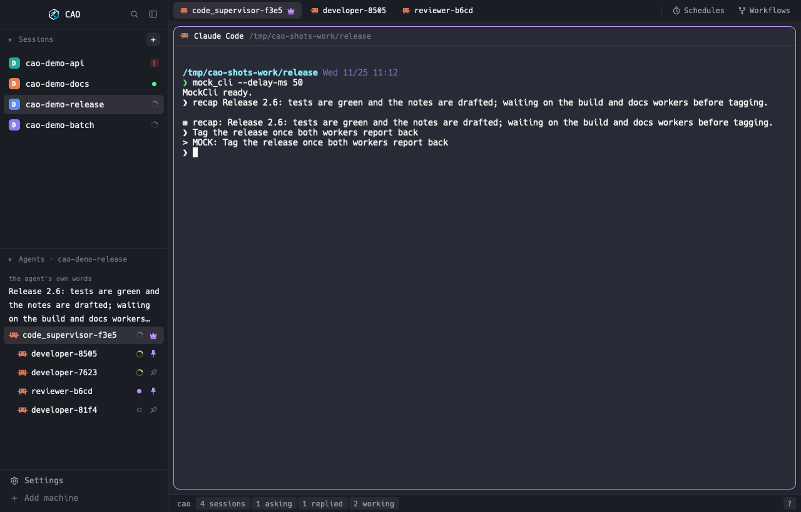

# Herdr App Backend

:::caution Experimental
The `herdr-app` backend is opt-in. The default backend is tmux. Report problems at [github.com/awslabs/cli-agent-orchestrator/issues](https://github.com/awslabs/cli-agent-orchestrator/issues).
:::

With the `herdr-app` backend, CAO runs its terminals in a dedicated herdr-core (`hc`) session, and the Herdr desktop app shows them: one space per CAO session and one tab per CAO terminal, named after the CAO session and window. herdr-core reports each agent's status natively (`working`, `blocked`, `idle`, `done`), so CAO delivers inbox messages from herdr-core's event stream instead of polling terminal output.

This backend is separate from the [herdr TUI backend](https://github.com/awslabs/cli-agent-orchestrator/blob/main/docs/herdr.md) (`terminal.backend: "herdr"`), which talks to the `herdr` terminal multiplexer. This page covers the app backend only. The full reference is [docs/herdr-app.md](https://github.com/awslabs/cli-agent-orchestrator/blob/main/docs/herdr-app.md) in the repository.

## Prerequisites

- herdr-core 0.1.21 or later on the machine where CAO runs. Check with `hc --version`. CAO looks for `hc`, then `herdr-core`, on `PATH`.
- The Herdr desktop app, if you want to see the terminals. CAO works without it.

## Enable It

Pick one:

```bash
cao config set terminal.backend herdr-app     # persistent
CAO_TERMINAL_BACKEND=herdr-app cao-server     # environment of the cao-server
cao-server --terminal herdr-app               # this run only
```

The herdr-core session defaults to `cao`. To use another one, run `cao config set terminal.herdr_app_session <name>` or set `CAO_HERDR_APP_SESSION`. cao-server starts that session's core when it isn't running. It never uses the `default` session, the one the app opens for your own terminals, and rejects `default` as the value of `terminal.herdr_app_session`.

Check that it took effect with `GET /health`: `terminal_backend` is `"herdr-app"`, and `components["herdr-core"]` is `"ok"` when `hc` or `herdr-core` is on `PATH` (`"unavailable"` otherwise).

## Show It in the App

Add the CAO core as a machine on the machine where the app runs:

```bash
# CAO on a remote host
hc machine add <ssh-host> --session cao

# CAO on the same machine as the app
hc machine add --via "sh -c" --name cao-local --session cao
```

Use your `terminal.herdr_app_session` value in place of `cao` if you changed it.

## A Dedicated CAO Window

If you add CAO as a machine in your main window, its sessions mix with your own work. The repository has an example of a second Herdr window with its own app home and its own herdr-core session, so the window lists only CAO. It shows a list of CAO sessions, the agents of the selected session as a tree of who started whom, top-bar tabs for the agents it shows, and a sidebar for schedules and workflows (CAO flows). It is a macOS setup: the Herdr app 0.1.16 or later, `jq`, and `hc` 0.1.21 or later on the Mac, and a cao-server on the `herdr-app` backend with no auth token.



*The window with demo data on a scratch server. The terminals are stand-ins, not real agents.*

From the example folder, on the machine where the app runs:

```bash
sh install.sh --local                  # CAO runs on this Mac ...
sh install.sh --cao-ssh-host HOST      # ... or on HOST, which `ssh HOST` reaches
~/.local/bin/herdr-cao                 # open the window (the launcher the installer wrote)
```

The installer never changes your main window's app home. `sh uninstall.sh` removes what it made. Prerequisites, options, the other topologies, and troubleshooting are in the README of the [herdr-app-cao-window example](https://github.com/awslabs/cli-agent-orchestrator/tree/main/examples/herdr-app-cao-window).

## Role and Waiting Labels

Every terminal carries `cao.managed`, `cao.terminal_id`, `cao.session`, `cao.window` and `cao.home`, plus the app's `herdr.space` and `herdr.tab` placement labels. Terminals that CAO creates for an agent carry three more labels that a client such as a Herdr window can read:

| Label | Value | When it is present |
|-------|-------|--------------------|
| `cao.profile` | The agent profile name | A terminal that CAO creates for an agent |
| `cao.caller` | The supervisor's terminal id | A worker that `assign` or `handoff` creates from a supervisor on the same node |
| `cao.waiting` | The number of open delegation edges | A terminal that waits for workers; absent when the count is 0 |

A root terminal (for example one from `cao launch`) has no `cao.caller`. Neither does a worker that a supervisor on another node places with `target_host`: `GET /terminals/{terminal_id}` returns that supervisor's id as `callback_terminal_id` instead, until cao-server restarts. A plain window that `cao terminal restore` recreates has neither `cao.profile` nor `cao.caller`, and neither do terminals created before CAO added them. For those, read `agent_profile` and `caller_id` from `GET /terminals/{terminal_id}`. The tmux and herdr TUI backends have no labels.

`cao.waiting` counts one edge per `assign` with a callback (the default) and one per `send_message` that expects a reply or goes to a terminal the sender created, until a reply, an auto-forward, or the worker's end closes it. A `handoff` sets nothing. CAO updates the label when an edge opens or closes and re-checks every terminal of the server every 30 seconds. Only the `herdr-app` backend writes it, and a caller cannot set it through `extra_labels`.

`cao.home` identifies the cao-server: the first 16 hex digits of the SHA-256 of its resolved CAO home directory (`CAO_HOME_DIR`). Several cao-servers with different homes can share one core, and each one sees, reconciles, and kills only the terminals with its own `cao.home`.

:::note Version
The role and waiting labels, and the flow routes that the dedicated window uses to create and edit schedules (`POST /flows/validate` and `PUT /flows/{name}`), are not in v2.5.5. They need a cao-server newer than that release.
:::

## Behavior to Know About

- **Native `error` is ignored.** herdr-core keeps a terminal's status at `error` after a failed turn, even once the agent is back at its prompt. CAO doesn't treat that as an error: it reads the agent's screen, as it does when no status is reported, so the terminal keeps taking input. Inbox messages aren't delivered on `error`; they go out on the next `idle` or `done`.
- **Inbox delivery waits about 10 seconds after a turn ends.** When an agent reports `idle` or `done`, CAO first waits for its output to settle (the same 10-second completion wait as on the other backends) and reports the terminal as processing meanwhile.
- **Sends wait for you.** herdr-core types into a terminal only once 3 seconds have passed since a person's last key there, and holds a send for a person's unfinished draft for up to 60 seconds.
- **Keys without Enter.** Text sent without Enter, such as a short menu answer, is typed key by key and limited to 64 printable characters that herdr-core accepts as key names: letters, digits, and unshifted punctuation such as `-`, `/`, `.` and `=`. Shifted punctuation such as `?`, `!`, `_` or `:` is rejected, and nothing is typed.
- **Tab order.** The app puts a new tab right after the selected one. CAO puts its own tabs back in order after each adoption and layout change: each tab follows the tab of the terminal that created it, and siblings are in creation order. A tab CAO doesn't own keeps its place.
- **Reconcile.** Each time the event stream connects, CAO compares its database with the core. It drops a CAO terminal row only when the core has a record for that terminal under this server's `cao.home` and every such record is finished. Rows the core has never heard of, including rows from the tmux or herdr TUI backend, are left alone.
- **Stopping the core.** Remove the machine entry from the app first (`hc machine rm cao-local`, or the app's machine list), then run `HC_SESSION=cao hc server stop`. If you stop the core first, the app's reconnect can start it again.

The [full reference](https://github.com/awslabs/cli-agent-orchestrator/blob/main/docs/herdr-app.md) covers more, including the connections each cao-server keeps, the Enter retry for slow agents, and history depth.

## Migrating from the Herdr TUI

CAO's own sessions don't move. After you switch `terminal.backend` to `herdr-app`, start new CAO sessions. The reconcile leaves old herdr TUI rows in the database alone.

If you also used the herdr TUI for your own work, `scripts/herdr_tui_to_app.py` copies it into the app once. It reads the TUI (herdr 0.9.x) and creates a herdr-core terminal for every pane, so the app shows one space per TUI workspace and one tab per TUI tab. Claude Code and Codex panes are relaunched and resume their agent session with their original arguments. Every other pane gets a login shell in its last working directory. The script only reads the TUI and never changes it.

```bash
python3 scripts/herdr_tui_to_app.py                               # dry run: print the plan
python3 scripts/herdr_tui_to_app.py --tui-session default --apply # create the terminals
python3 scripts/herdr_tui_to_app.py --rename-only                 # name spaces and tabs later
```

- The target is your `default` hc session, the one the app opens. Use `--hc-session <name>` to change it.
- The TUI's `cao` session is skipped unless you pass `--include-cao`.
- Running it again is safe: each terminal carries a `migrated.from` label, and the script skips panes it has already copied.
- `--help` lists every option, and `--self-test` runs its offline checks.

## Troubleshooting

```bash
HC_SESSION=cao hc ls               # list the CAO core's terminals (--all includes finished ones)
HC_SESSION=cao hc server status    # check the core
hc machine ls                      # on the app's machine: the machines the app knows
```

If cao-server was started inside an app terminal, it ignores the inherited `HC_TERMINAL_ID`, `HC_TERMINAL_SOCKET`, `HC_SCOPE` and `HC_SOCKET`, so it always talks to its own session's core. That includes `cao attach` and the browser terminal.
