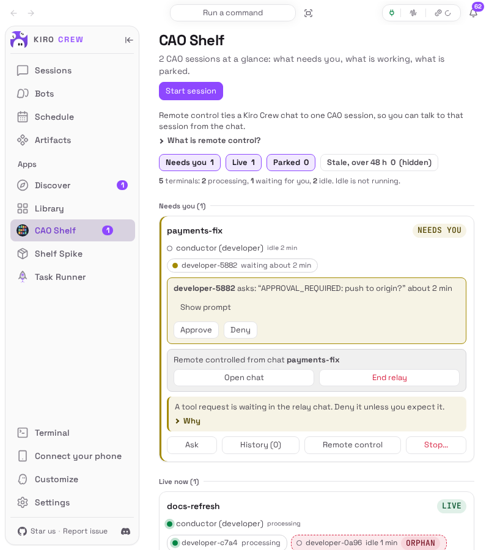
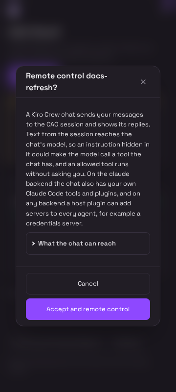

# CAO Shelf (Kiro Crew App)

CAO Shelf is a [Kiro Crew](https://github.com/kirodotdev/KiroCrew) App for CAO (CLI Agent Orchestrator): a sidebar page that shows every CAO session as one card, sorted into four tiers, **Needs you**, **Live**, **Parked** and **Stale**, so one glance answers three questions: does anything need me, what is
working, and what has been sitting idle for days.

A card is one CAO session. Its title is the session's conductor (the first agent, which hands work out) and
the helpers (the agents working for it) are small chips. From the page you can ask a conductor something,
answer a waiting helper, start a session, clean up stale sessions behind a listed,
unticked, confirmed stop, and remote control a session from a Kiro Crew chat
(see [Remote control](#remote-control)). The "shelf" is the picture: cards sit on a shelf, the busy ones in front and the
forgotten ones faded at the back.

It is a small, stdlib-only Python backend that polls CAO on loopback, plus a prebuilt React page.
CAO stays the source of truth: the App keeps no orchestration state of its own.

For the short task guide to CAO and Kiro Crew (install, configure, remote control, update), see
[Kiro Crew](../../docs/kiro-crew.md) in CAO's docs. This README is the full reference.

> **Status.** The backend, the page, the installer and the end-to-end rig are built and were run
> together against an isolated Kiro Crew 0.12.2 and a scratch CAO (see
> [Verified behaviour and limits](#verified-behaviour-and-limits) for what was run and what was
> not). Items marked **[UNVERIFIED]** come from reading Kiro Crew or CAO documentation or source and
> were not exercised.

## Who it is for

Operators who run many CAO sessions and open them rarely. In a read of a live CAO 2.5.4 server,
20 of 20 terminals were `idle`, none was `processing`, and 9 of 20 had been idle for more than 48
hours. CAO's own pages group workers by profile and show idle terminals in a headline "running"
count. The Shelf instead:

* shows the **session** as the unit, with one conductor as its face and helpers under it;
* never calls idle "running"; it says "idle 2 h", computed from `last_active`;
* puts anything that needs an answer first, and fades sessions as they age;
* keeps closed helpers visible for a while in a History drawer, labelled as rebuilt from inbox rows.

For how it relates to `ui://cao/dashboard` and the Web UI, and why a custom App was built, see
[PROPOSAL.md](PROPOSAL.md) section 4.

## What you see

The two images below are screenshots of the running App inside Kiro Crew 0.12.2, taken by the e2e
run (`e2e/tests/test_screens_restyle.py`) against the isolated harness with scratch sessions: a
session in Needs you with a waiting helper and an active relay whose tool request waits, and the
Remote control dialog on a phone-width screen in the dark theme. The page is built from Kiro Crew's
own App Kit controls and colour tokens, so it follows the dashboard's theme (including dark mode and
theme packs). The e2e run saves the full set (360 and 800 px, light and dark, plus the CAO-down
banner, an orphan, a session without a conductor and the remote control explainer open) under
`e2e/artifacts/screens/`; only these two are committed.





The page layout:

* Near the top, whatever the page's state, one sentence on what remote control means and a
  **What is remote control?** disclosure, closed by default. Behind it: the chat is tied to one
  CAO session; your messages go to its conductor tagged `[REMOTE-CONTROL]` (a `/` message goes
  untagged) and its replies come back to the chat; the relay agent reads the replies to judge
  progress (idle does not mean done, since helpers may still work), checks back with pauses and
  reports; you can keep typing to the session directly, and your next chat message then carries
  `[REMOTE-CONTROL catch-up]` so the reply opens with a brief; End relay stops the chat, never the
  CAO session; and how to start one. The texts are in [api-contract.md](api-contract.md#remote-control).
* A header with a **Start session** button (in the empty state instead when there are no sessions) and four tier toggles (Needs you, Live, Parked, Stale).
  Stale is off by default; the toggle states are remembered in the browser only.
* One honest line, for example "20 terminals: 0 processing, 0 waiting for you, 20 idle. Idle is
  not running."
* Cards grouped by tier. Each card has the conductor row, helper chips (at most 5, then "+N"), an
  expandable details table (terminal id, status, `last_active`, `caller_id`), and its actions.
* A helper whose caller no longer exists gets a dashed red **ORPHAN** chip. A non-conductor with no
  caller is marked "(peer)". If a session's conductor was deleted and only helpers are left, the
  card says **no conductor**, flags those helpers as orphans and turns **Ask** off with a reason.
* A count line, "N sessions hidden (unsupported name)", when CAO has `cao-` sessions whose names
  the Shelf cannot address (see [Limits](#limits-and-known-unverified-items)).
* A sidebar badge with the Needs you count, and a polite live region that announces a session
  entering Needs you without moving focus.

The original concept, before the page moved onto the App Kit, is the interactive mock
[design/mock-11-cao-shelf.html](design/mock-11-cao-shelf.html) with the text
[design/concept-11.md](design/concept-11.md); the running page no longer matches its folder-card look.
Where the mock shows closed helpers by name (for example "planner"), the App cannot: see
[Limits](#limits-and-known-unverified-items).

## Requirements

| Item | Needed | Notes |
|---|---|---|
| CAO | Running `cao-server` at `http://127.0.0.1:9889` | Targeted at CAO 2.5.4 and current main. Auth must be off (the default). No CAO setting is required: MCP Apps, AG-UI and the events surface can all stay off. |
| Kiro Crew | `kirocrew` on `PATH`, version **0.12.2** | The only version tested. `minKiroCrewVersion` in `app.json` is `0.12.2`. Pre-release `0.13.0-rc.1` is not targeted. Later releases are [UNVERIFIED]. |
| OS | macOS or Linux | CAO needs tmux or herdr, so Windows is out. The spike ran on Linux only; macOS is [UNVERIFIED]. |
| Python | None to install | The backend runs with Kiro Crew's own Python (3.12 in 0.12.2) and uses only the standard library. |
| Node | 22.12 or later, **only to rebuild the page** | A built page, `ui/bundle/index.mjs`, is committed with `ui/bundle/.inputs-sha256`, a content hash of its inputs (`ui/src`, `package.json`, `package-lock.json`, `vite.config.ts`, `tsconfig.json`), so a clone installs without Node: `install.sh` compares that hash, not file times. `app.json` names it `"entry": "bundle/index.mjs"`: Kiro Crew resolves `ui.entry` relative to the App's `ui/` folder and serves `ui/bundle/index.mjs` (checked: `ui/bundle/index.mjs` as the entry makes the page fail to load with a 404). |
| Network | Loopback only | The backend talks only to CAO on `127.0.0.1`, `localhost` or `::1` and to its own Kiro Crew gateway on loopback (for relay chats). |
| `cao-ops-mcp-server` | On `PATH` when you run `install.sh` | Comes with CAO. The remote-control agent runs it; `install.sh` refuses to install without it. |

The Kiro Crew dashboard must be served from the origin root, as it is by default. Hosts that serve
it under a path prefix are out of scope.

## Install

### From a fresh Kiro Crew to your first relay

Run these from a clone of this repository, in the shell where you use `kirocrew`:

1. Install Kiro Crew 0.12.2 or later (see [Kiro Crew](https://github.com/kirodotdev/KiroCrew)) and
   start it the way its guide says, so the dashboard opens.
2. Start CAO in its own terminal, and leave it running there (it runs in the foreground):

   ```bash
   cao-server
   ```

   Back in your first shell, check that `cao-ops-mcp-server` is on `PATH` (it comes with CAO); this
   prints a path when it is:

   ```bash
   command -v cao-ops-mcp-server
   ```

3. Install with the per-app trust grant (read [the trust step](#the-trust-step-in-plain-words)
   first). Add `--relay-model claude-haiku-4.5` to run the relay on a cheaper model, or
   `--cao-url URL` when CAO is not at `http://127.0.0.1:9889`:

   ```bash
   examples/kiro-crew-cao-shelf/install.sh --trust-app
   ```

   On a first install the script ends with exit code 7 and Kiro Crew's link to the App. That is
   expected: the next step finishes it.
4. Give the session-approval consent: open the link (or the dashboard: Apps, Library, CAO Shelf; a disabled App is not in the sidebar yet), read what
   the App asks for, and enable it there. Kiro Crew takes this consent only in the dashboard (see
   below for why the App asks).
5. Open the page: choose **CAO Shelf** in the dashboard's sidebar. If it says the App has no
   reachable backend, restart Kiro Crew the way you normally do.
6. On the `claude` ACP backend only, add [the Claude allow rule](#one-time-setup-the-claude-allow-rule)
   once. On `kas` you need no rule.
7. Start your first relay: on a session's card, press **Remote control**, read the risk, press
   **Accept and remote control**, and type a message in the chat that opens. With no session yet,
   press **Start session**, tick **and remote control it** and **I accept this risk**, and start one.

### What install.sh does

The script:

1. finds `kirocrew` on `PATH` and checks the version is 0.12.2 or later (it prints a `Target:` line naming the `HOME` and gateway port it will act on);
2. finds `cao-ops-mcp-server` on `PATH` (it comes with CAO) and the CAO address for the remote-control agent: `--cao-url`, else `CAO_SHELF_CAO_URL`, else `http://127.0.0.1:9889`;
3. builds the page only if `ui/bundle/index.mjs` is missing or the hash of its inputs differs from the one recorded in `ui/bundle/.inputs-sha256` (the only step that needs Node 22.12 or later; file times are not used, so a fresh clone needs no build);
4. stages a copy of this folder whose `app.json` names the absolute path of `cao-ops-mcp-server` and that CAO address (and whose relay agent names the `--relay-model` id, when you give one), then runs `kirocrew app install` on the copy, or `kirocrew app update` when the App is already installed (app data is kept). Your folder's own `app.json` is not changed. The copy goes under `$TMPDIR`, or `~/.cache/cao-shelf-install` when `TMPDIR` is unset, and is removed at the end;
5. applies the trust option you chose, then runs `kirocrew app enable cao-shelf`.

Without a trust option it changes no trust setting, says what is set, and exits 4 with the exact command to finish. It exits 2 when `kirocrew` is missing or too old, the CAO address is not loopback `http`, or the relay model is not a model id Kiro Crew accepts, 3 when the bundle is missing or stale and cannot be rebuilt, 5 when a `kirocrew` command fails, 6 when `cao-ops-mcp-server` is not on `PATH` (nothing is installed), and 7 when Kiro Crew waits for your session-approval consent (next paragraph).

**Consent in the dashboard.** Version 0.2.0 asks Kiro Crew for session approval: Kiro Crew refuses an App's trust-mode call without it, and CAO Shelf uses it only to set each relay chat's trust mode to `normal`; it approves no tool request (see [Remote control](#remote-control)). Kiro Crew gives this consent only in the dashboard, never from the command line, so on a first install, and on an update from 0.1.0, `kirocrew app enable` refuses with "asks to control your chats" and `install.sh` exits 7 with Kiro Crew's link to the App's page. Open it (or the dashboard: Apps, CAO Shelf), read what the App asks for, and enable it there. Run `install.sh` again afterwards only if you change something.

| Flag | Effect |
|---|---|
| `--trust-app` | Trust only `cao-shelf` (adds it to `agent.apps_trusted` and `agent.apps_trusted_local`). Recommended. |
| `--trust-all` | Set `agent.apps_allow_third_party=true`, which trusts EVERY third-party App. Never done without this flag. |
| `--cao-url URL` | The CAO the remote-control agent's `cao-ops-mcp-server` talks to (loopback `http` only). Default: `CAO_SHELF_CAO_URL` if set, else `http://127.0.0.1:9889`. Keep it equal to the page's `cao_url` setting: CAO Shelf refuses to attach a relay when they differ. |
| `--relay-model ID` | The model of the remote-control relay agent (`cao-remote-control`). Default: `CAO_SHELF_RELAY_MODEL` if set, else `auto`, the backend's own default. See [A cheaper model for the relay](#a-cheaper-model-for-the-relay). |
| `--dry-run` | Print every command that changes anything; run none of them. |
| `--no-build` | Skip the page build even if the bundle looks stale. |
| `--uninstall` | Disable and uninstall. App data is kept unless `--purge-data` is also given. |
| `--purge-data` | With `--uninstall`: delete the App's `data/` folder too. |

Then open the Kiro Crew dashboard and choose **CAO Shelf** in the sidebar. Kiro Crew assigns the
backend's loopback port when it starts the App (`"port": "auto"` in `app.json`), so you set no port.

### A cheaper model for the relay

The relay agent only forwards messages and copies replies, so a small model is enough for it. To
run it on Haiku:

```bash
examples/kiro-crew-cao-shelf/install.sh --trust-app --relay-model claude-haiku-4.5
```

The script writes the id into the installed copy's agent file; this folder's agent keeps `auto`. It
checks only the id's shape, with Kiro Crew's own model-name rule: letters, digits, `.`, `_` and `-`
starting with a letter or digit, with at most one trailing `[qualifier]`, or a `provider/model` id.
Anything else exits 2 and nothing is installed. The shape check says nothing about entitlement,
which differs by account and backend, so the App ships no model id of its own:

- On the KAS or kiro backend (kiro-cli), `claude-haiku-4.5` runs Haiku when your account is
  entitled to it.
- On the claude backend, Kiro Crew has no Haiku and folds `claude-haiku-4.5` onto Sonnet, so the
  relay runs on Sonnet.
- The script cannot check entitlement. On KAS, Kiro Crew does not use a model the account is not
  served: the relay chat stays on the session's current model (`auto`) and Kiro Crew only logs a
  warning. On another backend such a model can fail at the relay chat's first message.

Kiro Crew also has its own per-App pin, with no install step: Settings, Chat, Model, Apps, row
CAO Shelf (`apps.cao-shelf.model`). It applies while the agent's `model` is `auto`.

Kiro Crew treats an agent's `model` as your preference and keeps the one already on an installed
agent when it updates an App. So the id takes effect on a first install; on an App that is already
installed, the script says so, and you apply it with `install.sh --uninstall` and then the install
command again (app data is kept, and you enable CAO Shelf in the dashboard again).

The equivalent manual steps, which were run in the spike with the same Kiro Crew commands:

```bash
kirocrew app install examples/kiro-crew-cao-shelf
kirocrew app enable cao-shelf
```

To rehearse without touching your own Kiro Crew, use the isolated rig (`make install-isolated`,
see [e2e/rig/README.md](e2e/rig/README.md)).

To pick up changes after you edit the folder, `kirocrew app update cao-shelf --source
examples/kiro-crew-cao-shelf` re-copies it.

## The trust step, in plain words

Kiro Crew denies third-party App code by default. Enabling the Shelf is refused with
`app_execution_denied` until you grant trust. Enabling an App means **running its backend code with
the privileges of the Kiro Crew gateway**, which is your user account.

What you are trusting here: the backend is small, standard library only,
open source in the CAO repository (Apache-2.0), and written to speak only to CAO on loopback.
Read it before you enable it: `backend/server.py` and `backend/cao_shelf/`.

You have two ways to grant trust:

* **Per-app grant (recommended).** `./install.sh --trust-app` adds only `cao-shelf` to
  `agent.apps_trusted` and `agent.apps_trusted_local`. Run in the isolated rig: the App enabled and
  its backend started. Uninstalling removes the grant, which is why the script applies trust after
  installing.
* **Blanket grant.** `kirocrew config set agent.apps_allow_third_party true`, or in Settings,
  Security, Third-party apps, "Trust every third-party app". This trusts **every** third-party App,
  not only this one. It is the path the spike used. `install.sh --trust-all` does exactly this and
  nothing else does.

If you revoke trust later, Kiro Crew stops the backend within one health-watch interval.
[UNVERIFIED]

Kiro Crew's sandbox is **not** relied on as a boundary. On the spike host, a backend in the standard
sandbox could still write outside its folder and reach loopback ports. The App's own rules (below)
are the control.

## Using it

### Tiers

A session goes in the first tier that matches, using the status and `last_active` of its terminals
(rules in [api-contract.md](api-contract.md)):

| Tier | When | Notes |
|---|---|---|
| Needs you | Any terminal is `waiting_user_answer` or `error` | `error` gets a red edge, waiting gets an amber edge. The age shown is "about", because CAO reports no "waiting since" time. |
| Live | Any terminal is `processing` or `completed` | |
| Parked | Idle, and the newest `last_active` is under the stale threshold (48 h by default) | Under 1 h old is "warm". A session with any terminal whose `last_active` is missing or unreadable is Parked and says "age unknown": an unreadable clock is never shown as "now", and such a session is never Stale, so clean-up cannot pick it. |
| Stale | Idle, and the newest `last_active` is at or over the stale threshold | Dimmed; full colour on hover or focus. Hidden by default. |

The thresholds (1 h and 48 h) are settings. Order is Needs you, Live, Parked, Stale; within a tier
the most recently active session comes first.

Status comes from CAO and CAO **infers** it from the terminal screen, so it is a hint and can be
wrong. `last_active` is the better clock. The expanded details table shows both.

### Actions and their confirmations

| Action | What it does | Confirmation and safety |
|---|---|---|
| **Ask** | Sends a message to the session's conductor, as an inbox message from the sender id `cao-shelf`. The page then says what CAO did with it, read back from the conductor's inbox: delivered, or **queued** because the conductor is busy (CAO delivers it when the conductor is idle), or failed, or accepted but not confirmed. The card shows the conductor `processing`, `completed`, then idle on later refreshes. | If the conductor changed since the page rendered, nothing is sent and you see "This session changed, reload". A session whose conductor was deleted has no one to ask: Ask is off (and the backend refuses it), so a helper is never asked as if it were the conductor. |
| **Answer** | For a terminal that is waiting, shows the last lines of its prompt as plain text behind a "Show prompt" disclosure. You type an answer, or press a quick button when the App recognised the prompt. The answer goes to the terminal as typed input. The card quotes the last line of the prompt as the question (the shelf itself carries no question text). | The backend re-reads the terminal first. If it is no longer waiting, nothing is sent and you see "<name> is no longer waiting". Quick buttons exist only for a prompt shape the App recognises **on the provider it was recorded on** (today the `mock_cli` shape on `mock_cli`; other providers only after recordings, see Limits). Otherwise there is always a text box. Bidi, zero-width and C1 control characters are removed from prompt text before it is shown. |
| **Start session** | Opens a dialog: profile (listed from CAO), optional provider, working directory (required), optional first message, optional name. | Nothing is sent until you press Start. The dialog picks one idempotency key when it opens and sends it again if you press Start again after a failure, so a retry cannot launch a second session (CAO and the backend both treat a repeat of the same request as the first). A failure shows the error code and a fixed sentence naming the usual causes (name already used, directory missing, profile not installed); CAO's own text is not copied. |
| **Stop...** and **Clean up stale (N)...** | Ends sessions in CAO. | See the next section. |

### Safety of the steering actions

Stopping a session is destructive: CAO removes the session and its terminals. The Shelf is built so
it cannot stop anything you did not see listed and tick:

* The dialog names **every session and every terminal** it would end. **Nothing is ticked** when it
  opens, and the red button stays disabled until something is. The button states the count, for
  example "Stop 3 sessions (7 terminals)".
* If any listed session is working or waiting for an answer, a red warning names it.
* **Clean up stale** lists only sessions that are stale at the moment the list was built, oldest
  idle first, at most 25, with a notice if more exist. "Select all" exists only in that dialog and
  only ticks the rows listed.
* The stop request carries an explicit list of sessions. There is no "all", no wildcard and no
  shorthand; unknown request fields are rejected.
* For each ticked session the backend re-reads it just before stopping and **skips it** (reporting
  why, and sending nothing to CAO for it) if its `last_active` moved, its terminals changed, or it
  became active. A list older than 5 minutes is refused.
* On the first transport error to CAO the backend stops and reports the rest as failed instead of
  retrying. At most 25 sessions are stopped per request.
* Closing the dialog or pressing Cancel sends nothing to CAO. While a stop is in flight, Escape and
  Cancel do nothing, so the result of every session is shown before the dialog can close.

The backend log records one audit line per stop attempt with the session name, a terminal count and
the outcome, and no text.

## Remote control

Remote control lets you hold a conversation with a CAO session from a Kiro Crew chat: the
dashboard, the desktop app, or a phone through the tunnel. You type in the chat; the chat's agent
sends your message to the session's conductor, waits for the turn to end, and shows the reply. The
session needs to know nothing about it beforehand.

### What the chat can reach (read this first)

What reaches a relay chat besides its four CAO tools and Kiro Crew's `wait` tool depends on Kiro
Crew's ACP backend (the
`agent.acp_backend` setting): `kas` or `claude`.

**On the `kas` backend** the agent's `tools` list is a strict allowlist. The chat is offered exactly
the four CAO tools and `wait`, and its `allowedTools` become `permissions` allow rules for those
five, so they run without asking you; `wait` only pauses the chat, and a CAO tool runs for any
terminal id the model chooses. No Kiro built-in tool (shell, file
read or write, web fetch or search, sub-agents) is mounted, Claude Code is not involved (so
`~/.claude`, its plugins, permission mode and sandbox do not apply), and the servers in your
`~/.kiro/settings/mcp.json` are excluded. You need no allow rule. This was checked against Kiro Crew
0.12.2's source, not yet in a live run (see [What holds and what does not](#what-holds-and-what-does-not)).

**On the `claude` backend** Kiro Crew 0.12.2 runs a relay chat with **your own Claude Code
settings** and gives an App no way to narrow them. One part is closed: the agent's `toolsSettings`
make Kiro Crew refuse every shell command and every call of Claude Code's file-edit tools (Edit,
MultiEdit, NotebookEdit, Write) in the chat, sub-agents' calls included, under any permission mode
(proved on the rig with `"defaultMode": "auto"` in the user settings), with one exception: when the
Claude Code sandbox is on (`sandbox.enabled`) and `sandbox.autoAllowBashIfSandboxed` is true, Claude
Code approves a shell command that will run in its sandbox by itself, and Kiro Crew never sees it
(shown on the rig: no refusal row). Do not rely on that setting's default: it differs between Claude
Code builds (true in 2.1.312 and 2.1.220, taken from a remote feature gate in 2.1.325), and Kiro Crew
may run any of them. **If you enable the Claude Code sandbox, also set
`sandbox.autoAllowBashIfSandboxed: false` explicitly.** A tool that writes on its own
(`EnterWorktree`, or a plugin tool) is not covered either. The rest of your Claude Code setup
reaches the chat beside its four CAO tools and `wait`:

* your plugins and user-level MCP servers (for example Slack, mail, ticket, code review or GitHub
  tools), which Claude Code mounts in every session;
* the other built-in tools. On the rig (claude-agent-acp 0.99.1, Claude Code 2.1.325) a relay chat
  was offered `Agent`, `AskUserQuestion`, `CronCreate`, `CronDelete`, `CronList`, `EnterPlanMode`,
  `ExitPlanMode`, `EnterWorktree`, `ExitWorktree`, `ListAgents`, `ListMcpResourcesTool`,
  `ReadMcpResourceTool`, `ReadMcpResourceDirTool`, `Monitor`, `Read`, `ReportFindings`,
  `ScheduleWakeup`, `SendMessage`, `Skill`, `TaskStop`, `WebFetch`, `WebSearch` and `Workflow`,
  beside `Bash`, `Edit`, `NotebookEdit` and `Write`; your build's list can differ. A sub-agent
  (`Agent`) started there with no permission request at all, in `normal` mode with no allow rule,
  and ran asynchronously: a sub-agent started from a relay chat can keep running after End relay or
  Take over, because the relay-ended message stops only the relay chat's own agent;
* your permission mode and your `permissions.allow` rules.

**On both backends, a host plugin can add servers to every agent.** Kiro Crew lets an installed
plugin add an MCP server to every agent spec it renders, the relay agent included. On some
installs a plugin adds a credentials server, whose tool hands out cloud credentials; the relay
agent's installed file (`~/.kiro/agents/cao-shelf--cao-remote-control.json`) then lists that server
in its `tools`, so it is mounted on `kas` too. Such a plugin adds the server to `tools` only, never to
`allowedTools`, so its calls ask you first unless an allow rule, `auto` mode or a YOLO grant covers
them. CAO Shelf cannot remove a server a host plugin adds. Look at that file after you install or
update a plugin.

The chat's model reads what the CAO session wrote, and that text can carry instructions from
whatever the session read (a web page, an issue, a file in a repository). The agent is told to
treat it as data, but that is an instruction to a model, not a control. If such text makes the model
call a tool, the call **runs without asking you** when it is one of the four CAO tools or `wait` on
`kas`, when an allow rule covers it, or (on `claude`) when your `defaultMode` is `auto` (or `bypassPermissions`);
otherwise the chat shows a permission request, which you should refuse. On `claude` the worst case
is concrete: `Read` plus `WebFetch`, or any plugin that posts or sends, is enough to send out any
file you can read, `~/.aws` included. CAO Shelf states this and makes no relay chat until you accept
it, in the Remote control dialog of a card ("Accept and remote control") and in the Start dialog
("I accept this risk"). The page shows the short text, with the detail behind "What the chat can
reach":

> A Kiro Crew chat sends your messages to the CAO session and shows its replies. Text from the session reaches the chat's model, so an instruction hidden in it could make the model call a tool the chat has, and an allowed tool runs without asking you. On the claude backend the chat also has your own Claude Code tools and plugins, and on any backend a host plugin can add servers to every agent, for example a credentials server.
>
> **What the chat can reach** (behind a disclosure on the page):
>
> On the kas backend the chat is offered only its four CAO tools (send_session_message, get_terminal_status, read_session_output and get_session_info) and Kiro Crew's wait tool, which only pauses the chat. They run without asking you, and a CAO tool runs for any terminal the model names. No Kiro built-in tool (shell, files, web or sub-agents), no Claude Code setting or plugin and no server from your mcp.json reaches it, except servers that Kiro Crew or a host plugin adds to every agent.
>
> On the claude backend the chat runs with your own Claude Code settings. Besides its four CAO tools and Kiro Crew's wait tool (which only pauses the chat), it can reach your Claude Code plugins, your user-level MCP servers and Claude Code's other built-in tools (for example Read, WebFetch, sub-agents, scheduled tasks and worktrees). Kiro Crew refuses the shell and Claude Code's file-edit tools here; if you enable the Claude Code sandbox, also set sandbox.autoAllowBashIfSandboxed to false, or sandboxed shell commands run without that refusal. A call runs without asking you when your Claude Code settings allow that tool or use auto mode. Sub-agents start without asking and can go on after End relay or Take over. Read plus WebFetch, or any plugin that posts or sends, is enough to send out any file you can read.
>
> On both backends a host plugin can add an MCP server to every agent, this one included: on some installs a credentials server whose tool hands out cloud credentials. Such a tool asks you first unless an allow rule, auto mode or a YOLO grant covers it. In a relay chat, refuse any request for a tool other than the four CAO tools and wait.

To keep the risk low while you use relays on `claude`, keep `defaultMode` off `auto` and
`bypassPermissions`, set `sandbox.autoAllowBashIfSandboxed: false` explicitly if you use the
sandbox, and keep allow rules for plugin, MCP or built-in tools other than the five below out of
your user settings. On both backends, do not arm a YOLO grant while a relay is active. CAO Shelf
never reads or changes your Claude settings.

### Start a relay

* On a card, press **Remote control** (in the row with Ask, History and Stop). A dialog states
  the risk above, with the detail behind **What the chat can reach**; press **Accept and remote
  control**. Cancel or Escape makes nothing. CAO Shelf then creates a chat titled "Remote control: <session>"
  on its `cao-remote-control` agent, sets the chat's trust mode to `normal`, posts one setup message
  naming the session and its conductor terminal, and opens the chat. A session without a conductor
  cannot be remote controlled; the button says so.
* In the Start dialog, tick **and remote control it**, read the same short text and disclosure,
  then tick **I accept this risk** (Start stays off until you do). The new session's first message is the
  remote-control handshake (so the first-message field is hidden), and the chat opens when the
  session has started. You send your first message from the chat. A retry of the same dialog
  starts no second session.
* A session has at most one active relay. Pressing Remote control on a relayed card opens the
  same dialog, which offers **Open chat** and **Take over** with the same risk stated; nothing is created until you press
  Take over, which ends the old relay (its chat gets a relay-ended message) and opens a new chat.

The card of a relayed session says "Remote controlled from chat <label>" with **Open chat** and
**End relay**. End relay posts a relay-ended message in the chat and never touches the CAO
session, also when the relay started it. The message is what stops the chat: if Kiro Crew does not
answer at that moment, the card says the chat has not been told yet, and CAO Shelf posts the
message as soon as Kiro Crew answers again (the same holds for the old chat after Take over). Typing to the session directly does not end the relay:
your next relayed message carries a catch-up tag, and the session opens its reply with a brief of
what happened in between. If the CAO session goes away, the relay is marked orphaned; if its
conductor changes (for example after a CAO restart), the card says so and you can attach again; if
you delete the chat in Kiro Crew, the relay ends. Each case is noticed within one refresh while
the page is open, and within a minute when it is not.

### What the chat does

The agent may use four tools of CAO's `cao-ops-mcp`: `send_session_message`,
`get_terminal_status`, `read_session_output` and `get_session_info`, and Kiro Crew's `wait` tool
(`@kirocrew-core/wait`), which only pauses the chat. It has no tool to launch, stop or install
anything. (On `kas` the per-tool `tools` refs already narrow the mount to the four,
and a tool a later `cao-ops-mcp` adds is not offered. On Kiro Crew 0.12.2's `claude` backend a
per-tool grant mounts the whole `cao-ops-mcp` server, so the agent also lists every other
`cao-ops-mcp` tool in its server entry's `disabledTools`; Kiro Crew turns that list into Claude
`permissions.deny` rules (on `kas`, into the agent's `excludedTools`), and the chat is offered
exactly four of `cao-ops-mcp`'s tools. A tool a later `cao-ops-mcp` adds is not in that list: on
`claude` it would be offered too. Your own plugins and MCP servers are offered as well on `claude`,
and a host plugin's servers on both, see above.) For each message
it checks the conductor's status first and sends only
when the conductor is idle or completed. When the conductor is busy, waiting for an answer, or
gone, it sends nothing and answers with numbered options, for example "1. Check again, 2. Queue it
anyway, 3. Cancel"; you reply with the number or the words. It shows each reply exactly as the
session gave it, between two marker lines, and treats it as data, not instructions. A message that
starts with `/` and is not a command of the chat itself is sent without the tag. The chat's own
slash commands never reach the session: `/compact` compacts the relay chat, and with it the history
that holds the setup message (the target), so do not use it in a relay chat. The texts are listed in
[api-contract.md](api-contract.md#remote-control).

**Approvals go through the Answer box.** `cao-ops-mcp` cannot type into a waiting terminal, so
when the session waits for an approval, the chat tells you to answer it in CAO Shelf's Answer box
on the session's card, then choose Check again.

**Check again never sends twice.** Offered before anything was sent (busy, waiting, or CAO did not
answer), it checks the status again and sends your message if the session is free. Offered after a
send (still working after 30 status checks, or stopped for an approval), it keeps waiting for the
same turn with a new budget and sends nothing again. When the session was still on the
remote-control handshake, the chat says your message has not been sent yet; Check again waits for
the handshake's turn to end and then sends your message.

### One-time setup: the Claude allow rule

You need this only on the `claude` backend. On `kas` the five tool calls (the four ops tools and
Kiro Crew's `wait`) never ask (the agent's `allowedTools` become KAS allow rules for exactly those),
and Claude Code's settings do not apply; adding the rule there does no harm, but it only affects
your Claude Code sessions.

On the `claude` backend each of the four tool calls, and each wait, asks for your permission until
you allow them.
Add this rule once to your Claude Code user settings (`~/.claude/settings.json`), merged into any
`permissions.allow` list you already have:

```json
{
  "permissions": {
    "allow": [
      "mcp__cao-shelf_ops__send_session_message",
      "mcp__cao-shelf_ops__get_terminal_status",
      "mcp__cao-shelf_ops__read_session_output",
      "mcp__cao-shelf_ops__get_session_info",
      "mcp__kirocrew-core__wait"
    ]
  }
}
```

CAO Shelf never edits that file. When a relay chat has an unanswered tool request, the card says a
request is waiting. On `kas`, and on `claude` with the rule in place, the four tools and `wait`
never ask, so such a request is for another tool: deny it unless you are on `claude`, have not added
the rule yet, and the chat shows one of those five.
The name a request shows can be chosen by the model (a sub-agent's title is its description), so
CAO Shelf does not read it and never tells you to approve. The rule is
user-wide and matches by name: it pre-approves these four tools of any MCP server Claude Code names
`cao-shelf_ops`, in every Claude Code session you run (a project `.mcp.json` that defines a server
under that name included, once you accepted that server). CAO Shelf's agent is the only one that
ships a server by that name. `mcp__kirocrew-core__wait` pre-approves Kiro Crew's own `wait` tool
(a pause of 60 to 1800 seconds) in every Claude Code session that mounts `kirocrew-core`.

**CAO Shelf never approves a request for you.** An earlier draft had an optional App-side approver
for the four tools. It was removed: Kiro Crew 0.12.2 records no trusted tool identity on a
permission request in a Claude-backend chat, only a title, and the model can choose a title (a
sub-agent call titled like an ops tool, for example), so an approver could be talked into approving
another tool. Approve in the chat, or add the rule above.

**What the session-approval consent grants.** You give it in the dashboard when you enable the App
(see [Install](#install)). It lets the App's backend approve tool requests in, send messages to, and
set the approval mode of **any** of your local Kiro Crew chats, not only the App's own. Kiro Crew
refuses the App's call that sets a relay chat's trust mode to `normal` without it, so remote control
needs it. CAO Shelf's own code uses it only for that: setting `normal` mode on its own relay chats.
It approves nothing and sends only its setup and relay-ended messages to its own relay chats. That
is a property of this App's code, not a limit Kiro Crew enforces, which is one more reason to read
`backend/cao_shelf/` before you enable it.

### What holds and what does not

* **The target is held by the agent's instructions, not by code.** The setup message names one
  conductor terminal, and the agent is told to use only that one and to refuse any request, yours
  or the session's, to address another. Code holds the rest: which `cao-ops-mcp` tools are
  offered, the refusal of shell and file writes, the `normal` trust mode, the risk you accept, one
  relay per session, the records, and reconcile. On `kas`, and on `claude` with the allow rule in
  place, the four tools and `wait` run without a prompt; a CAO tool runs for any terminal id the
  model chooses.
* **Fresh replies are held by the instructions too.** On current CAO the agent waits until the
  conductor's `status_generation` moves past the reading it sent at. CAO 2.5.4 reports no
  `status_generation`, so there the agent waits until it has seen `processing` for this message:
  replies are best effort on CAO 2.5.4, and the catch-up tag is not used there (the session's own
  unprompted brief is the fallback).
* **Waiting costs a wait, not a model call a second.** Before each status check of a turn the agent
  calls Kiro Crew's own `wait` tool for 60 seconds (300 seconds while it watches delegated work),
  which pauses the chat without a model call; the App's manifest declares `mcpTools: ["wait"]`, so
  Kiro Crew withholds every other `kirocrew-core` tool from the agent. A reply therefore shows up to
  a minute after the turn ends. At most 30 status checks per message (30 minutes of turn, two and a
  half hours of watching); then it says the session is still working and offers Check again (a new
  budget) or Stop waiting. Pressing End wait on a wait counts as Stop waiting. Before the wait tool,
  a 120-second `mock_cli` turn took 113 status checks on the rig, back to back, each a model call;
  with it, see [Verified behaviour and limits](#verified-behaviour-and-limits).
* **Idle is not done.** The agent reads every reply and judges from it. A conductor that assigned or
  handed off work can be idle while its helpers work, so a reply that says it delegated, is waiting
  for helpers or callbacks, or will report back is shown with a line naming the helper terminals
  that are processing (from `get_session_info`), and the agent keeps watching, without asking you,
  until a reply says the request is finished, failed or needs input.
* **On `claude`, your own Claude Code tools reach the chat; on both backends, so do servers a host
  plugin adds to every agent** (see
  [What the chat can reach](#what-the-chat-can-reach-read-this-first)). On `claude` Kiro Crew
  refuses the shell and file writes there. The chat's `normal` trust mode asks you only about calls
  the backend asks Kiro Crew about: a call your allow rules cover, any call Claude Code's `auto`
  mode approves, and any call while a YOLO grant is armed runs without a request. Refuse any
  request in a relay chat for a tool other than the four CAO tools and `wait`.
* **Privacy.** Your relayed messages and the session's replies pass through the relay chat's model
  provider and are stored in the Kiro Crew transcript of that chat. CAO Shelf itself keeps no
  message text (see [Privacy](#privacy)).
* **Not verified:** the `kas` backend in a live run (checked against Kiro Crew 0.12.2's source
  only: `tools` is a strict allowlist and `allowedTools` pin the four tools and `wait` without a
  prompt; open are the `cao-shelf:ops` tool names with a colon, servers KAS starts for every session, and the CAO
  address reaching the ops server), the plain kiro-cli backend, Kiro Crew channels (whether a
  channel conversation can use the agent), and how faithfully a real model relays. [UNVERIFIED]

The App needs `cao-ops-mcp-server` on the gateway's `PATH` when you install it; `install.sh`
resolves it to an absolute path and writes that path, and the CAO address, into the installed
copy of the relay agent (`agents/cao-remote-control.json`, server `cao-shelf:ops`). The server is
declared there only, never in `app.json`: Kiro Crew copies every App manifest MCP server into your
default agent's config (`kirocrew.json`), which would give your ordinary chats the whole
`cao-ops-mcp`, `launch_session` and `shutdown_session` included, pointed at your CAO. On the rig the
default agent's config holds no `cao-shelf` server and a default-agent chat is offered no ops tool.
Keep that address equal to the page's `cao_url`: CAO Shelf refuses to attach a relay when
they differ (`relay_cao_mismatch`).

The relay routes are `GET /api/relays`, `POST /api/relays`, `POST /api/relays/{id}/end` and
`POST /api/relays/{id}/takeover` (contract in [api-contract.md](api-contract.md#remote-control)).

## Configuration

Settings live in the page (a Settings panel) and are stored in `data/config.json` inside the App's
folder (file mode 0600). A change may name any subset of the settings; a change that leaves `warm_hours` at or above `stale_hours` is refused and nothing is saved:

| Setting | Default | Range | Meaning |
|---|---|---|---|
| `cao_url` | `http://127.0.0.1:9889` | `http://` and host `127.0.0.1`, `localhost` or `::1` | Where CAO is. Anything else is refused with `forbidden_host`. |
| `poll_seconds` | 5 | 3 to 60 | How often the backend and the page refresh. |
| `warm_hours` | 1 | 0.25 to 24 | Idle under this is "warm". |
| `stale_hours` | 48 | 2 to 720 | Idle at or above this is Stale. |
| `persist_history` | true | on or off | Keep the optional closed-helper ledger (see Privacy). |

The tier toggles are stored in the browser (`localStorage`, key `cao-shelf:tiers`) and are the only
thing the page remembers there.

You cannot pass environment variables to an App: Kiro Crew fixes the backend's environment. Use the
Settings panel. If CAO runs with `CAO_ALLOWED_HOSTS` that excludes `127.0.0.1`, CAO answers 400 to
the backend; the default allows it.

## How it talks to CAO

```
 Browser  --same origin-->  Kiro Crew gateway  --signed, loopback-->  Shelf backend  -->  cao-server
                            (/apps/cao-shelf/api/*)           (127.0.0.1:$PORT)    (127.0.0.1:9889)
```

`$PORT` is the loopback port Kiro Crew assigns to the backend when it starts the App.

The page cannot call CAO directly: the browser's `127.0.0.1` is not your CAO host when you reach the
dashboard through a tunnel, and CAO refuses cross-origin writes. So the page calls only its own
backend through Kiro Crew's proxy, and the backend calls CAO's REST API over loopback.

* The backend **reads** `GET /sessions`, `GET /sessions/{name}`, `GET /terminals/{id}` (once per
  terminal, the first of each session too, for `caller_id`, then cached), conductors' inbox rows (for History), terminal output
  (only when you open a prompt), `GET /agents/profiles` and `GET /health`.
* It **writes** only when you act: an inbox message (Ask, followed by one read of that inbox to
  report its delivery status), `POST /terminals/{id}/input` (Answer),
  `POST /sessions` (Start) and `DELETE /sessions/cao-<name>` (Stop).
* It polls **only while a page is open and visible**, plus, while a relay is active, one read of each
  relayed session a minute even with no page open (see [Remote control](#remote-control)). A session is read every refresh when it is hot,
  every 15 s when parked and every 60 s when stale, so a parked session that suddenly asks can take
  up to 15 s to reach Needs you. In steady state the design budget is about 0.5 to 2 requests per
  second to CAO, against about 3.3 per second for CAO's Web UI Home page with 12 sessions
  (counted by the backend tests against a counting fake CAO). Opening the History drawer re-reads that conductor's inbox when the cached rows are older than 15 s, so a helper that closed a moment ago shows up; "All history" reads at most 4 conductors per call and none after 8 s of CAO time, and a failed read leaves that session's cache as it was and the answer marked incomplete.
* It does not use `/events`, AG-UI or MCP Apps, so it works on a default CAO configuration.

Remote control adds two paths, both on loopback:

```
 Relay chat agent  --MCP stdio-->  cao-ops-mcp-server  -->  cao-server
 (cao-remote-control,              (started by Kiro Crew;     (inbox message, GET /terminals/{id},
  four tools only)                  CAO_API_HOST/PORT)         terminal output, session info)

 Shelf backend  --app token, loopback-->  Kiro Crew gateway  (/api/chat, /api/chat/*)
```

* The agent's `cao-ops-mcp-server` sends your relayed messages as inbox messages from the sender
  `cao-ops-mcp`, reads `GET /terminals/{id}` for status, and reads terminal output and session info.
  The Shelf backend makes none of these calls.
* The backend calls its own gateway (`KIROCREW_GATEWAY_ORIGIN`, loopback only) with an app token it
  gets for the App secret: it creates the relay chat (`POST /api/chat/slots`), sets its trust mode
  (`POST /api/chat/mode`), posts the setup and relay-ended messages (`POST /api/chat`), deletes a
  chat you asked to delete, and reads relay chats' rows for the card signals. It never approves a
  tool request. For attach it reads `GET /sessions/cao-<name>` (the
  conductor check); for start-and-attach it calls `POST /sessions` like Start. End relay makes no
  CAO call.

The full contract is in [api-contract.md](api-contract.md) and [schemas/](schemas/).

## What it never does

These are design rules, each backed by a test:

* No telemetry, analytics or external network calls; the manifest sets `permissions.network` to
  false, and a browser test checks the page requests only its own `/apps/cao-shelf/api/`.
* No shell: the backend has no `subprocess`, `os.system`, `eval`, `exec` or `shell=True`.
* It reads one injected secret, the App secret Kiro Crew sets, to get an app token for its own
  relay chats; it never stores or logs either. CAO auth tokens are not supported in this version.
* It never edits your Claude settings; the allow rule for remote control is a step you take.
* No writes anywhere but its own `data/` folder.
* No answer through the inbox route, and no stop of a session that was not listed and ticked.
* No rendering of CAO text as HTML: session names, profiles, prompts and messages are shown as plain
  text only, and no link is built from CAO data.
* No message bodies, prompt text, answers, working directories or first messages in logs.
* It does not read or write Kiro Crew's own settings or heartbeat. Its only Kiro Crew calls are
  the chat calls of its own relay chats.
* Remote control never stops, launches or installs anything in CAO: the agent has no such tool,
  and End relay makes no CAO call.
* It never approves a tool request in any chat, its own relay chats included.

## Privacy

* Logs hold timestamps, endpoint, status, durations, counts and error codes; session names appear
  only in stop audit lines. Bodies never do.
* The prompt tail is fetched when you open it, kept in memory for 10 seconds, and never logged or
  saved.
* Inbox row bodies are passed to the page when you ask for them and are not stored.
* `data/` holds `config.json` and, if `persist_history` is on, `ledger.json`: closed-helper
  ids, row counts and times, **no text**, with the CAO address it was written for in its header.
  If you point the App at another CAO, the old ledger is renamed aside
  (`ledger.json.<UTC time>.aside`) so two CAOs that share a session name never mix history; delete
  the `.aside` files when you no longer need them. With `persist_history` off, the ledger is not written.
* `data/relays.json` holds each relay's ids, session name, label, state, times, "not relayed" count
  and the CAO address, and **no message or reply text**. It is kept whatever `persist_history` says.
* Relayed messages and replies pass through the relay chat's model provider and are stored in the
  Kiro Crew transcript of that chat, as any chat is. CAO Shelf reads a relay chat's rows only to
  count turns the agent did not forward and to see a pending permission request; it keeps neither.
  `data/` is mode 0700 (set by Kiro Crew) and the files the App creates are 0600.

## Troubleshooting

Error codes are the ones in [schemas/errors.schema.json](schemas/errors.schema.json); the page shows them as banners or inline alerts. `app_execution_denied` and the "no reachable
backend" message come from Kiro Crew, not from this App.

| You see | Code or source | Cause and fix |
|---|---|---|
| `install.sh` exits 3: the bundle was not built from the current `ui/src` | `install.sh` | You (or a merge) changed the page's sources or build config after the committed bundle was built, and Node 22.12 or later with npm is not on `PATH`. Install Node so the script rebuilds it, run `make build-ui`, or pass `--no-build` to install the committed bundle as it is. A fresh clone does not hit this: freshness is a content hash, not file times. |
| Enable is refused | `app_execution_denied` (Kiro Crew) | Third-party Apps are not trusted. See [the trust step](#the-trust-step-in-plain-words). |
| `app 'cao-shelf' has no reachable backend` | Kiro Crew | The gateway could not reach the backend's unsigned `GET /health`, so it dropped the App from the proxy. Check the App's log in Kiro Crew, and that the install finished. |
| "CAO is not reachable at http://127.0.0.1:9889", last snapshot dimmed with its age, actions disabled | `cao_unreachable` | Start CAO with `cao-server`, or fix `cao_url` in Settings. The page never shows "no sessions" in this state. It recovers on its own after CAO returns. |
| Same banner after a slow CAO | `cao_timeout` | CAO did not answer in time (2 s to connect, 10 s to read, 30 s for Start). Retry. |
| Banner "auth-enabled CAO is not supported" | `cao_auth_required` | CAO answered 401 or 403. This version cannot supply a token. Run CAO with auth off, or use CAO's own Web UI. |
| Banner naming a missing field | `cao_incompatible` | CAO answered a shape this App does not understand (for example no `terminals` list). Check the CAO version against Requirements. |
| A banner or inline error with a CAO reason | `cao_error` | CAO answered some other 4xx or 5xx (the status is in the error detail). |
| "Cannot reach CAO" right after changing the address | `forbidden_host` | `cao_url` must be `http://` and loopback. |
| "<name> is no longer waiting" | `not_waiting` | The terminal left `waiting_user_answer` between your click and the send. Nothing was sent. |
| "This session changed, reload" | `conflict_changed` | The conductor or terminals changed since the page rendered. Nothing was sent. Reload. |
| Stop list refused as expired | `plan_expired` | The list is older than 5 minutes or was already used. Open the dialog again. |
| Session or terminal "not found" | `not_found` | It was removed in CAO meanwhile. Wait one refresh. |
| "too many" | `too_many` | A stop request listed more than 25 sessions, or more than 4 history reads were asked at once. |
| "invalid request" | `invalid_request` | A name or id failed validation, a field was unknown, or the body was over 64 KiB. For Start, names must match `[A-Za-z0-9][A-Za-z0-9_-]{0,58}`. |
| "N sessions hidden (unsupported name)" | none | CAO has `cao-` sessions whose names are outside `[A-Za-z0-9][A-Za-z0-9_-]{0,58}` (for example a dot, or over 59 characters). The Shelf cannot show, answer or stop them: use CAO. |
| A card says "no conductor" and Ask is off | none | The session's first terminal was deleted and its remaining terminals are helpers of it (flagged ORPHAN). Answer a waiting helper or stop the session from the card. |
| Sessions look empty right after CAO restarted | none | The backend keeps the last snapshot and marks it stale until CAO answers. Wait one refresh. |
| Nothing in Needs you although a terminal is waiting | none | Status is inferred from the screen by CAO, so it can lag. A parked session is read only every 15 s. Check the details table (status and `last_active`). |
| Remote control says `no_conductor` | `no_conductor` | The session's conductor was deleted, so there is nobody to relay to. Start a new session. |
| Remote control says `relay_exists` | `relay_exists` | The session already has an active relay. Open its chat, or press Take over. |
| Remote control says `gateway_unavailable` | `gateway_unavailable` | The backend has no loopback gateway address or App secret, or the gateway did not answer. Try again; if it persists, restart Kiro Crew the way you normally do. |
| Remote control says `gateway_refused (session_approval_not_granted)` | `gateway_refused` | Kiro Crew needs the App's session-approval consent: enable CAO Shelf in the dashboard. Other codes in brackets are Kiro Crew's own. |
| Remote control says `risk_not_acknowledged` | `risk_not_acknowledged` | A relay request came without `acknowledge_risk: true`. The page sends it only after you press Accept and remote control (or tick I accept this risk). |
| Remote control says `relay_cao_mismatch` | `relay_cao_mismatch` | The agent's ops server was installed for another CAO address than `cao_url`. Run `install.sh --cao-url <the page's address>`. |
| A relayed card says a tool request is waiting | none | On `kas`, and on `claude` with the allow rule in place, the four CAO tools and `wait` never ask, so deny the request unless you are on `claude`, have not added the rule yet (see [Remote control](#remote-control)) and the chat shows one of those five. |
| A card says the chat has not been told the relay ended yet | none | Kiro Crew did not answer when the relay ended. That chat keeps relaying until it is told; CAO Shelf posts the message on every watch pass and the notice goes away once it is posted. |
| A relayed card says "N not relayed" | none | The agent answered N of your messages without sending them to the session. Repeat the message, or end the relay. |
| Start fails with a provider error | `cao_error` | The page shows the fixed sentence; the HTTP status CAO answered is in the error detail (for example 400 for a name already in use). Check the name, that the working directory exists and the profile is installed. |

Reading the details table: each terminal row shows its CAO `status`, its `last_active` time, and its
`caller_id` (empty for the conductor and for peers). Ages count on in the page from `last_active`
between refreshes. The line under the table names the session's refresh class (every poll, about
every 15 s, or about every 60 s), which bounds how old its data can be.

**Clearing the ledger.** Uninstalling keeps `data/` by default. To forget closed-helper history,
turn `persist_history` off in Settings, then delete
`~/.kiro/crew/apps/cao-shelf/data/ledger.json` (with Kiro Crew's default home). The file is
rebuilt from CAO's inbox rows if you turn the setting back on.

## Limits and known unverified items

* **Closed helpers are ids, not names.** CAO keeps no name for a deleted terminal. History shows
  `helper 7a13` and "last message 26 h ago", not "closed 26 h ago". Only the newest 100 inbox rows
  per conductor can be read, so History can be incomplete; the drawer says so when it may be. CAO
  also sweeps inbox rows after 14 days. The optional ledger keeps ids and times beyond that.
* **Peers exist only in the fake.** Real CAO refuses to create a terminal without a `caller_id`
  (HTTP 403), so on a real fleet every non-conductor is a helper and `(peer)` never appears; the
  fake CAO used by the tests has peers.
* **Status is inferred by CAO** from the terminal screen and can disagree with reality. The Shelf
  never claims "running".
* **"Waiting since" is approximate**; the App shows `last_active` and says "about".
* **Handoff and assign look the same** in the data; the card says "conductor working, helper `x`
  working", not "handoff in flight".
* **Suggested quick answers** exist today only for the `mock_cli` prompt shape, and only when the
  terminal's provider is `mock_cli`: the same last line from any other provider gets a text box.
  Real provider prompt shapes (for example Claude Code's approval dialog) were not recorded, so for
  real providers you type the answer. What to type (`y`, `1`) depends on the provider. [UNVERIFIED]
* **Sessions with unsupported names** (outside `[A-Za-z0-9][A-Za-z0-9_-]{0,58}`) are counted, not
  shown: the Shelf never puts an unchecked name in a URL.
* **A session whose conductor was deleted** shows no conductor. Its closed helpers are known only
  from the optional ledger (there is no inbox to read).
* **The Answer path** was verified against `mock_cli` only. For providers that block orchestrated
  input while waiting, answers use `/terminals/{id}/input` precisely because the inbox route would
  leave them `pending`; that refusal was read in source but not exercised.
* **Remote control** keeps the target and fresh replies by the agent's instructions, not by code,
  and is best effort on CAO 2.5.4 (see [Remote control](#remote-control)). It was not run against a
  real model, the kiro-cli backend or channels. On `claude` it needs your one-time allow rule (or an approval in the
  chat per call), your acceptance of the stated risk, and the session-approval consent in the
  dashboard.
* **Not supported in this version:** auth-enabled CAO, remote CAO, Kiro Crew served under a path
  prefix, Windows, a terminal viewer, cost or token display, an event timeline.
* **Unverified Kiro Crew points** (see [SPIKE.md](SPIKE.md) and [PROPOSAL.md](PROPOSAL.md)
  section 17): installing through a team registry; the `useNavBadge` and `useNotify` hooks against
  the real host; whether a panel tab renders; the approval flow when an update adds
  `permissions.api` entries; macOS behaviour.
* **Replay protection** needs Kiro Crew 0.12.2 or later: the backend refuses a request without the
  v2 headers (nonce and v2 signature), which that version sends on every proxied request. It
  protects against a captured request being replayed within 60 s; someone who can read the
  backend's environment or loopback traffic can already forge requests.
* The sidebar badge and the notification hooks depend on Kiro Crew hook signatures not yet checked
  against 0.12.2. The page set the badge to the Needs you count and the sidebar showed a marker on
  the App's icon in the isolated dashboard; the live-region announcement and `useNotify` were
  only exercised by component tests. [UNVERIFIED]

## Verified behaviour and limits

Run on one Linux host against an isolated Kiro Crew 0.12.2 (own `HOME`, gateway on 5499) and a
scratch `cao-server` (9990) with `mock_cli`, after the reviews of the shelf and of remote control
were fixed:

| Check | Result |
|---|---|
| `make check-backend` (ruff, black, isort, `mypy --strict backend`, pytest) | 580 backend tests pass, none skipped |
| `make check-ui` | typecheck, lint, 113 component tests, build and bundle guards pass; the bundle rebuilds byte-identically from a clean `npm ci` |
| `make check-fixtures`, `make check-rig` | fixtures equal the generator; 136 rig tests pass; shellcheck clean |
| `scripts/validate_markdown_links.py` (repository-wide) | prints nothing |
| `npm audit` (dev dependencies only) | 0 advisories after moving to vite 7, vitest 4, typescript-eslint 8 and an `overrides` entry for `minimatch` (every typescript-eslint 8 release still pulls a flagged minimatch; the override is lint-time only and lint passes). None of it is in the shipped bundle, which imports only the host's modules |
| e2e on the real stack (`./install.sh --trust-app`, then `make e2e`) | 49 journeys (the 15 remote-control journeys included), passed twice in a row. They include a real conductor deleted with its helpers left (no conductor, Ask off), a real orphan, Ask to a busy conductor ("queued", not "Sent"), and the CAO-down banner |
| Replay protection | the real 0.12.2 gateway sends the v2 headers on every proxied request, and the backend refuses a request without them; every journey passes through that gateway |

### Remote control on the rig

`make harness-up` installs the App into the isolated Kiro Crew with `--cao-url http://127.0.0.1:9990`
and gives the session-approval consent through that gateway's owner API (the CLI refuses it by
design; `install.sh` exits 7). Relay chats run on the Claude backend (claude-agent-acp 0.99.1 and
Claude Code) with a scripted model (`e2e/rig/mock_model.py`) in place of a real one; everything
else is real. `e2e/tests/test_j9_remote_control.py` proved, against a scratch CAO `mock_cli`
conductor:

| Journey | What was observed |
|---|---|
| Tool list | in a scratch home with no user-level MCP server, every model request of a relay chat offered exactly the four `mcp__cao-shelf_ops__` tools and no other MCP tool (before the `disabledTools` fix it offered all 18 `cao-ops-mcp` tools, `launch_session`, `shutdown_session` and `install_profile` included) |
| Your own settings | with `"defaultMode": "auto"` and a stand-in user-level MCP server (`e2e/rig/standin_mcp.py`) in the scratch home only, the scripted model called `Bash` and the stand-in's tool. Before the `toolsSettings` fix the Bash call ran with no prompt; after it Kiro Crew refused it ("Blocked by this agent's spec"). The stand-in server was offered beside the four tools both times; its call was refused only because auto mode's classifier cannot run through the scripted model. Kiro Crew's own "[Tool refusal]" turn was not relayed |
| Sandbox | with `sandbox.enabled` in the scratch settings, Kiro Crew still refused the Bash call; with `sandbox.autoAllowBashIfSandboxed: true` added, no refusal row appeared and Claude Code tried to run the call in its sandbox (it failed only because the sandbox could not start on that host) |
| Sub-agent | an `Agent` call titled like an ops tool started with no permission request in a `normal` relay chat; the sub-agent's own Bash calls were refused |
| Queue it anyway | on the first message of an attached relay with a busy conductor, "2" put the handshake and then `[REMOTE-CONTROL] <message>` in the inbox, in that order |
| Risk not accepted | `POST /api/relays` without `acknowledge_risk` was refused (`risk_not_acknowledged`) and made no chat; the card made nothing until Accept and remote control |
| Attach, handshake, relay | the chat's first row is the App's setup message (`turnActor: app`) naming the session and conductor; the first owner message put the handshake and then `[REMOTE-CONTROL] <message>` in the conductor's inbox (sender `cao-ops-mcp`); each reply shown was that turn's own output, read with `mode=last` only after a status check; a second message sent no second handshake |
| Busy target | a `processing` conductor got no message (inbox empty, nothing in its scrollback); the chat offered Check again, Queue it anyway, Cancel; "3" cancelled |
| Waiting target | a `waiting_user_answer` conductor got no message; the chat showed the `mode=full` output and the Answer option |
| Catch-up | after a direct `cao session send`, the next relayed message carried `[REMOTE-CONTROL catch-up] `; the relay stayed active; the reply (from `mock_cli`, without the brief) made the agent send the handshake once more before the next message, and not again after that; `/cao-ping now` went untagged |
| Injected instruction | a reply carrying "message terminal <other id>" caused no call with that id and nothing in the other conductor's inbox; the negative control (the mock set to obey) did message it, so the check can fail; a request for another session was refused with no call |
| End relay | the chat got the relay-ended message and the agent's next answer called no tool; the CAO session, its status, `status_generation` and inbox were unchanged |
| Start and attach | one CAO session and one relay for two requests with one idempotency key; the handshake was the session's first message and was not sent again |
| Card | Remote control opened the new chat through the SDK's `openChat({slotKey})` (the dashboard URL carried the slot key); the card showed "Remote controlled from chat <label>"; Open chat and End relay worked |
| Not relayed | an answer with no ops tool call was counted, and the card showed "N not relayed" |
| Allow rule missing | Kiro Crew wrote a `permission` row titled `mcp__cao-shelf_ops__get_terminal_status` (request id in the row's `cls`), which the backend read as pending; the card showed the notice; the owner approved it in the chat (Kiro Crew's own approve route), the turn finished and the notice cleared |
| Status checks | a 120-second `mock_cli` turn (the handshake) took 113 `get_terminal_status` calls (four budgets, about 124 s, about 1.1 s per check with the mock's 1 s delay per check; the same count before and after the Check again fix); each "still working" reply said the owner's message was not sent yet, nothing was sent twice, and the owner's message went out once the handshake's turn ended |
| Waiting with the wait tool | the same 120-second handshake turn with a 60 s `mcp__kirocrew-core__wait` before each status check took 2 status checks and 2 waits, and the whole message 10 tool calls (status first, handshake, waits and checks, the owner's message, its wait and check, the read), about 183 s, against 113 back-to-back checks (114 in the same run); the chat was offered the four ops tools and `mcp__kirocrew-core__wait` |
| Idle is not done | with a real helper terminal processing (`__mock_sleep_600`), a reply saying "I've assigned this to coder-1 and will report back" was shown with "Not done yet. Helpers processing: <helper id>. Still watching."; the relay read `get_session_info` for its own session, sent nothing more, kept watching with 60 s waits (reason "watching the conductor's helpers") and ended its turn only on the conductor's next reply, "the task is finished" |

`make e2e` passed twice in a row with these journeys included.

Still **not verified**: how faithfully a real model follows the relay procedure (the target, the
tags, the verbatim block; only the scripted model ran), the kiro-cli backend, Kiro Crew channels,
replies from a CAO v2.5.4 server (no `status_generation`; the rig's CAO reports one), whether a
target session opens a catch-up reply with the brief (`mock_cli` only echoes), and what Claude Code's
`auto` classifier decides for a plugin or MCP tool call in a relay chat with a real model (on the rig
it cannot run). [UNVERIFIED]

What the real stack did **not** show: any provider but `mock_cli`, macOS, a team-registry install,
the `useNotify` hook against the real host, and peers (real CAO refuses a terminal without
`caller_id`). CAO's CI does not run this App's checks yet; run `make check` in this folder.

## Uninstall

```bash
./install.sh --uninstall                 # keeps data/ (settings and ledger)
./install.sh --uninstall --purge-data    # deletes data/ too
```

This disables and uninstalls the App and removes its per-app trust grant. It never touches the
blanket `agent.apps_allow_third_party` setting; if that is still true it tells you how to turn it
off (`kirocrew config set agent.apps_allow_third_party false`). Run with `--purge-data`, the
uninstall was checked in the isolated rig (the App and its data folder were gone afterwards);
keeping the data without the flag is [UNVERIFIED] here and comes from Kiro Crew's publishing guide.

## Development and tests

Run everything from this folder (`make help` lists the targets):

```bash
make check-backend     # ruff, black, isort, mypy --strict (when installed) and the backend tests
make check-ui          # typecheck, lint, component tests, build, bundle guards (make ui-deps once)
make check-fixtures    # fixtures equal the generator output and validate against schemas/
make check-rig         # the rig's own tests (fake CAO, install.sh, manifest) and shellcheck
make check             # all four
make build-ui          # build ui/bundle/index.mjs
make fixtures          # regenerate fixtures (a shared-contract change: schemas/ and api-contract.md move with it)
make dev               # fake CAO + real backend + SDK stub on port 8765, without Kiro Crew (answers only its own Host and Origin)
make harness-up        # isolated Kiro Crew (5499) + scratch CAO (9990) + the App; harness-down stops them
make e2e               # Playwright journeys against that harness (needs playwright and pytest)
make install-isolated  # install.sh into the ISOLATED home only
```

`make check-backend` needs `ruff`, `black`, `isort` and `pytest` (and `jsonschema` for the contract
tests) importable by `PY` (default `python3`); run `make check-backend PY=/path/to/venv/bin/python`
if they live in a venv. The CAO repository's CI runs the same tools through `uv run`.

The end-to-end rig runs a scratch CAO on its own port (never 9889), its own `CAO_HOME_DIR` and tmux
socket, and an isolated Kiro Crew home, all under a scratch folder you choose. It is designed never
to touch your own CAO or Kiro Crew. Do not run `kirocrew stop`, `restart` or `service` to clean up a
rig: those act on your real service. Stop what the rig started with the rig's own script.

Check the Markdown links, this folder's included, with CAO's validator, which also runs in CI. Run it
from the repository root:

```bash
uv run python scripts/validate_markdown_links.py
```

It prints nothing when every relative link and heading fragment resolves.

## Files

| Path | Contents |
|---|---|
| [PROPOSAL.md](PROPOSAL.md) | Why, design, evidence tags, phases, open decisions |
| [api-contract.md](api-contract.md), [schemas/](schemas/) | Backend contract shared by backend and page |
| [SPIKE.md](SPIKE.md) | Appendix: verified Kiro Crew and CAO behaviour behind the design |
| [fixtures/](fixtures/) | Invented CAO data and expected outputs for tests |
| [design/](design/) | Visual mock, screenshots and concept text |
| `app.json`, `install.sh`, `Makefile`, `backend/`, `ui/`, `e2e/` | The App and its tooling |
| `agents/cao-remote-control.json` | The remote-control relay agent (prompt and its four tools) |

## See also

- [Kiro Crew](../../docs/kiro-crew.md): the task guide in CAO's docs that points here
- [Control planes](../../docs/control-planes.md): choosing between the Web UI, CLI and MCP surfaces
- [MCP Apps](../../docs/mcp-apps.md): the in-chat `ui://cao/dashboard` this App complements
- [HTTP API](../../docs/api.md): the REST surface the backend calls
- [Web UI](../../docs/web-ui.md): CAO's own browser dashboard
- [`../ops-mcp/`](../ops-mcp/README.md): driving the same session lifecycle from an external MCP client
