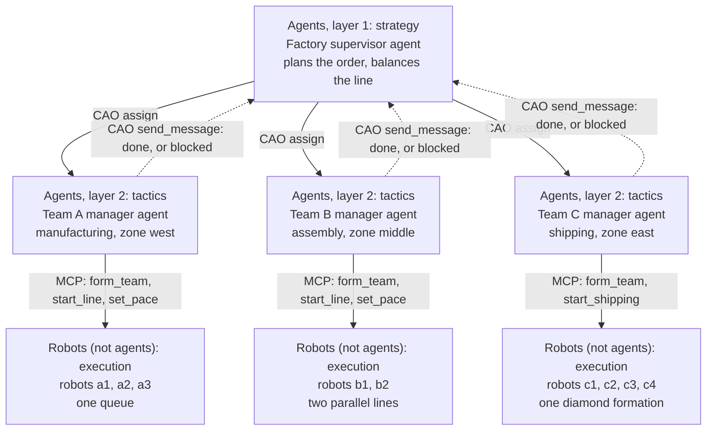
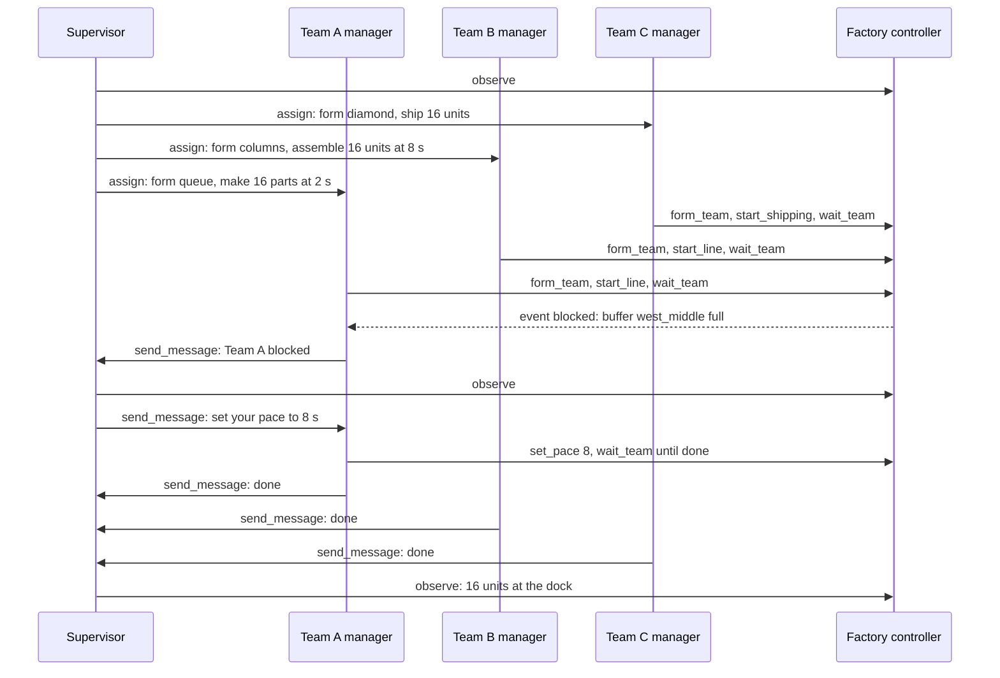
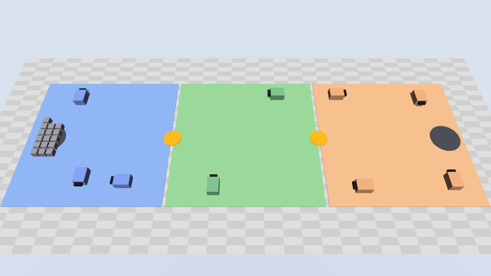
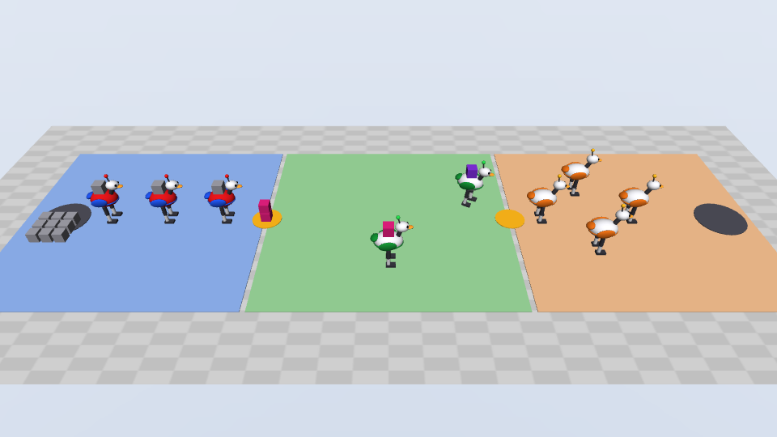
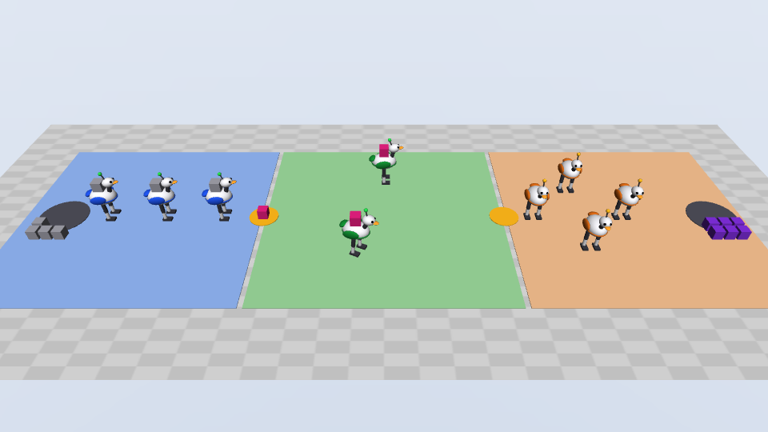
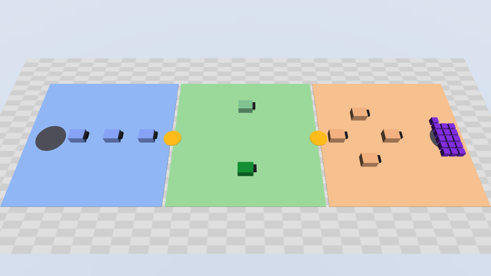

# A robot factory run by a team of agents

In this exercise, a team of four AI agents in two layers runs a simulated
factory floor. A supervisor agent takes the order. Three team manager agents
run three robot teams. Nine simulated robots, which are not agents, make,
assemble, and ship the parts. You start the simulator and the agents on your laptop. Then you watch
the parts flow from west to east, a team block, and the supervisor balance the
line.


<details>
<summary>Play the animation of the demo (47 seconds, repeats)</summary>


</details>

**The demo.** This is the order that [Run the demo](#run-the-demo) runs. The
animation replays the commands of a live run of this guide in the MuJoCo world
of the example: the same robots, commands, and order. It leaves out the time
that the agents use between the steps.

## What the exercise is about

### Two agent layers and the robots

Real factories are organizations in layers. A plant manager plans the order
and the targets. A team lead runs one line or one area. The machines do the
work. This example builds the same layers: two layers of CAO agents, and the
robots below them:



- **Agent layer 1, the supervisor.** One CAO agent. It reads the order, plans the
  pace of each team, and assigns one task to each manager. It can only read
  the floor. It talks only to the managers.
- **Agent layer 2, the managers.** Three CAO agents, one for each team. A manager
  forms its team, starts the program of its team, and watches it. It reports
  to the supervisor. Its credential reaches only its own robots.
- **The robots.** Nine simulated robots. They are not agents. Each
  team runs the program that its manager started, without an LLM in the loop.

### The floor and the teams

The floor has three zones. Parts flow from west to east. A **buffer** with a
small capacity joins two zones:

![The factory floor, with the robots in their formations. In the blue west zone, the three robots of Team A stand in one queue between the raw store with 16 grey parts and the amber buffer west_middle, which holds 2 parts. In the green middle zone, the two robots of Team B stand in a vertical column, one above the other, as two parallel assembly lines. In the orange east zone, the four robots of Team C stand in a diamond between the amber buffer middle_east, which holds 4 units, and the dock. Cards above the zones give each team, its formation, and its speed, and an arrow along the front shows the parts go from raw to machined (pink) to assembled (purple) to shipped.](images/floor-layout.png)

| Team | Zone | Robots | Kind | What the robots do |
| --- | --- | --- | --- | --- |
| Team A, manufacturing | `west` | 3: `a1`, `a2`, `a3` | `serial` | The robots stand in one queue from the raw store to the buffer `west_middle`. A part goes from robot to robot, one part at a time. Each robot works on each part for the same cycle time, the pace of the line. The part leaves the queue as a machined part (pink). |
| Team B, assembly | `middle` | 2: `b1`, `b2` | `parallel` | The robots stand in a vertical column. Each robot is its own assembly line: it fetches a part from `west_middle`, assembles it for its cycle time, and delivers the unit (purple) to `middle_east`. |
| Team C, shipping | `east` | 4: `c1` to `c4` | `formation` | The robots move as one diamond. For each shipment, the diamond loads a batch of units, one unit on each robot. Then it does its routine: `spin` (each robot turns 360 degrees in place), `turn` (the diamond turns 90 degrees about its centre), and `run` (the diamond runs to the dock at 1.6 m/s, unloads, and runs back). |

The teams work at different speeds. Team A is fast, Team B is slow, and Team
C runs in bursts. So the order has a **bottleneck**: Team B.

### The job of the agents

The order of the demo is: make, assemble, and ship 16 units. Team A starts at
a cycle time of 2 s, and Team B at 8 s. Team C ships in batches of 2 with the
routine spin, turn, run.

1. The supervisor assigns the three managers with the CAO `assign` tool,
   downstream team first: Team C, Team B, then Team A. `assign` returns at
   once, so the three teams work at the same time.
2. Each manager forms its team and starts the program of its team.
3. Team A makes a part every 2 s, but Team B takes about 7 s for each unit.
   The buffer `west_middle` holds only 2 parts, so it fills, and Team A
   **blocks**: its robots hold finished parts that cannot move on.
4. The Team A manager reports the block to the supervisor with
   `send_message`, and waits.
5. The supervisor reads the floor and **balances the line**. It sets the pace
   of Team A to the pace of Team B, here 8 s, and sends that pace to the Team A
   manager. This is takt-time balancing: a fast team in front of a slow team
   only fills the buffer and waits.
6. Each manager reports done. The supervisor checks the floor: 16 assembled
   units at the dock. It writes the final report.

The controller does no planning. It runs the programs that the managers
start. The supervisor finds the bottleneck and selects the new pace. The
managers select the commands for their teams.

### The simulator: MuJoCo

[MuJoCo](https://mujoco.readthedocs.io/en/stable/overview.html) (Multi-Joint
dynamics with Contact) is a free, open-source physics engine. Step 1 installs
it as a Python package. No robot hardware is necessary.

This exercise uses MuJoCo in a simple way, like the
[cross-zone transport example](../cross-zone-transport/README.md). Each robot
is an [Open Duck Mini v2](https://github.com/apirrone/Open_Duck_Mini), the
small open-source biped that [Strands Robots](https://github.com/strands-labs/robots)
drives in its demos. Step 1 downloads its MuJoCo model (Apache-2.0, about
18 MB) from one pinned commit, and checks the SHA-256 of each file. In the
simulator:

- the battery lid and the top panel of a robot have the color of its team,
- a lamp above the head shows the state of the robot: green when it works or
  moves, amber when it waits, and red when it is blocked. The shell of a
  blocked robot also turns red,
- the legs step when the robot walks, turns, spins, or runs. A working robot
  nods over its part and moves its antennas.

The robots and the parts are kinematic: the root of each robot is a mocap body
that moves at a set speed, and the controller sets the leg, neck, and antenna
angles from that motion. Nothing has contact or gravity. The simulator measures
the positions. The robots stand 1.6 times the size of the real robot, so that
they show in the overview camera. Without the download, the controller uses
simple bipeds of the same size, and the example works the same.

A local process, the **controller** (`demo.py serve`), runs the MuJoCo world.
The agents use the world only through the MCP tools of the controller.

### What you get from the exercise

- You see a team of agents in two layers drive a physical-AI floor: a CAO
  supervisor delegates to CAO managers, and each manager drives a robot team.
- You see `assign` and `send_message` work together: parallel work, and
  reports that come back up the hierarchy.
- You see a decision that needs the whole floor. Only the supervisor sees all
  three teams, so only the supervisor can find the bottleneck and balance the
  line.
- You see three robot teams do different things: a queue, parallel lines, and
  a formation that spins, turns, and runs.
- You see how agent profiles, tool allowlists, and scoped credentials keep each
  agent in its layer.

The agents need approximately 4 to 6 minutes for a run. The exercise needs no
GPU, no display, and no robot hardware.

## Agents

### Agent profiles

The directory has one committed profile for each role:

| Profile | Agent | `factory-sim` tools | CAO tools |
| --- | --- | --- | --- |
| `factory_supervisor.md` | The supervisor | `observe` | `assign`, `send_message` |
| `factory_line_manager.md` | The Team A manager (kind `serial`) | `observe`, `form_team`, `start_line`, `set_pace`, `wait_team` | `send_message` only |
| `factory_assembly_manager.md` | The Team B manager (kind `parallel`) | `observe`, `form_team`, `start_line`, `set_pace`, `wait_team` | `send_message` only |
| `factory_shipping_manager.md` | The Team C manager (kind `formation`) | `observe`, `form_team`, `start_shipping`, `wait_team` | `send_message` only |

`demo.py prepare` gives each team the manager profile of its kind. Each
profile has the sections Role and Identity, Core Responsibilities, Available
MCP Tools, Run Bindings, Workflow, Critical Rules, Failures and Uncertain
Results, Example, and Final Report Format.

### Run copies

`prepare` does not install the committed profiles. It writes one **run copy**
for each agent to `profiles/` in the run directory:

- The name gets a random suffix, for example
  `factory_supervisor_<id>`. So a later run cannot replace the profiles of a
  running run.
- The `factory-sim` server starts the Python of `.venv` with
  `demo.py connect <credential file>`. Each agent gets its own credential file.
- `provider` is the `--provider` of `prepare`.
- The end of the instructions gets the **run bindings**: the `run_id`, and the
  zone and team of the agent. The supervisor also gets the manager profile of
  each team. A manager gets only its own team, so its bindings do not name the
  profile of another manager. They are identifiers, not instructions.

### Credentials and scopes

The controller checks a credential on each tool call. The credential, not a
prompt, sets what an agent can do:

| Credential | Scopes | Tools |
| --- | --- | --- |
| `supervisor` | `observe` | `observe` |
| `manager_west`, `manager_middle` | `observe`, `act`, `line` | `observe`, `form_team`, `wait_team`, `start_line`, `set_pace` |
| `manager_east` | `observe`, `act`, `ship` | `observe`, `form_team`, `wait_team`, `start_shipping` |
| `operator` | `observe`, `operate` | `observe`, `stop_simulation` |

The CAO allowlist of each profile limits the CAO tools in the same way:

| Profile | CAO grant | CAO tools |
| --- | --- | --- |
| Supervisor | `@cao-mcp-server` | `assign`, `send_message`, and the other CAO tools |
| Managers | `@cao-mcp-server/send_message` | `send_message` only. CAO refuses `assign`, `handoff`, `find_profiles`, and `delete_terminal`, so a manager cannot start another agent, for example the manager of another team with that team's credential. |

A manager credential also holds its zone. The controller takes the team of a
call from the credential, not from a tool argument. No tool has a team or a
robot argument, so a manager cannot name the robots of another team.

## Orchestration

### Why assign and send_message

The three teams must work at the same time, so the supervisor uses `assign`,
not `handoff`. `handoff` waits until one worker finishes before it returns.

CAO delivers a message to a terminal only when that terminal is idle. The
protocol uses this rule:

- After the three assigns, the supervisor ends its turn. Each manager report
  arrives as a new message and starts a new turn of the supervisor.
- A manager watches its team with `wait_team`, which waits up to 45 s in one
  tool call. While it waits, the manager is busy and gets no messages.
- When its team blocks, a manager reports once and ends its turn. Now it is
  idle, so the answer of the supervisor reaches it. It sets the new pace and
  watches its team until done, without a second block report.



### Why one agent for each zone, not one for each robot

The example has four LLM agents: the supervisor, and one manager for each zone.
The west manager drives all three robots of Team A. The robots are not agents.
These are the reasons:

- **The time scales are different.** An LLM turn takes seconds, and often tens of
  seconds. The robots of Team A pass a part every 2 s, and the controller moves
  the robots every 20 ms. An agent for each robot could not react in time. So
  the agents decide what is slow to change (the formation, the pace, the batch,
  the routine), and the team program does the fast work. Real sites use the same
  layers: a planning system, a cell controller or fleet manager for each area
  (for example, a VDA 5050 master control), and the robot controllers.
- **The work is coupled inside a team.** The robots of Team A hand each part to
  the next robot in the queue, and the four robots of Team C must move as one
  formation. With one manager, one decision changes the whole team at the same
  time. With one agent for each robot, the agents must agree with messages
  before each move, and a late or lost message breaks the queue or the
  formation.
- **The authority follows the boundary of the area.** A zone owns its robots,
  its side of each buffer, and its safety. One credential for each zone gives
  each manager exactly the robots of its area, and no tool takes a robot
  argument. The supervisor needs to talk only to three managers.
- **One report for each problem.** When the buffer in front of Team B is full,
  the three robots of Team A are blocked for the same reason. One manager sends
  one report. Three robot agents would send three reports of one problem.
- **The cost grows with the agents.** Four agents use four CAO terminals and four
  model sessions. One agent for each robot would add nine more, for robots that
  have no decision of their own to make.

One agent for each robot is the better design when each robot has its own
judgment to make: for example, an inspection robot that interprets camera
images, a mobile manipulator with open-ended tasks, or a fleet of different
robots with no cell controller. To do that with this example, give each robot
its own profile and credential (a `robot` claim next to `zone`), and let the
team manager delegate to its robot agents with `assign`: a third layer of agents.

## Requirements

### Software

| Requirement | Version | How to check |
| --- | --- | --- |
| CAO | `main` from 2026-10-23 or later, or the first release after 2.5.4. The managers need #972 (a worker can always reach `send_message`) and #948 (per-tool grants such as `@cao-mcp-server/send_message` in the delegation ceiling). | `cao --version`, and the date of the installed commit |
| tmux | 3.3 or later | `tmux -V` |
| uv | A recent release | `uv --version` |
| Python | 3.11 or later | Step 1 finds or installs it with `uv`. The example needs 3.11 because the fixed `dnspython` (2.9.0, GHSA-45c3-73f7-pv4m) needs it. |
| MuJoCo | The version in `uv.lock` | Step 1 installs it as the Python package `mujoco`. You do not install it separately. |
| OpenGL | Only for the pictures of `--record`. No separate GPU is necessary. | On macOS, OpenGL is part of the system. On Linux without a display, see [See the robots move](#see-the-robots-move). |
| Provider CLI | A CAO provider that `prepare` accepts. GitHub Copilot CLI is the default. See [Providers](#providers). | Start the CLI one time in this repository, sign in, and accept its first-run prompts |

To install or update CAO from the latest `main`:

```bash
uv tool install git+https://github.com/awslabs/cli-agent-orchestrator.git@main --upgrade
```

For other installation methods, see [Install CAO](../../../README.md#install-cao).
The example has its own Python project and lockfile. It does not change the
CAO installation.

### Providers

`demo.py prepare --provider <provider>` sets the provider of all four agents.
The default is `copilot_cli`. These providers are not supported, for the
reasons that `demo.py` prints:

| Provider | Why it is not supported |
| --- | --- |
| `antigravity_cli` | It reads the MCP servers of all CAO terminals from one shared file. An agent could use the simulator credential of another agent. |
| `cursor_cli` | CAO launches it without the instructions of the agent profile. |
| `grok_cli` | It grants MCP servers only as a whole. A manager that can call `send_message` could then also call `assign`, and start the manager of another team with that team's credential. |
| `hermes` | It reads MCP servers only from its own Hermes profile. |
| `opencode_cli` | It keeps the MCP servers of all agents in one shared configuration. |

With `claude_code`, `copilot_cli`, or `kiro_cli`, the provider refuses the
tools that a profile does not allow. CAO shows this in the
`Enforcement:` line of `cao launch`. With the other providers, the allowlist is
only an instruction, and `prepare` prints a warning. Use those providers only
for a trusted local demo. See [Tool restrictions](../../../docs/tool-restrictions.md).

### Compute and GPU

The controller and the agents need no GPU. The pictures of `--record` need
OpenGL, but no separate GPU. See [See the robots move](#see-the-robots-move).

## Run the demo

Use three terminals:

| Terminal | Use |
| --- | --- |
| Terminal 1 | Prepare the run, install the profiles, launch the supervisor, and check the result |
| Terminal 2 | Run the MuJoCo controller, `demo.py serve` |
| Terminal 3 | Run `cao-server` |

Each step has an **Expected output** section that you can expand. The outputs
come from a run of this guide with `--provider claude_code`. In them, `<id>` is
a random ID, and `<run_id>` is the run ID. `<repo>` is the path of the
repository, `~` is your home directory, and `<time>` is a time stamp. On
macOS, `/tmp` can show as `/private/tmp`.

### Step 1. Install the example dependencies

In Terminal 1, from the repository root:

```bash
cd examples/robotics/hierarchical-factory
uv sync --locked
uv run --locked python demo.py fetch-robot
```

`fetch-robot` downloads the robot model to `.robot-models/` in the example
directory, which git ignores. A later `fetch-robot` downloads only a missing or
changed file. To keep the model in another directory, set
`FACTORY_ROBOT_MODEL_DIR` in every terminal of the run. You can skip
`fetch-robot`: the robots are then simple bipeds.

<details>
<summary>Expected output</summary>

The first time:

```text
Using CPython 3.12.4 interpreter at: /opt/homebrew/opt/python@3.12/bin/python3.12
Creating virtual environment at: .venv
Resolved 87 packages in 9ms
Installed 77 packages in 8.89s
 ...
```

Later times:

```text
Resolved 87 packages in 9ms
Audited 77 packages in 41ms
```

Then `fetch-robot`, the first time and later times:

```text
Open Duck Mini v2 from apirrone/Open_Duck_Mini at b23317a485b3 (Apache-2.0): 47 files checked in <repo>/examples/robotics/hierarchical-factory/.robot-models/open_duck_mini_v2
```

</details>

### Step 2. Prepare a run

In Terminal 1, run these commands. To use a provider other than Copilot CLI,
add `--provider <provider>` to the `prepare` command, for example
`--provider claude_code`. See [Providers](#providers).

```bash
export RUN_DIR=/tmp/cao-factory-demo
REQUEST="Make, assemble, and ship 16 units. Start Team A at 2 s and Team B at 8 s. Ship in batches of 2 with the routine spin, turn, run."
uv run --locked python demo.py prepare --run-dir "$RUN_DIR" --request "$REQUEST"
```

<details>
<summary>Expected output</summary>

```text
cao install /tmp/cao-factory-demo/profiles/factory_supervisor_<id>.md
cao install /tmp/cao-factory-demo/profiles/factory_line_manager_<id>.md
cao install /tmp/cao-factory-demo/profiles/factory_assembly_manager_<id>.md
cao install /tmp/cao-factory-demo/profiles/factory_shipping_manager_<id>.md
cao launch --agents factory_supervisor_<id> --headless --async --auto-approve --session-name cao-factory-<run_id> --working-directory <repo>/examples/robotics/hierarchical-factory -- 'Make, assemble, and ship 16 units. Start Team A at 2 s and Team B at 8 s. Ship in batches of 2 with the routine spin, turn, run.'
```

`demo.py` commands can also print an `AuthlibDeprecationWarning` from a
dependency. You can ignore it.

</details>

`prepare` writes these items to the run directory:

| Path | Contents |
| --- | --- |
| `profiles/` | One run copy of a profile for each agent. See [Run copies](#run-copies). |
| `credentials/` | One private credential file for each actor, readable only by you |
| `run.json` | The run ID, the profile names, the actors and their scopes, and the controller URL |
| `run.env` | Shell variables for Steps 5 and 6: the profile name of each agent, the run ID, and the session name |
| `scene.json` | A copy of the scene |

- If the run directory exists, `prepare` stops with an error. Use a new
  directory for each run.
- Do not move the example directory or its `.venv` until the cleanup. Each
  run copy starts the Python interpreter of `.venv` and `demo.py` by their
  full paths.

### Step 3. Start the MuJoCo controller

In Terminal 2, from the repository root:

```bash
cd examples/robotics/hierarchical-factory
export RUN_DIR=/tmp/cao-factory-demo
uv run --locked python demo.py serve --run-dir "$RUN_DIR" --allow-motion \
  --record /tmp/cao-factory-frames
```

<details>
<summary>Expected output</summary>

When the controller starts:

```text
<time> factory SIMULATION ONLY: kinematic robot proxies; motion approved for this scene
<time> factory Robots: Open Duck Mini v2
<time> factory LIVE VIEW: open http://127.0.0.1:8767/ in a browser to watch the run
<time> factory Recording frames of the world to /tmp/cao-factory-frames
[<time>] INFO     Starting MCP server 'CAO hierarchical factory simulator' with transport 'http' (stateless) on http://127.0.0.1:8767/mcp
INFO:     Started server process [<pid>]
INFO:     Waiting for application startup.
<time> mcp.server.streamable_http_manager StreamableHTTP session manager started
INFO:     Application startup complete.
INFO:     Uvicorn running on http://127.0.0.1:8767 (Press CTRL+C to quit)
```

While the agents work, the controller writes one line for each tool call of
an agent, and one line for each status change of a command. The line of a tool
call starts with the agent, for example `west team manager`. This excerpt
leaves out the `observe` and `wait_team` calls, the `accepted` lines, the HTTP
lines, and the MCP library lines:

```text
<time> factory east team manager called form_team(command_id=form-1, formation=diamond)
<time> factory run=<run_id> actor=east command=form-1 operation=form_team status=finished reason=None
<time> factory east team manager called start_shipping(command_id=ship-1, units=16, batch=2, routine=['spin', 'turn', 'run'])
<time> factory run=<run_id> actor=east command=ship-1 operation=start_shipping status=running reason=None
<time> factory middle team manager called form_team(command_id=form-1, formation=columns)
<time> factory run=<run_id> actor=middle command=form-1 operation=form_team status=finished reason=None
<time> factory middle team manager called start_line(command_id=line-1, parts=16, cycle_seconds=8.0)
<time> factory run=<run_id> actor=middle command=line-1 operation=start_line status=running reason=None
<time> factory west team manager called form_team(command_id=form-1, formation=queue)
<time> factory run=<run_id> actor=west command=form-1 operation=form_team status=finished reason=None
<time> factory west team manager called start_line(command_id=line-1, parts=16, cycle_seconds=2.0)
<time> factory run=<run_id> actor=west command=line-1 operation=start_line status=running reason=None
<time> factory west team manager called set_pace(command_id=pace-1, cycle_seconds=8.0)
<time> factory run=<run_id> actor=west command=pace-1 operation=set_pace status=finished reason=None
<time> factory run=<run_id> actor=west command=line-1 operation=start_line status=finished reason=None
<time> factory run=<run_id> actor=middle command=line-1 operation=start_line status=finished reason=None
<time> factory run=<run_id> actor=east command=ship-1 operation=start_shipping status=finished reason=None
```

The agents choose the command IDs and the number of `observe` and `wait_team`
calls, so your lines can be different.

</details>

Do not stop the controller until [Stop and clean up](#stop-and-clean-up).

- The controller is not `cao-server`. It owns the MuJoCo world, so the world
  and its programs keep running between the turns of the agents.
- `--allow-motion` is your approval for motion in this simulation. Without it,
  the controller rejects `form_team`, `start_line`, `start_shipping`, and
  `set_pace` with `motion_not_approved`.
- `--record` saves pictures of the MuJoCo world. See
  [See the robots move](#see-the-robots-move). The directory must be new or
  empty. To run without pictures, remove `--record` and its directory.
- The controller listens only on `127.0.0.1`, port 8767 by default, so it can
  run next to the cross-zone transport example (port 8766). If another process
  uses the port, `serve` stops before it marks the run as started. Stop the
  other controller, or prepare a run with another `--port`.

### Step 4. Start the CAO server

In Terminal 3:

```bash
cao-server
```

<details>
<summary>Expected output</summary>

```text
INFO:     Started server process [<pid>]
INFO:     Waiting for application startup.
Server logs: ~/.aws/cli-agent-orchestrator/logs/cao_<time>.log
For debug logs: export CAO_LOG_LEVEL=DEBUG && cao-server
INFO:     Application startup complete.
INFO:     Uvicorn running on http://127.0.0.1:9889 (Press CTRL+C to quit)
```

</details>

If `cao-server` already runs, skip this step. If it runs an earlier CAO
version, stop it and start it again.

### Step 5. Install the agent profiles

Install the four run copies, not the profiles of this directory. `source` sets
the variables `SUPERVISOR`, `MANAGER_WEST`, `MANAGER_MIDDLE`, `MANAGER_EAST`,
`RUN_ID`, and `SESSION`. `tee -a` also writes the output to `install.log`. The
cleanup uses the paths in that file.

In Terminal 1:

```bash
source "$RUN_DIR/run.env"
cao install "$RUN_DIR/profiles/$SUPERVISOR.md" | tee -a "$RUN_DIR/install.log"
cao install "$RUN_DIR/profiles/$MANAGER_WEST.md" | tee -a "$RUN_DIR/install.log"
cao install "$RUN_DIR/profiles/$MANAGER_MIDDLE.md" | tee -a "$RUN_DIR/install.log"
cao install "$RUN_DIR/profiles/$MANAGER_EAST.md" | tee -a "$RUN_DIR/install.log"
```

<details>
<summary>Expected output</summary>

Three lines for each agent, in the order of the commands:

```text
✓ Copied agent from file to local store
✓ Agent 'factory_supervisor_<id>' installed successfully
✓ Context file: ~/.aws/cli-agent-orchestrator/agent-context/factory_supervisor_<id>.md
✓ Copied agent from file to local store
✓ Agent 'factory_line_manager_<id>' installed successfully
✓ Context file: ~/.aws/cli-agent-orchestrator/agent-context/factory_line_manager_<id>.md
✓ Copied agent from file to local store
✓ Agent 'factory_assembly_manager_<id>' installed successfully
✓ Context file: ~/.aws/cli-agent-orchestrator/agent-context/factory_assembly_manager_<id>.md
✓ Copied agent from file to local store
✓ Agent 'factory_shipping_manager_<id>' installed successfully
✓ Context file: ~/.aws/cli-agent-orchestrator/agent-context/factory_shipping_manager_<id>.md
```

If the provider uses its own agent file, `cao install` also prints a line
`✓ <provider> agent: <path>`.

</details>

### Step 6. Launch the CAO supervisor

> [!CAUTION]
> Use `--auto-approve`. Do not use `--yolo`. `--yolo` removes the tool
> restrictions of the supervisor. The supervisor can then use a shell and read
> the credential files of all the managers. Do not change the generated
> allowlists, and do not add other MCP servers.

In Terminal 1:

```bash
cao launch --agents "$SUPERVISOR" --headless --async --auto-approve \
  --session-name "$SESSION" --working-directory "$(pwd)" \
  -- "$REQUEST"
```

<details>
<summary>Expected output</summary>

The `Blocked:` line lists the tools of the provider, so it is different for
other providers.

```text
Agent 'factory_supervisor_<id>' launching on claude_code:
  Allowed:  @factory-sim, @cao-mcp-server
  Blocked:  Agent, Bash, BashOutput, Edit, Glob, Grep, KillShell, Monitor, NotebookEdit, Read, Task, WebFetch, WebSearch, Write
  Enforcement: native (the provider refuses blocked tools)
  Directory: <repo>/examples/robotics/hierarchical-factory

  To skip this prompt next time, relaunch with --auto-approve
  To remove all restrictions, relaunch with --yolo

Session created: cao-factory-<run_id>
Terminal created: factory_supervisor_<id>-<id>
Message delivered to factory_supervisor_<id>-<id>. Running in background.
```

</details>

- `--async` returns when CAO delivers the request. It does not wait for the
  order. Do not launch the request again.
- CAO can deliver the request two times, when it does not see the first paste
  arrive. The supervisor runs the order only once (Critical Rule 6 of its
  profile). In the runs of this guide, it said so in its final report.
- If a provider CLI shows a first-run prompt in its window, CAO cannot start
  it, and `cao launch` or the worker fails with a timeout. For example, Copilot
  CLI asks to set up multi-line input in a VS Code terminal. Start the CLI one
  time by hand in this directory and answer its prompts (see
  [Software](#software)), then shut down the session and launch again.
- The first start of a provider CLI on a machine can take some minutes, for
  example for a sign-in or an update. If `cao launch` stops with
  `Timed out ... waiting for the initial message to be delivered`, look at the
  supervisor window (Step 7) before you do anything. In one run of this guide,
  the request arrived later, and the run continued.

### Step 7. Watch the agents

- **Session status.** In Terminal 1:

  ```bash
  cao session status "$SESSION" --workers
  ```

  <details>
  <summary>Expected output</summary>

  While Team B and Team C still work:

  ```text
  Session:  cao-factory-<run_id>
  Terminal: <id>
  Agent:    factory_supervisor_<id>
  Provider: claude_code
  ...
  Status:   completed

  Last response:
  Team A's manager reports done ... Teams B and C are still running, and I'm
  waiting for their done reports.

  ID           AGENT                            PROVIDER        MODEL                HONORED  STATUS
  -----------------------------------------------------------------------------------------------
  <id>         factory_shipping_manager_<id>    claude_code     provider default     yes      processing
  <id>         factory_assembly_manager_<id>    claude_code     provider default     yes      processing
  <id>         factory_line_manager_<id>        claude_code     provider default     yes      completed
  ```

  The supervisor shows `completed` between its turns: it waits for the
  reports of the managers. The run is complete when the three managers show
  `completed` too, and the last response of the supervisor is the final
  report.

  </details>

- **tmux.** Run `tmux attach -t "$SESSION"`. Window 0 is the supervisor. The
  other windows are the managers. To detach, press Ctrl+b, then d. Do not type
  in an agent window.
- **Controller log.** Look at Terminal 2.
- **Live view.** Open `http://127.0.0.1:8767/` in a browser. See
  [Watch it live in a browser](#watch-it-live-in-a-browser).
- **Simulator picture.** Open `/tmp/cao-factory-frames/latest.png`. The
  controller replaces it at each change.

#### What each agent does

| Agent | CAO terminal (tmux window) | What it does | Lines in Terminal 2 |
| --- | --- | --- | --- |
| Supervisor | `factory_supervisor_<id>-<4hex>` | Reads the floor, plans the order, assigns the three managers, balances the line after a block, and checks the result. | `supervisor called observe()` |
| Team C manager | `factory_shipping_manager_<id>-<4hex>` | Forms the diamond. Starts shipping with the batch and the routine. Reports done. | `east team manager called form_team(...)`, `... start_shipping(...)` |
| Team B manager | `factory_assembly_manager_<id>-<4hex>` | Forms the columns. Starts the two lines at 8 s. Reports done. | `middle team manager called form_team(...)`, `... start_line(...)` |
| Team A manager | `factory_line_manager_<id>-<4hex>` | Forms the queue. Starts the line at 2 s. Reports the block once, applies the new pace, and reports done. | `west team manager called form_team(...)`, `... start_line(...)`, `... set_pace(...)` |

### Step 8. Check the result

In Terminal 1:

```bash
uv run --locked python demo.py status --run-dir "$RUN_DIR"
```

<details>
<summary>Expected output</summary>

An excerpt. The output also has the `scene`, `parts`, and `commands` fields,
and the poses of each robot.

```json
{
  "run_id": "<run_id>",
  "observed_at": "<time>",
  "position_units": "m",
  "motion_approved": true,
  "stopped": false,
  "teams": {
    "west": {
      "status": "done",
      "cycle_seconds": 8.0,
      "program": {"command_id": "line-1", "target": 16, "output": 16, "avg_output_interval_seconds": 7.11, "blocked_seconds": 26.48, "starved_seconds": 0.0}
    },
    "middle": {
      "status": "done",
      "cycle_seconds": 8.0,
      "program": {"command_id": "line-1", "target": 16, "output": 16, "avg_output_interval_seconds": 7.12, "blocked_seconds": 0.0, "starved_seconds": 13.54}
    },
    "east": {
      "status": "done",
      "cycle_seconds": null,
      "program": {"command_id": "ship-1", "target": 16, "output": 16, "avg_output_interval_seconds": 6.93, "blocked_seconds": 0.0, "starved_seconds": 109.26}
    }
  },
  "places": {
    "raw": {"parts": []},
    "west_middle": {"parts": []},
    "middle_east": {"parts": []},
    "dock": {"parts": ["part-01", "part-02", "part-04", "part-03", "...", "part-15", "part-16"]}
  }
}
```

</details>

A successful run shows these values:

| Field | Expected value |
| --- | --- |
| `teams.*.status` | `done` for the three teams |
| `teams.*.program.output` | `16` for the three teams |
| `places.dock.parts` | The 16 parts, `part-01` to `part-16` |
| `parts.*.stage` | `assembled` for every part |
| `teams.west.cycle_seconds` | The pace that the supervisor set, for example `8.0` |
| `commands` | `form_team`, `start_line`, `start_shipping`, and `set_pace` have `"status": "finished"` |

<details>
<summary>Example final answer of the CAO supervisor</summary>

An excerpt from a run with `--provider claude_code`. The words and the layout
are different in each run.

```text
The order is complete: 16 assembled units are at the dock, and every team
shows done with output 16 of 16. This is from my own observe at observed_at
<time>, 233.8 s into the simulation.

Who did the work
- Supervisor: me. I only read the floor with observe and talked to the managers.
- Team C (east): factory_shipping_manager_<id>, terminal <id>, robots c1–c4.
- Team B (middle): factory_assembly_manager_<id>, terminal <id>, robots b1 and b2.
- Team A (west): factory_line_manager_<id>, terminal <id>, robots a1–a3.

Team results
┌────────────┬───────────┬──────────────────────────┬─────────────────┬──────────────┬───────────┬───────────┐
│    Team    │ Formation │      Pace / routine      │ Output / target │ Avg interval │ Blocked s │ Starved s │
├────────────┼───────────┼──────────────────────────┼─────────────────┼──────────────┼───────────┼───────────┤
│ A (west)   │ queue     │ 2 s, then 8 s            │ 16 / 16         │ 7.11 s       │ 26.48     │ 0         │
├────────────┼───────────┼──────────────────────────┼─────────────────┼──────────────┼───────────┼───────────┤
│ B (middle) │ columns   │ 8 s                      │ 16 / 16         │ 7.12 s       │ 0         │ 13.54     │
├────────────┼───────────┼──────────────────────────┼─────────────────┼──────────────┼───────────┼───────────┤
│ C (east)   │ diamond   │ batch 2, spin, turn, run │ 16 / 16         │ 6.93 s       │ 0         │ 109.26    │
└────────────┴───────────┴──────────────────────────┴─────────────────┴──────────────┴───────────┴───────────┘

Bottleneck and the fix
- Team B, at 8 s, was the slowest step.
- Team A at 2 s filled the 2-part buffer between them and was blocked at 6/16.
- Team B had not yet made enough units for a measured average, so I used its
  8 s cycle time. Team A's pace change to 8 s (set_pace) finished, and Team A
  was never starved afterwards.
- Team C spent most of the run (109 s) waiting for input. Shipping was never
  the limit.

Evidence
- The dock holds part-01 to part-16, and every one has the stage assembled.
- The raw store and both buffers are empty.
- All 7 commands show finished, none rejected or failed.
...
This is an assisted kinematic MuJoCo simulation, not real robot work.
```

</details>

A successful tool call or test run does not prove a multi-agent run. Make sure
that each manager did its part, and that the supervisor balanced the line.

## Stop and clean up

Do these steps in this sequence:

1. In Terminal 1, stop the simulation. The output is the full state, as in
   Step 8. Make sure that it shows `"stopped": true`.

   ```bash
   uv run --locked python demo.py stop --run-dir "$RUN_DIR"
   ```

2. Stop the CAO session:

   ```bash
   cao shutdown --session "$SESSION"
   ```

   <details>
   <summary>Expected output</summary>

   ```text
   ✓ Shutdown session 'cao-factory-<run_id>'
   ```

   </details>

3. In Terminal 2, press Ctrl+C one time. The controller stops and writes
   `last-state.json` to the run directory. With `--record`, it also writes the
   animation and the picture viewer. A long run has many frames, so this can
   take some seconds. The controller ignores a second Ctrl+C until the
   recording is complete.

   <details>
   <summary>Expected output</summary>

   ```text
   INFO:     Shutting down
   INFO:     Waiting for application shutdown.
   <time> mcp.server.streamable_http_manager StreamableHTTP session manager shutting down
   INFO:     Application shutdown complete.
   INFO:     Finished server process [<pid>]
   <time> factory Writing the recording to /tmp/cao-factory-frames
   <time> factory Recorded 208 frame(s); open /tmp/cao-factory-frames/index.html
   ```

   The number of frames depends on the run.

   </details>

4. In Terminal 1, remove the installed files of this run:

   ```bash
   cao profile remove --yes "$SUPERVISOR"
   cao profile remove --yes "$MANAGER_WEST"
   cao profile remove --yes "$MANAGER_MIDDLE"
   cao profile remove --yes "$MANAGER_EAST"
   sed -n -E 's/^✓ (Context file|[a-z_]+ agent): //p' "$RUN_DIR/install.log" | tr '\n' '\0' | xargs -0 rm -f --
   ```

   <details>
   <summary>Expected output</summary>

   One line for each agent. The last command prints nothing.

   ```text
   ✓ Removed 'factory_supervisor_<id>' from ~/.aws/cli-agent-orchestrator/agent-store
   ✓ Removed 'factory_line_manager_<id>' from ~/.aws/cli-agent-orchestrator/agent-store
   ✓ Removed 'factory_assembly_manager_<id>' from ~/.aws/cli-agent-orchestrator/agent-store
   ✓ Removed 'factory_shipping_manager_<id>' from ~/.aws/cli-agent-orchestrator/agent-store
   ```

   </details>

5. Keep `last-state.json` if you need it. Then remove the run directory. The
   pictures are not in the run directory: remove them with
   `rm -rf -- /tmp/cao-factory-frames` when you do not need them.

   ```bash
   rm -rf -- "${RUN_DIR:?}"
   ```

6. If you do not need `cao-server`, press Ctrl+C in Terminal 3.

The credential files are temporary. Do not commit them, and do not attach them
to an issue or a pull request.

## See the robots move

### Watch it live in a browser

While the controller runs, it serves a read-only **live view** on the same
`127.0.0.1` address, as in the cross-zone transport example. Open its base URL
in a browser:

```text
http://127.0.0.1:8767/
```

Use the `--port` that you prepared with if it is not `8767`. The controller
prints the exact URL (`LIVE VIEW: ...`) when it starts.


- **The map** draws the zones, the buffers with their fill, the raw store, the
  dock, and every part in the color of its stage. Each robot is a picture of the
  Open Duck Mini in its team color (red when blocked), with its state lamp above
  it, a short line for its heading, and the part that it carries.
- **The organization** panel shows the supervisor, the managers, and their
  robot teams. The supervisor shows what
  it does now, for example `a team is blocked: balancing the line`. Each
  manager shows the status of its team, its output and target, its pace, its
  blocked and starved time, and the state of each robot. A blocked team has a
  red frame. A command that just finished is amber.
- **The action log** lists every command and its result.

The page polls the controller's `observe()` a few times a second. It serves only
simulation state (positions, team states, parts, and command history, never a
credential), and it needs no GPU or display. It loads its state from an address
relative to its own, so it also works behind a forwarded port. On a remote host,
such as a browser IDE, forward the port first: in VS Code or code-server use the
**Ports** panel, or `ssh -L 8767:127.0.0.1:8767 <host>`. Do not publish it on a
public interface.

The controller accepts only `127.0.0.1`, `localhost`, and `::1` in the `Host`
header of a request, and refuses a cross-site `Origin`. So a web page cannot
use DNS rebinding to read the live view or reach the MCP endpoint. If a port
forward sends its own name in the `Host` header (some browser IDEs do), the
live view answers `Misdirected Request`. Then set that name in Terminal 2
before Step 3, for example `export FACTORY_ALLOWED_HOSTS=ide.example.com`.
Add only the name of your own forward.

### Saved pictures with `--record`

`demo.py serve --record DIR` saves pictures of the MuJoCo world from a fixed
overview camera. Step 3 uses this option. The pictures do not change the
simulation.

| Picture | State |
| --- | --- |
|  | 1. Start. The robots stand where the scene puts them. The 16 grey raw parts are in the raw store. |
|  | 2. Team A is blocked: the buffer `west_middle` is full, so the robots of Team A are red. Team B assembles. |
|  | 3. Team A works at the new pace. Team C has delivered units to the dock. |
|  | 4. Done. The 16 purple units are at the dock. |

| In the picture | Item |
| --- | --- |
| Light blue, light green, and light orange areas | Zones `west`, `middle`, and `east` |
| Open Duck Mini robots with a blue, green, or orange battery lid | The robots of Team A, Team B, and Team C. The head faces where the robot goes. |
| A green, amber, or red lamp above the head | The robot works or moves, waits (for example for a part), or is blocked |
| A red shell | The robot is blocked: it holds a finished part that cannot move on |
| A cube on the back of a robot | The part that the robot carries |
| Grey, pink, and purple cubes | A raw part, a machined part, and an assembled unit |
| Amber discs | The buffers `west_middle` (capacity 2) and `middle_east` (capacity 4) |
| Dark discs | The raw store (west) and the dock (east) |

The controller writes these files to the directory:

| File | Written | Contents |
| --- | --- | --- |
| `latest.png` | At each change | The last picture |
| `frame-0001.png`, ... | At each change | One picture for each change |
| `animation.png` | At Ctrl+C | An animated PNG of the pictures, at most 400. Open it in a web browser. |
| `frames.json` | At Ctrl+C | The file, time, caption, robot poses, team states, and parts of each picture |
| `index.html` | At Ctrl+C | A page that shows each picture with its caption. Use **Previous**, **Play**, **Next**, or the slider. |

The pictures need OpenGL, but no separate GPU:

- On macOS, the pictures work with no settings. Do not set `MUJOCO_GL=glfw`.
- On Linux without a display, set `export MUJOCO_GL=egl` or
  `export MUJOCO_GL=osmesa` in Terminal 2 before Step 3.
- If the renderer does not start, the controller logs `Recording is off:` and
  continues without pictures. The simulation and the agents work as usual.

## Demo scenarios

Use a new run for each scenario: stop and clean up the previous run, then do
Steps 2 to 8 with the request of the scenario. To use `--port` or `--provider`,
add them to the `prepare` command of Step 2.

The runs of this guide did every scenario in the table: "Another routine" with
the default provider, `copilot_cli`, and the others with
`--provider claude_code`.

| Scenario | Request | Expected result |
| --- | --- | --- |
| Balance the line | The request of Step 2 | Team A blocks. The supervisor slows Team A to the pace of Team B. All 16 units are at the dock. |
| Defaults | `Make, assemble, and ship all the parts.` | The supervisor uses the defaults of its profile: each line at its `min_cycle_seconds` (Team A at 2 s, Team B at 4 s), a batch of 2, and the routine spin, turn, run. Team A blocks, and the supervisor sets it to the measured pace of Team B, about 6 s. |
| Another routine | `Make, assemble, and ship 8 units. Start Team A at 6 s and Team B at 4 s. Ship in batches of 4 with the routine turn, run, spin.` | Team C loads four units, turns, runs, and spins after it runs back. Team B is faster, so the block is less likely. |
| Impossible request | `Make, assemble, and ship 30 units.` | The supervisor finds only 16 raw parts. It reports that the order is not possible, and it assigns no manager. |
| Not a valid routine | `Make, assemble, and ship 8 units. Ship in batches of 2 with the routine spin, turn.` | The routine has no `run`. The supervisor refuses before it assigns any manager, and no robot moves. If a manager still calls `start_shipping`, the controller rejects it with `routine_needs_one_run`. |
| A routine that is too long | `Make, assemble, and ship 16 units. Start Team A at 2 s and Team B at 8 s. Ship in batches of 2 with the routine spin, turn, spin, turn, spin, turn, run.` | The routine has seven moves, and `max_routine_moves` of Team C is 6. The supervisor refuses before it assigns any manager, and no robot moves. |
| Operator stop | The request of Step 2 | While the teams work, run `demo.py stop` in Terminal 1. The programs become `interrupted`, reason `operator_stop`, and each team shows `stopped`. The robots stop where they are, and the controller rejects all later actions. |

## From the simulation to real robots

This example does not control real robots. It simulates the **coordination
layers** above the robots: the plan, the teams, and the balance of the line.

| In this example | On a real site |
| --- | --- |
| The supervisor agent | A plant or shift planner that sets the order and the targets of each area |
| A manager agent | The team lead or the cell controller of one line or one area |
| A team program (`start_line`, `start_shipping`) | A job that the cell controller sends to the robots, for example a VDA 5050 order to a fleet of mobile robots |
| `set_pace` after a block | Line balancing to the takt time of the bottleneck |
| A buffer with a capacity | A conveyor or a staging area between two cells |
| `observe` and `wait_team` | The state that the cell controllers report |
| The credential of each manager | A separate access key for the cell controller of each area |
| `demo.py stop` | A stop request in software. It does not replace the emergency stop and the safety system of the robots. |

The structure on the CAO side stays the same: one profile for each role, the
allowlists, `assign`, and `send_message`. The MCP server behind `factory-sim`
changes, and so does the text of each profile: today each profile says that
it runs a simulation and must not contact physical robots. A real site also
needs a safety system on the robots, a connection from the MCP server to each
cell controller, and tests on the site with people who monitor the robots.

## Safety and limits

### Simulation only

- The robots and the parts are kinematic mocap bodies. They move along
  straight segments at set speeds. A part moves with its robot (idealized
  transfer).
- There are no wheel dynamics, grasps, collisions, or real-world safety claims.
- There is no hardware driver, robot network discovery, or hardware endpoint.

### Trust model

- The example trusts the private run directory and your local user account.
  It is not an OS sandbox.
- The credential sets the access of each agent. A tool argument or a prompt
  cannot give an agent more access. The supervisor has a read-only credential.
- Only the supervisor can delegate. A manager holds only
  `@cao-mcp-server/send_message`, and CAO refuses `assign`, `handoff`, and the
  other identity and discovery tools to an allowlist without
  `@cao-mcp-server`. So a manager cannot start the manager of another team,
  whose run copy has the credential of that team. The run bindings of a manager
  also name only its own team.
- If the provider does not enforce the allowlist, only the instructions forbid
  the shell and file tools. An agent can then read every credential file of the
  run. See [Providers](#providers).
- The tokens do not appear in output, profile text, or process arguments. Each
  stdio connection reads only its own credential file.
- The controller binds only `127.0.0.1`. It serves the authenticated MCP
  endpoint, and the read-only live view (`GET /` and `GET /state`) without a
  credential, as in the cross-zone transport example: the live view shows only
  simulation state and accepts no command. It uses the FastMCP static-token
  verifier. It checks the `Host` and `Origin` headers of every request, so DNS
  rebinding cannot reach it (see [Watch it live in a browser](#watch-it-live-in-a-browser)). Use it only for this
  short local demo. The MCP connections ignore proxy settings and HTTP
  redirects.

### Failures and recovery

- A team program continues to its end, even if its manager stops or the MCP
  connection closes. A manager that starts again finds its program with
  `observe`.
- A repeat of an identical command with the same command ID returns the
  recorded state and does not act again. The controller rejects a different
  call with the same command ID.
- `demo.py stop` marks active commands `interrupted`, keeps the actual
  positions, and locks the run permanently.
- Ctrl+C, `kill <pid>`, and a closed Terminal 2 window stop the controller
  cleanly. It writes `last-state.json`, and with `--record` also the animation
  and the picture viewer.

### Scene files

`factory.json` is the scene. `demo.py prepare --scene <file>` uses another
scene. The scene is checked before a run starts:

- Identifiers use lowercase letters, digits, `_`, and `-`. They start with a
  letter and have a maximum of 64 characters.
- Zones are axis-aligned rectangles. A place must be in all of its zones. A
  buffer joins two zones and has a capacity from 1 to 8.
- A team is keyed by its zone. It uses only the robots of its zone, and every
  robot is in exactly one team. Its slots are in its zone.
- A `serial` team takes parts from the raw store. A `parallel` team takes
  parts from a buffer. Both deliver to a buffer and have a cycle time range.
- A `formation` team takes units from a buffer to a dock. It must stay in its
  zone at any angle, at home and at `run_to`.

## Files and tests

| File | Contents |
| --- | --- |
| `demo.py` | The operator commands `prepare`, `serve`, `status`, and `stop`, and the `connect` stdio relay that the profiles start |
| `simulation.py` | The shared MuJoCo floor: the scene checks, the team programs, the buffers, and the command history |
| `factory_mcp.py` | The authenticated FastMCP server and its scoped tools. It writes one log line for each tool call, with the agent that made the call. It does no planning. |
| `viewer.html` | The live view that the controller serves at `/` |
| `sprites/` | The pictures of the Open Duck Mini in the live view: one for each team color, and one for a blocked robot. They are renders of the Open Duck Mini v2 model (Apache-2.0). |
| `robot_model.py` | Downloads, checks, and loads the Open Duck Mini v2 model, and sets its walking pose |
| `open_duck_mini.json` | The pinned commit and the SHA-256 of each file of the Open Duck Mini v2 model |
| `recorder.py` | The optional pictures of `serve --record`: PNG frames, the animated PNG, `frames.json`, and `index.html` |
| `factory_supervisor.md` | Agent profile of the supervisor |
| `factory_line_manager.md` | Agent profile of the manager of a `serial` team (Team A) |
| `factory_assembly_manager.md` | Agent profile of the manager of a `parallel` team (Team B) |
| `factory_shipping_manager.md` | Agent profile of the manager of a `formation` team (Team C) |
| `factory.json` | The scene: three zones, two buffers, nine robots, three teams, and 16 raw parts |
| `images/` | The pictures in this guide, from a run of this guide. The GIF animation replays the commands of that run. |
| `tests/` | Simulator, MCP, recorder, and setup tests |

To run the tests:

```bash
uv run --locked pytest
```

<details>
<summary>Expected output</summary>

The number of tests and the time can be different.

```text
........................................................................ [ 58%]
...................................................                      [100%]
123 passed in 43.61s
```

</details>

- The tests use real headless MuJoCo and authenticated loopback MCP. They need
  no provider credentials.
- CI runs them in the **Robotics factory example** workflow on Python 3.11
  and 3.12.
- Without `fetch-robot`, the tests use the simple bipeds and need no download.
  After `fetch-robot`, one more test loads the Open Duck Mini model.
- They check the scene rules, the queue order of Team A, the parallel lines of
  Team B, the spin, turn, and run of Team C, the block and the new pace, a full
  order, the scoped credentials of each layer, `wait_team`, the stop, the
  profile schemas, and that each profile documents exactly the tools of its
  credential.
- The tests do not run the CLI agents. A multi-agent run needs an
  authenticated provider and is a separate acceptance step: [Run the demo](#run-the-demo).

No robotics logic is in CAO core. The example adds no driver, provider,
workflow engine, or dependency to the normal CAO installation.
