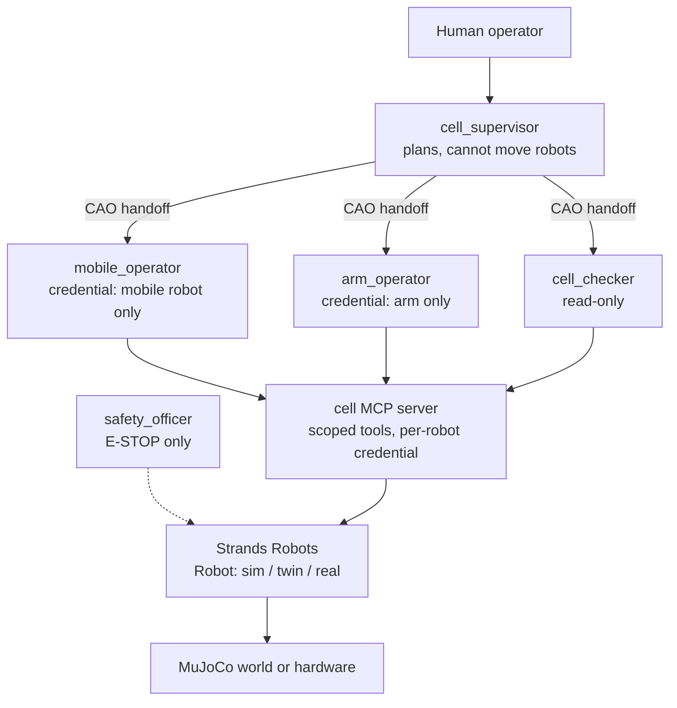

# Plan: a policy-driven robot work cell with CAO

Status: phases 0&ndash;3 implemented in sim (2026-10-21); see
[section 10](#10-what-was-built-phase-0-results-and-decisions) for what changed
from this draft. Branch `feature/robotics-policy-driven-cell`, cut from `main`
at `bfad0d4b` (2026-10-20).

## 1. Why a second robotics example

[`cross-zone-transport`](../cross-zone-transport/README.md) and the blog post
[Physical AI needs orchestration](https://awslabs.github.io/cli-agent-orchestrator/blog/2026/10/11/physical-ai-needs-orchestration)
prove the *orchestration* side: a CAO supervisor plans, zone workers act with
one credential each, custody changes only on measured positions, and a
read-only checker verifies. They deliberately keep the robots simple: carts
that move along straight lines, with the parcel riding the cart. No robot
controller or learned policy is involved, and nothing in the example would run
on a real robot.

This example closes that gap. The agents still plan and delegate, but every
motion is produced by **the robot's own controller**: a learned policy, a
planner, or a vendor driver. The same agent tool surface runs in MuJoCo, on a
MuJoCo twin of a real driver, and on hardware.

| | cross-zone-transport (today) | policy-driven-cell (this plan) |
| --- | --- | --- |
| Robot motion | Kinematic carts on straight lines, written by the example | Produced by a policy, planner or vendor driver, through [Strands Robots](https://github.com/strands-labs/robots) |
| Physics | MuJoCo positions only | Full dynamics: a walking humanoid or quadruped, a jointed arm |
| What an agent asks for | `move(robot, location)` | `start_policy(robot, provider, instruction)`, then poll `get_task_status`, then `stop_task` |
| Path to hardware | None | `mode="sim"` &#8594; `transport="twin"` &#8594; `mode="real"`, same tools |
| Dependencies | `mujoco` only, Python 3.10+ | `strands-robots` (pinned), Python 3.12+ |
| What stays the same | Supervisor plans, one credential per robot or zone, measured evidence, independent checker | Same |

## 2. What Strands Robots gives us (researched 2026-10-20)

- **One `Robot()` object for sim and hardware.** `Robot("so101")` is a MuJoCo
  simulation by default; `mode="real"` is an explicit opt-in for hardware.
  Current release `strands-robots==0.5.3`, Python `>=3.12`, Apache-2.0.
- **Policies behind one interface**: LeRobot (ACT, Pi0, SmolVLA, Diffusion,
  GR00T N1.7), whole-body control (`wbc`, GR00T WBC ONNX checkpoints for the
  G1), RL (`rsl_rl_onnx`), planners (`curobo`, `moveit2`), scripted and
  `mock`. All run through `run_policy` / `start_task` in sim and on hardware.
- **Native drivers** (`strands_robots/drivers/`): a `HardwareDriver` contract
  with the agent-tool surface plus `send_action`, `start_task`, `run_policy`,
  `get_task_status`, `stop_task`, `stop`, `cleanup`. Drivers exist for Unitree
  G1 / Go2 / B2 / H1, Franka, UR, xArm, Kinova, KUKA, Spot, Stretch, Reachy,
  Feetech and Dynamixel buses (SO-100/101), Yahboom M3 Pro and more.
- **Twin transport**: some drivers (for example `yahboom_m3pro`) can run over a
  MuJoCo twin with `transport="twin"`, so an agent uses the same verbs and
  units against the twin as against the robot.
- **Shared rollout loop** (`drivers/rollout.py`): a policy rollout on a
  background thread with a pace, a budget, a believable stop, and an
  `exit_reason` a late poller can read.
- **Safety pieces we can reuse**: E-STOP over the mesh, human-in-the-loop
  approval gates, motion grants, an audit log, refusal codes.
- **Fleet examples** (`examples/fleet/`): multi-vendor skill dispatch (SO-101,
  LeKiwi, Go2 in one world), failover, evacuation, work-order dispatch.

Known limitation, from Strands' own `examples/18_so101_pick_and_lift.py`: in
MuJoCo the SO-101 friction grasp does not lift the cube, so the reference pick
uses `attach_bodies(mode="weld")`, a grasp assist and not a physical grasp. Any
manipulation step on the SO-101 in sim must say so in the README and in the
evidence it returns.

## 3. Two ways a robot moves in this example

1. **Policy path.** The agent selects a policy for a robot and a task, and the
   policy turns observations into actions. Examples: the G1 walking to a
   waypoint with the GR00T WBC policy (`target_velocity`, `height`); the SO-101
   picking with an ACT / SmolVLA checkpoint or a planner.
2. **Driver path.** The robot's vendor controller *is* the policy, and the agent
   commands the driver's own verbs. Examples: the Yahboom M3 Pro base and arm
   over `cmd_vel` and joint topics (twin transport in sim), or a UR / xArm arm
   through its controller.

The example shows both, side by side, behind the same MCP tool names, so the
orchestration layer does not care which one a robot uses.

## 4. Proposed scenario: a two-robot pick-and-deliver cell

One MuJoCo world, two robots, one job:

1. **Fetch.** A mobile robot (G1 humanoid on the WBC policy, or the Yahboom M3
   Pro on its driver over the twin) walks or drives from its bay to the arm
   station. The checker verifies arrival from the measured base pose.
2. **Pick and place.** The SO-101 arm picks a part from the table and places it
   on the mobile robot's carrier. The checker verifies the part's pose on the
   carrier.
3. **Deliver.** The mobile robot returns to the drop zone. The checker
   verifies the part's measured position in the drop zone.

Each step is one CAO `handoff` from the supervisor to the robot's operator
agent. A step that fails, for example a policy that times out or a pick that
drops the part, comes back with the rollout's `exit_reason` and measured state,
and the supervisor decides: retry, re-plan, or escalate to the human. That is
the three-outcome escalation pattern from GlueFactory, applied to robots.

Scope can grow later: a second arm, a quadruped (Go2, RL policy), or the
cross-zone ownership rules from the first example.

## 5. Architecture

- **Agents** are CAO profiles, as in the first example: supervisor (plans,
  delegates with `handoff`, no robot tools), one operator per robot, a
  read-only checker, and an optional safety officer that holds only E-STOP.
- **Cell MCP server** (`cell_mcp.py`) wraps one Strands `Robot` per robot and
  exposes a small, scoped tool set. Credentials work like
  `cross-zone-transport/transport_mcp.py`: one credential per agent, checked
  by the server and not by the prompt.
- **Tools** (draft): `observe`, `list_policies(robot)`,
  `start_policy(robot, provider, instruction, kwargs)`,
  `get_task_status(robot)`, `stop_task(robot)`, `driver_command(robot, verb,
  args)` for the driver path, `estop()`, and checker-only `verify(predicate)`.
- **Evidence**: every tool returns measured state from the simulator or
  driver, plus the rollout's `exit_reason`. The checker uses Strands'
  simulation predicates where they fit, and records an MP4 per step.

## 6. Safety rules (non-negotiable)

- Simulation is the default. Hardware needs `--mode real` **and** an operator
  confirmation at the start of the run, and it is never used in CI.
- The supervisor and the checker hold no motion tools.
- Each operator's credential names one robot. A tool argument cannot widen it.
- `estop()` stops every robot, and CAO session shutdown calls `stop_task` and
  `cleanup` on every robot.
- Every rollout has a time budget, and an exhausted budget is a failure, not
  a success.
- A grasp assist in sim (`attach_bodies`) is reported as such in the evidence.

## 7. Delivery phases

| Phase | What | Exit criterion |
| --- | --- | --- |
| 0. Spike (2&ndash;3 days) | Confirm which policies run **CPU-only** in MuJoCo with `strands-robots==0.5.3`: G1 + GR00T WBC (checkpoint source, licence, size, real-time factor on a laptop), SO-101 pick (ACT / SmolVLA checkpoint vs planner vs scripted + weld assist), Yahboom twin. | A table of chosen robot, controller, checkpoint, licence and runtime, signed off before any example code |
| 1. Cell MCP server | `cell_mcp.py` over Strands `Robot`, scoped credentials, the tool set above, `mock` policy for tests | Unit tests pass with the `mock` policy and no model download |
| 2. Agents and runner | Profiles (`cell_supervisor.md`, `mobile_operator.md`, `arm_operator.md`, `cell_checker.md`), `demo.py prepare / serve / connect`, same shape as the first example | A scripted run (no LLM) completes fetch &#8594; pick &#8594; deliver in sim |
| 3. End-to-end with CAO | Real provider CLIs (Claude Code, Kiro CLI, Codex), recording, failure-injection scenarios (policy timeout, dropped part) | Three recorded live runs, including one recovered failure |
| 4. Twin and hardware path | Driver path on a twin (`transport="twin"`), then an optional real robot (SO-101 on a Feetech bus, or a Yahboom M3 Pro) | The same agent prompts move the twin; hardware run filmed if a robot is available |
| 5. Docs and enablement | README, images and GIF, tests in CI, a blog post, a bonus module for the OPN310 workshop | PR ready for review |

## 8. Open questions

1. **Hardware**: which robot(s) can we use for phase 4, if any? An SO-101 is the
   cheapest real arm Strands supports.
2. **GPU**: is a GPU acceptable for the demo? GR00T N1.7 and cuRobo want one;
   the plan assumes CPU-only for the default path.
3. **Mobile robot**: G1 humanoid (strongest visual, needs the WBC checkpoint)
   or Yahboom M3 Pro (driver path, twin already exists)?
4. **Mesh**: keep everything in one process for v1, or use the Strands Zenoh
   mesh so each robot is its own peer from the start?
5. **Python 3.12** for this example only, while CAO stays on 3.10+: acceptable?

## 9. Risks

- **Dependency weight and churn**: pin `strands-robots` and each checkpoint
  revision; cache assets for offline runs (`HF_HUB_OFFLINE=1`).
- **Checkpoint licences**: confirm each one allows redistribution or download
  in a public example.
- **Sim realism**: the SO-101 grasp needs the weld assist in MuJoCo; say so
  plainly rather than imply a physical grasp.
- **Runtime**: policy rollouts are slower than kinematic moves; budget each
  step and keep a run under about 10 minutes on a laptop.

## 10. What was built: phase 0 results and decisions

Spike on a laptop CPU (Apple silicon, no GPU), `strands-robots==0.5.3`:

| Robot | Controller | Weights and licence | Result |
| --- | --- | --- | --- |
| Unitree G1 | Holosoma locomotion policy (`holosoma` provider, `target_velocity`) | Amazon FAR, Apache-2.0, downloaded on first run and checked by sha256 | Walks 1.9 m in 5 s and stays upright, faster than real time |
| SO-101 | Inverse-kinematics primitives (`move_to`, `set_gripper`) plus a weld grasp assist | No checkpoint | Lifts the part 149 mm and places it in a bin |

Decisions, answering section 8 with defaults:

1. **CPU only.** Holosoma replaces GR00T WBC: it runs in real time on a CPU and
   its weights are Apache-2.0, while the WBC checkpoints are under an NVIDIA
   licence.
2. **Mobile robot: the G1.** The Yahboom twin and the driver path move to
   phase 4.
3. **Scenario changed** from fetch &#8594; pick &#8594; deliver to a sorting
   job with a safety interlock: the arm refuses to move while a humanoid is
   inside its exclusion radius. Parts riding on a walking humanoid would need
   a weld to the pelvis, a second simulator assist; the interlock gives the
   supervisor a real planning decision instead.
4. **One MuJoCo world per robot**, in a shared cell frame. A G1 world stepped
   without its policy falls over, so the humanoid's world advances only while
   Holosoma runs.
5. **Steering**: the walk loop sends a base-frame `(vx, vy)` with zero yaw rate
   in 2 s segments and checks the measured pelvis between segments. Shorter
   segments did not converge, because the gait restarts on each call.
6. **One process, no mesh** for v1. **Python 3.12** for this example only.
7. **Tools** are simpler than the draft in section 5: `observe`,
   `walk_to(robot, location)`, `pick_and_place(robot, part, bin)` and the
   operator's `stop_cell`. Each motion returns `accepted`, and the agent polls
   `observe` for the command record.

Validated: 13 fast tests and the sim test pass, `demo.py rehearse` completes
in about 20 s, and one live CAO run with Claude Code agents passed the checker
(see the README). Still open from phase 3: Kiro CLI and Codex runs, recordings,
and failure-injection scenarios. Phases 4 and 5 are not started.
